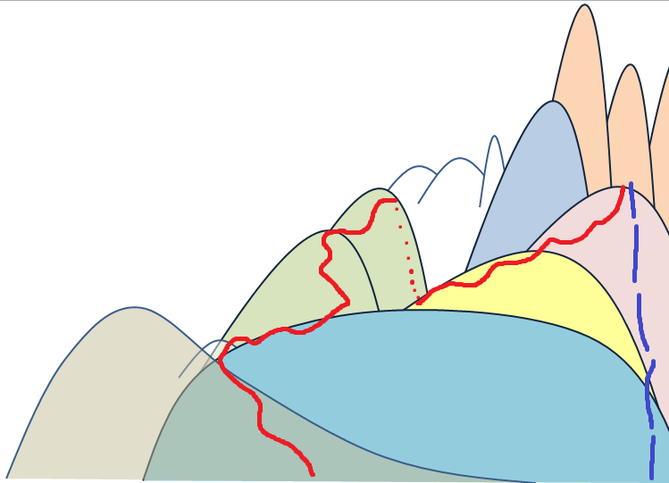
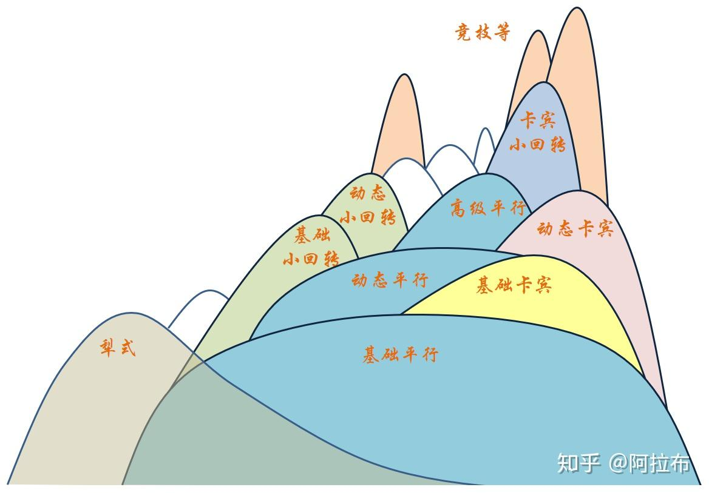

<!-- 来源: https://zhuanlan.zhihu.com/p/29800732 | 分类: 01_双板技术 | 发布: 2017-09-30 | 赞同: 192 -->

# 【双板教程--00】写在前面的废话

（V0.21：201801210 添加练习三原则，不定期修正和更新）

这应该是一个如何最快学习双板滑雪的系列教程，或者说，打算是这样。

然而，如何才能“最快”？回答这个问题，既不能信口开河，也不能泛泛而谈，所以就有了一大篇废话来浪费大家的时间。

滑雪技术的学习，就像攀登群山，除了主峰，高高低低还有若干山头围绕。看似最近的路线，可能刚刚爬过一个山头，才知道后面是峭壁断崖。而别人开辟好的步道可能是漫漫长路之字上升，却不会有断路的问题。另一方面，旅行者可能会根据自己想去的地方选择一条合适的线路，专业登山者却一定会选择从遥远的山脊绕行，因为要爬山那几座最高的山峰需要最优的规划。

</tab>※左边的红线是爬山，右边的蓝线，那叫攀岩。

所以，并没有一个统一的“最快的方法”，这个“最快”是因人而异的。我们将这个要求按照其定义展开：

最快=“最短时间”内达成“目标”

那么这两个关键因素就清楚了：你的“目标”是什么？如何做到“最短时间”？

## 一，目标决定了路径

学习双板滑雪的目的，通常分为这几类：

A）娱乐式滑雪，雪场随便玩玩，"跟谁去"或者"吃什么"可能比"怎么滑"更重要；

B）旅游式滑雪，主要在雪场雪道内玩耍，对技术要求不高，但是能安全的滑行大部分雪道；

C）探险式滑雪，道外野雪才是最爱，专找一般人到不了的地方；

D）刺激式滑雪，以高速滑行、或自由式（蘑菇、空中）为主，各种花样玩(zuo)耍(si)；

E）职业式滑雪：以竞技、职业教练、技术研究等为目的，希望成为顶级技术大拿。

不同的目标，对滑雪技术的偏向和深度要求是不同的。所以目标确定之后，才能确定所必须学习的技术要点，制定出最快的学习路径。这里说有可能，是因为还要考虑自身的基础，比如力量、平衡、协调等能力，以及练习频度等等。

## 二，最短的路径规划

到达指定目标的最快方式，无非就是两点：不走弯路，不走回头路，因为这样花费的时间最少。道理大家都懂，问题的关键就是如何才能做到。

若想不走弯路，前提就是了解所有技术点的相对关系。就像爬山用的地形图，不但有各山头的位置，还得有他们的高度，以及那些承前启后的关键节点等。那么在滑雪世界里，这种地形图是什么呢？很简单，就是技术体系。各个技术体系，其实就是各个团体对滑雪技术的理解，他们所描述出来的体系结构，就是这张“地形图”。通过这样类比，我们很容易就可以理解，为什么有的体系简单学起来却很慢，有的体系繁琐几乎看不懂却得了不少赞，有些体系在某些级别几乎没有重合，而有的体系据说永远无法登上最高峰。。。

所以，确定学习目标之后，就可以依据所熟悉或者信任的体系选择晋级路线（学习路径），然后依次决定各个阶段的技术点和学习深度（熟练度）。如果说技术要点代表了一个个山体，熟练度就代表了海拔高度，那么这样规划出来的学习路径，就相当于一个到达指定山头的最短路径，也就是最快的路径。

## 三，适宜的熟练度要求

我把每个双板技能的熟练度分为“ 能、会（熟）、精、通 ”四个层次：

【能】Acquisition，吸收阶段 。学习后能够在适合的条件下有一定的机会正确完成动作（不能次次成功）。这个阶段，动作的完成需要刻意去控制身体，或者完全按照头脑中的指令来执行。并且一旦条件不适合，就会动作走形。通常意识不到自己的动作质量。

【会】Consolidation，熟练阶段 。相对于“能”做却不一定对，“会”的阶段一般能够保证结果是正确的，即条件适合时，基本上每次都可以正确的完成动作，并无须在头脑中刻意指挥。在条件不理想时，需要刻意的控制身体才能实现正确动作，但仍有失控走形的可能。可能有多余的动作。

【精】Refinement，精炼阶段 。能够无意识的做成正确的动作，没有多余的部分，动作的结果（或表现）精确一致，基本不会被外部条件所影响。有可能清晰的意识到自己的动作质量，并自我改进。

【通】Mastery，贯通阶段 。完全了解动作的所有细节，在任何条件下动作只要做成，便完美一致。能够将动作进行分解、变化或者扩展，来应对不理想的外部条件，或者加入个人风格。

一个技能，必须学习到熟练阶段。至于是否精炼和贯通，可能并不影响下一个阶段的学习，但是，这些欠缺总会反应到未来的某个瓶颈期。所以，如何设计自己的进阶熟练度，取决于自己对“快”的定义，比如是稳扎稳打，还是快速进阶遇到瓶颈再回头，请各取所需。但是反过来，如果其目的并没有这个”未来的阶段“，那么理所当然的，不够精炼也基本不会影响其学习进程（滑雪体验还是会有些许影响的）。

※此处应有表格

## 四，准确的自我认知

如果不知道自己的位置，再好的地图也帮不了你。所以，能够正确的认知自己的当前水平，是学习过程中不走回头路的关键。

我们把如何高效工作套用在滑雪学习中，姑且称之为滑雪练习三原则：

一，做正确的练习；

二，正确的做练习；

三，把练习做正确。

下面展开进行说明。

第一，所谓正确的练习，即最适合的，最能解决问题的，或者对技术提高的作用最显著的练习。这个正确练习的获知，要么来自可靠的指导者，要么来自完善的体系+准确的自我认知。

第二，只有按照正确的方法或步骤去实施，才能有效和高效的完成练习。尤其是很多滑雪练习，只看过视频或演示而不知道练习要点，就很容易变得形似神非，完全达不到练习的效果。

第三，必须对结果进行确认，才能最终保证练习的有效性。可以让指导者检查，或者请人拍视频回去自己分析，或者通过可以检查效果的特定标准。

如果从一开始就严格按照这三原则进行练习，那么显而易见，第三条的结果，就是下一轮练习中第一条的输入。因此，准确的自我认知，在学习过程中非常关键。

在以后的教程里，我会尽量考虑如何设计一些练习，让学习者能够清晰无误的自我判定正确性。但是，目前还不能保证百分之百都能做到，先作为一个良好的愿望放在这里吧。

## ※声明※

1）本人在知乎发表的文字，包括专栏文章和回答，没有授权任何其他机构转载，如果在别处看到，一定是没有版权的，本人保留依法追责的权利。

2）本文为草稿，随时有可能跟更新，谢绝转载，请勿联系。

3）按照目前中国雪圈的现状，本文中的诸多内容，可能很快变成某些大神自己的言论，这个就请大家宽容点，不必追究。毕竟在绿野说的那么多，已经被拿走无数，就算为中国雪圈整体水平的提高做贡献了。以后的教程也同样，这点不再重复。但我自己的东西，我保留最终解释权。

【修订记录】

2018.01.21 添加练习三原则 V0.21

2017.09.30 第一次发布 V0.20

2017.09.12 初稿 V0.10

【本文结束】
