<!-- 来源: https://zhuanlan.zhihu.com/p/24340389 | 分类: 01_双板技术 | 发布: 2017-10-12 | 赞同: 283 -->

# 【双板技术--00】基础概念与名词解释

（V0.20：20171012，草稿，不定期修正和更新）

滑雪是一项身体运动，所有的技术都要用身体的动作来实现。然而出于讨论、教学、诊断等目的，也需要用语言来描述这些运动和技术（嘴滑），但如果大家说了同一个词，心里想的却是不同的意思，那还怎么交流？

因此，嘴滑的第一步，就必须对一系列基础的概念进行定义，建立一套完整的概念体系。

本文所涉及概念和定义有：

---- 雪板的运动方向：前、后、左右、内、外。

---- 雪板的平放、立刃、换刃。

---- 直滑、侧滑、搓雪、卡宾。

---- 坡面、坡度、滚落线、重力线、坡面垂线。

---- 滑行轨迹相关术语：横滑、（转）弯、转换区、换弯、弧顶、入弯、出弯。

.

## 一、雪板运动方向

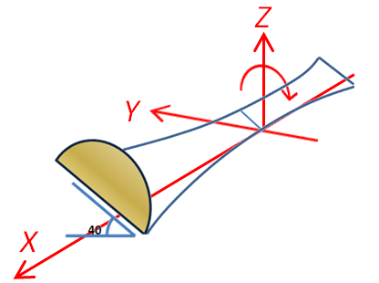

沿雪板长轴的方向X称为“轴向”，向板头方向为 前 ，向板尾的方向为 后 。

沿雪面（底面或者板刃）垂直长轴的方向Y称为“板腰方向”，向两侧的运动方向除了“ 左 、 右 ”两个绝对方向之外，还有远离转弯圆心方向为“ 外 ”，向着圆心方向为“ 内 ”。

垂直于雪面的方向Z，一般不用考虑雪板在这个方向的运动，所以无须定义。但是，还有一个重要的运动，是沿X轴的翻转运动（表示在YZ平面内），这就是立刃（Edging）。在滑行中对雪板本身的控制，主要就是指YZ平面的这两种状态： 平放 （flat），或者 立刃 （Edged)。

平放时，因为板刃的存在，以及雪面起伏、摩擦力等因素，雪板向前运动会比向左右侧向运动更容易一些。

而立刃之后，雪板的侧切会自动带动滑雪者转弯，这部分内容请参考专栏文章： 《转弯半径那点事儿：如何读懂双板的基本参数》 。

在滑行中，两种状态都可能会用到。正确的滑行，应当以立刃滑行为主， 但是每个转弯之间的切换过程中，会有或长或短的平放状态 。这是因为相邻的两个弯必然是用到了不同的雪板侧刃，因此在这个切换过程中，会有一个“解除立刃----放平雪板----再次立起另一侧刃”的过程，这个过程也称之为“ 换刃 ”。

## 二，雪板滑动模式

在滑行时（空中飞什么的，不谈），雪板有四种滑动模式。

1、向板尖方向笔直滑行，称为“ 直滑 ”（Sliding）。

直滑时板底通常是平放雪面的（如果不是平放，因为板刃与侧切的作用，要么转弯，要么卡雪）。

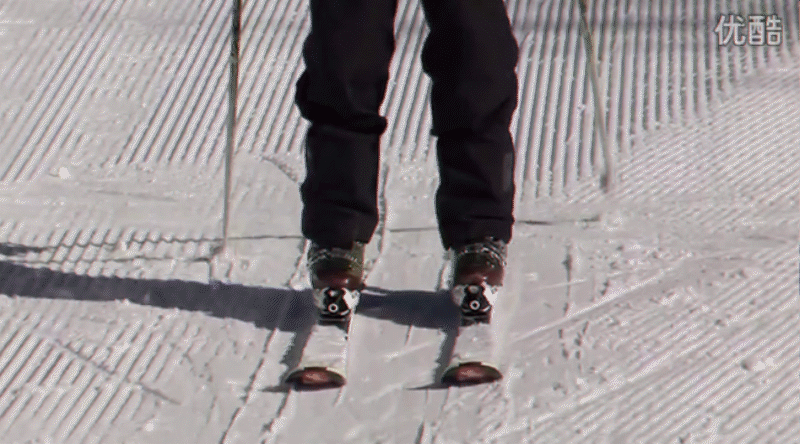

直滑是非常重要的滑行方式，大多数人都可以无师自通的学会“平行式直滑降”。（等等，没听说过这个词？那听说过“冲坡”没有？对了，就是这个。）

不过，非常严肃的说，直滑是平行式滑雪中非常重要的一环，是连接两个转弯的标准动作。如果一个正在练习平行式的滑雪者不能正确实现弯间的直滑，那么他将无法晋升中级水平。但是，随着级别的提升，直滑的持续时间会越来越短，甚至消失（奔丁+跳换弯，雪板平放瞬间在空中不接触雪面）。

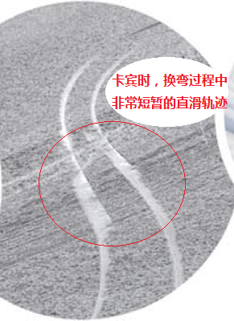

2、向雪板侧面方向滑动，称为“ 侧滑 ”（Slipping）。

侧滑发生时，通常板底接近平放雪面（但因为平放的雪板边刃很容易卡雪，所以一般不会完全平放）。侧滑时速度越快或者坡度越陡，雪板与地面的夹角就可以越大。

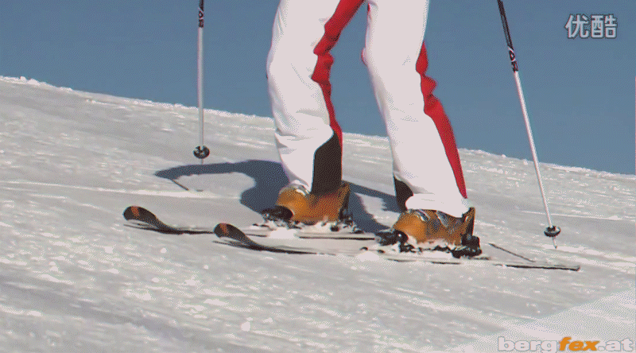

纯粹的侧滑，一般是指侧向的持续滑动，这种方向基本不用于正常的滑行，但有些练习会用到，如SideSlip，PivotSlip，DiagnalSlip等。

3、雪板同时混合了向前和向侧面的运动方式，称为“ 搓雪 ”（Skidding）。

或者说，雪板在转弯时，发生一定程度的侧向滑动，就是搓雪，此时板尾的转弯半径大于板头。

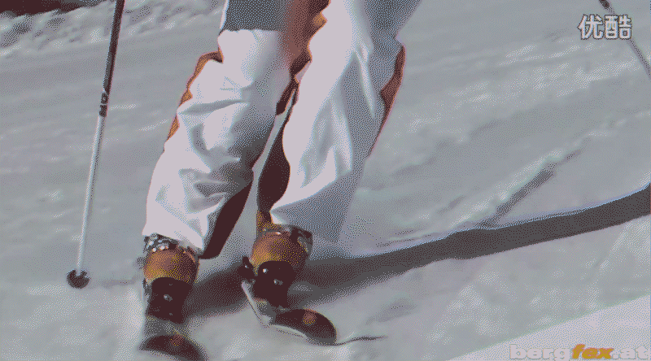

大多数的滑雪转弯都是搓雪转弯（Skidded Turn）。搓雪转弯的轨迹，是月牙形的，稍宽一点时就无法区分两只雪板。

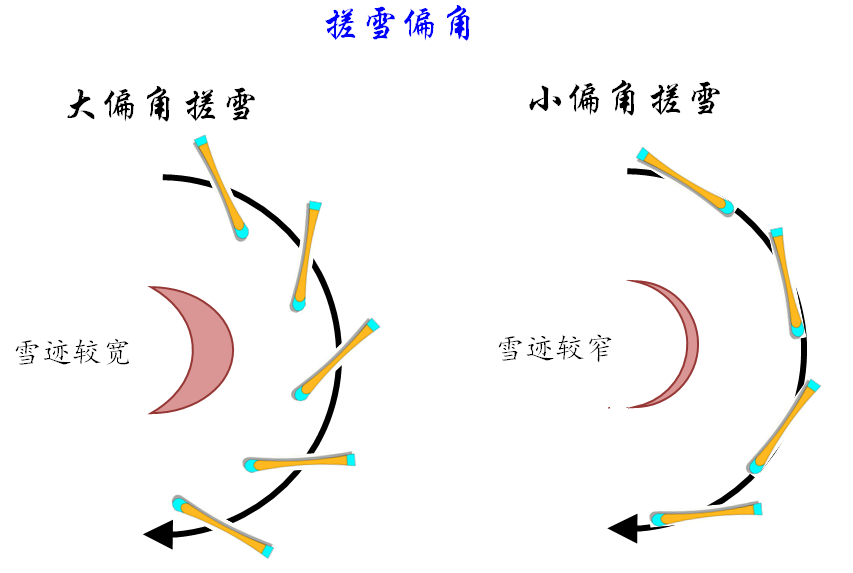

搓雪是最常用的滑行方式，从初级道到超级双黑，从飘逸的雪道巡游，到急促的侧身急停（HockeyStop)，从初学者的犁式、中级滑行者的基础平行和中级平行，到六级小回转的前五级，都是搓雪滑行。

4、雪板转弯时，板头和板尾通过同一条在雪面刻出的圆弧，称为“ 卡宾 ”（Carving）。

卡宾弯（Carved Turn）的本质，是完全沿着雪板的板刃滑行，没有任何侧滑，因此也就没有任何搓雪（Skdding）。卡宾弯的半径，取决于雪板的侧切形状和弯曲程度（通常取决于立刃角度）。

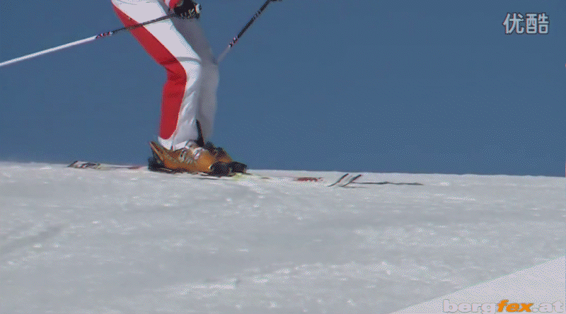

卡宾最典型的特征，是滑过雪面后，只留下两条圆润的细线。

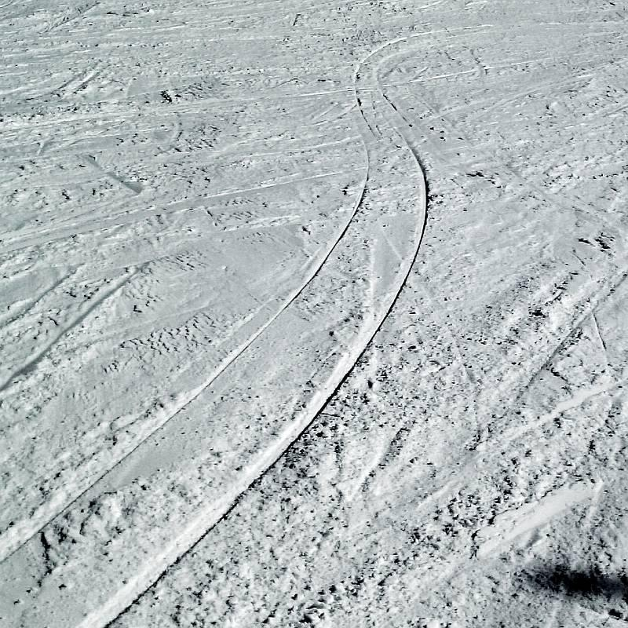

Carving还有一些更加形象的叫法，如日本的“刻滑”——板刃刻入雪中，口语化的“走刃”——雪板走在刃上。但作为书面正式用词，我还是比较偏好卡宾——“卡”本身也有切入雪中的意思，如下图所示。

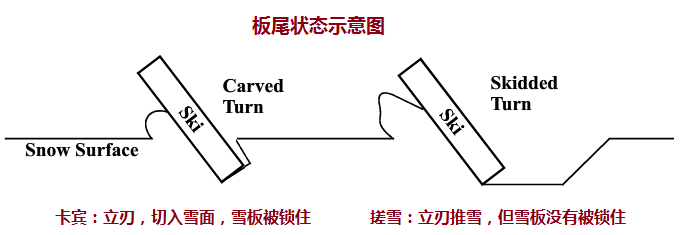

.

## 三，雪坡

双板滑雪技术，就是指在是雪坡上从高处滑行到低处所使用的技术。在描述雪坡时，“滚落线”是最重要的一个概念。

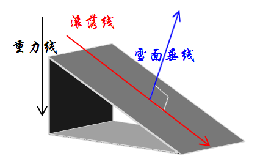

“ 滚落线” ，顾名思义，就是雪球从雪坡上滚下的轨迹，实际上它是地球引力在坡面上的投影。因此，滑雪者在雪坡自上而下运动，沿滚落线方向加速度最大、路程最短。多数情况下，滚落线代表了滑行者的行进方向（所有的转弯的中轴线），沿滚落线的向前，通常表示为“ 山下 ”方向，或者向" 下一个弯 "。

沿地心引力的方向，我们可称之为“ 重力线 ”。日常生活中，重力线通常是垂直与地面的，但在雪坡上则不然，垂直于雪坡的，是另一个概念“ 雪面垂线 ”。在学习滑雪技术时，雪面垂线远比重力线要重要的多。

滚落线与水平线的夹角（也就是重力线与雪面垂线的夹角），就是雪坡的角度——“ 坡度 ”。坡度有两种定义， 高度与底面长度的百分比 和 坡面与地平线夹角度数 ，其关系如下图所示。

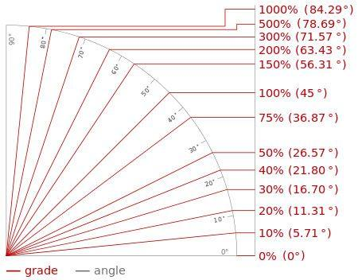

有些雪场的雪道图或者一些滑雪APP，并没有正确的使用两种单位。所以，如果你听说一个40度的中级道，那八成是指40%而不是真的40°。也别觉得40%只是一个小坡，通常让新手们脚底发软的陡坡，也就这个坡度了。而到了75%，基本就会感觉在跳悬崖。

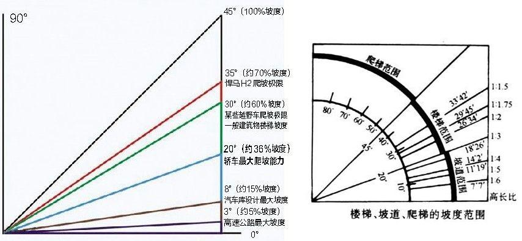

## 四，雪板轨迹与滑行路线

双板滑雪的轨迹，代表了滑行路线，通常是以滚落线为轴心的一条S形波浪线，即我们是围绕滚落线来回转动的。

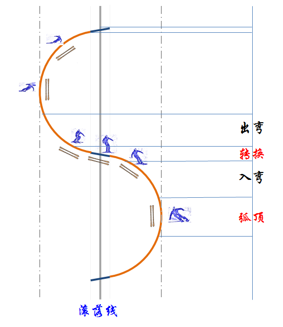

标准的双板滑行轨迹，由一小段横穿滚落线的“ 横 滑”（Slide或者Glide）和一个C形圆弧（Round）状的“ 转弯 ”（Turn）交替组成。所以，最简单的描述在滑行轨迹中的位置的方法，就是雪板与滚落线的相对关系：

1）雪板横穿滚落线 、雪板垂直于滚落线（近似）、雪板越过滚落线、雪板横穿前进方向：这个阶段是衔接上一个弯和下一个弯的 转换区 （Transition Zone）， 换弯 /换刃的动作就发生在这里，是技术练习的重点区域。在高级水平的滑行中，转换区很变得非常短暂。

2）雪板与滚落线平行、板头指向滚落线、板头指向山下：这是C形圆弧的“ 弧顶 ”（Apex）区域，加速度在这里最大。注意：通常滑雪者在此区域无法改变雪板状态。

对于轨迹的阶段划分，不同的技术体系有不同的定义。在我这里，就简单的把从横滑到弧顶的过程叫“ 入弯 ”，从弧顶到横滑的过程叫“ 出弯 ”。

需要注意的是，日常的滑行轨迹可能会与标准图形出入比较大，比如初级的转换区会比较长，初中级搓雪入弯比较短，而出弯比较长，某些特定的滑法会产生特别的标志性轨迹，如逗号弯等，但出“弯-换弯-入弯-弯顶”四阶段总是可以分辨的。这四个阶段的技术特点，会在后续章节进行描述。

雪板的轨迹是分析滑行动作的重要辅助手段，比如前文提到的卡宾和搓雪，在轨迹上截然不同：卡宾是两条细线，而搓雪是一片月牙。

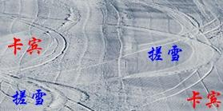

而弯形上，除了作为基础的“圆”弯，还有“深弧”滑法的“扁”弯，以及“窄”弯和“Z”字弯，后两者只应存在于个别场合和练习中，如果不是特意而为，就是错误的。

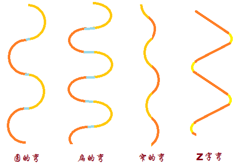

对于双板滑行，最基础的能力，就是“把弯滑圆”。如果不能滑出圆润的C弯，说明基础动作有缺陷，其后再怎么滑都是沙上建塔，难有存进。

滑行轨迹连续滑行时，滑行轨迹的中心线代表了滑雪者的行进方向，在技术分析时通常选择与滚落线重合，但实际滑行时未必总是如此。比如在选择雪道较好的雪况、避让他人和障碍时，就需要改变行进方向。

双板滑雪的名词术语是一个非常庞大的体系，这里只是一些比较重要的基础概念，其他的术语，如运动分析相关、各种练习等等，会在相关的章节里描述，敬请期待。

## ※声明※

1）本人在知乎发表的文字，包括专栏文章和回答，没有授权任何其他机构转载，如果在别处看到，一定是没有版权的，本人保留依法追责的权利。

2）本文为草稿，随时有可能更新，谢绝转载，请勿联系。

3）欢迎大家讨论、补充。有疑惑就敞开了问，简单的会直接回答，复杂的也可以在未来的章节里解释。

4）部分配图来自于网络，如有侵权，请联系我删除。

【修订记录】

2017.10.12 完成配图，第一次发布 V0.20

2017.04.08 文字初稿 V0.10

【本文结束】
