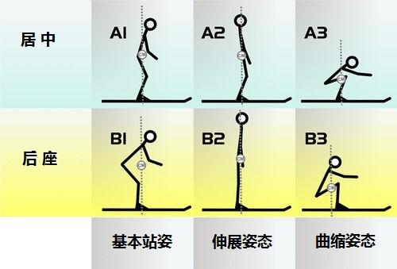
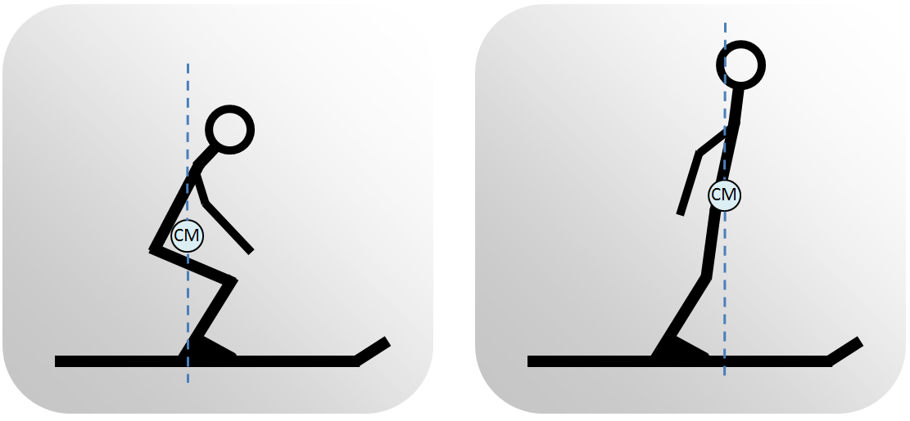
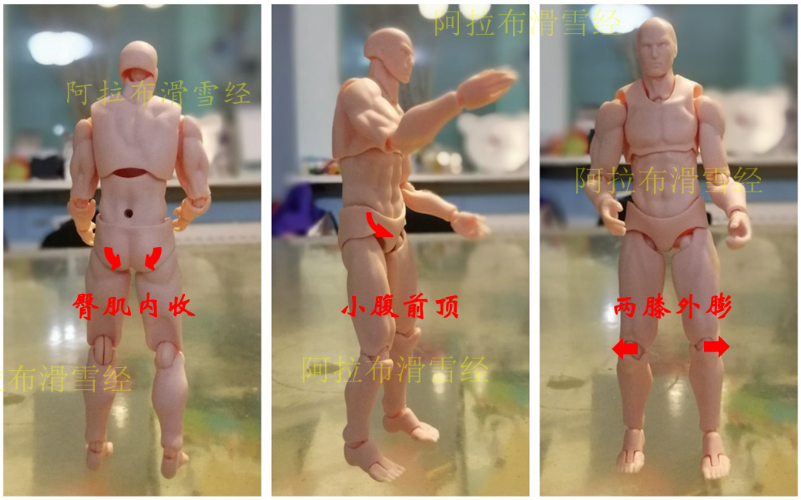
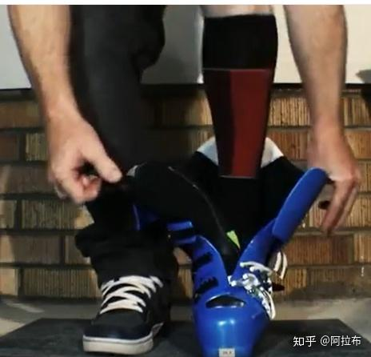
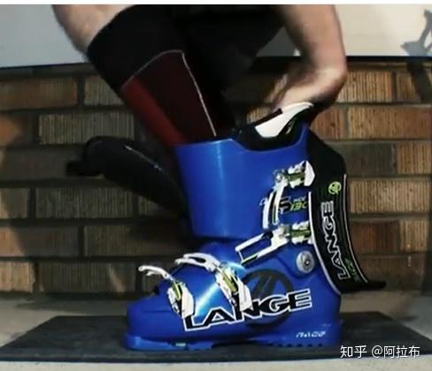
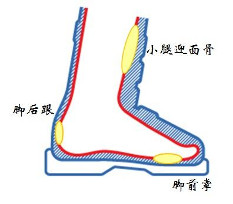
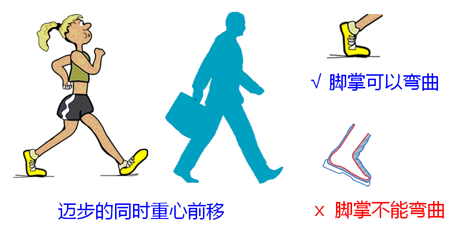
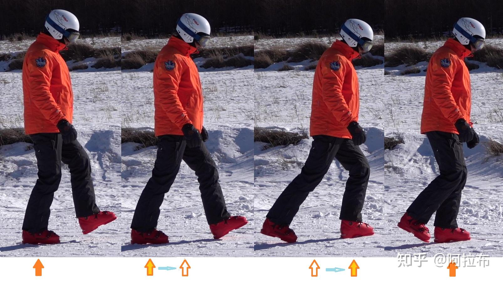

<!-- 来源: https://zhuanlan.zhihu.com/p/31207052 | 分类: 01_双板技术 | 发布: 2017-11-27 | 赞同: 308 -->

# 【双板教程--01】第一课，从穿上雪鞋开始

> 原文：[知乎 · 阿拉布](https://zhuanlan.zhihu.com/p/31207052)　·　发布于 2017-11-27　·　本文仅供学习交流，版权归原作者所有

（V0.21：20180824，改进穿鞋方法）

可能很多人都会认为，滑雪的第一课，应该是穿上雪板，站在坡顶准备下滑时开始。但其实，这个时候再开始学习，已经太晚太晚了。在第一次滑行之前，必须要学习站姿、行走、意外处理等内容，之后才有资格站上雪坡，开始学习第一滑。

## 双板滑雪的基础站姿

双板滑雪的基本站姿，是人的身体在运动时的一种自然形态，被称为运动站姿：

1、两脚打开与肩（或胯）同宽，保持腿部放松，然后轻轻上跳几次，此时两脚的间距就是个人最舒适的自然间距；

2、膝盖放松前曲，保持膝盖骨在脚背上方即可；

3、上身挺直，略前倾（与小腿平行），保持重心在足弓前缘，即脚跟微微受力的状态；

4、大臂自然下垂并向两侧略打开，小臂略前伸协助平衡，目视前方，完成。

这个姿态称为“居中、灵活的运动站姿“。检测站姿是否居中、灵活的最佳方式，就是轻轻跳起，脚掌微微离地即可，能感觉到无需任何准备即可快速、轻松、灵活的起跳，跳起和落下时姿态稳定没有任何改变（如果跳起幅度比较大，膝盖会有相应的曲张来进行缓冲）。

运动站姿是一个非常轻松，非常灵活的姿态，能够保证身体随时对动作做出反应的同时，又可以长时间轻松的保持稳定。

最常见的站姿问题是后座，如图上所示。后座会导致身体僵硬，失去灵活性，在滑行中身体反应慢于需求，导致无法完成动作或者出现危险时无法及时规避。在初学者中，后座的问题十分严重，甚至很多正规滑雪学校的学员都无法避免，这是因为他们真正学习站姿的时机太晚了。 只有在第一次穿上雪鞋的那一刻，就尽力保持正确的站姿 ，才能保证不会有错误的身体记忆来干扰日后的学习和滑行。

与后座相对的是过度前倾，不过这个问题并不常见，也比较容易纠正。过度前倾的好处是，在动态滑行中有足够的余量避免后座（动态站姿部分在后面的章节），但是会导致滑行阻力过大，滑行中容易卡住跌倒，再就是小腿迎面骨会被雪鞋硌伤。如果自己有这样的问题，略注意回到居中的站姿即可。

## “压鞋舌”与正确站姿

很多滑雪教程把”前压鞋舌“作为评判正确站姿的标准，即小腿迎面骨紧紧压住鞋舌，似乎这样做就是可以保持“不后座”的站姿。但是，问题来了：

> 为什么我已经很注意“前压鞋舌”，还被指出重心落后（后座）？

这是因为，正确的姿态是全身参与的结果，仅仅靠小腿的状态，并不能保证姿态正确。如下图：

尽管小腿保持了前压鞋舌，但是上身的姿态不正确仍然导致了后座（这种姿态特别常见）或者过度前倾。

那么“压鞋舌”这个说法是不是没有意义？也不是的，应该要理解，这是一种“ 动作提示 ”，相当于小贴士（Tips），而绝不是客观的要求，或者动作标准。在全身姿态正确的时候，“压鞋舌”这个状态是存在的（也有人不敏感而意识不到），也就是说“压鞋舌”是正确姿态的必要条件。同时，在滑行中，重心会有动态的变化，这时候有一个“提示”让人保持姿态正确，也是有益的。所以我们在学习时，要知其然，更要知其所以然。

## 灵活站姿的核心秘诀

下面要讲的是滑雪站姿的核心细节，这些细节非常重要，在初级时可能体会不到，但到了中级阶段，往往会变成进步的关键。

居中灵活的站姿核心有三点：

第一点，向内微微收紧臀肌，即两臀瓣略微向中间夹，这是第二点的前提；

第二点，小腹（耻骨）略向前挺，实质上是腹肌略收，骨盆后旋，这是保持灵活的关键，也是第三点的保障；

第三点，两膝微微外膨，即保持一点向外的张力，但仍然是在两脚正上方，不要有向外的动作。这一点对于滑行非常重要，尤其是将来学习平行式滑法时非常有帮助，也是克服K腿等毛病的关键之一。

以上动作微微用力保持住即可，过于用力既不会有更好的效果，还会导致肌肉疲劳，动作变形。

## 穿、脱雪鞋的小技巧

正规的双板雪鞋是比较难穿的，这里分享一下穿脱雪鞋的小技巧。

a）最好坐在长凳的角上，如果在中间，就少坐一点；

b）将雪鞋所有的扣都打开，放在屁股下方；

c）曲腿将脚尖插入雪鞋，然后一只手向 侧前方 拉鞋舌，另一只手向另一侧拉开鞋帮；

d）然后脚后跟使劲向下踩，很容易就穿进去了；

e）磕两下脚后跟，让脚紧贴后部鞋帮，然后 从上到下 依次扣紧鞋扣。如果不容易直接扣到最紧，可以交替扣紧雪鞋的锁扣，比如先把1号扣2格，然后2号扣3格，然后1号再扣到4格。

脱雪鞋相对容易，用穿的动作，反着拔出脚来即可。也可以把腿搭在另一只腿上，然后用手抓住鞋帮后部，向斜下方用力推即可。

因为雪鞋的雪帮本身就带有一定的前倾，穿上雪鞋后就必须时刻保持运动站姿，这样脚在雪鞋中主要是三个点保持受力。如果有其他的地方感觉压迫，那要么是鞋不合适，要么是没穿好或者姿势不对。

*脚在雪鞋内的受力点*

穿上雪鞋后，可以马上扶着柜子或者墙，检查运动站姿：膝盖是否在脚掌上方，重心是否在足弓前缘，轻轻起跳是否灵活。

## 穿雪鞋行走

穿着雪鞋走路会感觉非常别扭，这是因为雪鞋的前掌不可弯曲，这样我们习惯的走路方式就无法实现。

所以，穿着雪鞋行走时，不可以迈步的同时移动重心。正确的方法是，迈出一只脚时保持重心在后脚，然后在前脚落地时再把重心移动前脚。

其实滑雪的绝大多数动作都是以操纵重心移动为核心，那么就从行走开始习惯这一点吧。

## ※声明※

1）本人在知乎发表的文字，包括专栏文章和回答，没有授权任何其他机构转载，如果在别处看到，一定是没有版权的，本人保留依法追责的权利。

2）本文为草稿，随时有可能更新，谢绝转载，请勿联系。

3）欢迎大家讨论、补充。有疑惑就敞开了问，简单的会直接回答，复杂的也可以在未来的章节里解释。

4）部分配图来自于网络，如有侵权，请联系我删除。

【修订记录】

2017.11.27 文字初稿，欠两张图，第一次发布 V0.10 2017.12.05 补全，第一次完整发布 V0.20

2018.08.24 改进穿鞋方法 V0.21

【本文结束】
