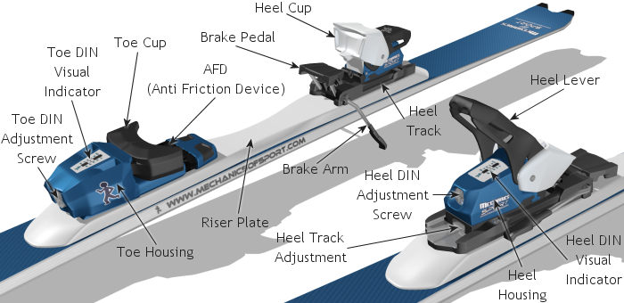
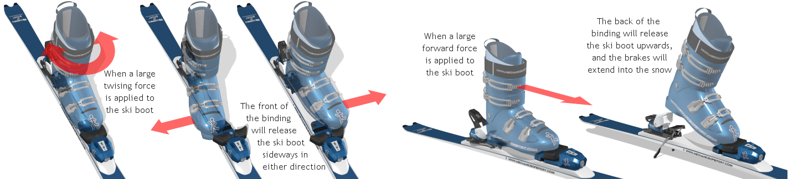
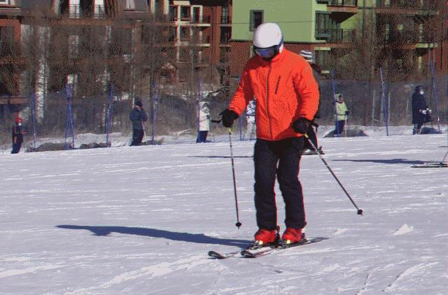
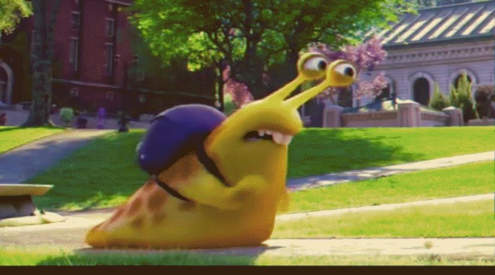
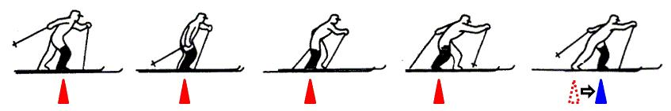
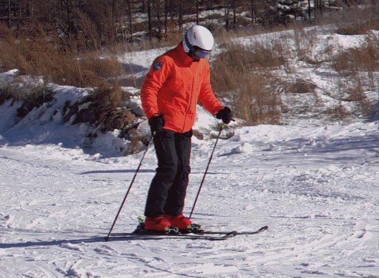
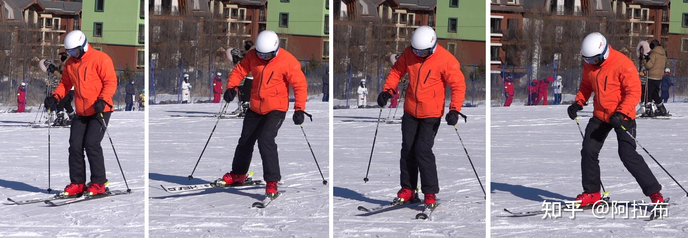
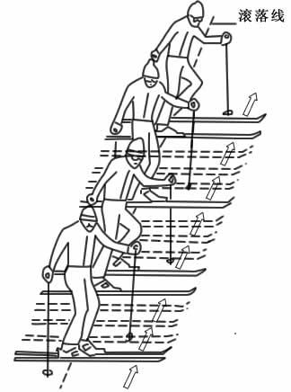
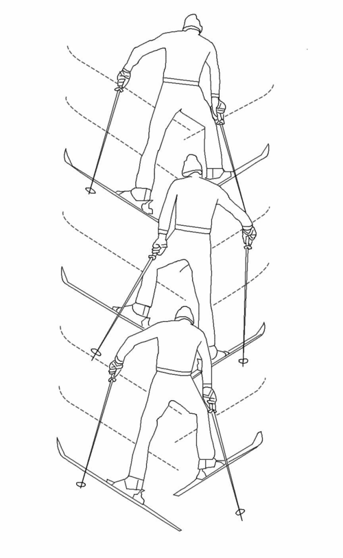

<!-- 来源: https://zhuanlan.zhihu.com/p/31703246 | 分类: 01_双板技术 | 发布: 2017-12-13 | 赞同: 280 -->

# 【双板教程--02】平地练习，滑行前非常重要的几分钟

（V0.20：20171215，第一稿补全，不定期修正和更新）

心急的滑雪者往往穿上雪板就会迫不及待的开始第一次滑行，但是，花几分钟来做几个平地练习，熟悉一下雪板的运动特性，才能事倍功半，更快更安全的学会滑行。

现在，先从了解设备开始。

## 雪板与雪杖

穿雪板之前，先了解一下固定器。（滑雪板请参考： 如何读懂双板的基本参数 ，可以直接跳到后面看结论部分。）

固定器的作用是将雪鞋卡在雪板上，使他们成为一体，同时在遇到危险时可以让雪鞋与雪板脱离。它由前后两部分组成，中间的长度对于鞋底长度（Sole Length），在穿上雪板前必须检查固定器长度是否正确，既要避免过松容易脱落，更要避免过紧，以至于在需要时（比如摔倒、卡住）雪板不能脱落，会导致膝、踝等关节的严重损伤。

固定器的前端卡子（Toe Cup）是左右开合的，其作用是提供扭转脱离。后端的卡子是个上下动作的锁扣，可提供上下脱离，穿之前必须压下后柄（Heel Lever），穿雪板的时候用脚后跟向下踩，就会听到“咔”一声，后柄弹起，雪鞋被锁住。固定器的脱离阈值是可以设置的，具体的计算方案可参考我的一个回答： 滑雪板双板固定器上的 DIN 值调节有什么讲究？ ，简单说成人初学设置5以下，小童直接设0，大童2~3即可。

如果是使用雪场的雪板，通常是根据鞋号领取设置好固定器长度的雪板，然后试穿后不合适再找工作人员调整一下。拿到后还要确认一下脱离功能是否正常，后固定器通常没问题，前固定器需要用手掰一下卡子，确认能够活动、没有被卡死。

雪杖会随同雪板一起拿到。雪杖的长度为手肘到底面的距离再加上杖柄长度。 切记不要把雪杖的腕带直接套在手腕上！ 这样滑倒后雪杖可能会导致拉伤手腕等。腕带的正确穿套方式如下图，即能保证松手时杖不会丢失，也能保证雪杖不会拉扯到手腕。

## 平地练习（一）：找到重心

固定器调整好后，将雪板带到人少安静的地方，放好穿上。双手拿好雪杖，然后按照基础站姿的要求，认真站好，做几个轻轻起跳的动作（雪板不用离地），检查是否居中灵活。

然后做一个实验：

1）将两手臂平伸，雪杖垂直支撑在雪面，然后整体身体前倾，形成一个直角三角形，身体是长边。

2）下一步可以试着慢慢松开雪杖的支撑，体验前倾的极限，这是与正常站立截然不同的感受。※ 这个实验要小心一点，如果固定器太松或者脱离值太小，可能会脱落。

3）以膝盖为轴，将膝盖以上的身体抬至竖直，然后试着轻轻跳几下，感受一下 前倾站姿 的特点，比如灵活性和稳定性的差异。

4）恢复基础站姿，然后将重心后移到脚后跟（可以看到雪板的头部会微微抬起），此时再尝试起跳的动作，感受 后座站姿 是否还有灵活性。※ 注意用雪杖来帮助保持稳定，小心雪板向前滑动。

5）恢复基础站姿，两脚前后微微滑动，保证雪板没有粘在雪面；然后尝试将后座站姿突然变为略前倾，此时应当是上身并没有发生移动，而雪板则会向后滑动【平地•1•选修】。多试几次，练熟这个动作，在滑行中如果出现重心落后，就需要用这样的动作把重心找回来。

## 平地练习（二）：行走

务必找到重心之后再练习行走，否则可能发生无法移动的情况，比如这个实验。

奔跑的蜗牛：穿好雪板，检查雪板可前后滑动；右脚在前，左脚在后，然后迅速将左脚向前推，同时右脚迅速向后拉，这时上身应该是原地不动的。重复这个两脚来回滑动的练习，进一步熟悉对重心的感觉。注意平衡，可用雪杖来协助身体的稳定。

这个练习说明了滑雪运动最大的特点之一。雪板底面与雪面的摩擦系数很小，所以与走路、骑车、驾驶等的体验完全不同，并没有一个强大的摩擦力来改变质心的运动（与轮滑、滑板、滑冰有一定的可比性）。要最快速的学习滑雪，就必须从一开始就抓住质心的运动特性，熟悉它，掌握它，利用它，再去学习各种滑行动作就会轻而易举。

下面开始学习穿雪板行走的要点。现在我们知道，在前后方向没有多少摩擦力可供我们移动身体，所以想直接跟走路一样迈开步子行走是不可能的，只能最大化的利用远大于滑动摩擦的静止摩擦力。具体的做法如下【平地•2•必修】：

1）重心完全落在右脚上；

2）将左脚向前迈出，但是重心维持不动；

3）左脚落下踩稳后，再将重心从右脚转移到左脚。此时因为两雪板都是静止不动的，所以重心的转移才得以实现。

以上过程可以用雪杖协助平衡。这种行走一开始可能慢一点，但熟悉了之后也可以做到健步如飞，甚至可以上一点小坡（比如魔毯或者缆车入口的小坡，顶多用雪杖协助一下）。

## 平地练习（三）：蹬冰式滑行

穿上雪板后，第一次向前移动时，可能多数人都会采用雪杖向后推的方式。

然而，在雪面平地移动，最有效的方式是蹬冰式滑行（Skate Skiing）。与滑冰的动作一样，站在一侧雪板上，将另一侧雪板的板尖打开（向外约10~20度），然后向斜后方蹬出，身体就会沿站立雪板的方向前行；蹬出的雪板收回后放于身侧，利用惯性维持滑行并将重心移动到新板上，然后再打开旧板向后蹬出，交替进行【平地•3•必修】。

平地滑行可以体验重心的连续移动，以及重心在两脚上的交替转移，是非常好的练习。因为是在平地上进行的，也没有失控的危险。开始学习平地滑行时速度要低一点，需要停止时用雪杖协助即可。等后面学习了犁式制动，就可以随意提供速度了。

如果对自己信心不足，也可以先练习单脚的平地滑行，即只穿一只雪板练习。注意要两个脚交替，如果滑大圆圈的话，板在内圈与外圈的体验也不同。

## 平地练习（四）：其他练习

其他需要学习的平地练习还有原地转向，侧身登坡，八字登坡等。

原地转向【平地•4•必修】是一个踏步练习，将板尾或者板头向一侧打开20~30度，重心转移过去后另一个板跟上，然后再向同一侧继续打开，重复即可完成面向圆心或者背向圆心的原地（踏步）转向。因为雪板在侧向有较大的摩擦力（板刃的作用），所以这个练习比较容易。

侧身登坡【平地•5•选修】和八字登坡【平地•6•选修】是穿雪板上坡的有效方式，也是滑雪的必备技能。这两个练习相对简单，按下图去做即可：

*侧身登坡*

*八字登坡*

两种登坡同样是利用了雪板的板刃。可以说，滑雪运动中板刃是改变质心运动方式的最主要的工具。后面的学习，主要就是围绕重心/质心和板刃进行。

## ※声明※

1）本人在知乎发表的文字，包括专栏文章和回答，没有授权任何其他机构转载，如果在别处看到，一定是没有版权的，本人保留依法追责的权利。

2）本文为草稿，随时有可能更新，谢绝转载，请勿联系。

3）欢迎大家讨论、补充。有疑惑就敞开了问，简单的会直接回答，复杂的也可以在未来的章节里解释。

4）部分配图来自于网络，如有侵权，请联系我删除。

【修订记录】

2017.12.13 第一次发布 V0.10

2017.12.15 补全配图与练习编号，少量文字修改 V0.20

【本文结束】
