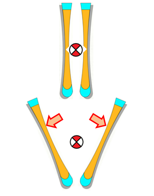
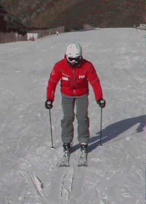
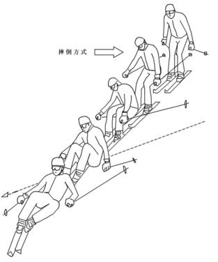
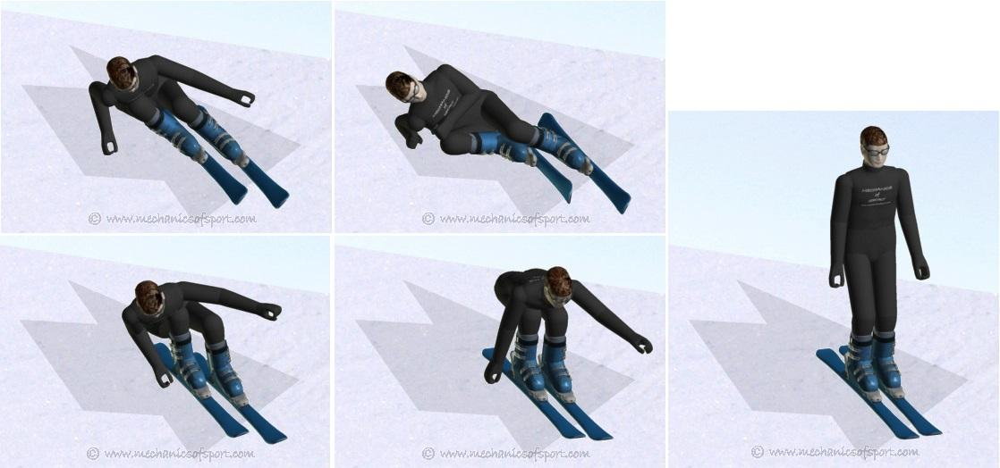
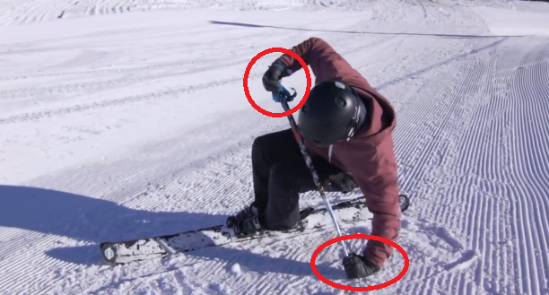
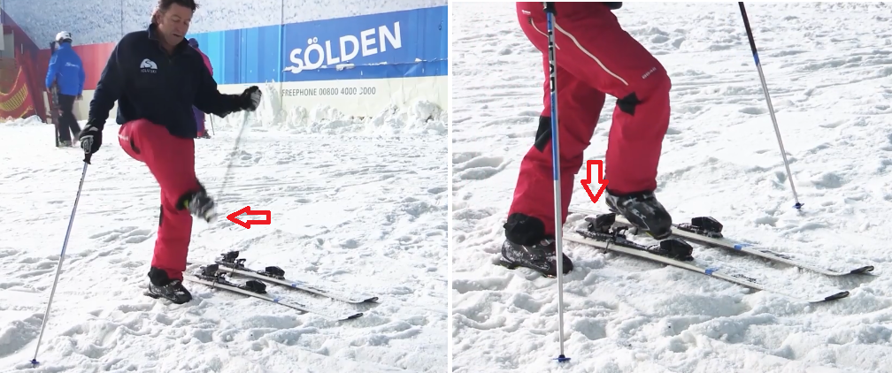
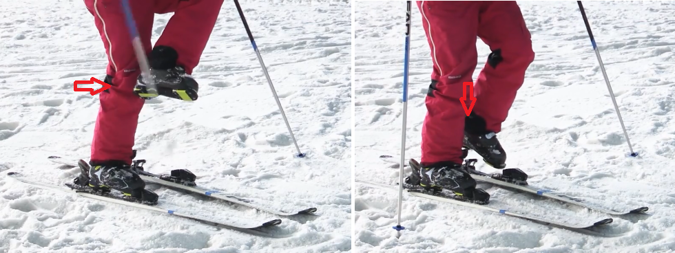
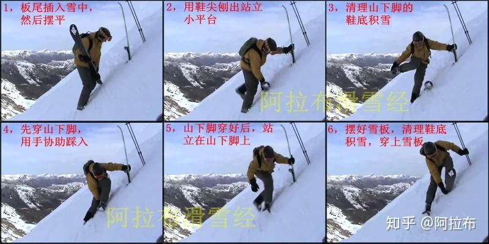

<!-- 来源: https://zhuanlan.zhihu.com/p/32048449 | 分类: 01_双板技术 | 发布: 2017-12-28 | 赞同: 313 -->

# 【双板教程--03】上雪道前必须Get的三个技能（最后一个越会滑越有用）

> 原文：[知乎 · 阿拉布](https://zhuanlan.zhihu.com/p/32048449)　·　发布于 2017-12-28　·　本文仅供学习交流，版权归原作者所有

（V0.11：20180104，添加陡坡穿板例图，不定期修正和更新）

平地练习的目的是熟悉雪板和运动特点，现在开始为了上雪道做准备。为了滑雪者的安全，有三个技能是上雪道前必须学会的：让自己停下来，安全的摔倒以及站起，以及如何在雪道上穿雪板。

## 犁式制动

下面我们学习双板滑雪第一个重要技能，犁式制动（犁式刹车），这也是最基础的保命技能。在没有掌握这个技能之前，不建议上任何雪坡。同时，这也是第一个使用板刃的技能：这个动作会天然形成微小的立刃，而不管滑雪者是否意识到。

犁式制动【预备•7•必修】的动作非常简单，将平行的双板板尾向外推开，形成一个“楔形”即可。这个动作的要点，是要 板尾打开的同时保持住基础站姿 ，尤其是重心要居中，两个膝盖要打开，不能形成夹膝。

请结合上一课的蹬冰式滑行，在平地开始练习犁式制动。

务必牢记一点：能够在多快的速度下停止，就选择最多滑这么快的雪道，千万不要选择超过自己能力的雪道。如果速度过快一时停不下来，也别紧张，保持犁式制动的正确动作时间长一点，自然就会减速了，同时恭喜您，无师自通了犁式直滑降这个练习。

如果停不下来同时前方有障碍，那只能主动摔倒，不过放心，双板滑雪主动摔倒基本不会受伤，甚至大部分情况下都不会疼。

## 摔倒与站起

谁也不能保证滑雪学习会一帆风顺，当出现失控、前方无法规避的障碍等情况时，请 尽快向侧后方摔倒 。

在向侧后方摔倒的过程中，会有个天然的立刃过程，导致雪板出现转弯，就会向一侧移动一点。也正是因为这个立刃的过程，才能最快让滑行停止下来，如果向后座倒，雪板还是板底在雪面上，那么就会一直滑下去直到撞到什么东西：雪堆、护栏、其他障碍什么的，危险性很大。

所以，主动摔倒时一定要选择空旷无障碍的一侧。如果两边的条件都允许，那么要尽量选择离雪道边近的一侧，避免被阻碍其他人滑行甚至被二次伤害。

一旦意外躺倒并持续滑动，可以尽量将双脚抬起，并用一侧手肘减速，使身体慢慢转成侧身，再尽量将雪板转到前方并用板刃制动。

下面是学习如何站起【预备•8•必修】：

1）首先将身体调整为沿滚落线侧躺的姿势；

2）两雪板平行放置，贴雪面的腿曲缩，保证两板的板刃都接触雪面；

3）用手或者用雪杖支撑自己侧身站起。

*（临时用，可能会换成动图）*

越是陡坡，站起来越容易。缓坡或者野雪可能需要雪杖协助，请参考下图：用雪杖支撑在腰腹侧面，一侧的手按住仗尖，另一侧手按住杖柄，然后支撑自己侧身站起。

这个技能虽然是必修，但是并不难，记在心里需要用的时候再拿出来就可以。如果想试一下，可以去雪道边等地方找个雪堆，练习一次如何站起。

在雪道上直接站起的前提就是两雪板能够平行摆好，如果做不到，请用杖尖或者手压下固定器后柄，将雪板摘下，再站起来。

## 在雪道上穿板

摔倒时雪板脱落是很常见的事情，所以如何穿雪板也是必备技能。

在比较缓的雪道上，只需要将两个雪板沿垂直滚落线的方向，板头朝向雪道中央摆放好，然后依次穿上即可。注意穿雪板前，要压下后柄。

但是，在陡坡和野雪等环境下，如何穿雪板【预备•9•必修】也是一项技巧。

1）用板刃在雪面切出一个小凹槽，使雪板横放时不滑动。如果是粉雪，可以将板尾斜插入雪中。

2）站在雪板下方，抬起山下脚（远离雪板的那只），用雪杖敲去鞋底粘附的雪（带着这些雪可穿不上雪板，会导致后固定器无法踩下）。

3）山上脚支撑身体，用山下脚在身体另一侧去踩雪板固定器，你会发现这样会比较轻松的穿上，而且非常稳定。

4）穿好雪板后，将重心移动到穿好的这只脚上，使之成为新的山下脚，然后抬起新山上脚，用雪杖清理鞋底积雪。

5）穿好山上脚的雪板，成功脱困。

这是一项非常重要的技巧，越是在困难环境下越能显出它的价值，所以，什么时候学到这项技能都不会晚。

## ※声明※

1）本人在知乎发表的文字，包括专栏文章和回答，没有授权任何其他机构转载，如果在别处看到，一定是没有版权的，本人保留依法追责的权利。

2）本文为草稿，随时有可能更新，谢绝转载，请勿联系。

3）欢迎大家讨论、补充。有疑惑就敞开了问，简单的会直接回答，复杂的也可以在未来的章节里解释。

4）部分配图来自于网络，如有侵权，请联系我删除。

【修订记录】

2017.12.28 第一次发布 V0.10

2018.01.04 添加陡坡穿板例图 V0.11

【本文结束】
