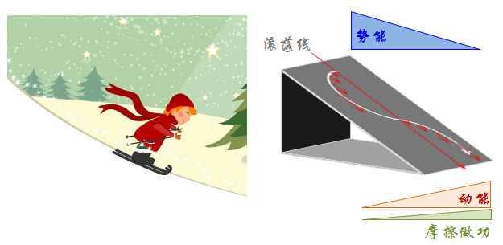
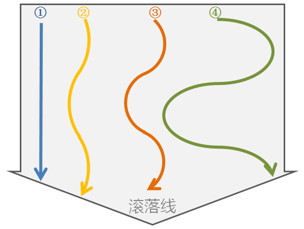
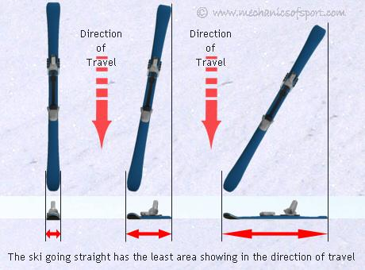
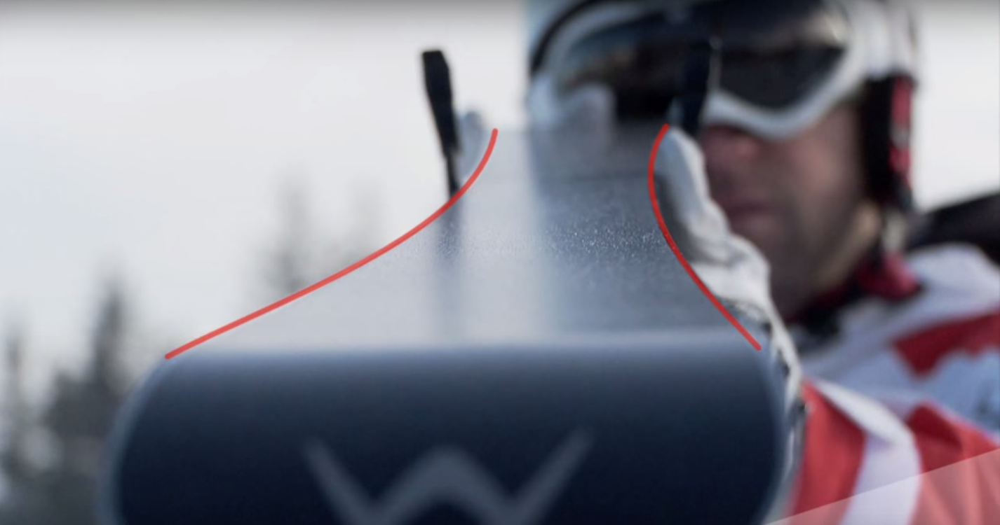
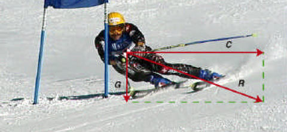
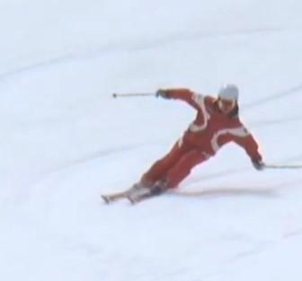

<!-- 来源: https://zhuanlan.zhihu.com/p/32414054 | 分类: 01_双板技术 | 发布: 2018-01-08 | 赞同: 182 -->

# 【双板技术--01】为什么我们要这样滑雪

> 原文：[知乎 · 阿拉布](https://zhuanlan.zhihu.com/p/32414054)　·　发布于 2018-01-08　·　本文仅供学习交流，版权归原作者所有

（V0.10：20180108，第一稿，不定期修正和更新）

## 雪道滑行的原理

很多我们所熟知的运行，如跑步、自行车、滑冰等，需要用自己的力量推动自己前进。而我们所谈论的双板滑雪则完全不同，需要先达到坡顶，然后从雪坡上利用重力自然下滑。因此，我们滑行最主要的推动力，就是自身的质量（体重）。滑行开始，不断加速的过程，就是势能在转化为动能，同时摩擦力（雪面和空气）也消耗了一部分能量。

那么如何控制下滑的速度，让我们能够享受滑雪的同时保证安全？

有两种方法，一个是加大摩擦力（搓雪），这就需要 充分的使用板刃 ，因为只有板刃才能有效提供摩擦力；另一个就是通过 拉长运动轨迹 ，让势能转化为动能的时间变长，降低加速度的同时，让摩擦力消耗更多的能量。

这就是为什么我们在滑行中要转弯，以及为何会有浅弯、深弯、扁弯的区别。

## 雪板带我们去何方

滑雪时，是人控制雪板，还是雪板控制人？

显而易见应该是前者，任何运动都应该是人主动控制的。但是后者也不能完全说不存在，因为滑雪并不是一个可以随心所欲的运动，滑雪者必须服从两个外部因素：身体的惯性，和雪板的运动特性。

当我们跑的很快时，不可能转一个直角弯，这就是惯性的作用。而使用滑板、自行车、汽车这样的外部工具运动时，运动工具的方向、速度等特性都必须熟悉之后，才能控制这些工具按照我们的想法运动，同时他们特性也会限制控制者的需求。滑雪也是如此，首先还是要遵从雪板的运动特性，然后才能去逐步控制雪板完成指定的滑行轨迹，而这个轨迹的指定也是依据雪板特性才能制定出来。

因此， 学习滑雪的过程，往往是先让板控制人，再由人控制板，如此循环前进 。

雪板的运动特性并不复杂，只遵循物理学的一个简单原理：物体总是沿阻力最小的方向运动。比如直滑降，阻力与滚落线截面宽度相关，板长方向与滚落线重合时宽度是最小的，那么自然直冲山下就是雪板自己选择的运动方式（所以学会犁式制动前千万别冲坡，这不是失控不失控的问题，是根本不存在控制）。

前面已经了解到，转弯是滑行的主要方式。为了让转弯更容易，现代雪板普遍采用了侧切设计（参考 转弯半径那点事儿：如何读懂双板的基本参数 ）。雪板的板刃（侧面），本身就是一条曲线。

所以一旦使用板刃，雪板的运动特性就是转弯，而非直行。如果不了解这个特性，滑雪者预期的滑行路线与雪板实际运动方向就会出现差别，往往失控便产生于此。

同时，为什么初学滑雪时请教练要比自己学来的快，也是因为好的教练会事先指导运动轨迹(以带滑为主，少有讲解的），这样滑雪者的预期与实际滑行是重合的，最大可能的避免了失控的发生。当然，自学滑雪的时候，如果事先能了解到这些知识，也是可以提高学习效率的，这也是本专栏的目的之一。

## 功能决定形式

现在回到开始的问题，为什么我们要这样滑雪？

因为这个样子去滑行，是适应客观世界的最佳方式。从物理定律，从动力学，从人体结构，一切的客观条件，一起决定了我们滑行的最佳方式。所以，滑行中的每个姿态要求，每一个动作，都会对应着某个功能性的要求，这就是“功能决定形式”。

也正因为如此，滑雪教学会有很多体系，有些非常不同，但是各个体系的滑行姿态，往往看起来差别并不很大。而这些体系之所以不同，也是受当地的雪况、历史沿袭等因素影响，也是有他们所特别强调（或需要）的功能性要求。即使是日本SAJ纯粹为了创新而制造出来的反物理滑法，也一定程度上是迎合了奇特的审美需求。

*SAJ双轴滑法*

了解到“功能决定形式”的意义，我们学习滑雪时目的就会明确，对练习的要求也就能够把握的更好。归根结底，都是为了更快更好的学习双板滑雪。

## ※声明※

1）本人在知乎发表的文字，包括专栏文章和回答，没有授权任何其他机构转载，如果在别处看到，一定是没有版权的，本人保留依法追责的权利。

2）本文为草稿，随时有可能更新，谢绝转载，请勿联系。

3）欢迎大家讨论、补充。有疑惑就敞开了问，简单的会直接回答，复杂的也可以在未来的章节里解释。

4）部分配图来自于网络，如有侵权，请联系我删除。

【修订记录】

2018.01.08 第一次发布 V0.10

【本文结束】
