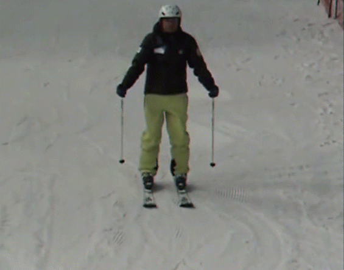
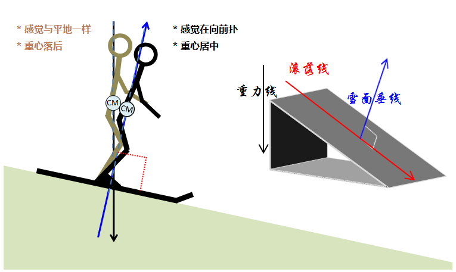
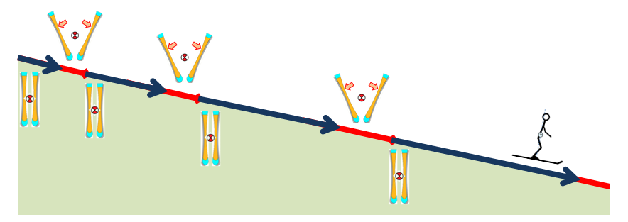
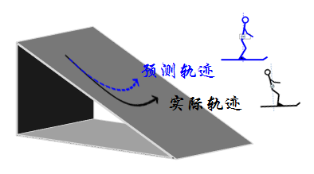
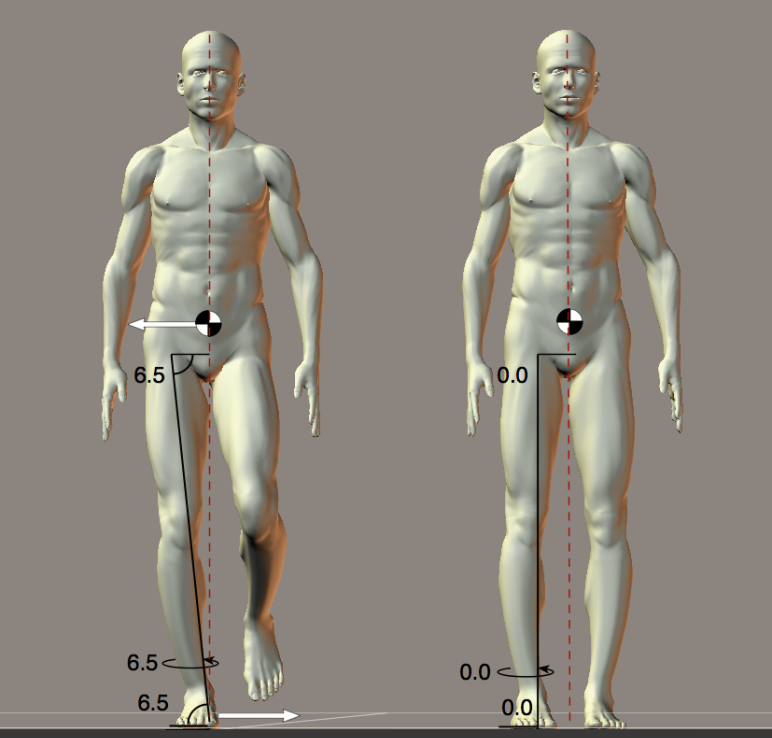

<!-- 来源: https://zhuanlan.zhihu.com/p/32730706 | 分类: 01_双板技术 | 发布: 2018-01-12 | 赞同: 175 -->

# 【双板教程--04】直滑降：第一次滑行，以及与后座的第一场战斗

> 原文：[知乎 · 阿拉布](https://zhuanlan.zhihu.com/p/32730706)　·　发布于 2018-01-12　·　本文仅供学习交流，版权归原作者所有

（V0.10：20180112，第一稿，不定期修正和更新）

站姿熟悉了吗？犁式制动练好了吗？如果是，那么去最缓的那条初级道，尝试第一次滑行吧。

## 平行式直滑降

平行式直滑降，是所有滑雪动作中最容易学习的一个，甚至大多数人认为自己不用学就会：它看起来似乎就是——冲坡。但是，平行式直滑降与雪场广播里严禁的“冲坡”其实是不同的：平行式直滑降是有技术规范的、安全可控的......冲坡（玩笑了，或者也可以这么说：超出安全可控范围的直滑降，才是冲坡）。

平行式直滑降的技术要求很简单，就是基础站姿，只不过是动起来的。

但是，上了雪坡，有一些新的要点必须要注意。在平地上，站姿正确时，我们的重心垂直投影在足弓前缘。然而在雪坡上滑行时，如果重心仍旧按重力线投影在相同位置，那重心就会变成落后了。只有按照坡面垂线投影，才是正确的站姿，此时，在心理上，可不是稳定的，而是向前冲的状态。

没错，就是要向前冲：身体不向前冲的话，你的脚就先冲出去了，然后就是失控、摔倒。所以，一定要同步的让身体与脚上的雪板一起移动，才能保持稳定的姿态，才有可能时刻保证灵活和可控。

下面我们来做第一个滑行练习：平行式直滑降与犁式制动【直滑降•1•必修】。

从坡顶开始启动直滑降，两三米后用犁式制动停止；然后再次启动，约五六米后再次停止；依次增加停止前的距离/速度，逐渐适应速度感和对雪面阻力的感受。

当能够掌握好速度和制动之后，就可以连续滑行直到速度接近自己的控制极限再进行制动。任何一段直滑，都可作为一个完整的平行式直滑降练习【直滑降•2•必修】。一般滑雪场的初级道都是笔直的，可以从初级道坡度一直滑行到坡底；某些中级道也具备这样的特征，在保证安全的前提下也可以练习平行式直滑降，不过通常安排在向平行式进阶的中级早期阶段，而不是现在初级水平。

如果在滑行中用小幅度的犁式制度将速度一直控制在匀速，就是犁式直滑降【直滑降•3•选修】。这个练习的主要用于对速度比较恐惧，以及身体力量太弱而无法保证制动效果的情况。

## 为什么重心会落后

重心落后，俗称后座，简直就是滑雪者最痛恨的顽疾。不止是初学者，很多中高级滑雪者也同样为了纠正重心而烦恼。那么为什么会出现重心落后呢？

主要有三种情况：

一、恐惧：身体的本能反应

最初的后座通常来自身体的本能，当出现危险时，身体自然而然要往后缩。克服这一点也是最容易的，可能“勇敢一点”就能够解决，或者当滑雪者自信能够应付他所面临的情形时，所谓的恐惧就自动消失了。

这部教程中，采用的办法是逐步适应速度，让速度时刻保持在滑雪者可控的范围内，这样学习者就不会受到恐惧的干扰。

二、惯性：对运动特性预测不准确

物理学的基础知识告诉我们，质量越大，惯性越大。在滑行中，身体的惯性要比脚部加雪板大的多。如果对速度和方向预测不准确，没有做好相应的准备，脚部和雪板动起来后，身体的惯性就会导致其滞后于脚部，从而导致了重心落后，并失去主动控制能力。

这种重心落后，会随着滑行水平的进步多次出现，比如第一次转弯，第一次在中级道滑行，第一次卡宾，第一次滑蘑菇，以及换了更好的雪板被拽着走等等。这是因为当新的运动模式出现时，因为还不熟悉它的速度和方向特性，就有可能出现预测不准确，从而导致再次出现后座。

矫正这种后座并不难，在掌握正确站姿的前提下，通常注意到就能很快改善。然后，随着对新技术的熟悉，或者对新难度的逐渐适应，这种情况就会被彻底克服掉。

另外还有一种属于惯性的重心落后。在运动中，身体的调节动作滞后了，就会难于维持动态的平衡，从而出现后座等问题。换句话说，动态平衡能力比较弱的滑雪者，在地形或雪况突然变化时，容易发生调整不及时。多做一些地形训练，如雪包和波浪道，会增强身体的动态平衡能力。

三、技术：没有掌握正确的知识或者动作要领

在前面的直滑降姿态讲解中，我们就了解到如果按照平地的感觉来处理坡面滑行姿态，就会出现重心落后。这是运动基础知识的欠缺导致的。

在更高的层次，尤其是开始学习平行式转弯之后，很多技术细节不了解或者没有做到位，就会导致重心落后。这种后座可以通过一些练习来纠正（练习本身必须要做正确，做准确），也可以通过录视频分析等手段加以改善。这部分的具体内容，在后续的相关章节会详细展开。

## 与重心落后战斗

既然后座如此难缠，现在就开始第一次战斗吧。

首先，如何自我检测重心是否居中而不落后？重心落后的主要后果，是导致站姿失去灵活性，如果是在转弯中，还会导致板尾压力过大，从而锁住板尾。本节不涉及转弯，就只需检查站姿是否灵活，检查的方式包括：搓脚，踏步，小跳。

在滑行中，两脚灵活的前后交错错动【直滑降•3•选修】，是检查重心是否居中的最简单方式。如果重心落后，压力会集中在板尾方向，搓动就没那么容易了。

直滑降中踏步【直滑降•4•必修】则不仅仅能够检查重心居中，同时还能很好的练习左右平衡能力。踏步时，重心必须在两脚间轻微的左右移动，才能保证平衡。更进一步的练习是，抬起一直脚，单脚滑行一段距离【直滑降•5•选修】，这个练习对将来学习转弯很有帮助。

对重心是否居中的最严格的检查，则是滑行中的双脚跳。在练习时，跳的幅度可以小一点，雪板微微离地即可，称之为直滑降小跳【直滑降•6•必修】。对于力量特别不足的，感觉脚底在雪鞋里面没有压力了也行，当然效果肯定不如离地好。

## 培养动态平衡能力

动态平衡能力对平行式滑行非常重要，所以在起步阶段就应该重视动态平衡能力的培养。

动态平衡练习【直滑降•7•必修】，主要是利用各种地形来锻炼动态平衡能力，即身体根据外界变化，迅速调整姿态，以维持站姿一直居中。主要可利用的地形是小波浪道，小雪包，雪堆，雪道边的凸起，台阶，公园设施的边角等。

如果一开始感觉速度较快来不及反应，可以先用犁式直滑降进行练习。

## ※声明※

1）本人在知乎发表的文字，包括专栏文章和回答，没有授权任何其他机构转载，如果在别处看到，一定是没有版权的，本人保留依法追责的权利。

2）本文为草稿，随时有可能跟更新，谢绝转载，请勿联系。

3）欢迎大家讨论、补充。有疑惑就敞开了问，简单的会直接回答，复杂的也可以在未来的章节里解释。

4）部分配图来自于网络，如有侵权，请联系我删除。

【修订记录】

2018.01.12 第一次发布 V0.10

【本文结束】
