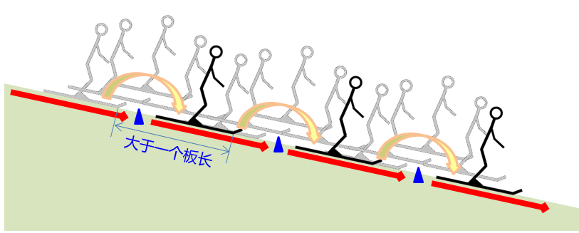
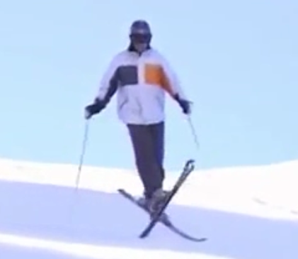
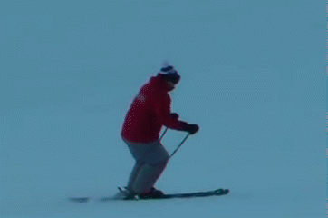
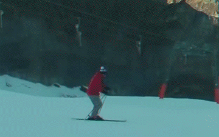
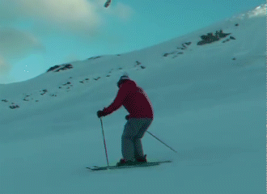

<!-- 来源: https://zhuanlan.zhihu.com/p/33164902 | 分类: 01_双板技术 | 发布: 2018-02-01 | 赞同: 144 -->

# 【双板教程--05】直滑降的完结：测验，以及高端练习

（V0.10：20180201，第一稿，不定期修正和更新）

现在要面对第一次考试了。

本教程中安排的测验，并不是严格的升级测试，而是对技能掌握程度的一种检验标准：测试不通过，可能不影响下阶段的学习；但是要明白，带着缺陷升级，迟早这个缺陷会变成瓶颈。所以，心急的学习者可一边强化测验所需要的技能，一边学习新的课程，这样学习的过程会更加丰富有趣。

另外，最开始的时候提到，准确的自我认知是高效学习的关键，而自我认知的方法之一，便是这种能够检查技能效果的的标准化测验。

## 直滑降测验

直滑降练好了吗？

直滑降的关键技能，就是重心的前后平衡能力。对于这个技能，“跳”是最直接的检测方式。因此，直滑降的终极测试，就是“直滑降三连跳”【直滑降•8•测验】：

1，测试的雪坡最好是较陡的初级道，或者中级道的缓坡部分；

2，跳起的规则是 在空中飞跃距离大于一个雪板长度 ；

3，至少 连续跳起三次 ，每次落地到跳起的间隙尽可能短（可能会有一点下蹲蓄力的时间，但不能有其他多余的动作，比如调整平衡等）。

通过这个测试，意味着前后重心的平衡能力达标了，后面学习转弯时便可以专注于新的方向（左右重心，上下压力等），学习会变的更加轻松。当然，在以后的学习过程中，前后重心的平衡可能会因地形的升级、以及与其他方向的技能混合等，而产生更高的要求，届时可能还需要对这个技能再进行升级。

## 高端直滑降练习

直滑降虽然看起来简单，但也能玩出花来。下面介绍一些高端直滑降练习，可以直（Si）通（Ke）到直滑降大师级，也可以在学习转弯之余调剂一下。注意：以下的所以练习都必须是采用平行式直滑降形式。

- 直滑降平转360【直滑降•9•选修】：直滑降时，上身先转90度，然后反方向快速释放，带动雪板旋转360度。理论上只要雪面平整，站姿正确，这个动作就很容易完成。但实际上，想练出来还是很难的，重心往往不那么对，雪面也往往不那么平。
- 单脚直滑降跳换脚【直滑降•10•选修】：这个练习就简单多了，单脚直滑降一段时间，然后跳到另一脚继续直滑降。但是要小心，开始练习时很容易摔倒。这个练习对将来学习平行式转弯非常有帮助。
- 直滑降剪刀跳【直滑降•11•选修】：非常有趣的动作，直滑降中跳起，一只脚翘起板尖，另一只脚翘起板尾，侧面看像打开的剪刀。如果埋头苦练时感觉太无聊了，不妨来做做这个练习，欢乐一点吧。

- 直滑降挑战中级陡坡【直滑降•12•选修】：在较短的中级陡坡上，用直滑降验证正确的站姿（小跳等），然后快速用犁式刹车停止。要小心的选择地形，陡坡下方要有足够的安全距离用来制动，同时要保证行进路线上空旷无人。如果没有把握，可以在学会平行式制动（侧身急停/转停）后再补做这个练习。
- 直滑降板尖跳【直滑降•13•选修】：直滑降起跳的时候将板尖翘起。对平衡的灵活性和精确控制很有帮助，同时也锻炼了核心力量的使用。刚开始练习时很难做到这么大幅度，可以从小到大慢慢提高。

- 直滑降板尾跳【直滑降•14•选修】：直滑降起跳的时候将板尾翘起。对平衡的灵活性和精确控制很有帮助，同时也锻炼了核心力量的使用。刚开始练习时很难做到这么大幅度，可以从小到大慢慢提高。

- 直滑降海豚跳【直滑降•15•选修】：以直滑降板尖跳开始，在空中迅速收小腿变成板尾跳的形式，雪板在空中的轨迹像一只跃出水面的海豚。真正的海豚跳转弯（Dolphin Turn）可是大师级的练习，直滑降海豚跳可以作为它的前导练习。能完成这个练习，也就是当之无愧的直滑降大师了。

## 预备部分总结

平地练习和直滑降练习，都是大部分滑雪者容易忽略的部分，甚至国内很多滑雪学校和教练也是以犁式转弯开始教学。但是，这两部分其实非常非常重要，是滑雪学习过程能否事半功倍的关键——双板滑雪，最关键的技术要素就是站姿，而前后平衡则是站姿中最重要的基础。

因此，以平地练习奠定的静态站姿，以直滑降练习奠定的动态站姿，将成为后面学习过程的j坚实基础和巨大助力。

后面，将开始转弯的学习。从下一章节开始，如果还有学习者感觉重心后座，那么请自觉的先做个直滑降测试，通过后我们再讨论是何原因导致。

## ※声明※

1）本人在知乎发表的文字，包括专栏文章和回答，没有授权任何其他机构转载，如果在别处看到，一定是没有版权的，本人保留依法追责的权利。

2）本文为草稿，随时有可能更新，谢绝转载，请勿联系。

3）欢迎大家讨论、补充。有疑惑就敞开了问，简单的会直接回答，复杂的也可以在未来的章节里解释。

4）部分配图来自于网络，如有侵权，请联系我删除。

【修订记录】

2018.02.01 第一次发布 V0.10

【本文结束】
