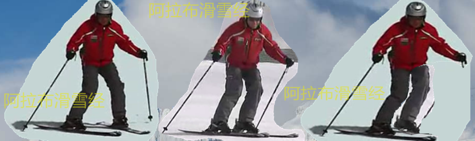
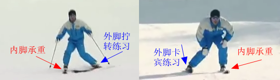
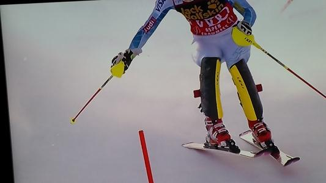
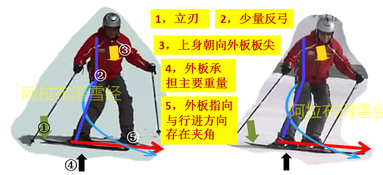
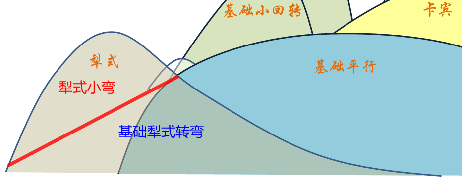
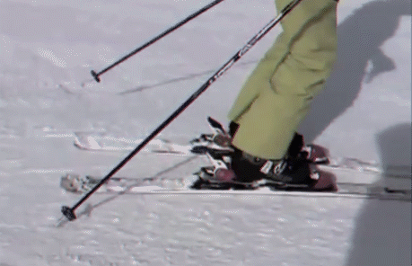
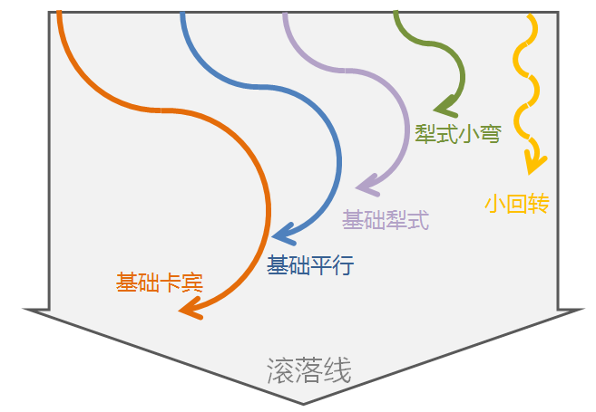

<!-- 来源: https://zhuanlan.zhihu.com/p/33511471 | 分类: 01_双板技术 | 发布: 2018-02-08 | 赞同: 203 -->

# 【双板技术--02】犁式转弯的爱与恨：为什么，学什么，谁需要，如何做

（V0.11：20191022，更新DirectParallel动图，不定期修正和更新）

犁式，在绝大多数滑雪体系里，都是学习双板的第一步，甚至有诸多“先犁两年”“犁上高级道”“回炉犁式去”这样的说法，似乎犁式是解决一切基础问题的法宝。然而，也有很多大神对犁式不顾一屑，从北美的PMTS体系的Direct Parallel，到国内曾经喧嚣一时的直接学习平行式的各种民间教程，似乎“K腿”“A板”等问题都是犁式惹的祸。

那么犁式到底是怎么回事？练的是什么？谁需要学习？如何学习？本章内容将尽力解释清楚这些问题。

## 为什会有犁式转弯

前面说过，学习滑雪就像爬山，直接攀登“基础平行”这个山头有点难，那么选择旁边那个平缓的“犁式转弯”就是更加高效的路线。所以，学习犁式然后再转换到平行式，其实是一种更容易的进阶路线，而且通常比直接学习平行式还要快。

可犁式与平行式滑雪看起来差别那么大，为什么先学犁式再学平行式反而会快呢？

因为， 需要学习的 犁式转弯与平行式转弯的差别，并没有想象中那么大。看下图。

左边为犁式转弯，中间为基础平行式转弯，右边呢？

把犁式转弯的内腿换成基础平行的内腿后，还会认为两者差别很大吗？

正确的学习犁式转弯，本质上就是在为平行式打基础，同时降低了学习平行式的难度，所以世界上的绝大多数滑雪体系都会从犁式开始教学。

然而，犁式转弯的学习，同样也会有很多误区，导致很多人学习了“犁式转弯”却没能获得平行式的基础，所以这样的“犁式”确实让人恨的牙根痒痒。下面的内容会让大家了解到如何避免犁式学习中的误区。

## 犁式转弯的优点

（1）犁式刹车和转弯是初学者的第一个保命手段

我一向认为在任何运动中，安全都应该是第一位的。而犁式刹车和转弯，简单易学有效，不但可以迅速消除初学者恐惧心理，而且能够切实的避免很多危险。没有一个保证安全的手段就在雪道上练习，等同于将初学者置于危险之中，是非常不负责任的。

（2）可以从容不迫的练习基础站姿

站姿是滑雪的基础，通过犁式练习基础站姿的好处，就是从容和专注：在可控的速度下，你可以仔细感受和调整每一个关节的动作，最终完成居中和灵活的站姿。排除其他各种干扰专门进行一个内容的练习，往往事半功倍。另外，基础站姿也包括了上臂的姿势，如果能在犁式就把上臂动作固定，对将来学习点杖也有好处，至少不会胳膊漫天飞。

（3）循序渐进的身体控制练习

双板滑雪中，对身体（或者平衡）的控制有四种：前后，左右，上下，旋转。

在直滑降练习中，我们可以专注于重心的前后控制，也就是时刻保持重心居中（不落后，因为人在滑雪时的天然倾向是重心落后）。在后续的波浪道练习（根据地形和速度变化调整重心）和中级道犁式转弯练习（在滚落线方向保持重心），会加强这方面的控制。而这些练习，都不会掺杂任何其他的控制动作。

而犁式转弯的出弯/入弯动作，用到了身体/重心的左右控制。同样的，在低速、可控的条件下，这个练习很容易做到，之后还将通过大量练习进行强化。同时，左右控制是发生在换弯阶段，这时候通常是不需要关注前后控制的，也就是说犁式的两种控制练习分离的很好。

（4）稳定的新动作学习平台

学习一个新的动作时，最好的方式仍然是排除一切干扰，专注于动作本身。犁式无疑是一个很好的平台，很多技术动作的第一次尝试都可以在这个平台上进行，比如立刃，引申，拧转，起伏加压，卡宾，奔丁等等，许多教学录像中都可以看到用犁式演示或者感受这些高级动作的镜头。究其原因，无非“稳定”二字：在保证基础站姿的犁式平台上，无需担心身体失稳，也不用操心重心调整，练习者的主要精力就可以全部集中在新动作上了。

## 犁式转弯的缺点与不足

犁式转弯最大的缺点，可能就是太简单，太容易做到，这其中即包括正确的动作，也包括错误的动作，以及在初学阶段不宜练习的动作。犁式转弯作为一个稳定的学习平台，很多错误无法体现出结果，比如后座，在初级道时滑雪者几乎无法自己感觉出来。而夹膝这个问题更难分辨，初学者看正确的姿态甚至都会认为是夹膝的。

而犁式阶段危害最大的错误，则是内脚承重过多。作为从两脚平均承重过渡到外脚主要承重的初学阶段，出现内脚承重肯定是正常的。但是，许多“高级犁式练习”，恰恰是内脚主要承重，来让外脚可以单纯的试验高级动作。初学者如果不能分辨其中的要领，一味模仿外形，就会形成错误的滑行习惯，对后面学习平行式带来更大的困难。

另外，犁式转弯还有一个天生的不足，就是入弯与平行式转弯不同，或者说因为犁式板型的特点，入弯阶段比平行式转弯少了一段。这个特点一方面大大减小了犁式转弯入弯和换弯的难度，另一方面也导致后面学习平行式转弯时，可能会带入“A板”、“推板尾”等问题（犁式入弯天然就是A板的，推板尾则是半犁式入弯固有的动作）。

*“A板”：对运动员来说，这并不是问题*

## 适合初学者进阶的犁式转弯

我们的目的很明确，就是尽快过渡到平行式转弯，那么犁式转弯阶段的学习内容当然就只能是“为平行式打基础”的那部分，其余无关的东西必须排除在外。

现在，我们看一下哪些东西是犁式转弯与平行式转弯所共有的。首先，弯形是一致的，无论犁式还是基础平行式，都需要滑出圆润、饱满的S形转弯。

其次，姿态方面，我们继续对比两种转弯的出弯阶段。

除了重心居中这个永恒的核心，还可以看出来有以下几处相同或者相似：

1，外板都存在立刃；

2，少量的反弓（从外板轴向看，躯干与腿部有一个夹角）；

3，上身大致朝向外板板尖方向（犁式偏的略少一点）；

4，外板承担主要重量；

5，外板指向与行进方向存在夹角（搓雪角）。

所以我一直在说，犁式天然就是立刃的，犁式天然是反弓的（上下分离的），犁式天然就是搓雪的。在犁式转弯的学习过程中抓住这几个要点，就能最大程度的完成犁式转弯的学习目的，真正为平行式转弯打下坚实的基础。

事实上，前四点也是初学平行式滑雪者最经常出现的问题，这说明了，大多数自学的滑雪者，在犁式转弯阶段没有接受到正确的指导。

另外，在正规的体系里，以上这些要点也是要求做到的，所以所谓”回炉犁式“，并不是要去再滑若干时间的犁式转弯，而是这些本应该在犁式阶段掌握的要点，需要重新学习或者复习。然而，大部分不了解这样要点的滑雪者，哪怕回炉十次犁式，也无济于事。在了解之后，是用犁式还是平行式来矫正这些问题，就可以根据自身条件选择最佳方案。

## 犁式转弯的学习内容和分级

双板滑雪中，转弯的动力来自于两个方面：雪板自身设计，以及拧动大腿的力量。后者一直都没有提到，这是因为基础平行阶段不需要专门练习这中能力，但平行式中弯和小弯则必须用到拧转（或轴转）的能力。

综上所诉，我们把为基础平行打基础的部分归纳为基础犁式转弯，而涉及拧转的部分，划分为犁式小弯（相当于高级犁式转弯）。需要注意的是，有些体系比较偏重拧转/轴转，在初学犁式转弯时就会加入这部分内容，所以本教程的基础犁式转弯/犁式小弯，与其他体系的初级/高级/动态犁式转弯等形态，不可以直接对应。

基础犁式转弯的主要内容，是利用重量在两脚上的转移来控制转弯，同时协助身体各部分，形成正确的滑行姿态，具体的要求包括（暂定，以后可能修改）：

1）转弯过程中的重心居中（在横滑降阶段的滑行中动态居中的基础上）；

2）饱满圆润的S弯形；

3）外脚承重，与重量的左右转移；

4）正确的滑行姿态（Alignment）。

犁式小弯的主要内容，是在基础犁式转弯的基础上，加入拧转，使得弯形更小跟紧凑，同时练习拧转所需要的身体姿态，具体的要求包括（暂定，以后可能修改）：

5）拧动大腿加速转弯的能力；

6）腿部姿态；

7）节奏控制。

## 犁式转弯以及学习内容的取舍

犁式转弯真的是非学不可吗？ 不一定 。

对于大部分人来说，是的，因为这样更容易。但是对于那些运动协调性非常好的人，特别是有滑冰和轮滑基础的来说，可能真的不是必学的。同时，上面一再提到，犁式转弯与基础平行转弯，在出弯阶段是非常相似的，也就给了我们一个机会，一种能够跳过犁式直接学习平行式的可能。

在后面的教程中的第一个犁式转弯练习，是可以直接用平行式/半平行式来实现的，如果学习者能够顺利用平行式完成这个练习，那么就可以尝试PMTS的Direct Parallel去直接学习平行式，或者跟随本教程的犁式学习进程，但是大部分练习用平行式的板型来完成，这样后面学习平行式就会快的多。

*Direct Parallel*

对于犁式小弯来说，如果学习目标是卡宾，也可以暂时舍弃，按照基础犁式-->基础平行式-->基础卡宾的路线先行学习卡宾滑法，之后再回来补学拧转技术。

然而，如果滑雪者所学习的雪道非常窄，或者有较多的人冲坡，那么我建议要么预先就把犁式小弯的内容与基础犁式转弯混合在一起学习，要么尽快过渡到犁式小弯，因为学习转弯技术需要占一定宽度的雪道，在环境不允许时，小弯占道少，从而被冲撞的几率也就更小。

*中级坡度下，不同滑行方式对雪道的占用情况*

## ※声明※

1）本人在知乎发表的文字，包括专栏文章和回答，没有授权任何其他机构转载，如果在别处看到，一定是没有版权的，本人保留依法追责的权利。

2）本文为草稿，随时有可能更新，谢绝转载，请勿联系。

3）欢迎大家讨论、补充。有疑惑就敞开了问，简单的会直接回答，复杂的也可以在未来的章节里解释。

4）部分配图来自于网络，如有侵权，请联系我删除。

【修订记录】

2018.02.08 第一次发布 V0.10

2019.10.22 更新DirectParallel动图 V0.11

【本文结束】
