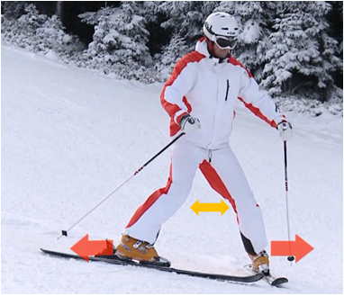
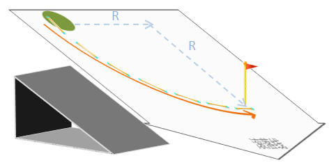
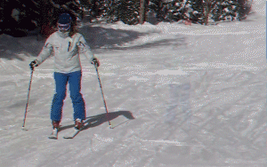
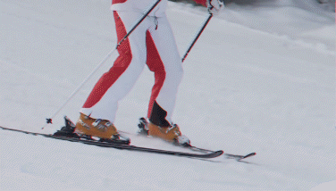
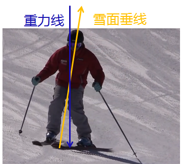
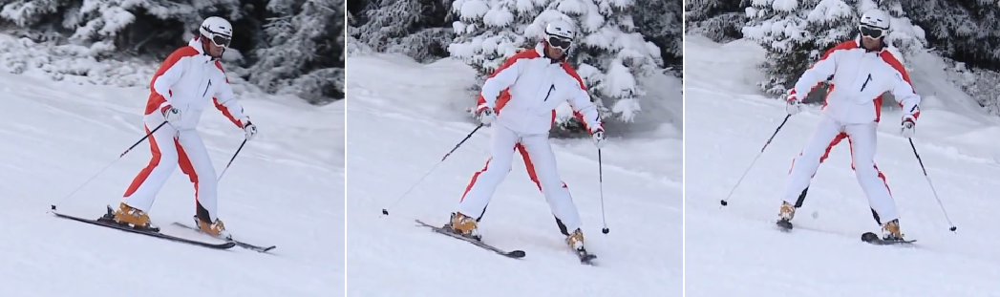
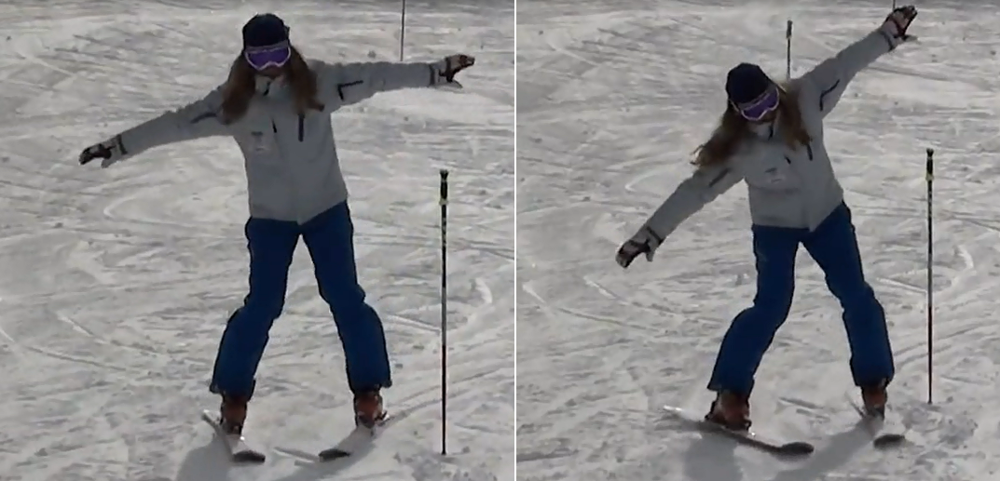
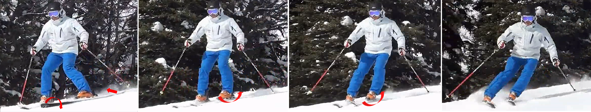
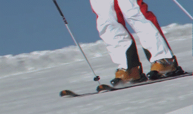

<!-- 来源: https://zhuanlan.zhihu.com/p/33511588 | 分类: 01_双板技术 | 发布: 2018-03-07 | 赞同: 128 -->

# 【双板教程--06】第一次转弯：精确学习法的开始

（V0.10：20180307，第一稿，不定期修正和更新）

理论基础和实践基础都已经具备，终于可以开始学习转弯（话说我自己都等不及了）。

作为第一个入门的转弯动作，我们要学习的是最容易掌握、但是也是最重要的下半弯（弧顶与出弯部分）。

从前一篇的理论分析中，我们已经了解到，犁式转弯外腿与上身姿态与平行式非常相似，指的就是下半弯部。因此，本章节的内容，也可以尝试用两板平行的方式来尝试。

在学习之前，先要确认两件事：

1）犁式制动是否已经掌握？

2）直滑降的测试是否已经通过？如果还没有通过，很可能会在转弯时因为重心落后而摔倒。如果出现这种情况，请回炉基础站姿和直滑降相关练习。

## 犁式站姿

犁式站姿就是犁式制动完成后的姿态（双板教程--03，预备练习7），这里再复习一次：在基础站姿的基础上，将两板尾向外侧推出，而板头间距不变。

犁式滑行中，可以通过调节板尾的打开宽度来调整速度，但是 板头间距不能变 ，必须保持10cm左右。另外，膝盖也一定要保持向外张（感觉不难受的程度），绝对不能夹膝，因为夹膝在平行阶段是错误动作，同时夹膝也容易导致后座。

## 犁式转弯——下半弯

第一次转弯必须在初级雪道进行。学习之前，建议先热身，然后做一两趟【直滑降+小跳】练习，保持身体活性和居中灵活的站姿，同时熟悉一下这条雪道的加速特性。

一般人的右腿比较强，因此通常第一个弯从左转开始，此时右腿为外侧腿。现在开始学习基础犁式下半弯【基础犁式•1•必修】：

1）在雪道左侧找一块平整、无人的正方形区域，大约8~15米宽，站在区域的右侧顶部。区域的大小取决于坡度、雪质、雪板三维、体重等因素，实际上大致有个方向就可以了。如果有朋友或者教练带，可以让他先滑一次，以他的停止点来确定区域大小就好。

2）在区域的左侧底部，寻找一个标志物，比如一小堆雪、能识别的痕迹、雪面杂物等，有条件的话可以请朋友插一只雪杖。

3）面向坡下，采用直滑降的预备姿势站好（如果尝试平行式，保持用雪杖支撑自己站稳）。扭头看左下角的标志物，在心中模拟转弯路线。如果有人带滑，记住他的轨迹。

4）回忆一下直滑降中的基础站姿，然后在心中模拟一次在转弯路线上保持基础站姿的情形。

5）将重量主要放在外侧腿（右腿），然后启动滑行：犁式站姿时用雪杖撑出向前，同时收窄板尾。此时，将完成心思放在前后重心的平衡上，只要保持重心居中不落后，雪板就会带着你开始第一次转弯。

6）主要重量一直放在外侧腿，沿弧形路线保持好重心和站姿，记住一开始会略有加速，开始转弯过半时就会开始减速并慢慢停止，千万不要害怕。最终停止的点会会与终点标志物略有偏差，不要紧，走哪儿算哪儿。如果接近雪道边缘还没停止，将重量平均分配在两腿，然后用犁式制动停下。

7）停止后，原地转向面向坡下，按照刚才滑行的轨迹大小，寻找右下侧的标志物，在心中模拟出路线，然后开始向右的下半弯。

*身体重量主要在外侧腿*

## 注意事项

A）第一次选择停止的位置要靠近雪道边，这样一旦有意外也不会造成麻烦和危险。但也要留出足够的余量，防止速度超出预期时滑出雪道。

B）转弯中，上身姿态保持不动，尤其是上身与外腿的夹角，这样转弯完成之后，会感觉身体并不是正直站立，而是略微向山下倾斜，这样就对了。

C）一般把重量放在外腿就可以实现转弯，不要用力去蹬雪板，站在外板上就好。也可以用上半身加强外板上的压力，这样更夸张的向外腿施压，能够提高这个练习的感受以。但请注意，这些强化外板的练习不可以带入到正常滑行中。

*采用夸张的上身外倾来向外腿施压*

*”倒飞机“练习也是一种夸张的外腿施压方式*

D）如果是采用平行式来学习这个动作，那么转弯的过程就不会像犁式这么平稳，这是因为犁式的内脚提供了很稳定的支撑，而平行式的内脚则可能只是个拖累（各种卡雪、卡刃、卡板等等），所以一边要用外脚处理转弯和平衡，一边还要关注内脚不要捣乱，只有运动协调能力特别好的人才能完成。一般人，还是先练好外脚，再去关注内脚为宜。

*参考：半犁式转弯中的内脚动作*

## 精确学习法

所谓“精确学习”，就是实现高效学习滑雪的方法，即通过理论和技术分析，合理安排学习内容，尽可能的提升学习的效率和效果。

比如第一次转弯，因为犁式转弯的上半个弯（转换、入弯）与平行式是完全不同的，而下半个弯（弧顶、出弯）则相似，因此在学习过程中，应当主要关注下半个弯，并且对减少对内腿姿态的关注。

同时，对于有志向直接挑战平行式滑行的人，这也是一个检测其能力的好机会。如果能在下半弯学习中直接应用平行式，难么他就可以跳过犁式入弯，直接进入平行式的学习。

在后面的章节中，都会尽可能精确的指明那些人需要学习，哪些部分是学习的重点，哪些是临时性的过渡技术，这样学习者就能够最大化的把时间和精力用在最有用的地方，从而达成”最快学习双板滑雪“的目的。

## ※声明※

1）本人在知乎发表的文字，包括专栏文章和回答，没有授权任何其他机构转载，如果在别处看到，一定是没有版权的，本人保留依法追责的权利。

2）本文为草稿，随时有可能更新，谢绝转载，请勿联系。

3）欢迎大家讨论、补充。有疑惑就敞开了问，简单的会直接回答，复杂的也可以在未来的章节里解释。

4）部分配图来自于网络，如有侵权，请联系我删除。

【修订记录】

2018.03.07 第一次发布 V0.10

【本文结束】
