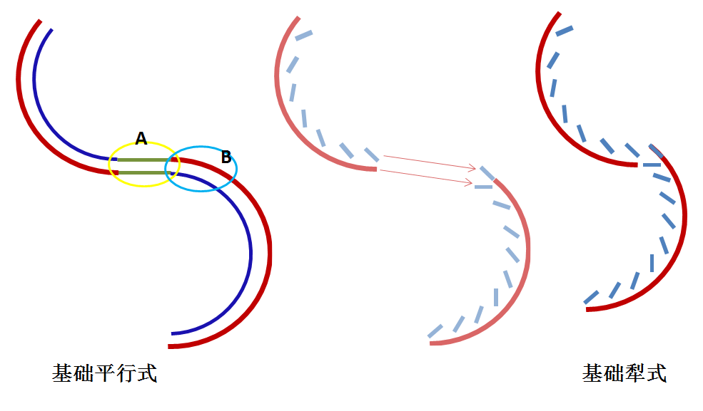
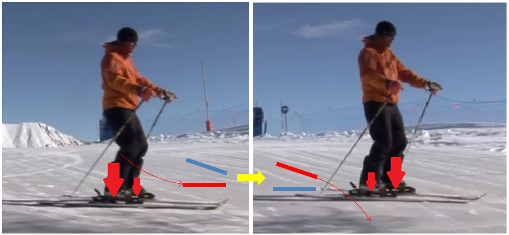
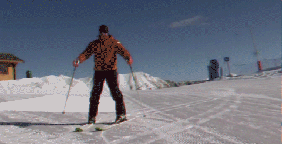
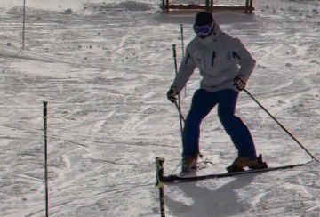
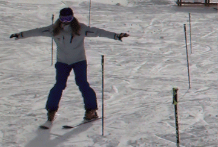
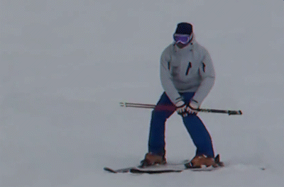
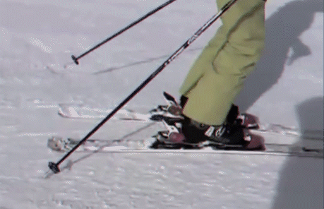

<!-- 来源: https://zhuanlan.zhihu.com/p/34313457 | 分类: 01_双板技术 | 发布: 2018-03-16 | 赞同: 161 -->

# 【双板教程--07】入弯，和完整的基础犁式转弯

（V0.11：20191022，添加DirectParallel动图，不定期修正和更新）

犁式滑行的精华部分，都在下半弯，但是这种半个弯半个弯的不连续滑法，练习效率很低。现在我们开始学习犁式的上半弯滑法，并详细分析犁式入弯与平行式入弯不同，以扬长避短，达到精确学习的目的。

## 犁式入弯的天生缺陷

下图是换弯阶段平行式与犁式的对比：

将左侧轨迹的A和B两部分去除，然后再合并到一起，就是右侧轨迹。

那么A与B是什么呢？A是转换时放平板底的过程，B是平行式入弯的起始过程。A段可以通过拉长弯间转换来略弥补（犁式的转换动作很快，所以要刻意延长。但是，犁式永远不可能同时放平两个板底），但是B段就没有办法了。

所以，犁式入弯天生就缺少了一小段，这样从犁式转平行式时没有补上的话，滑行技术就会有缺陷，这也是困扰了太多刚刚学习平行式的滑雪者的烦人问题。

将来在平行式的学习中，我们再将缺少的部分补上，现在先来掌握本阶段能Get到的技能。

## 基础犁式入弯

基础犁式入弯【基础犁式•2•必修】的动作很简单：在下半弯完成后，直接将重心转移到侧前方的新外脚即可。

虽然描述起来简单的不像话，但是实际操作的时候不一定很容易做到（也可能真的不难，看脸咯，哈哈）。这里有几个要点需要强调：

1）出弯后可以略微向前（横向）直行一小段距离，有两个好处，一个是有充分的时间体验重量转移的过程，再一个还可以让速度减一减。

2）重量转移到新外脚之后，会一边转弯一边加速，这个时候在直滑降阶段练就的前后重心控制能力就要用上了，一定要保持住（前后方向）居中而灵活的站姿。

3）要有耐心，让雪板把弯转完整，并可以尝试加大外侧压力减小转弯半径。犁式阶段一个很重要的任务就是要学会圆润饱满的弯形，这一点除了正确的姿态，还要有足够的耐心。

4）完整的基础犁式转弯的滑行速度要比下半弯练习要快，因此转弯半径也会大一些，这就需要更大一点的场地。如果所在场地太小，建议先学习后面犁式小弯的前两个练习再回到这里，这样转弯半径会小很多。

再次强调，基础犁式的学习目的，是掌握正确的弯形，并形成外脚承重主导转弯的滑行方式。基础犁式对于转弯中的速度缺少控制手段，所以需要根据能力选择合适的坡度。在连续滑行中，可以通过转换时横向减速，以及加大外脚压力/立刃角度来缩小半径这两种方式调节速度。

## 强化练习

滑雪中的姿态控制可以分成四个方向，前后，左右，上下，旋转（身体的轴向）。在直滑降阶段学习了前后控制，在基础犁式开始接触左右控制，这就是学习的重点。

姿态的左右控制有两个方面：换弯时的左右承重转移，以及弯中的持续外脚承重。前者是这两章的主要内容，后者则需要进一步的练习，最好能到内脚完全不承重的程度。以下是几个帮助承重转移和外脚承重的练习。

【基础犁式•3•必修】基础犁式弯间小跳：在两个弯中间小跳一下，确认居中和灵活的站姿。

【基础犁式•4•选修】犁式倒飞机：正常的飞机盘旋时，是内侧机翼低，外侧机翼高，但是这里需要反过来，两手平伸，转弯时用上身带动外侧手臂压低，协助将身体更多的压在外侧板上。

【基础犁式•5•选修】基础犁式触外膝：强化外侧板承重的另一个练习，两手横握雪杖，转弯时把雪杖中部贴在外侧腿的膝盖上。可用来尝试加大立刃角度后的弯形变化。

## 完成标准与后续进程

基础犁式的目标和功能都很简单，因此在初级道上练习熟练就好，不建议去中级道，因为速度会太快，比较危险。完成的标准有两条：

1）内脚承担的重量越少越好，能到内侧板底轻轻浮在雪面上走的程度最佳。

2）转弯动作熟练到无意识的状态，无须关注动作、压力等即可随意转弯。

达到以上两条标准，说明外腿已经具备独立转弯的能力，不再需要大脑时刻关注。下一步就可以把关注点放在内腿，学习内侧板的同步转向与协调功能——这就是平行式滑行。

然而，下一步如果学习平行式，因为欠缺对速度和弯形的控制，滑行能力、地形选择等都会有很大限制，而且也比较危险，所以建议还是要学习下一章的犁式小弯。如果目标很明确的是最短时间学习卡宾，那么可以跳过犁式小弯直接开始后面的平行式学习。

上一章提到运动协调能力特别强的学习者可以直接用平行/半平行的方式学习下半弯，但是在入弯这里，就不能完全按照本章的做法去练习了。具体的做法是熟练掌握下半弯后直接开始学习平行式入弯。这里先介绍一种通过自我感受来学习连续转弯的办法：向相反方向逐步增加启动转弯时板尖与滚落线的夹角，从0度增加到接近75度左右即可（即向上半弯逐渐移动），更饱满的弯形需要其他技术要点来配合，请静待后续章节。

## ※声明※

1）本人在知乎发表的文字，包括专栏文章和回答，没有授权任何其他机构转载，如果在别处看到，一定是没有版权的，本人保留依法追责的权利。

2）本文为草稿，随时有可能更新，谢绝转载，请勿联系。

3）欢迎大家讨论、补充。有疑惑就敞开了问，简单的会直接回答，复杂的也可以在未来的章节里解释。

4）部分配图来自于网络，如有侵权，请联系我删除。

【修订记录】

2018.03.16 第一次发布 V0.10

2019.10.22 添加DirectParallel动图 V0.11

【本文结束】
