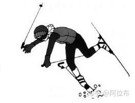
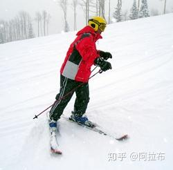
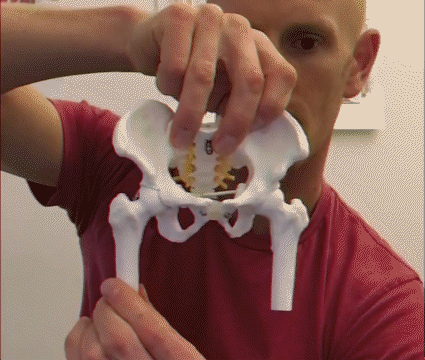
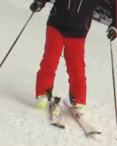
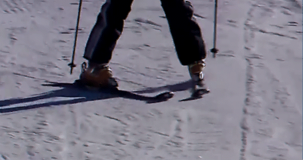
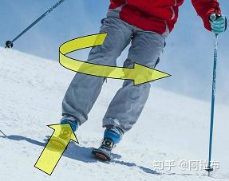
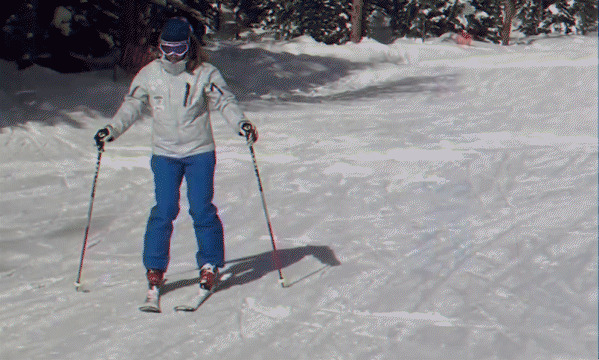

<!-- 来源: https://zhuanlan.zhihu.com/p/34570982 | 分类: 01_双板技术 | 发布: 2018-12-30 | 赞同: 144 -->

# 【双板教程--08】犁式小弯：只需要一个受益终生的基础动作

> 原文：[知乎 · 阿拉布](https://zhuanlan.zhihu.com/p/34570982)　·　发布于 2018-12-30　·　本文仅供学习交流，版权归原作者所有

（V0.20：20190109，补充完整，不定期修正和更新）

如果说基础犁式转弯是利用身体的重量驱动雪板，被动的依靠雪板外形来转弯，那么本节将要学习使用肌肉力量主动控制弯形的方法。

自我摸索的初学者会有很多种主动控制滑行方向的尝试，其中最多的就是试图利用全部身体来“迫使”雪板改变滑行方向， 比如下图。然而事与愿违，将身体压在一侧雪板，只会驱使它转向另一侧，其结果就是失控。

在转弯中，试图用身体改变的自我尝试主要是用上半身压向弯内，这在转弯初期确实能够获得一点加速转弯的感觉，但随后就会导致外脚承重不足，并且搓雪角消失，姿态和弯形都被破坏。

正确使用肌肉力量来改变弯形的方法并不难，而且非常基础，在后续任何阶段都可以使用，而且在高级阶段是必须使用。所以这是一项受益终生的技能，从一开始就正确地学习，无疑是最高效的方式。

## 轴转（Pivoting）

轴转，又叫转腿/拧转，是指大腿骨在髋关节的臼窝内的旋转所形成的动作。

轴转的要领有两个。

第一条：轴转是大腿带动的，从膝盖到脚踝都跟随大腿转动，而不参与发力，仅仅保持本来的姿态即好。简单来记，就是“只拧大腿”。

第二条：轴转并非立即转动雪板。当提起雪板，在空中练习这个动作时，肯定能立刻看到雪板以脚心前后为轴的转动。但是，当雪板的板刃接触雪面后，再想让雪板立刻转动就很难了。正确的动作要领是， 在整个转弯过程中施加转动大腿的力量，让雪板均匀的加速转弯 。简单的口诀可以是：“只拧不转”，只施加拧动大腿的力，但不直接转板。

在后面平行式的练习中，会有一些可以直接转动雪板的轴转练习，比如侧身刹车（Hockey Stop，冰球刹），旋转横滑降（PovitSlip）等。这些练习中雪板能够直接旋转的条件，都是要放平板底（或接近放平）。任何用刃时的轴转/拧转/转腿，都不要有直接转动雪板的想法。

平行式时轴转还有一个重要的要求，是双腿要同步旋转。这个要求对平行式滑法非常关键，但在犁式阶段，只能说可有可无，是否同步取决于个人的协调能力，不强求。

## 犁式小弯

将轴转应用于基础犁式，就成为犁式小弯滑法。顾名思义，这种滑法的弯形非常小，通常可以比基础犁式转弯的半径小一半以上。

注意一点，在应用轴转之后，上半身的朝向会略偏向外板，而不再是两板正中，这是因为外板的搓雪角变大的缘故。但是因为内板是跟随状态，身体不可以偏向外板太多，否则会失去平衡或导致两板相撞，这也是限制犁式转弯滑行能力的原因之一。除此之外，其他基础犁式转弯的所有动作要领都要完全遵守。

【犁式小弯•1•必修】转出半径小于基础犁式转弯一半的弯。

通过施加拧转的力量大小，可以控制弯形的大小，因此可获得一定的控制方向的能力。

【犁式小弯•2•必修】在转弯过程中改变转弯半径。

## 学习进程安排

如果学习完整的基础犁式，那么稍加练习就可以掌握犁式小弯，然后可以在中级道多加练习（对，中级道，此时的你应该在中级道如履平地）。

如果是因为雪道太窄等限制，直接从犁式小弯开始学习，那么从第一个弯开始就要有意识的同时用身体重量和大腿拧动的力量来完成，让弯形尽量的小。然后按照基础犁式的进程一步一步学习即可。

【推荐一本书】大名鼎鼎的《Ultimate Skiing》已经在国内翻译出版了，译名《滑雪宝典》，定价98元，淘宝等渠道60以下可以拿到。这本书是现代滑雪技术分析的鼻祖之一，其内容被各路大神引用，很多人第一次阅读时会倍感熟悉（比如我），绝对值得拥有。这本书偏向于理论分析，让你明白滑雪是什么，为什么，怎么做，但是涉及的练习比较少，教程更是没有（所以此处有我，哈哈），比较适合解惑，而非直接学习滑雪。对滑雪理论无感的可以忽略。【完】 ※声明※ 1）本人在知乎发表的文字，包括专栏文章和回答，没有授权任何其他机构转载，如果在别处看到，一定是没有版权的，本人保留依法追责的权利。 2）本文为草稿，随时有可能更新，谢绝转载，请勿联系。 3）欢迎大家讨论、补充。有疑惑就敞开了问，简单的会直接回答，复杂的也可以在未来的章节里解释。 4）部分配图来自于网络，如有侵权，请联系我删除。 【修订记录】 2018.12.30 第一次发布 V0.10

2019.01.09 添加配图，第一次完整发布 V0.20 【本文结束】
