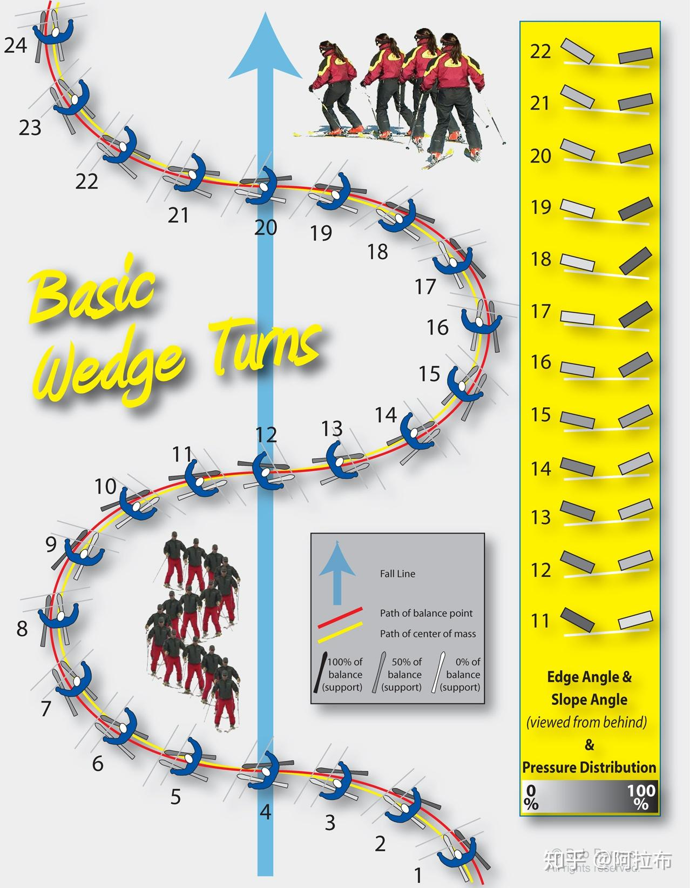
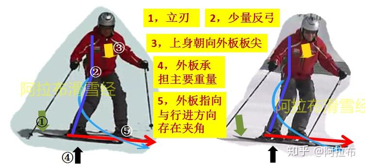
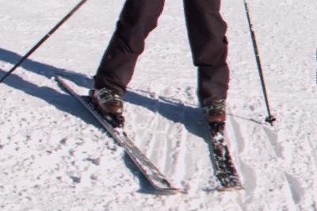
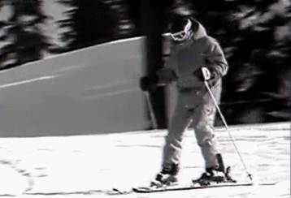
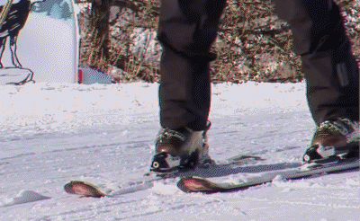
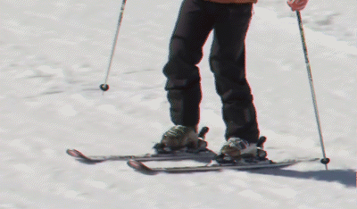
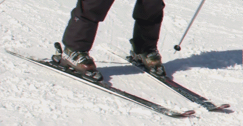
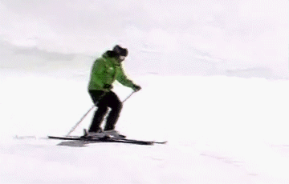

<!-- 来源: https://zhuanlan.zhihu.com/p/54901175 | 分类: 01_双板技术 | 发布: 2019-03-22 | 赞同: 138 -->

# 【双板教程--09】犁式阶段的完结与半犁式转弯

> 原文：[知乎 · 阿拉布](https://zhuanlan.zhihu.com/p/54901175)　·　发布于 2019-03-22　·　本文仅供学习交流，版权归原作者所有

（V0.10：20190321，第一稿，不定期修正和更新）

在《 犁式转弯的爱与恨 》中说过，犁式转弯作为一种滑行方式和技术练习平台，在后续的中高级阶段仍然可以使用。这里的“完结”，指的是“为平行式打基础”的犁式转弯阶段，而不是说犁式滑法再也用不到了。

我们学习犁式转弯的基本目的，是为了更容易和更快的学习平行式转弯。现在，是时候检查一下我们的学习效果了。

### 正确的弯形

说到平行式转弯，多数人都会把注意力放在“平行式”三个字上面。然而，被忽略的“转弯”的能力，才是一切滑行技术的基础。只不过在犁式转弯中，这个能力是通过犁式的特性，自然而然的自动完成，所以这前面的学习过程中并没有被特意强调。但是，在结束犁式转弯阶段、转向平行式之前，必须明了并强化这种能力，否则在初学平行式转弯时必然会走弯路。

转弯能力的直接体现，是滑出正确的弯形。一方面，弯形作为滑行结果，是正确滑行的必要条件：动作对了，弯形必然也是对的；反之，弯形不对，动作必然有错误。另一方面，平行式的诸多要点，也需要在正确的弯形中才能练习到。没有正确的弯形，就永远不可能Get到这些点，自然会被卡住无法进步。

在初中级阶段，弯形是否正确的标准只有两点：圆润，饱满。圆润是说弯形是否平滑和均匀，尽可能接近于一段圆弧线；饱满是说圆弧所对应的扇面夹角，是否足够大，通常要求达到150°-180°。

犁式转弯阶段，弯形基本上都是圆弧，这是犁式转弯的特性决定的。然而在平行式式转弯时，这些特性不再存在，各种千奇百怪的弯形就会出现。弯形不正确不但限制了继续进步的可能，而且也会成为身上最明显的“野路子”标签。

### 正确的姿态

犁式滑行是一种很容易做到的滑行方式，哪怕姿态有很多地方不对，也不一定会影响弯形和的速度。然而前文已经讲过，我们学习犁式转弯的目的是为了给平行式转弯打基础，所以，有利于平行式滑行的姿态才是我们要学习的部分。

在犁式阶段，正确的姿态主要有两个要求： 在转弯中保持重心居中 ，和 用外板承担身体的大部分重量 。其他的特点（立刃、反弓、朝向）是犁式本身所固有的，等过渡到平行式转弯才需要专门进行学习。

在直滑降阶段我们已经掌握了沿滚落线运动时保持重心居中，但是在学习转弯的过程中，有些滑雪者可能还是会出现一边转弯一边重心逐渐落后的情况，尤其是突然转移到更陡的雪道时。前面讲解的【基础犁式•3•必修】弯间小跳练习，可以有效的检查和改善这种情况。当感觉犁式滑行已经完善、打算开始学习平行式之前，不妨再做几次弯间小跳，甚至在转弯的过程中也可以轻松的小跳几下。

而用外板承重，是犁式转弯学习的重中之重，特别是对于犁式小弯，这个要求需要滑雪者刻意去做，而不能自然而然的做到。只有掌握了外板承重，滑雪者才有余力将内板解放出来，去关心内板的状态，调整内板的动作。如果内板被身体压在雪面，那么无论如何也不可能学习到正确的平行式转弯。

### 犁式转弯测验

犁式转弯的测验，包括基础犁式和犁式小弯，都可采用同一个练习来完成，只是转弯的半径会不同。因为在学习平行式之前，弯形都不会有太大错误，因此测验重点还是放在外板承重方面，同时兼顾重心居中。

【犁式转弯•8•测验】内脚踏步半犁式转弯：

1，犁式入弯，开始转弯后抬起内板，再放在与外板平行的位置。抬脚的时机取决于滑雪者的平衡能力，越早越好。抬起内板的时候，板尖不能高于板尾，否则需要检查转弯时的重心。

放下雪板时，尽量做到内板的外侧板刃接触雪面，不行的话就让板底平放雪面。可以一直抬着内板直到出弯前再放下；也可以早早放下，以两板大致平行的方式滑行后面的弯；甚至还可以连续抬起和放下内板【犁式转弯•9•选修】。

2，转弯是以两板平行的状态结束的。开始下一个弯时，将新外板（山上位置）向外打开板尾，然后转移承重到外板，形成新的犁式入弯。

在滑行中，尽量平滑的完成这个过程。入弯之后，再做前面讲解的踏步并板，这样就可以形成连续的滑行。

切记：先打开外板，再转移承重 ，这个顺序很重要。尽管在犁式阶段相反的次序也没问题，但形成习惯带入将来的平行式，就会导致讨厌的A板入弯问题。

### 半犁式转弯

【犁式转弯•10•必修】半犁式转弯，又可以叫做犁式—半平行转弯（Wedge-Christie），指的是采用犁式入弯，然后用平行/半平行式出弯的一种滑行方式。（半平行是指两雪板同侧板刃触雪，但两板不平行的一种滑行状态）。

半犁式转弯用处很多。在低速或者静止状态下，它在入弯时就可以转过很大的角度，这样转弯半径会很小，方向改变很快，同时还保持了犁式的稳定性，而且非常省力。因此在陡坡、深粉雪、密林等需要迅速或者小半径转弯的低速场合，半犁式是非常好的一种应急技术。

半犁式转弯同时也是犁式到平行式的过渡阶段，可用来练习平行式转弯的下半弯。然而由于犁式入完的一些缺陷， 本教程建议不宜过多练习半犁式转弯 。

半犁式转弯的主要技术要点，是内板的翻转和跟随。当用外板承重和转弯，内板放松时，雪板会自然跟随外板而形式接近平行的状态。但此时如果不特意去翻转内板，就容易出现内板的内刃卡雪，滑雪者会感觉非常别扭，甚至可能因此摔倒。正确的动作，是在跟随状态时 翻转内板的板刃 ，从内刃触雪变成外刃触雪，这样同侧板刃接触雪面，才是平行式的标准状态。

以平行式完成下半弯后，采用【犁式转弯•8•测验】中一样的方式，再次形成犁式入完，这样就能连续滑行了。

通过半犁式转弯来进阶平行式的通常办法是：

1）在转移承重之后，尽可能早的翻转内板形成跟随状态，这样几乎全部转弯都采用平行式完成；

2）入弯时尽量少的打开新内板的板尾，当完全不需要推开板尾就可以入弯时，犁式入弯就彻底被消除，此时就成为标准的基础平行式转弯。

这种进阶方式需要大量的练习，比较耗费时间，本教程将在后续章节讲解更有效率的平行式学习方法。

## ※声明※

1）本人在知乎发表的文字，包括专栏文章和回答，没有授权任何其他机构转载，如果在别处看到，一定是没有版权的，本人保留依法追责的权利。 2）本文为草稿，随时有可能更新，谢绝转载，请勿联系。 3）欢迎大家讨论、补充。有疑惑就敞开了问，简单的会直接回答，复杂的也可以在未来的章节里解释。 4）部分配图来自于网络，如有侵权，请联系我删除。

【修订记录】 2019.03.21 第一次发布 V0.10

【本文结束】
