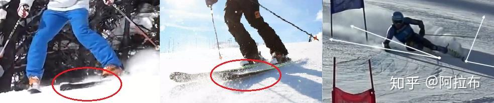
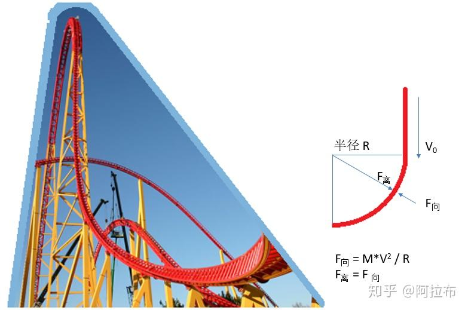
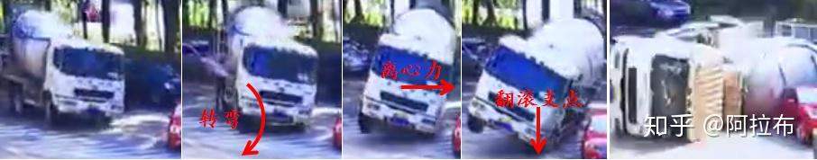
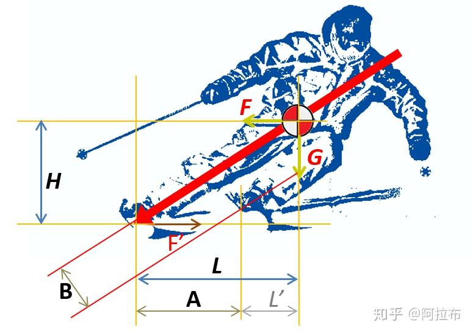
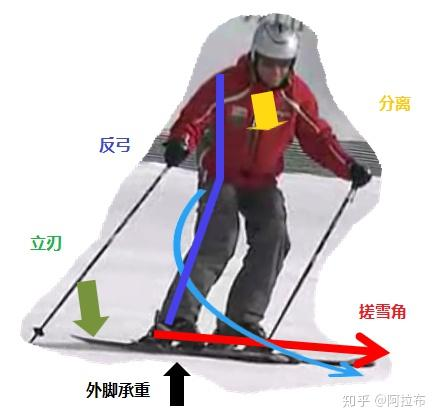
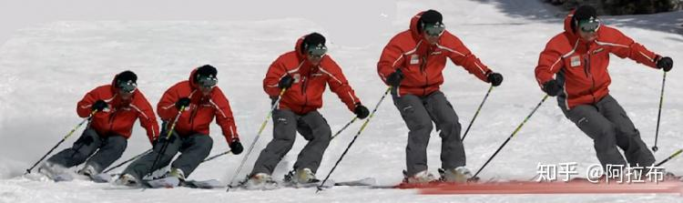
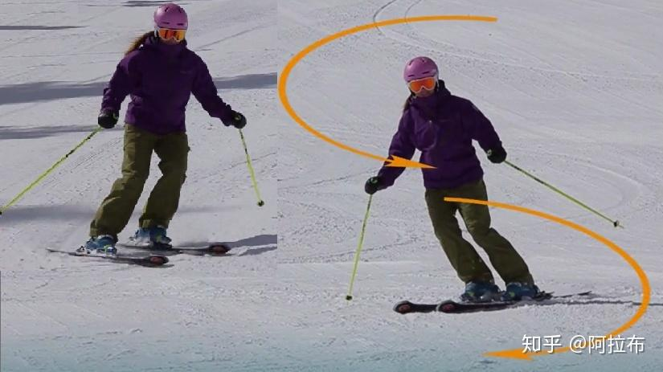
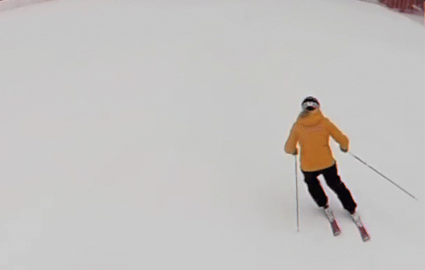

<!-- 来源: https://zhuanlan.zhihu.com/p/87617885 | 分类: 01_双板技术 | 发布: 2019-10-21 | 赞同: 350 -->

# 【双板技术--03】无立刃，不平行：基础平行转弯概要

> 原文：[知乎 · 阿拉布](https://zhuanlan.zhihu.com/p/87617885)　·　发布于 2019-10-21　·　本文仅供学习交流，版权归原作者所有

（V0.24：20250418，修正离心力和质心参考系的表述，增加外腿伸展的解释）

终于进展到平行式转弯。【拖了这么久，真的很抱歉！】

当我们使用大头板，在雪道上轻松的转弯滑行时，实际上是雪板的侧切在帮助我们转弯（细节请参考 《转弯半径那点事儿：如何读懂双板的基本参数》 ）。而侧切与雪面发生作用的部位，就是板刃，更确切的说，是立刃后的板刃。

*犁式转弯，基础平行式转弯，极限平行式转弯*

我们在学习犁式转弯时，并没有强调立刃，这是因为“ 犁式天然就是立刃的 ”：当我们做出犁式滑行的姿态时，板刃已经自然而然的轻微立起来了。而通过上图左侧犁式转弯和基础平行式的对比，可以看出两者的立刃角度相差并不大，这正是之前提到的，通过犁式可以更快的学习平行式滑雪的原因之一（细节可参考 《【双板技术--02】犁式转弯的爱与恨：为什么，学什么，谁需要，如何做》 ）。

但犁式滑行的天然本质也带来了巨大的缺点：人的身体结构限制了立刃角度非常小，这个因素导致犁式滑行只能有限的利用板刃，因此只能在缓坡和低速时使用。而平行式滑行，则可以自由的利用各种立刃角度，充分发挥雪板侧切/板刃的能力。上图中，高山竞技滑雪的王者之一Ted Ligery所演示的超高角度立刃。而高立刃，也是进阶高级滑雪者的必要条件之一。

同时，平行式滑行高效使用板刃的方法，也失去了犁式天然的稳定性，这导致平行式滑雪的立刃，必然伴随着姿态的“平衡”，才能形成 安全 、 稳定 、 流畅 、以及 美观 的滑行。下面，让我们先从物理和生理的角度，来了解平行式转弯的一些原理，从而把握“平衡”的要点。

## 平行式转弯的一些原理

从物理的角度看，平行式滑雪是一个相对复杂的运动，这是因为它叠加了重力加速、旋转运动、雪板形变、雪面的变形（切入与堆积）、雪面与空气的摩擦等诸多因素。但仅为定性而不是定量的探究原理，我们可以将转弯最简单的一部分，用简化的模型来进行分析。

就像左边的过山车轨道一般，如果滑雪者从雪坡上直线下滑，到平地时速度为V0，然后马上进入一个稳定的转弯线路（假设雪板瞬间切入雪面并弯曲），那么在水平面推动我们转弯的，是雪面向雪板施加的向心力（F向）。而在质心系（非惯性系）中滑行者会“真实”感受到离心力（F离），离心力作用在滑雪者身体上，与向心力（F向）大小相同，方向为沿水平面朝向弯外。然而质心参考系中，向心力作用在脚下，离心力是作用在全身（通常用质心/CoM来表示离心力的作用点，大部分情况下在人体的小腹中心），这一对力在侧平面并不是天然平衡的，如果仍旧按照正常的站姿，离心力就会导致滑雪者向弯外翻倒，如下图中的车辆事故：

*可怜的大个子*

事故中，水泥车在急转弯中，离心力导致了车辆侧翻，翻滚的支点是车辆外侧的轮胎。所以，为了形成平衡的转弯姿态，转弯时就必须采用一定的内倾（Inclination），比如向内倾斜的过山车转弯轨道，来抵消离心力的影响，达到平衡状态。而最佳平衡位置，从上面的事故中可以看出，就是转弯中刚体最外侧的支点。

因此在质心参考系，我们可以建立下图的侧平面简化模型：

平衡的最佳支点，显然就是外侧雪板。假设内脚不受力，则有三个外力作用在滑雪者身上，分别是重力 G ，离心力 F ，以及雪面的支持力，为G和F的合力的反作用力。他们都作用在滑雪者的质心上，质心距离外板的横向距离为L，质心高度为H。

因此可知，导致滑雪者向外侧翻倒的“元凶”，是离心力F与质心高度H构成的“外翻力矩”FH。而起到稳定作用的，则是重力G与横距L构成的“稳定力矩”GL。在平衡状态下：

F * H = G * L

基于这个等式，我们可以得出如下推论：

1）为了平衡离心力的作用，L必须大于0，也就是说必须通过身体的内倾来保持转弯时的稳定。而对于双板滑雪，这个身体内倾的动作，恰恰就是“立刃”！所以平行式转弯在物理上就必须采用内倾/立刃的姿态，“ 无立刃，不平行 ”。

2）横距L越大，高度H越小，能够抵抗的离心力就可以越大。因此，高速滑行时，滑雪者的身体会压的很低，屁股贴近雪面，H非常小，除了高立刃之外，也是抵抗离心力的要求。而 采用较长的外腿姿态 会增加L，同样能够增加对离心力的抵抗能力，这点在世界杯比赛中非常容易观察到，运动员在高速滑行中大弯时，外腿几乎都是伸直的。

3）质心与支撑点的连线，最好是通过外腿，这样人体骨骼系统就可以承担主要的支撑力。要实现这一点，就需要将质心向身体外侧略微移动，形成身体向内，而上身反方向略微向外的，类似一张少许拉开“弓”，这就是我们熟悉的“反弓”Angulation。 反弓姿态是建立外板上的平衡的最佳方式，同时还有更好的让雪板切入雪面（抓雪），以及稳定上身等优点 。而犁式转弯，也天然是反弓的。现在进阶到基础平行阶段，需要我们有意识的保持犁式滑行时的反弓姿态，以实现外脚承重/平衡在外板上。

此外，内脚的参与会让问题变的很复杂。少量的内脚压力足以让内板立刃和转弯，而过多的内脚承重通常来说会减少抵抗离心力的能力，降低支撑的稳定性，导致V板、减速、半径变大、甚至滑倒等问题。其实，双板滑雪内脚并非这么没用，越高级的技术阶段，内脚的作用就会越重要，但在基础阶段，还是应该以外脚为主，先练好外脚，再去修正内脚动作。

## 平行式转弯的技术要求

从犁式进阶到平行式，最大的变化在于：平行式转弯的立刃，要求两板同时、同幅度的进行。因此，两板必须立刃角度一致，双脚着力点一致（意味着脚踝前曲角度一致，也就是两小腿也要平行）。而在保持基础站姿的状态下身体直接内倾，会发现我们的身体结构会导致内腿的姿态不能与外腿保持一致，这就要求我们的上半身需要稍稍转向弯外。这种上半身与双板朝向不一致的情况，称为“ 分离 ”Seperation。我们知道，犁式转弯的姿态中，身体朝向与外板方向天然存在一个夹角，因此“ 犁式天然也是分离的 ”。分离是反弓的前置条件，没有分离的反弓幅度有限，甚至会导致腰部的损伤。

从以上的原理分析，我们已经得到四个技术要点： 立刃 、 反弓 、 分离、外脚承重。 其中立刃、反弓、分离都是在犁式转弯中的“天然”特性。因此，从“自然而然”的立刃和分离反弓，过渡到“有意识的，可管理的，平衡的”立刃和分离反弓，是进阶平行式滑雪重要的改变之一。而外脚承重，非但不是犁式弯中的天然特性，而且做不到也不影响滑行，因此我们在犁式阶段特别强调外脚承重，就是为了能够更方便的进阶平行式转弯。

既然有“立刃状态”，那么就需要“解除立刃”（释放），这个动作发生在出弯阶段，也是平行式转弯中非常重要的一个环节。从解除立刃/出弯，到恢复基础站姿/换弯，再到下一个弯的再次立刃，就是衔接两个弯的完整过程（也称为弯间的“过渡”阶段）。这个过程，在基础平行阶段是通过“ 引身 ”Extension，以及其后接续的动作连贯完成的。连贯流畅，也是过渡阶段的基本要求。

单独的引身（Extension）只是一个起身的动作，目的是引导解除立刃状态的锁定（旧弯的立刃动作），也为新弯的立刃做好了准备。引身后可在身体较直立、两板平放雪面的状态下滑动（slide）一段时间，重新恢复运动站姿（Re-Centering），然后在完全稳定下来后，再次立刃进入下一个弯。熟练之后，这三个动作会在很短的时间内一气呵成，放平板底的过程只有一瞬间，就不需要中间的滑动了。

平行式转弯的核心要求，就是双板同侧板刃平行和同步地转弯。因此，这三个动作必须是两板一起做到，同步立刃，同步转弯，同步释放，不能一个板一个板的来（No step）。要练习好两板同步，同样需要先修炼好外板转弯，然后如上一章所说：“只有掌握了外板承重，滑雪者才有余力将内板解放出来，去关心内板的状态，调整内板的动作。如果内板被身体压在雪面，那么无论如何也不可能学习到正确的平行式转弯。”

总结一下平行式转弯的基本技术要求，除了立刃这一基本动作要求，反弓可以作为外板承重的补充，分离则可具体化为身体面朝外板的板头。再加上我们一直所要求的重心和弯形，可提炼为这两句口诀：

无立刃，不平行

重心居中，外脚承重，适度分离，两板平行，引身点杖，流畅画圆，弯形饱满，节奏稳定。

## 平行式转弯的学习过程

在学习基础平行式转弯之前，我们应该已经通过了犁式阶段的测验，也就是说基本具备了平衡在外板上转弯的能力，因此在开始学习平行式转弯的弯中动作时，只要保持犁式转弯的大部分姿态，仅仅把内脚动作改成平行式就好。同时入弯部分，犁式与平行式差别较大，我会安排专门的练习来掌握这些内容。

在基本掌握单个的转弯技术之后，我们需要学习更重要的内容，即弯的接续，或者说换弯。平行式转弯越到高级阶段，换弯技术就会越重要。在基础平行阶段，我们首先学习让两个弯平滑连接和过渡的技术，然后加入点杖环节，让姿态和技术变得完整。

以上学习内容的安排，仍旧采用“精确学习，循序渐进”的方式，从较简单的下半弯，逐渐延时到入弯，以及连贯的转弯，之后再学习点杖等动作。速度与节奏方面，则必须按照“先慢速做对做熟，再做快”的过程进行，尤其是涉及动作次序的环节，“没做熟就想做快”是此阶段绝大多数问题的根本原因。

平行式转弯相比犁式转弯要复杂，因此滑雪者在学习过程中可能会出现各种各样的错误动作。在课程中，可能会穿插讲解这些错误动作的原因和改善方法。也有可能在适当的时候，整理一份常见错误及改正方法的索引。

敬请期待后续的练习部分。

## ※声明※

1）本人在知乎发表的文字，包括专栏文章和回答，没有授权任何其他机构转载，如果在别处看到，一定是没有版权的，本人保留依法追责的权利。 2）本文为草稿，随时有可能更新，谢绝转载，请勿联系。 3）欢迎大家讨论、补充。有疑惑就敞开了问，简单的会直接回答，复杂的也可以在未来的章节里解释。 4）部分配图来自于网络，如有侵权，请联系我删除。

【修订记录】 2019.10.21 第一次发布 V0.10

2019.11.03 修改技术要求讲解次序 V0.20

2020.03.05 添加姿态图片 V0.21

2021.01.04 基础平行要点中，上下分离改为适度分离 V0.22

2024.04.27 基础平行要点中，引身点杖改为 引身换弯 ，点杖不再作为基础平行阶段的必修内容 V0.23

2025.04.18 修正离心力和质心参考系的表述，增加外腿伸展的解释 V0.24

【本文结束】
