<!-- 来源: https://zhuanlan.zhihu.com/p/87615557 | 分类: 01_双板技术 | 发布: 2019-11-03 | 赞同: 233 -->

# 【双板教程--10】平行式转弯第一课：下半弯+放平板底

> 原文：[知乎 · 阿拉布](https://zhuanlan.zhihu.com/p/87615557)　·　发布于 2019-11-03　·　本文仅供学习交流，版权归原作者所有

（V0.10：20191103，第一稿，不定期修正和更新）

平行式转弯的学习，一般安排在犁式能够熟练掌握外脚承重和通过弯型来控制速度之后。

前面的章节已经提到过很多次，平行式转弯的换弯和入弯阶段在犁式转弯中是缺失的，所以初次学习平行式，我们还是从最熟悉的下半个弯开始练习，先不去管换弯和入弯，而是用放平板底的滑动来代替，专心练好下半弯的两板平行和其他滑行要点。同时，“放平板底”也是是换弯中的核心动作之一，是基础平行阶段非常重要的一个学习内容。

## 平行式转弯姿态

在《【双板技术--02】犁式转弯的爱与恨：为什么，学什么，谁需要，如何做》中说的很清楚，犁式和基础平行式在平衡、姿态、转弯等方面是几乎完全相同的，主要不同之处，只有内脚。因此，学习基础平行转弯的姿态，只要先摆出犁式的姿态，用雪仗支撑好身体，再改动内脚让两板平行即可。

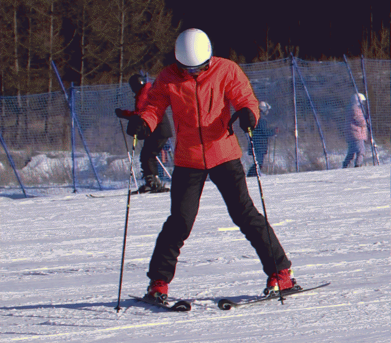

可以先在静止状态，或者在家里做一下这个动作，你会注意到犁式的姿态可以稳稳的站好，而改成平行式姿态时，需要用雪仗支撑住，或者扶着什么东西才能站稳。那么为什么在转弯时，平行式的动作可以保持稳定呢？这就是我们在《 【双板技术--03】无立刃，不平行：基础平行转弯概要 》之中讲解的，在转弯时所受的离心力，拉住了我们的身体，使之不会倒入弯内。

离心力是速度与半径的函数，因此在启动平行式转弯时，需要一定的初始速度。在练习单个的转弯时，必须稍微向山下滑出一点距离、获得初速后再启动转弯。

需要注意一点，因为姿态中“分离”的因素（本质上立刃后身体结构的限制），平行式的两个雪板并不是平齐的，而是内板要前出一点，称为“板头差Lead”。板头差是自然现象，它的大小与立刃角度和板距等有关，我们不需要关系这点，只要姿态上维持两小腿平行就足够了。

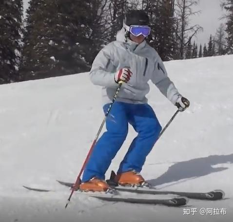

## 下半弯的内脚动作

在犁式和基础平行式转弯中，都是外脚承担主要支撑作用。通过犁式转弯完全掌握了外脚承重的转弯后，我们就可以把注意力放在内脚上，让内脚能够与外脚平行动作，并完成同步。

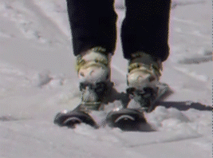

平行式内脚的动作，并不复杂，就是类似踢毽子的内翻。在做这个动作的时候，需要稳稳当当的踩在外板上，并保持好平衡，让内脚几乎完全不受力，这样才能轻松的微微抬起内脚，内膝倒向弯内，内脚（的脚心）向上翻起一点点，形成内板外刃在雪面拖行（也可以微微悬空）的状态，此时因为我们身体结构的整体性和对称性，两个板会自然地大致平行。

练习下半弯，犁式转弯的时候是面向山下开始，但此时外板实际上向转弯方向偏过一点点了（如下图）。在改成平行式下半弯练习时，一开始可以从同样的角度开始（位置A），稍微熟练后再从板尖朝向山下（位置B），或者更前的位置开始（位置C）。

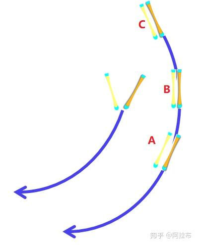

【基础平行•1•必修】下半弯的滑行动作，就是保持外脚承重转弯的同时，内脚同步翻转，并保持两板平行。一开始可以稍微抬起一点内板，熟悉一些之后就可以让内板的外刃在雪面上拖动，感受一下外刃持续平滑搓雪的感觉。

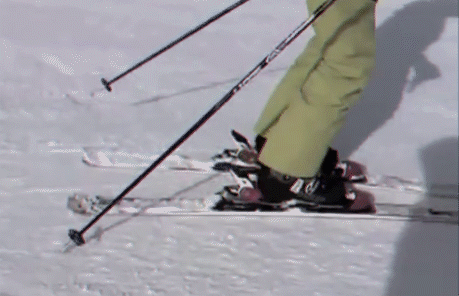

如果想在家里体验这种感受，可以穿上拖鞋坐在椅子上（最好略低一点），两大腿平行向前：(1) 一只脚模拟外脚，用大脚趾球踩住拖鞋向外滑动20~30公分；(2) 另一只脚模拟内脚，用小脚趾球踩住拖鞋，向外脚一侧滑动拖鞋，直到两小腿平行；(3) 用内脚的小脚趾球踩住拖鞋，按照“后-靠近外脚-前”的弧形轨迹在地面滑动，就可以模拟内板外刃在雪面搓雪转弯时的感觉了。

## 放平板底滑动

在本节中，放平板底的滑动是作为过渡动作出现的，但这个动作本身是基础平行式滑行中非常重要的一个环节，因此值得我们现在就练好它。

【基础平行•2•必修】这个练习动作非常简单：双板横放雪坡，保持运动站姿侧对滚落线，此时两雪板是山上刃触雪的状态； 身体从侧面向坡下方向倾倒 ，这样两板山下刃会慢慢降低直到接触雪面，板底变成了放平的状态，同时拧动雪板使板头朝向山下，然后就可以转弯了。

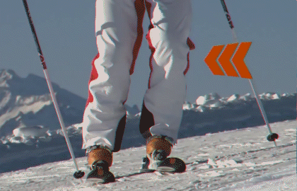

这个动作的核心要求，其实是重心和平衡的控制，这部分的基础要领在《 阿拉布：【双板教程--04】直滑降：第一次滑行，以及与后座的第一场战斗 》中进行了详细的介绍，如果做起来有困难，不妨回去复习一下。而从侧面向坡下方向倾倒、放平板底的过程，本身也是一个练习，称为 横滑降 ，后面会有具体的讲解。

放平板底滑动与下半弯可以组合为一个单独的练习，称为【基础平行•3•选修】基础平行单个转弯。但是需要注意这样转弯之后会有横向的继续向前的惯性，如果需要停止，可以略向山上多转一点。在启动和停止时可用雪仗的支撑来辅助平衡。

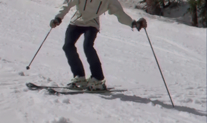

## 连续半弯练习

单个弯的练习效率偏低，我们可以通过放平板底滑动来连接两个下半弯，形成连续的练习。

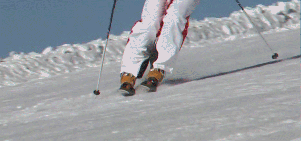

【基础平行•4•必修】这个练习也可称为“花环/Garland"，意思是它的轨迹就像一根节日装饰用的纸拉花。

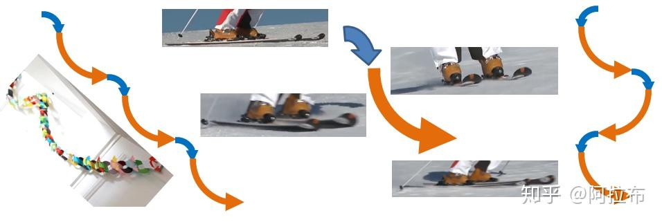

如上图，在一个方向上不断重复放平板底滑动--下半弯，就可以形成拉花一样的轨迹（上图左侧）。这样做的优点是可以练习多次重复练习同一个动作，练习效率比较高；缺点是会横穿雪道，需要注意观察雪道上方，并避让经过的其他滑雪者。

如果雪道较窄，可以采用上图右侧的办法，滑动至板尖朝下时，反方向转弯，这样占用的雪道比较窄，也不容易被后方来的滑雪者撞到。这样做，实际上就是（基础平行•3）：基础平行单个转弯的连续版本。

一定要记住，每（半）个转弯完成后，要恢复成基础站姿，再开始下一个循环。当能够连续和流程的完成花环练习，并且弯型饱满，姿态稳定，就可以结束这部分，进展到下一个阶段了。

## 横滑降与延伸练习

横滑降是很常用的练习，也是非常好的一个测试重心控制能力的标准：当横滑降能够做到启停自如、匀速滑动、且没有一点左右移动时，就可以证明滑雪者对重心的左右、前后控制都基本合格了。通过横滑降，可以延伸出一系列的练习动作，这里介绍常用的几个。

【基础平行•5•选修】“ 横滑降 （SideSlip）”包含了启动和匀速滑降两部分，通过身体倾倒的幅度来控制立刃角度，而立刃角度则决定了滑降速度。

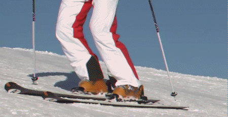

横滑降还可以用来练习两板平行状态下的控制能力。练习时以外脚承重来控制滑降，注意力放在内脚上，通过调整内脚压力/板距/立刃角度/，使两板保持平行。练习时注意：

1）重心需保持在两板中央，否则向下滑动时会发生向前或者向后的偏移，这样的话需要返回去练习正确的运动站姿和重心控制。

2）一定要选择平整的、或者较硬的雪面，否则高低不平的浮雪或者小雪包会卡住板刃，导致滑雪者向下翻倒。

3）稍陡一些的雪坡做起来会更容易。如果一条雪道有个别地方比较陡，不太敢滑，正好可以用来做横滑降练习。

【基础平行•6•选修】“ 横滑降停止” 也是一个练习，可用来强化立刃动作。在横滑降时，两膝盖向山上方向顶，两板从接近平放的状态变成立刃状态，阻力增大，滑动就会停止住。必要时用雪仗来辅助平衡。

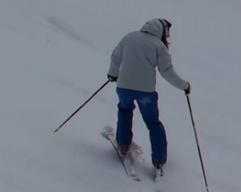

这个练习还有一个比较好的变化体是【基础平行•7•选修】“ 横滑降停止点杖 ”：停止时用两个雪仗的杖尖同时触碰山下板外刃，然后保持不动，用来练习精确立刃的能力。

【基础平行•8•选修】“ 斜滑降 ”说指向前/后有一定偏移的横滑降，比如下面的前向斜滑降。做这个练习时，需要板尖略偏向山下，但要保持好平衡。

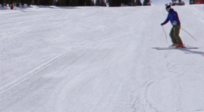

【基础平行•9•选修】在横滑降中任何控制前后的偏移就是“ 落叶飘 ”练习了。这是一个很好的控制重心前后移动的练习。

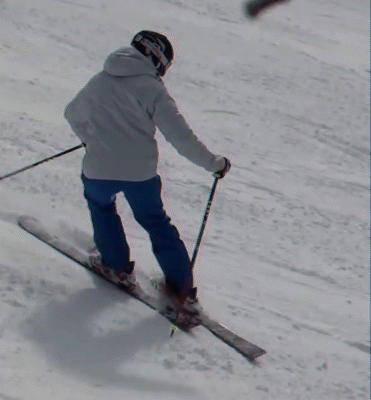

横滑降及其延伸练习就介绍到这里。

## ※声明※

1）本人在知乎发表的文字，包括专栏文章和回答，没有授权任何其他机构转载，如果在别处看到，一定是没有版权的，本人保留依法追责的权利。 2）本文为草稿，随时有可能更新，谢绝转载，请勿联系。 3）欢迎大家讨论、补充。有疑惑就敞开了问，简单的会直接回答，复杂的也可以在未来的章节里解释。 4）部分配图来自于网络，如有侵权，请联系我删除。

【修订记录】 2019.11.03 第一次发布 V0.10

【本文结束】
