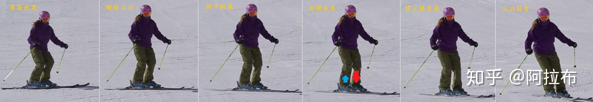
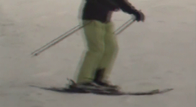
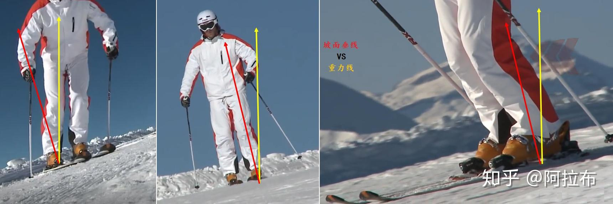
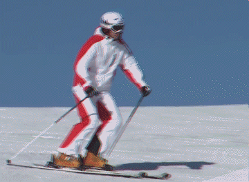
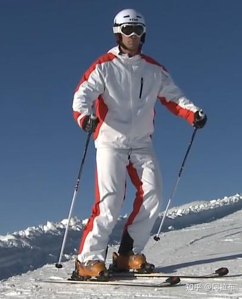

<!-- 来源: https://zhuanlan.zhihu.com/p/90399656 | 分类: 01_双板技术 | 发布: 2019-11-22 | 赞同: 109 -->

# 【双板教程--11】基础平行第二课：连续的单个弯+最关键的内容

> 原文：[知乎 · 阿拉布](https://zhuanlan.zhihu.com/p/90399656)　·　发布于 2019-11-22　·　本文仅供学习交流，版权归原作者所有

（V0.10：20191122，第一稿，不定期修正和更新）

在下半弯和转弯姿态基本熟练之后，我们就要学习完整的转弯过程，也就是把犁式转弯所欠缺的入弯部分补上。然而在真正学习入弯之前，还需要一个中继阶段来过渡一下，这是因为目前这个阶段的滑雪者，大部分还不具备真正的平行式入弯所需要的速度条件，以及在很短的时间内正确完成一系列动作的能力。

细心的读者可能会发现，上一章我们提到了一个练习，叫做"基础平行单个转弯"(练习#3)，这个练习是不是已经泄漏了平行式转弯的天机？从某种意义上讲，是的，这个动作连贯起来大致上已经可以算基础平行了。然而问题也就出在“连贯”上，初学平行的滑雪者，做单个动作可能没问题，但是要连贯起来，就需要大量的雪时了。

我们现在通过对问题的分解和专项训练，来为大家尽量减少这些雪时。首先必须要说明几个原则。

## 平行式学习中的基本原则

次序第一

现在这个阶段，动作的次序是最重要的。随着平行式转弯的学习，我们在雪道上的速度会越来越快，每个弯给我们思考和准备的时间也就越来越少。如果没有任何准备就开始学习完整的平行式转弯，换弯过程中很容易手忙脚乱，不知所措。而在一系列的动作中，漏过某个动作或者次序错误，滑行中就会出现错误，并且随着错误滑行的积累，就越发难以纠正。

次序的学习，必须从很慢的节凑开始，留给自己充分的思考和准备时间。这就是我常说的：先练慢，做对了，再练快。

对于滑雪来说，做快是很容易的事情，动作一瞬间带过去，似乎也看不出细节的对错。然而，当坡度升级，或者速度快到一定程序，这样滑雪的人就会感受到瓶颈。越是到高级阶段，基本动作的次序就越重要，因为在高速和苛刻的平衡要求下，这些平时可以模糊处理掉的错误细节，会造成非常严重的后果。

从初学开始，就把次序做对，无疑是最有效率的学习方法。

精简第二

有科学研究说，人的大脑一次只能记住7件事，这个数字对个人可能不一定准确，但人脑的并行处理能力确实是有限的。我们在滑行中，需要时刻注意周围的环境，要留意雪道上的滑雪者，要预测自己的滑行轨迹，因此，留给动作或者姿态的注意力是非常有限的。

好的教程中每个学习单元只会安排一个内容，前一个学习任务熟练之后，不需要再占用注意力，这样就可以再练习中全力关注当前内容，这才是效率最高的学习方法。所以，每一个练习的设计必须精简，每一次滑行也只能设定一个目标，牢记这个目标然后完成它，就能最快的进步。

回顾第三

我们自己在做练习的时候，每趟滑行之前，一定要想清楚该怎么滑，练习什么内容，该如何做。在一趟滑行结束后，一定要回想一下，滑行的目的是否实现，实现的怎么样。如果一趟下来，发现对想练的动作毫无印象，那就要检讨哪里出了问题，比如不能把注意力从外脚滑行中解放出来，那么就需要回过头去，继续练习外脚滑行相关的内容。

## 放平板底的滑行

上一课中，我们学习了放平板底的滑动，用来连接两个下半弯。这节课，让我们把滑动升级为“滑行”，用来填充上半弯。

在完整的平行式转弯中，这个动作是入弯的第一步，但对于初学者，其后的立刃动作比较难以直接在上半弯中做出，所以我们把“放平板底滑行”拉长，在雪板转过滚落线后再立刃，这样就容易多了。

动作本身非常容易，利用上一个弯的速度，放平板底后无须任何动作，雪板会一边向前（惯性）的同时，板尖会逐渐指向山下。当板尖转过滚落线后，衔接下半弯的动作，完成转弯。

而在这个简单的动作中，我们需要建立一个非常简单，但同时又是平行式滑行中最重要的一个概念：何为“上”？

当我们放平板底的时候，我们的身体必然是垂直于坡面的（中图），因为如果像平地站立一样按照重力线站立，雪板与坡面直接就会存在夹角，也就是相当于立刃状态了（左图）。而在滑行中，我们所说的“重心居中”，也是指重心沿坡面垂线的投影落在足弓上（右图）。

但是显而易见，这种姿态不可能静止存在，它只能出现运动中。在连续平行式阶段，我们所有需要学习的动作都是在运动中完成的，所以首先要适应速度，建立在一定速度下完成系列动作的能力，平行式的滑行能力才能稳步提高。

了解之后，我们在练习中就需要格外注意，首先接受沿坡面垂线站立的概念和要求，再进一步形成习惯，最好能做到在滑行中的任意时刻，重心都是在足弓“ 上 ”方（即按照坡面垂线投影），这就是“重心居中”的真正含义。如果能一直保持住重心居中，不但后面的学习能够越来越快，并且各种滑行都会受益无穷。

如果有点害怕速度，就先在更缓的雪坡上练习，等能够控制自己的动作后，对速度的接受程度就会相应提升了。这时候就可以升级坡度，继续进步。

## 连续的单个转弯

从上节的下半弯练习开始，然后利用下半弯结束时的少许速度，放平板底，耐心等待雪板旋转指向山下，然后再次进行下半弯的动作，这样就可以形成连续的滑行【基础平行•10•必修】。

上半弯的时间取决于初始速度（来自上个弯），一般来说并不长，而且上半弯的轨迹，最好是与下半弯对称，即弯形基本一致。如果放平板底后雪板在滑动中转向有点慢，可以略微用腿部拧转雪板，但是注意一定要用合适的力量，让雪板均匀的转向。

这个练习的重中之重是重心的控制，所以一定不能急，要慢慢体验重力带着你加速的感觉，然后通过搓雪转弯减速。一个弯完成之后，不要着急开始下一个弯，检查一下重心和站姿，然后再开始。 慢慢来，把动作做对，把次序做对 。

练习需要在比较缓和比较宽的雪道上进行，因为弯型会比较宽，小心雪道上路过的其他滑雪者，尤其是后方的鱼雷，建议 每个弯启动之前都回头看一眼 。

进入连续转弯之后，我们的双手又可以像犁式滑行时一样“闲置”了，这里再次提醒一下双手持杖的姿态：两手大约一杖宽，大臂放松向两侧自然打开，小臂略向下倾斜，保持双手在视野余光之内，双手尽量全程不动，但可以稍微用点力来辅助上身的稳定（想象抱住一个粗柱子一起转弯）。

## 常见问题

不像犁式的姿态天然就能保证大部分动作的正确性，平行式是一种很“自由”的滑行，在给予滑雪者各种可能性的同时，也导致大量的错误动作很容易出现在滑行中。本章节所做的练习，比较容易出现这些问题。

- 雪板旋转过快（WT#1）

通常是因为坡度有点陡了，或者害怕速度，在放平板底滑动的加速阶段，因为害怕而迅速拧动雪板，这样的结果不是转弯，而是刹车。一种解决的办法是换到缓一点的坡道上练习，另一种则可以试试直滑降小跳（教程04•直滑降•6），适应坡度和速度。

- 入弯速度太快感觉转不过来（WT#2）

典型的问题是因为重心调整太慢，在雪板放平转向山下时重心落后，导致这个过程时间太长，因此加速太多（更多的势能转化为动能）。从某种角度上讲，平行式滑雪是一个“勇敢者的游戏”，有些人会把放平板底的动作描述为“向山下扑”，那么越是勇敢的人“扑”得越果断越快，那么他消耗的势能就越少，获得的速度就比较低；而越是害怕的人，动作就越犹豫越慢，反而拉长了下滑的时间，消耗更多的势能，速度变得很快，反而更危险了。这里改善的办法跟上面一样，更缓的坡度（刹车能力足够的话也可以同样坡度）练习直滑降小跳。

- 犁式入弯/换弯时A板（WT#3）

这也是平行式阶段非常常见的一个问题，原因也很简单：动作的次序没有做对，还没有放平板底就开始切换新外板立刃。这里提了次序的原则，但是教程中还没涉及到这个问题相关的连续动作，只是放平板底的环节必须在这节课中练习到位。

- 转弯中V板/倒犁式（WT#4）

转弯中出现倒犁式，即板尖打开比板尾大，形似V字，是典型的内板承重导致的现象。通常出现这个问题时还会伴有较大的立刃角度，即滑雪者太想提高滑行表现，因此采用了不适当的策略。重新回到外板承重就可以解决问题。

- 上身压向弯内（WT#5）

身体早于雪板转向。出现这个问题的滑雪者需要回到前面的犁式环节来重新学习转弯，然后将犁式转弯时的内腿变成平行式内腿姿态即可。

- 后座（WT#6）

后座是我们从第一次上雪坡就开始的战斗，然而滑雪者并不能一劳永逸的杜绝这个问题，随着坡度、速度、新技术的升级，后座很可能一次又一次的出现。这是一个正常的过程，不需要太担心，但要一直保持重视。从后座的原因来分类，我们在直滑降阶段学习了如何解决基础站姿时的后座，在犁式转弯阶段解决了转弯过程中的后座，在平行式中还会面临两个新型的后座：入弯立刃动作不正确导致的后座，出弯/换弯动作不到位导致的后座。

具体的问题分析和改善方法，会在后续相关章节中详细说明。

## ※声明※

1）本人在知乎发表的文字，包括专栏文章和回答，没有授权任何其他机构转载，如果在别处看到，一定是没有版权的，本人保留依法追责的权利。 2）本文为草稿，随时有可能更新，谢绝转载，请勿联系。 3）欢迎大家讨论、补充。有疑惑就敞开了问，简单的会直接回答，复杂的也可以在未来的章节里解释。 4）部分配图来自于网络，如有侵权，请联系我删除。

【修订记录】 2019.11.22 第一次发布 V0.10

【本文结束】
