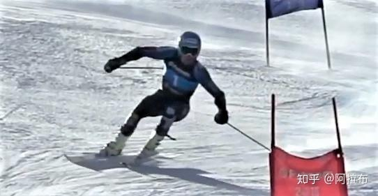
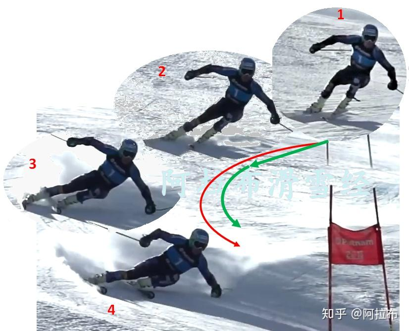
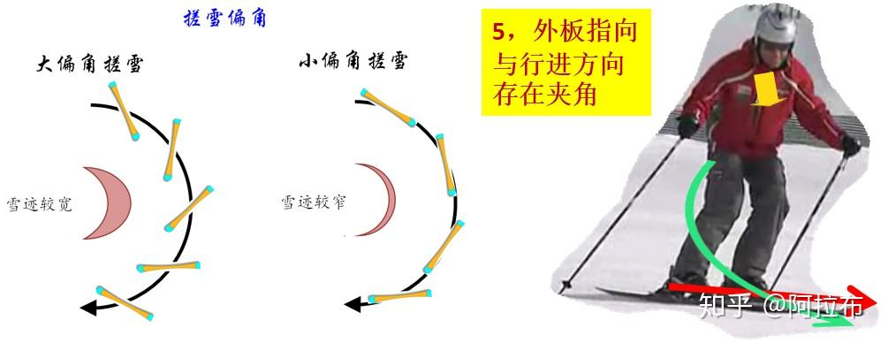
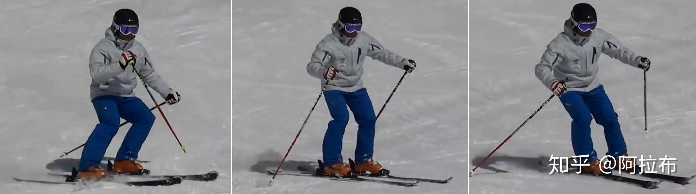
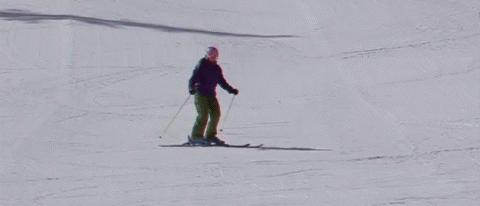
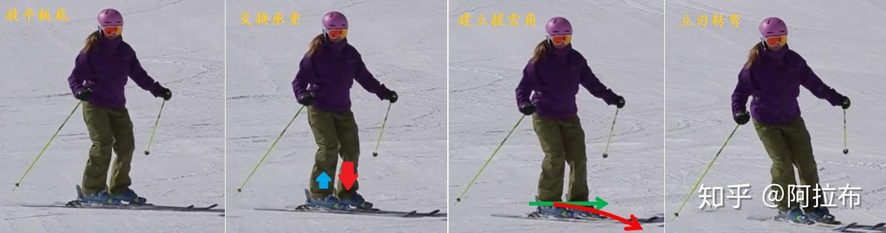
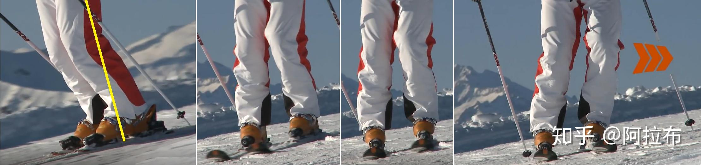
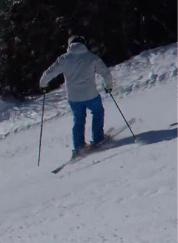
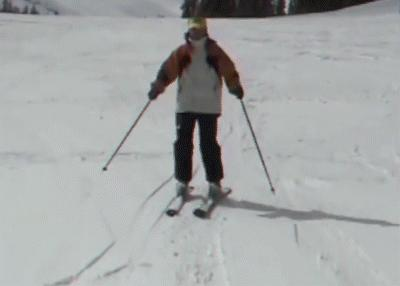

<!-- 来源: https://zhuanlan.zhihu.com/p/93500478 | 分类: 01_双板技术 | 发布: 2019-12-12 | 赞同: 147 -->

# 【双板教程--12】基础平行第三课：上半弯立刃

> 原文：[知乎 · 阿拉布](https://zhuanlan.zhihu.com/p/93500478)　·　发布于 2019-12-12　·　本文仅供学习交流，版权归原作者所有

（V0.11：20200105，添加附录的入弯后座和平行式刹车，不定期修正和更新）

到现在，我们还差一步就能够做到完整的基础平行式转弯了，这就是在上半弯就立刃转弯。但这一动作通常是与弯间的衔接动作一起完成的，所以我们需要从上一个弯结束时就开始做动作，然后一气呵成。

同时，我们还会在这里揭示动作中一些内在的、微小但是非常关键的要点。这些微小的要点，都是日后成为大神的基础。与其在瓶颈后再返工，吃尽改动作的苦头，不如一开始就慢一点，把基础打牢。这一章所讲的“上半弯立刃”，有不少滑了很久平行式的滑雪者也没有做到，然而他们打算进展到下一步“动态平行式转弯”时，却无论如何也找不到门路，就是因为这一步的欠缺。

虽然我们在这段教程中每次都只进步一点点，但是只要在这里打好基础，后面从动态平行到高级平行就会突飞猛进，那时候才是我们真正的收获季节。

## 上半弯立刃：想说爱你不容易

为什么不容易？因为这是一个非常不稳定的状态，“害怕”是我们身体的自然反应，比如下图：

Ted Ligety的这个姿态显然不合常理，他为什么没有掉下去？

因为速度，或者说，惯性。

因为Ted在高速运动，相对雪坡，他的身体具有强大的横向惯性，使之向一侧“抛射”（#1），而不至于马上跌落。而在非常短的时间内，他的雪板立刃切雪（#2），随后雪板支撑力对抗惯性，使身体停止横向运动（#3），开始快速转弯（#4）。在#3时，雪板已经回到能够支撑他的状态，结束了“抛射”。

我们在学习基础平行的阶段，不会有这样的高速运动，但是速度仍然是我们学习和建立转弯能力的关键之一。在第一课时，可以从0速度开始每一个“下半弯”；在第二课“连续单个弯”时，就需要带一点速度才能开始下一个弯，否则滑不出圆弧线路；现在是第三课，我们需要不低于第二课、但最好更快一点的速度，才能很好的完成动作（这里有点像学骑自行车，稍微有点速度才有走的稳。控制速度，保证安全，然后驾驭速度，才能不断进步）。

有个速度之后，这件事情就会变的容易了吗？显然没有，速度只是必要条件。只有尽可能缩短惯性滑行的阶段，尽早建立雪板对我们的支撑，才能实现这一目的。

## 先建立偏转角度再立刃

在立刃前先建立偏转角，就可以从脚下获得一定的阻力反馈，从而使得心理上对（向山下倾倒）立刃不再抗拒。这个技巧，或者说过渡动作，让我们能够通过获得搓雪阻力而克服恐惧心理，在上半弯完成立刃滑行。等我们对速度的容限更高、对姿态的控制更完美之后，我们就可以选择直接越过这个过渡阶段，入弯时就开始立刃。

先复习一下搓雪角与犁式/平行式姿态时与雪板朝向的偏角。

搓雪偏角的存在是我们能够搓雪转弯的直接原因。犁式转弯是通过打开板尾来建立这个偏角的，但是在滑行中一般会一直保持板尾打开的状态（这也是我们说犁式缺少平行式部分入弯动作的原因），所以犁式转弯中每个弯的搓雪角都已经预先建立了。在平行式下半弯的学习中，搓雪角是以一直近似“自然”的方式建立的：当板尖转过朝向山下，身体朝向按照犁式转弯的记忆与“自然”出现与雪板的偏角。现在进展到完整基础平行式，我们需要在每个弯的起始都有意识的建立搓雪角，并随着技术的进步和风格的变化，在以后的滑行中更加灵活的安排这一步骤的时机。

在平行式转弯中，当上一个弯结束时，身体朝向会比雪板更加偏向山下一点（图左），出弯后放平板底的同时，我们恢复基础站姿，此时雪板指向与身体朝向恢复一致（图中）。在这个过程中，因为速度和惯性的影响，身体朝向是不变的，改变的是雪板指向。那么在接续的放平雪板板底的滑行中，我们都了解板头会在身体重量的驱动下转向山下方向，此时继续保持身体朝向不变，就会形成所需要的偏角（图右）。

利用这个偏角，微微立刃，就可以感受到搓雪带来的阻力，此时雪板的支撑就建立了，我们可以从容流畅的完成搓雪转弯【基础平行•11•必修】。

## 注意事项

首先要选择合适的坡度和雪道。从缓一点的坡开始练习，对速度有把握之后再去更陡的地方。在目前这个阶段，弯会相对比较大，所以尽量选择宽一些的雪道进行练习，并注意避让经过的其他滑雪者。

其次是速度，尤其是出弯速度，要在自己的控制范围之内，但不能太慢，否则刚刚放平板底滑行，上一个弯带来的惯性就消耗完了，这样无法形成偏角，而是如同上一课一样，雪板带着身体直接转向了。

最后再强调一下次序，这个阶段最重要的任务之一，就是形成正确的动作次序，这样随着速度的增加，动作加快之后才不会错乱。

## 附一：入弯后座

平行式入弯的时候，如果滑雪者急于建立搓雪角，很可能采取向山下方向送出雪板的动作，或者说入弯伸腿以便尽快给雪板压力从而立刃，这就会导致雪板相对身体过于超前，于是产生了后座。这是很常见的现象，最典型的表现就是入弯就后座，持续到出弯，然后通过换弯时的大幅度动作调整过来，并且认为这是正常的过程。

问题的解决就是按照上面的正确动作来实现立刃，注意两个要点：在身体的惯性前进方向建立阻力，而不是向山下；不要伸腿，而是保持重心居中的姿态、跟随雪板运动的同时，感受脚下的压力变化，尽可能早的立刃。而加速立刃的办法，需要在以后的动态平行式阶段才开始学习，目前最重要的是打好基础，建立正确的姿态和动作次序。

## 附二：平行式刹车（HockeyStop）

平行式刹车也叫冰球刹（HockeyStop），有两种实现方式，称为“侧身急刹”和“侧身转停”，通常前者停止比较快，也就是这部分要学习的内容。对于当前阶段的滑雪者来说，这个动作的基础已经具备，但不得不说，还是很难做到标准的侧身急刹，主要是因为后面的立刃和平衡技能还不够熟练。

在【双板教程—10】中我们学习了两个练习，分别是（练习2•放平板底的滑动）和（练习6•横滑降停止），这两个练习就是侧身急刹的基础。不过，（练习2•放平板底的滑动）是要反过来多的，也就是从放平板底滑行状态反向回到横板立刃。动作最关键的要素是重心居中，也就是上一节所强调的重心在足弓之“上”（下面左图黄线）。

雪板回到横放状态时，需要立刃变成横滑降状态，之后利用横滑降停止的动作就可以完成平行式刹车了。

最后停止时需要注意姿态要平衡，并在雪板（腿部）停止后上身继续向前弯曲一点，利用上身来抵消最后一点惯性，并可用点杖辅助最后的平衡。同时，这也能有效的防止停止动作过猛，导致倒向山上。

完整的侧身急刹【基础平行•12•必修】，重点在于重心居中，以及后半段的立刃搓雪和平衡。重心居中才能尽快放平板底，放平板底才能迅速旋转雪板；立刃快速准确才能尽快开始搓雪减速，同时立刃后保持重心居中才能保证刹车时不会前后偏移；最后的平衡能力是停止后不倒地的关键，这个平衡与滑行时平衡在外板上的姿态（反弓）基本是一致的。

平行式刹车中的侧身急刹相对比较简单，但是要掌握好需要很好的基本功，因此也可以多多练习来提高对重心控制、立刃、反弓等姿态相关技能的把握。

## ※声明※

1）本人在知乎发表的文字，包括专栏文章和回答，没有授权任何其他机构转载，如果在别处看到，一定是没有版权的，本人保留依法追责的权利。 2）本文为草稿，随时有可能更新，谢绝转载，请勿联系。 3）欢迎大家讨论、补充。有疑惑就敞开了问，简单的会直接回答，复杂的也可以在未来的章节里解释。 4）部分配图来自于网络，如有侵权，请联系我删除。

【修订记录】 2019.12.12 第一次发布 V0.10

2020.01.05 添加附录的入弯后座和平行式刹车 V0.11

【本文结束】
