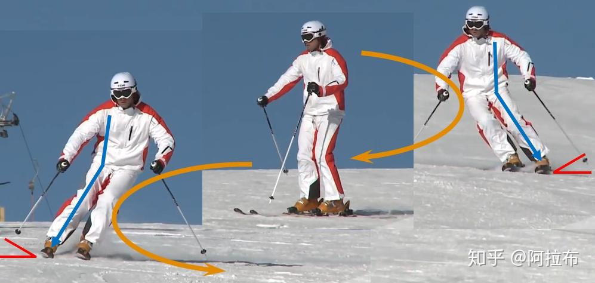
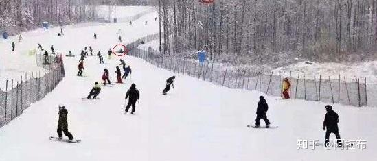
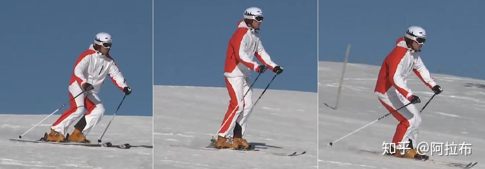
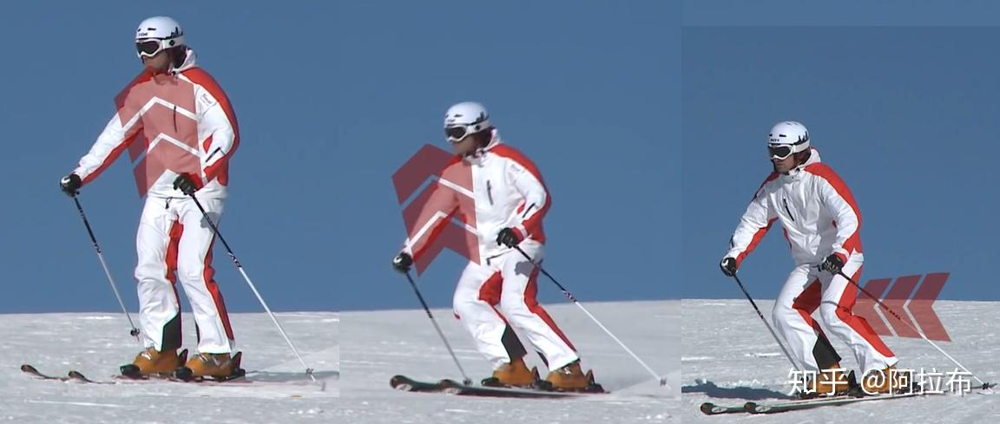
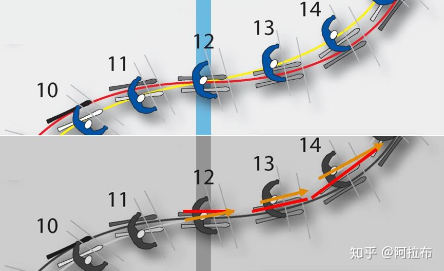
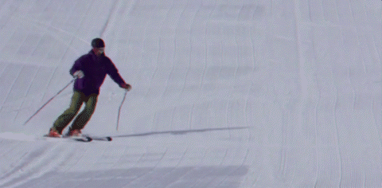
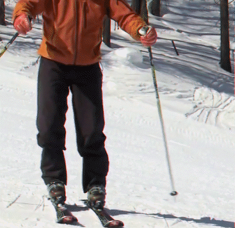
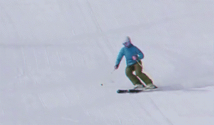

<!-- 来源: https://zhuanlan.zhihu.com/p/98848451 | 分类: 01_双板技术 | 发布: 2020-01-06 | 赞同: 115 -->

# 【双板教程--13】基础平行完成篇：连贯换弯，引身，点杖

> 原文：[知乎 · 阿拉布](https://zhuanlan.zhihu.com/p/98848451)　·　发布于 2020-01-06　·　本文仅供学习交流，版权归原作者所有

（V0.12：20240427，点杖改为基础平行阶段选修内容）

我们从最简单的下半弯开始学习平行式转弯，逐渐延伸到整个转弯。然而在平行式滑雪中，转弯时的技术虽然很重要，但还有更复杂的另外一个过程：弯的接续，也就是换弯。只有掌握了连续转弯（Linked Turn），我们的基础平行式学习才算完整。

我们在上一课学习到延续上一个弯的身体朝向，这只是换弯过程中的很小一部分。在这一课，我们要了解从上一个弯到下一个弯的完整过程，并学习一种最常见的换弯动作：引身。

随后，我们将通过学习点杖来强化换弯，辅助转弯姿态的建立，并增加滑行的稳定性。

## 从上一个弯到下一个弯

在S形的平行式滑行线路中，从一个弯到另一个弯，会有哪些改变呢？

1）首先是转弯方向发生改变，比如向左转弯变成向右转弯；

2）为改变转弯方向，必须改变立刃方向，或者说刃的切换，比如从两板的右侧板刃，切换到两板的左侧板刃。而立刃是身体内倾（Inclination，不是内倒Banking）的结果，因此立刃的切换需要身体重心从板的一侧移动倒另一侧，即重心移动轨迹穿过雪板轨迹（X交叉）；

3）同时，因为外脚承重的原则，外侧脚也必须进行切换，通常称为“承重转移”；

4）随转弯方向的改变，搓雪角变成相反，因此需要重新建立新的分离。但如上一章所讲，身体朝向在换弯时要保持不变；

5）随着转弯的进行，重新建立方向相反的反弓。

以上这些改变，是我们必须要做的事情，但对于初学者，并不是同时去做，而是按照正确的次序逐一完成。在以后更高的阶段，可以同步一些动作，比如重心穿越和立刃；也可以延缓一些动作，比如分离。

下面我们对基础平行滑法中，这些改变以及所必须做的动作逐一进行说明。

## 换弯第一事：路线规划

下一个弯开始之前，就必须要想好要往哪里滑，滑多大的弯，然后才能确定应该采取的姿态、技术动作等。

上一个弯转过弧顶之后，视线就已经转到下一个弯的方向，可以从容观察前面雪道是否平整、空旷，是否有需要规避的障碍，如雪包、光板、摔倒的、坐着的、减速标志、低速滑行者、 可能突然改变方向的滑行者 、等等。观察完毕后，根据自己的滑行能力来决定下一步的动作，如立即停止，立即转弯，正常转弯，延后转弯等。

在视线不好的地方，如雪道中大的起伏，最好先减速，到达起伏的坡顶后再决定下一步的线路。否则高速冲上坡顶后，突然发现坡下面坐了一排人，那就麻烦了。同时，遇到这种雪道上大的起伏，不要从靠近两侧的地方通过，毕竟就算有人不要命也要坐在坡下休息，通常也不会坐在中间。

*红圈处，起伏再大一点就会是上方的视野盲区*

## 换弯第二事：引身

单纯的引身，就是指身体的伸展（Extension）。由于立刃的原因，我们在出弯前内腿是曲缩的，同时为了抵抗滑行中的离心力，躯干通常也会略有曲缩，在出弯并恢复基础站姿的时候，必然身体会有一点伸展。这个伸展动作，就是“引身”这个词的由来。

然后我们开始下一个弯，再次立刃时新的内腿开始曲缩，同时胯部为了即将到来的离心力略微前屈。这个与引身正好相反的“身体收缩”，虽说目前这个阶段可以与引身分开来做，但是在以后连贯快速的换弯中，因重心在整个过程中沿同一个方向持续移动，所以实际上是一个连续的动作，或者说是引身之后自然的后续动作。

在当前，我们需要一个明显的恢复基础站姿的阶段，因为在这里我们需要完成三件事。

首先是解除立刃，放平板底，确保身体重心是 沿坡面垂线 在足弓之上。因此在引身时，我们需要一边伸展身体，一边让身体向山下移动，形成放平板底的基础站姿。

其次是向前恢复居中的站姿。在出弯的时刻，尽管沿前进方向重心保持居中，但因为上身向山上的内倾，从滚落线投影方向看，我们的重心是略有落后的。因此，放平板底的同时，还要让身体向前移动（或者向后拉双脚），这样才能恢复居中的站姿。

*Up and Forward*

再次是分离的解除，这是与引身同步进行的。在出弯前，我们身体朝向与雪板指向之间有一个夹角，但在恢复到基础站姿时，两者是完全同方向的，这个夹角在引身的过程中消除了。在向上向前伸展身体的同时，两个脚同步的放平板底并自然滑动，让雪板变成与身体朝向相同的方向，上一个弯的分离就消除了（下图位置13）。

*Bob Barnes: Basic Parallel Turn (Part)*

而下一个弯分离的建立，取决于将采取的滑行方式，或者与滑行水平相关。我们目前的策略是先建立分离，产生搓雪角之后再立刃。等熟练了之后，就可以分离与立刃同步进行。再以后进阶到更级的阶段，也可能会先立刃，在需要的时候再建立分离。

三件事之中，最重要的是放平板底，尤其是旧外板。如果旧外板还在立刃状态，新外板也开始立刃，就会出现两板同时立刃的情况——这不就是犁式吗？这就会导致犁式入弯的现象（A板入弯）。因此，在目前的阶段，一定要把“放平板底-立刃”的感觉和动作次序练熟，将来的进步才不会被这个问题阻碍。

## 换弯第三事（完成）：承重转移

在上一个弯结束时，主要的重量是放在旧外脚上。而下一个弯，立刃之前，就必须把主要重量放在新外脚上。承重的转移，就发生在中间的放平板底恢复基础站姿的过程，通常建议放平板底时双脚均匀承重，然后承重转移并立刃。

承重转移也可以早于放平板底，这样恢复基础站姿时就已经是新外脚承重，下一步的立刃会来的更快，动作衔接更连贯。但更早的承重转移会增加学习的困难（旧内板的控制），时机把握不好会导致失稳、不平行等问题，因此目前阶段还是建议在放平板底后再做承重转移。

如果承重转移做晚了，就会出现入弯压内脚的情况，通常会出现倒犁式、K腿、转不过弯等问题。

目前刚刚学习基础平行时，引身与入弯是分开的，因此可以从容的进行承重切换。在今后更高的阶段，两个动作连贯起来后，承重转移就会被包含在这个连续的动作之间，一方面新外脚承重的时机会变得不明显、完全由自己把握；另一方面，承重转移的时间窗口变得很小，稍不熟练就很容易发生过早或者过晚的情况。因此现在一定要练好动作次序，在立刃入弯前完成承重交换，形成习惯才能在下一阶段游刃有余。

## 带有引身换弯的基础平行转弯

一旦承重转移完成，就可以开始下一个弯，换弯阶段也就结束了。这之后，就可以按照上一章的内容，从上半弯开始立刃，然后完成转弯。

将上面三件事组合起来与完整的单个转弯结合，就是带有引身换弯的基础平行转弯【基础平行•11•必修】。

## 点杖

点杖（Pole Plant）是平行式滑行特有的内容，但并不是必须的。犁式不需要点杖，平行式也可以不点杖，但点杖对于滑行是有好处的，尤其是基础平行式，对于换弯动作和滑行节奏帮助很大。

我们之前讲过持杖的动作，点杖在这个基础上，仅仅是增加了手腕的前后摆动。

在换弯的过程中，保持两臂持杖姿态不动，手腕向前摆动，在入弯时杖尖触地，然后手腕再向后摆动，就完成了点杖的过程。然而，我们看到的标准的点杖，似乎动作范围比这个描述大的多？是的，这是因为整个身体在向山下和向前移动，或者说，引身的作用。所以，点杖的要诀是 只动手腕，雪杖向下个弯内的移动是由身体带动 。

所以，开始点杖，身体就会向下一个弯移动，出弯也就开始，这就是点杖可以创造节奏的原因。而杖尖点地的时刻，通常标志着已经立刃，并开始稳定滑行。因为从放平板底到立刃，通常姿态是不稳定的，点杖会增大支撑面积，创造更稳定的环境，从而让滑雪者从容实现姿态（内倾与离心力）的平衡。

此外，点杖还会阻碍身体一侧向前的运动趋势，这就创造出一个短暂的、轻微的力矩，使得整个身体加速转动，滑雪者通过姿态的控制可以让这个加速只作用在雪板上，因此可以更快的实现分离和立刃。这种阻滞产生回转的效果（Blocking）在小回转和某些高级别滑法中比较明显，当前的基础平行阶段也可以用，但不必刻意去追求。

点杖最容易犯的两个错误，一是向下一个弯内伸手，这是大多数未经训练的滑雪者的自然倾向，只要学习了正确的点杖动作就可以纠正过来。二是点杖后，手臂向后甩动，部分人是因为杖尖点地过于用力，雪仗受到的阻力太大，导致胳膊被顶向后，另外一部分人纯粹是因为双臂过于放松，没有保持基本的持杖姿态。杖尖点地的动作，必须很轻柔，并非要雪杖真的支持身体，而是创造一点点支撑就足够了，相当于用杖尖在雪面“向后挑（划拉）”一下。

带点杖的基础平行转弯【基础平行•14•选修】，是本阶段的最终形态。

今天的动作学习完毕，到这里基础平行式转弯的所有内容也就都完成了。基础平行虽然相对简单，但是很多基本功都已经体现在滑行中，需要多加练习。下一章将介绍多个平行式常用练习，来帮助大家尽快掌握基础平行式滑行，为下一步学习更高级的滑法打好基础。

## ※声明※

1）本人在知乎发表的文字，包括专栏文章和回答，没有授权任何其他机构转载，如果在别处看到，一定是没有版权的，本人保留依法追责的权利。 2）本文为草稿，随时有可能更新，谢绝转载，请勿联系。 3）欢迎大家讨论、补充。有疑惑就敞开了问，简单的会直接回答，复杂的也可以在未来的章节里解释。 4）部分配图来自于网络，如有侵权，请联系我删除。

【修订记录】 2020.01.06 第一次发布 V0.10

2020.03.03 修正立刃与犁式入弯关系 V0.11

2024.04.27 点杖改为基础平行阶段选修内容 V0.12

【本文结束】
