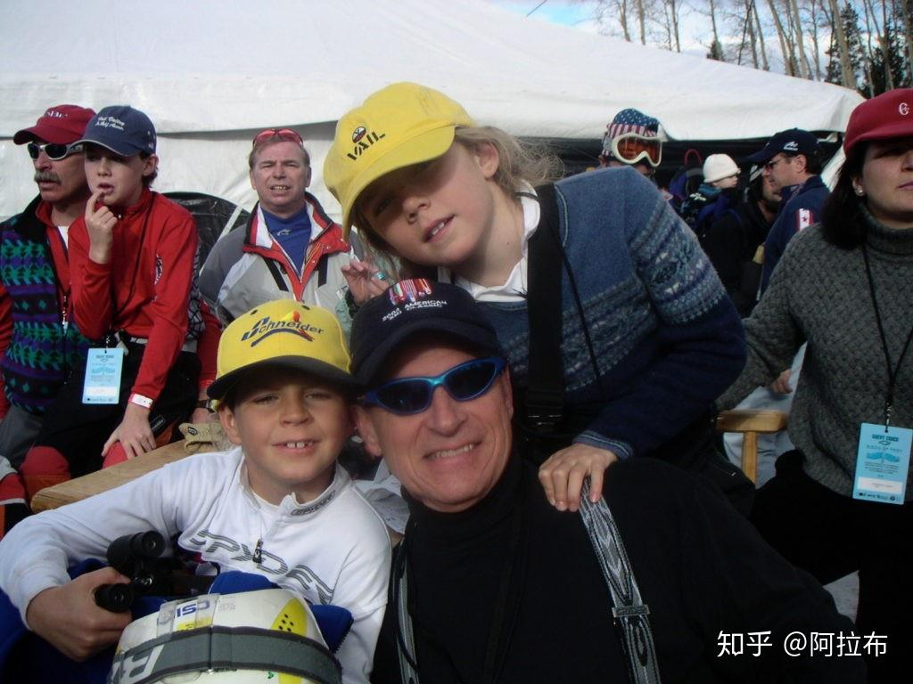
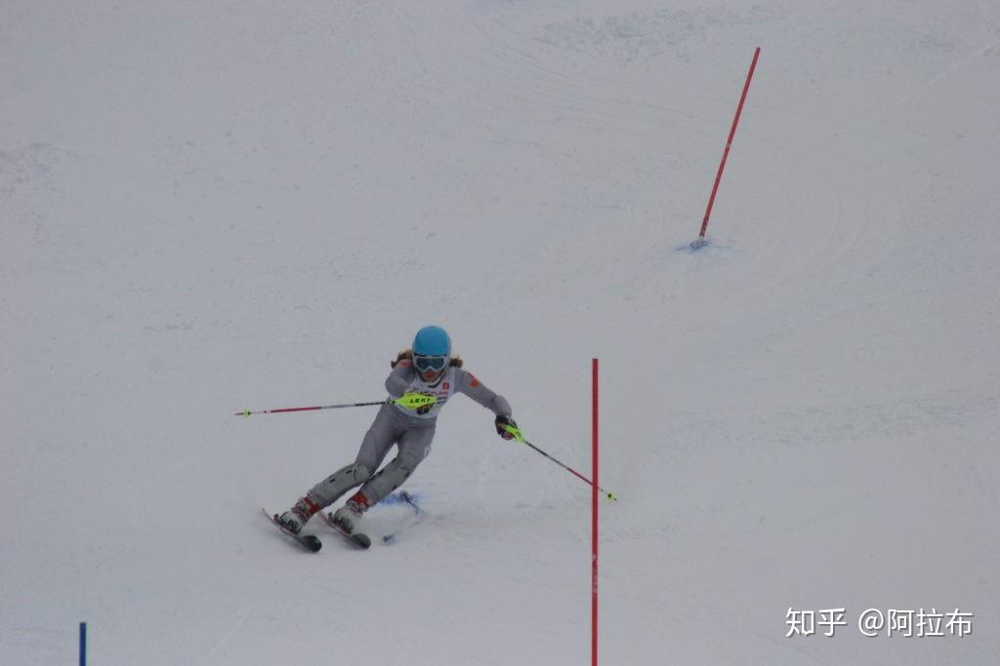
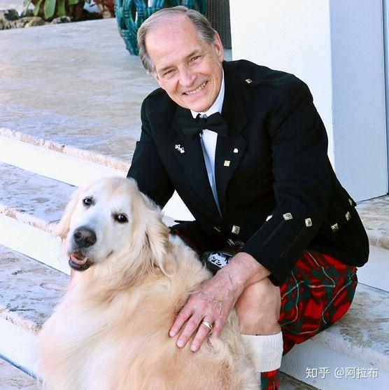

<!-- 来源: https://zhuanlan.zhihu.com/p/101897339 | 分类: 01_双板技术 | 发布: 2020-01-09 | 赞同: 18 -->

# 【翻译】Mikeala方法

> 原文：[知乎 · 阿拉布](https://zhuanlan.zhihu.com/p/101897339)　·　发布于 2020-01-09　·　本文仅供学习交流，版权归原作者所有

本文由Mikeala家庭密友，资深竞技滑雪发展的赞助和管理者Dan Leaver于2020年1月1日发表于Ski Racing 的 Fall Line 专栏。由阿拉布未授权翻译，因为联系作者的途径是Facebook，Twitter，GoogleMail，本布无能为力了。

进入2020年成为Ski Racing Media的新所有者，我想以新的名字-Fall Line重新介绍“Black Diamond”专栏。Ski Racing的长期所有者兼首席执行官加里·布莱克（Gary Black Jr.）用这个专栏来讨论对竞技滑雪界至关重要的事项。我将定期以这种格式投稿，尤其是以我对北美滑雪比赛的发展及其在世界舞台上取得成功的热情。在这方面，我认为写一写北美目前首席运动员的文章是合适的。她的方法和到达顶部的道路可以为所有人参考。

Mikaela Shiffrin，可以说是这项运动中最出色的年轻滑雪选手，如果我们以其历史胜利率的一半甚至快进的话，她注定将成为目标人物。更重要的是，她是我们这项运动中不断成长的年轻人中令人惊叹的榜样。

我很早就意识到的其中之一就是，Mikaela 的母亲Eileen Shiffrin，是天生的教练。我对此有独特的见解，因为自从“ Miki” 在学前班里课休时试穿我儿子Alex的鞋子以来，我们的家人一直是非常亲密的朋友。在Alex和Mikaela 第一次穿上塑料雪鞋之前，Eileen和我一起参加了大师赛。Eileen是一位非常熟练的大师级赛手，而我只是一个初学者。我最开始训练的某天，Eileen注意到了这一点，将我拉到一边说：“你知道你在做什么吗？你会自杀。我让你看看这有多危险。”

众所周知，Eileen和Mikaela 的父亲Jeff从她很小的时候就开始参与运动员发展。这一直是Mikaela 成功的秘诀之一。她并非是带着雪板出生直接就能滑出在完美的转弯，而是从小开始就正确地学习滑雪。

*Alex和Dan Leever在Mikaela Shiffrin的第一个赛季就与她在一起。Jeff和Taylor Shiffrin在合照的背景中。照片由Dan Leever提供*

Miki很少进行无目的的滑行。我与孩子们一起滑雪的第一个回忆是Miki的哥哥Taylor在前，领着Miki滑行，随后Jeff大喊“膝盖靠向雪板！”——重心向前的一种引导方式。在Vail的韦尔山学校的幼儿园里，整个学校在星期五都滑雪。在第一个滑雪周五，他们让所有幼儿园的孩子一起滑下兔子坡。然后，一名滑雪指导员将每个孩子分到1至3组。Miki最后一个滑下，每个弯都做出了完美的点杖动作。指导员说：“我们没有适合你的组。”

专业科学中有一个术语称为“ 刻意训练 ”（译注：Ericsson 1993）。它主张只有通过有目的和系统的方式进行练习，才能培养出真正的世界级专业人士。刻意训练涉及执行一项适度挑战的技能，稍微超出当前的舒适范围，并提供定期反馈。当我们实现进展后，我们会适度地向前移动目标，然后再次执行。一遍又一遍地练习相同的技术，就是“我们开车数千小时，却仍然不是一级方程式赛车手”的原因。

Mikaela一生都采用这种提升的方法学。练习的量不重要，重要的是你 如何 练习。

这使我想到了Mikaela的第二个秘密。Jeff和Eileen将他们整个成人滑雪生涯致力于帮助他们的孩子进步。他们告别了大师级比赛和大部分休闲自由滑雪活动。孩子们六岁时Eileen和我去了Vail滑雪俱乐部，并组成了一个特殊的六岁小组，因为那时没有一个小组如此年轻。Eileen是教练，我是“牵引员 (Drag Man)”，跟着孩子们下来帮助他们乘缆车或在他们跌倒时扶起来。这些六岁孩子中，6六个中的5个加入了少年或高级世锦赛队（1位自由式，1位多项）。在粉末天的比赛中，我们没有自由滑，而是手动用耙子或雪板推平雪道。孩子们注意到了。

第三个秘密是过程和文化。Shiffrin从未谈论过结果。她总是谈论滑行。这无关输赢，而是进步，以及每个人生存和呼吸的滑雪比赛。Shiffrins一家在夏天度假时区欧洲滑雪，始于Miki 8岁，整个家庭都去。当我们的家人聚在一起时，我们总是谈论滑雪比赛。我们都沉迷于这项运动。在那种环境中成长时，怎么可能不被滑雪虫咬伤呢？在视频方面，我向您保证，从来没有人比Shiffrins观看过更多的世界杯视频。可以通过生动想象的图像对潜意识进行编程，就像在实际练习中一样。观看视频延长了Mikaela的培训时间和雪龄。

*Shiffrin在惠斯勒杯上作为U14参赛。照片由Dan Leever提供*

Eileen参与了Mikaela的所有技术进步。Mikaela与她的教练一起训练，然后她和Eileen会在晚上观看视频，以确保语言和对进度的讨论一致。这种类型的父母参与并不适合每个人。一些运动员喜欢用自己的方式锻炼。这里没有唯一正确的方法。但是，我们当然不能说这种方法有什么问题。它创造了许多世界一流的运动员。走向世界一流的旅程需要家庭付出巨大的努力和高昂的代价。带父母一起旅行的最好方法是让他们参与进来。Shiffrin是个招牌范例。在Eileen执教Mikaela的过程中，Jeff一直担任管理者，负责组织旅程中的所有复杂细节。这是他们的家庭事务。

Leever Partners发布了一份滑雪进度报告。它的标题是“ 滑雪比赛中没有失败者” 。明年，我们将在《Ski Racing》中摘录部分。起这个名字的原因以及为什么与Mikalea的旅程有关就是我们的研究内容，其中包括对我们的运动思想领袖的访谈，对世界杯运动员的调查，深入的统计，以及得出的两个主要结论。

首先，这个标题是因为，我们发现几乎没有人为他们的旅程感到后悔，无论他们在何处结束。从根本上并且至关重要的是，我们发现滑雪比赛的本质上对每个参与者都是有益的。一遍又一遍，人们告诉我们要重新调整目标，从奥运会到美国滑雪队，到NCAA，到USCSA，再到俱乐部和大师赛。我们没有听到任何有关后悔的故事。酷！

该研究的第二个主要发现是， 如果 您的目标是世界杯，则需要做出 巨大 的付出，很多是整个家庭的付出。通常，它需要从很小的时候就开始，并且要承受非常极度沉重的、高质量的、多年的训练。Mikaela不是天然的怪胎，而是这种方法的产物。

有一点并没有广为人知，Mikaela是在很少的比赛中成长起来的。Shiffrin的重点始终是对技能的掌握。追逐比赛，也就是让运动员环游世界参加比赛，会适得其反。年轻时的身体之外的结果与最终成功几乎没有关系。相反，省钱，建立世界一流的基础，无需任何追逐比赛，结果将会自动到来。滑雪比赛开销的“军备竞赛”，尤其是旅行，会适得其反，其原因是身体的磨损和疲惫，以及缺乏时间进行高质量的训练。在美国，我们的年轻运动员在国际上取得了不错的成功，但是成人运动员一直在挣扎。这是因为在较容易的山丘上，相对较容易的雪面，获得的结果不会转化为达到世界杯水平所需的成功技能。在美国，我们需要在坡地准备，建造地形，引入难度，适合年龄，雪面准备和路线设置方面更加严格。然后，我们需要刻意训练-很多！如果这样做，我们将像奥地利人，挪威人，意大利人和法国人一样，在世界杯第二轮中拥有多名运动员。Mikaela的方式是我们所有人都能效仿的模型。选择在于我们自己。

Dan Leever Chairman

- Dan Leever brings more than 30 years of experience growing and managing companies and has an extensive background in ski racing. He is currently a Board Member and a member of the Executive Committee of Ski and Snowboard Club Vail, he was a prior Board Member of US Ski and Snowboard, and Trustee of the US Ski and Snowboard Foundation. He is active in ski industry investments serving as Chairman of SYNC Performance, the World Pro Ski Tour, along with Ski Racing Media. Additionally Mr. Leever is an Operating Partner of PWP Growth Equity, a private equity fund. For 25 years Mr. Leever served as CEO of Platform Specialty Products Corporation (now Element Solutions) of West Palm Beach, FL, and its predecessor companies. PSP was a multinational specialty chemical manufacturer with revenues of $3.7 billion, over 8,500 employees, and operations in 100 countries.
