<!-- 来源: https://zhuanlan.zhihu.com/p/103919812 | 分类: 01_双板技术 | 发布: 2020-03-02 | 赞同: 285 -->

# 【双板教程--14】基础平行专项练习（一）：重心居中和外脚承重

（V0.10：20200302，第一稿，不定期修正和更新）

平行式转弯是一种自由度很高的滑行方式，从入门到各种高级滑行方式，姿态的变化范围非常大，这也会导致滑雪者很容易在滑行中做出错误的姿态而难以察觉。尤其是刚刚学会基础平行式的雪友，对滑行的正确姿态还不熟悉，这就需要在学会基本的滑行后，通过各种练习来固定住正确的姿态，最终形成身体记忆。

在 《双板技术--03：无立刃不平行》 中，我们总结了平行式转弯的基本要求，前四句口诀是：

重心居中，外脚承重，适度分离，两板平行

这几句口诀，正好指出了我们的练习次序：首先要加强重心的掌握；在重心基本居中之后再练习外脚承重（即外板上的平衡），包括外脚平衡能力，以及反弓、分离等姿态练习；最后在外脚能力满足后，修正内脚姿态，实现两板平行。

后四句口诀中，“ 流畅画圆，弯形饱满 ”是要自始至终贯彻在每个转弯中，“ 引身点杖 ”“ 节奏稳定 ”则主要是对换弯的要求。在平行式滑行的更高级阶段，换弯的练习非常多也非常重要，但现阶段则主要还是以引身和动作次序这些基础要求为主。

基础平行阶段所有的练习都应该在平整宽阔的初中级道上进行，中级道需避开比较陡的地段。用中低速度滑出大弯，以便有充分的时间来完成练习动作。

## 重心居中练习

粗略的讲，假设正常人重心控制能力的满分为100，那么在初级道只要20分就可以做到正常滑行（即有点落后但不影响转弯），中级道30分就能滑，高级道40~50分，自由式、雪包或蘑菇、竞技等的入门水平大概需要60分，80分基本上就是国内顶级水平了，但要参加国际比赛还是要练到100分甚至更高（至于世界杯水平的选手，大部分是超过100的，不要当他们是正常人）。

所以，滑行中对重心的掌握不是一蹴而就的事情。随着坡度、速度、技术的增加和提升，对重心控制的要求越来越严格，所以经常出现“明明中级道时重心已经对了，一上高级道又落后”这种类似的情况。反过来，我们也可以在当前比较舒适的雪道上练习技术，然后去陡一点的雪道来检验练习效果。

【基础平行•15•选修】 换弯夹小跳

基础平行转弯的角度应该接近180°，出弯的时候是面向雪道侧面的，此时继续向前直线滑行的同时，微微向上小跳，可以保证站姿是居中灵活的，然后放平板底、恢复基础站姿，并开始下一个弯。

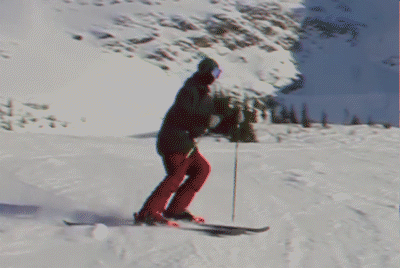

注意在很缓的坡时，身体沿重力线站立与放平板底垂直与坡面的角度差不多，但在陡坡时差别就比较大了。一开始练习小跳，还是沿重力线起跳比较方便。熟练之后可以尝试垂直坡面小跳，注意此时起跳和落地之间会向坡下移动一点距离。

另外有一个练习是从引身直接起跳，落下后直接立刃入弯，到将来的动态平行转弯阶段才能用到，目前千万不要按照那个样子来练习。

【基础平行•16•选修】 搓脚弯

弯中的重心练习最容易的一个就是“搓脚弯/ShufflingFeetTurn”，在滑行中两个脚前后交错移动，以检查重心在滑行中是否居中和灵活。注意，这个练习在转弯中是两脚均匀承重的，因此一旦能够做到，就不用过多练习了。

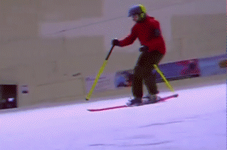

【基础平行•17•选修】 千步弯

（StepTurn）这个练习要更难一些，但也更有用，世界杯运动员有时候也会用这个动作来热身。在滑行时交替抬起两只雪板，像“原地踏步”一样（想象一下，雪板在走，而我们只是在雪板上原地踏步）。注意重心在两个脚之间来回切换时保持上身稳定。

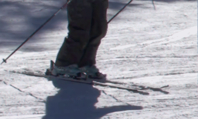

【基础平行•18•选修】 小跳弯

（LeaperTurn）难度更大，但对改善重心靠后的效果非常好。把自己变成一根弹簧，落地时最好 板尖先着地 。这个练习的关键在于：勇敢向前跳。练习中以外脚承重为主，但是在开始的时候可以两脚均匀承重。

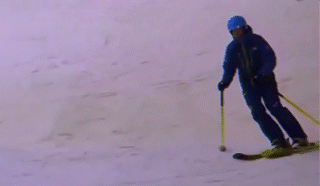

【基础平行•19•选修】 倒滑

（SwitchTurn）看起来挺难，但实际上就是个重心练习，重心对了很容易做到。在比较宽的雪道上，倒着做出柔缓的平行式转弯。滑行中越过山下肩观察下方情况 。如果不知道如何起步，可从 落叶飘 （ 教程10—基础平行•9•选修 ）这个练习开始。

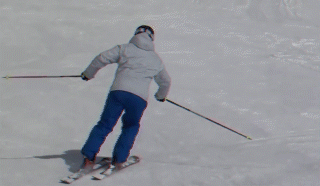

## 外脚承重练习

外脚承重是我们从第一个转弯就必须要贯彻的原则，如果一开始就能做好，在后面的学习中就会受益无穷，避开很多别人常见的错误。

外脚承重的实质是在外板上的平衡，当这个平衡实现的时候，内脚就可以解放出来，才有可能与外板同步。实现外板上的平衡，有两个关键点：平衡的能力，平衡的姿态，在外脚承重练习部分我们主要关注前者，即外脚承重的能力。

在练习外脚承重之前，务必完成重心居中的练习，因为落后的姿态会锁住两脚的灵活性。重心没有达到当前最低要求时，做其他练习基本上就是浪费时间——可以学，但练不出来，除非在练习中把重心也一起练对了。

【基础平行•20•选修】 内脚踏步

这是一个比较简单的过渡性练习，在转弯中不断抬起内板，强迫外脚承担更多的重量，然后放下内板辅助平衡。当感觉不需要放下内板时，可以转到下一个练习。注意内板起落过程中尽量板尖比板尾更接近雪面、或一样，一定要避免板头距离雪面更远的情况。

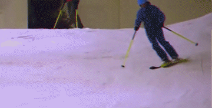

【基础平行•21•选修】 下半弯抬内脚

先从比较容易的后半弯开始，抬起内板，仅用外板滑行。内板抬起越早，说明外板上的平衡建立的越快。一开始的时候可以等板尖转过滚落线再抬内板，然后慢慢把动作提前。

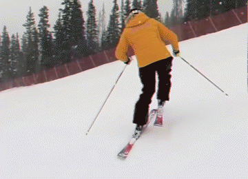

【基础平行•22•选修】 单外脚入弯

Mikaela Shiffrin 把这个练习叫做“Get over it”，是她认为最重要的基础练习之一。放平板底开始入弯时，迅速抬起内脚，从而以最快的速度建立外脚承重并开始立刃入弯。入弯后可放下内脚，或者在熟练后，不放下内脚，而是接着做下一个练习，鹳鸟弯。

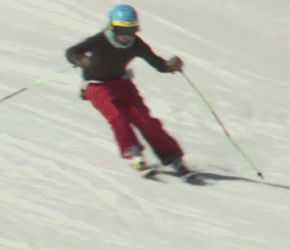

【基础平行•23•选修】 鹳鸟弯

（StorkTurn）因形似单脚站立的水鸟而得名，是外脚承重与重心居中的复合练习，具有很好的强化重心作用，但首先要能做到单外脚入弯。它同样是Mikaela Shiffrin推荐的基础练习（Weight Outside Ski Inside Tip Down Tail Up），也是PMTS大名鼎鼎的“幻影练习/Phantom Drill"的近似形式（合并练习22单外脚入弯）。练习要求：抬起内板时，内板的板尖接近雪面，板尾高高抬起。这个练习的关键点，在于 胯和肩要整体向前 ，这样才能保持重心正确。

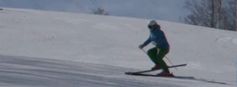

#幻影移动 （Phantom Move） 是美国PMTS特有的重要概念，是指开始转弯时迅速建立外脚承重的动作，即入弯时迅速抬起内脚并向外翻转脚踝（膝盖向弯内倒），从而带动外脚立刃。在实际滑行中，不需要真正抬起内脚，而是引发承重转移和立刃即可。此时内脚的动作仅发生在雪鞋内而无法被外人察觉，却能够引发外脚的立刃和转弯，是个“像幽灵（Phantom）一样无法察觉的动作(move)”，因此命名为“Phantom Move”。

【基础平行•24•选修】 单外板转弯

（OutsideSkiTurn）是非常重要的练习，也是检查外脚承重能力的标准方法，是世界杯运动员必练项目。但是大多数初级滑雪者把这个练习做成了上面的练习（21：下半弯抬内脚），从而完美错过了本练习最重要的内容：单外脚入弯。这个练习的核心要求，是 必须在雪板垂直滚落线时（面向雪道侧面时）抬起内板，并滑过至少两个雪板的长度后再入弯 。具体练习时，可以在雪板垂直滚落线时抬起新内板，心中默数“1、2”再开始转弯。标准的单外板转弯要求内板基本上平行于雪面，如果目前做不到这点，可退回到上一个练习（鹳鸟弯）。

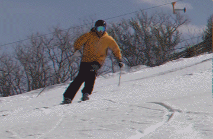

【基础平行•25•选修】 标枪弯

（Javelin Turn）是非常著名的外脚承重与上下分离的复合练习，从基础平行到世界杯运动员都能用上。

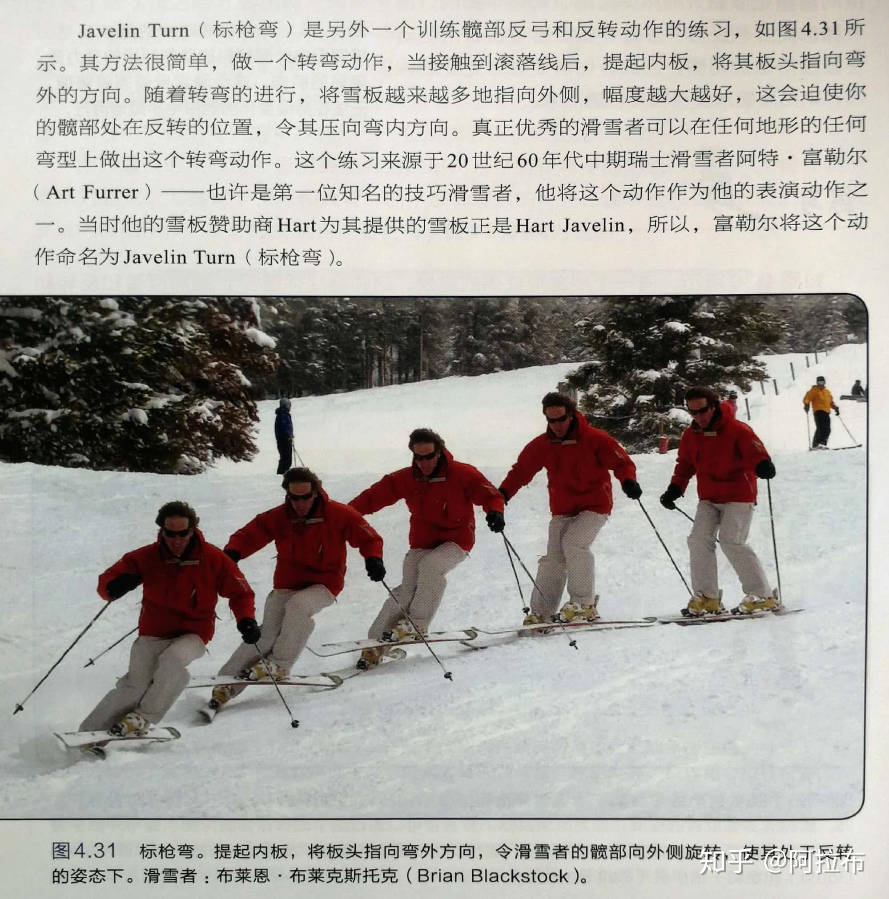

*《Ultimate Skiing/滑雪宝典》第4章 对齐与站姿 4.4节（P76）*

标枪弯在不同的练习目的时，可以设定不同的要求，因此应用非常广泛。基础平行阶段练习标枪弯的要求，是在搓雪大弯中，抬起内板指向身体朝向，外板转弯与内板形成交叉。注意，要点是通过外板的转向形成交叉，内板相对于身体是稳定不动的。另外，内腿的小腿与外侧小腿尽量保持平行，即内脚尽量贴近外腿。

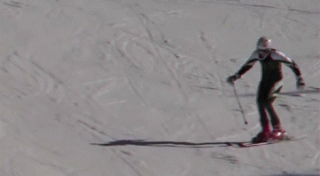

外脚承重的主要练习就讲解到这里，这5个练习是循序渐进的关系，如果当前练习做不好，可以退回上一个练习进行巩固和检查问题。

下一章将要讲解上下身姿态和换弯相关的练习。

## ※声明※

1）本人在知乎发表的文字，包括专栏文章和回答，没有授权任何其他机构转载，如果在别处看到，一定是没有版权的，本人保留依法追责的权利。 2）本文为草稿，随时有可能更新，谢绝转载，请勿联系。 3）欢迎大家讨论、补充。有疑惑就敞开了问，简单的会直接回答，复杂的也可以在未来的章节里解释。 4）部分配图来自于网络，如有侵权，请联系我删除。

【修订记录】 2020.03.02 第一次发布 V0.10

【本文结束】
