<!-- 来源: https://zhuanlan.zhihu.com/p/108407742 | 分类: 01_双板技术 | 发布: 2020-05-02 | 赞同: 104 -->

# 【双板教程--15】基础平行专项练习（二）

（V0.11：20210706，第一稿更新扶外膝动图）

在大致掌握了重心居中和外脚承重这两类 基础能力 之后，我们需要通过更加严格的姿态练习来学习反弓和分离，并明确适合当前滑行的动作幅度，以形成灵活、稳定、安全、美观的滑行姿态。

然后，还需要对弯的接续进行提升，即加强换弯的相关练习，才能真正实现流畅滑行。要知道，平行式滑行的中高阶段，绝大数的技术点都是关于换弯的，只有在当前阶把换弯动作的基础打牢，将来学习高级动作才不会花去大量时间返工，这也是我们教程的一贯原则。

## 基础平行姿态简述

（本章之前应有专门章节讲述关于姿态的理论，暂简述如下）

滑行中踝、膝、胯等关节的排列构成了滑行姿态，其目的是为了更好的实现和维持重心居中与外脚承重。

很多很多讲述滑雪的书或者视频，都会用大量的篇幅去讲述平行式转弯的姿态。确实，平行式转弯姿态并不是我们日常生活和运动中曾经用到的的一种姿态，它的细节也非常丰富，不是三言两语就能说得清的（我最早试图描述基础平行式转弯的姿态时，也用了几百字十几个步骤）。然而在学习平行式转弯时，这些方法不是最好的，因为太复杂了。

我们现在所使用的，是最简单的方式：将犁式姿态的一条腿，转变成与另一条腿平行的姿态就可以了。

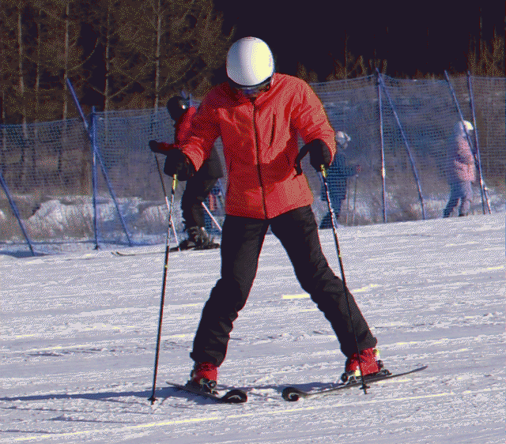

但并不是说长篇大论就没有意义，那些严谨的论述让我们明白了为什么要这样，以及如何是正确的姿态。通过这些的分析和论述，我们知道反弓和分离都发生在髋部，也就是通过大腿骨在髋关节内的动作，形成了滑行的姿态。这与上面我们挪动犁式姿态中一条腿是一致的。

大家可以在家里试着练习这个动作，在墙边按照犁式姿态站好，扶着墙把墙边的腿移动到另一条腿旁边，让两脚和两小腿平行，这就是基础平行式的姿态了。

## “恰到好处”的姿态幅度

在平行式姿态中，上半身作为一个整体参与运动，无论腿部如何动作，上半身都不应该有任何动作，也就是说要做到“肩胯一体，铁板一块”。

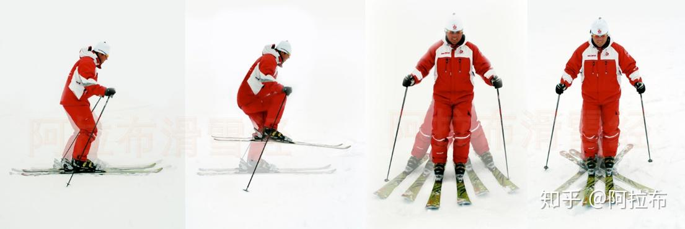

*Josh Foster - CSIA*

我们在第一课《 阿拉布：【双板教程--01】第一课，从穿上雪鞋开 》中讲解了【灵活站姿的核心秘诀】，这里非常有必要复习一下，就很容易做到“肩胯一体”了。

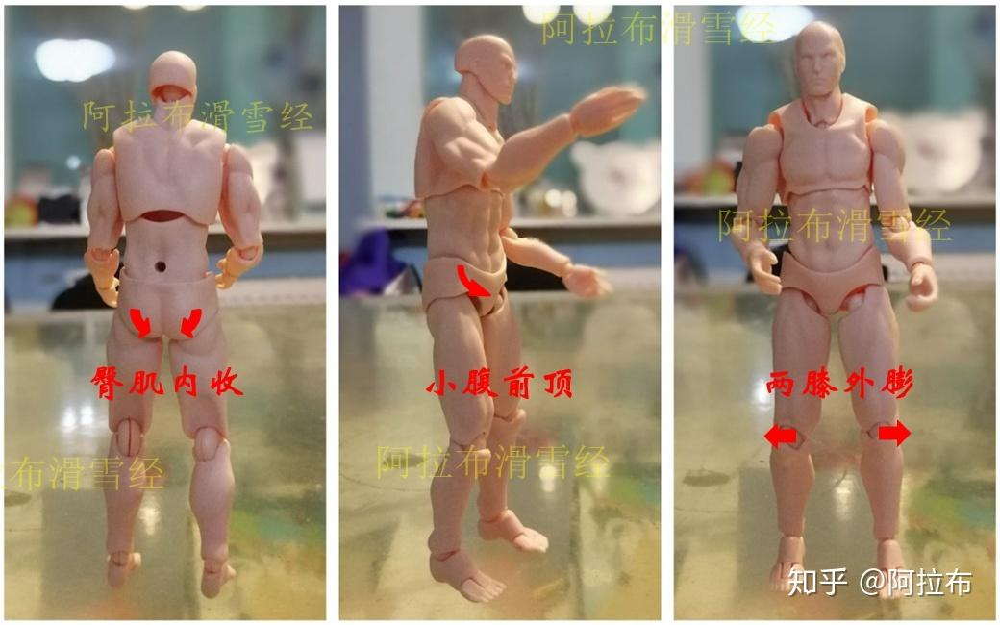

回到从犁式建立平行式姿态的过程，犁式姿态的板尾打开角度越大（此时两脚距离越远），形成的平行式姿态（反弓和分离）的幅度也就越大，这是因为更宽的犁式对应于更陡的坡度（对应平行式更高的速度），此时如果切换成平行式转弯，也会需要更大幅度的姿态。

但是在犁式姿态中，反弓与分离的幅度是同步的，同时因为关节的极限而限制了姿态的幅度。而在平行式转弯中，反弓与分离的幅度没有限制，也没有锁定在一起，姿态的自由度非常高，可以做出更有表现了的姿态，以应对极限滑行时的苛刻要求。

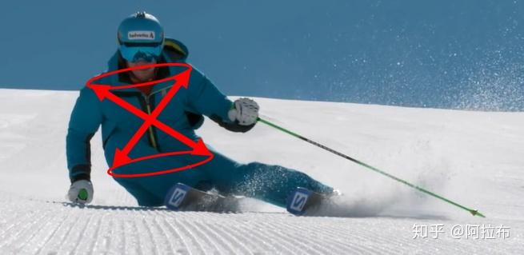

*Luca Aerni - The art of the turn - Salomon TV*

那么反弓和分离的程度是如何确定的呢？

反弓比较简单，在基础平行阶段反弓的作用是实现在外板上的平衡，因此只要有一点点反弓就足够了。而过度反弓，则可能会破坏平衡，造成重心过于倒入弯内，反而导致内脚承重。所以，能够刚刚好保持外脚承重的反弓就是最好的。

而分离要复杂一些，当前阶段我们不讨论分离的高端应用，只要能保持两板平行和同步立刃就足够了，多余的分离都会导致问题。所以，最小程度的分离就是当前恰到好处的姿态要求。

总而言之， 反弓和分离都要有，但以做到能满足要求的最小程度为最好 。

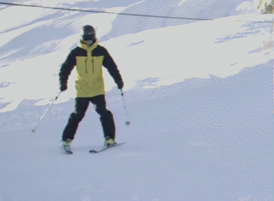

*最小必要程度的反弓和分离就是最好的*

## 姿态练习

【基础平行•26•选修】双手扶外膝

非常简单但是对于练习反弓和分离很有效果。入弯时两手重叠放在外侧腿的膝盖的侧前下方，等转弯完成，引身的同时抬起两手，随入弯再次放在新外腿的膝盖侧下。

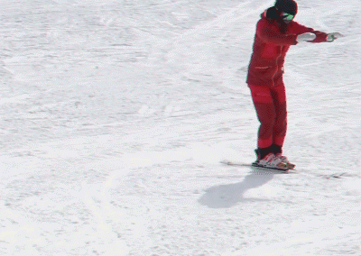

【基础平行•27•选修】夹杖

这是常用的固定上身姿态的练习，重点在保持上半身的“肩胯一体”。将一只雪仗用大臂夹在背后，另一只雪仗用双手压在腹部，这样就固定住上身了。转弯时保持正确的反弓姿态，逐渐让滑行流畅舒适。

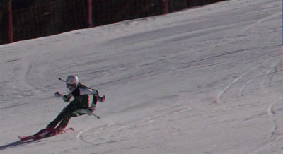

【基础平行•28•选修】平端雪仗

在上身做到“肩胯一体”之后，双手平端雪仗就能够很好的指示上身的反弓程度了。两臂在舒适的前提下尽量前伸，以提示重心居中；双手朝上平摊，把雪仗放在手上。在基础平行转弯中，保持雪仗一直平行于雪面。

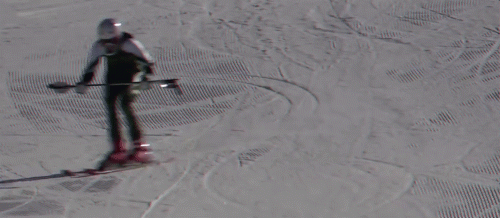

【基础平行•29•选修】雪杖压肩

与上一个练习异曲同工，但是雪仗压在肩部，可以更准确的指示反弓幅度。同时重心控制会更夹灵活一些。在基础平行转弯中，尽量让雪仗时刻平行于雪面。

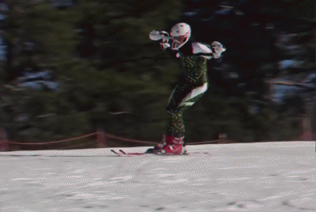

【基础平行•30•选修】超人

Superman Drill 又是一个反弓和分离的复合练习。转弯中外侧手卡住胯部，把上半身向外侧压（注意：千万不能用手把胯部往里按）；内侧手抬起垂直于胸部，指向前进方向，大约是外侧板头的方向。滑行中一定要平衡在外板上，不要追求过度的反弓。

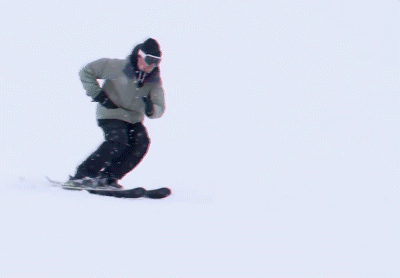

还有一个近似的练习Schlopy Drill，在北美用的比较多。区别是 Schlopy Drill 中，内侧手向上抬起45°指向弯内，提示内侧肩胯的抬升。

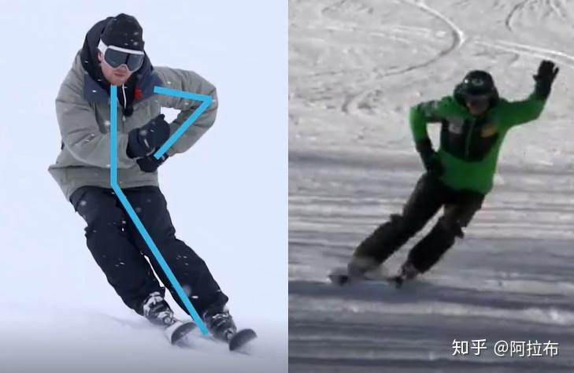

*Superman Drill VS Schlopy Drill*

## 换弯练习

【基础平行•31•选修】背后交换雪仗

（Swiss Drill）这又是一个世界杯运动员常用的练习，但本身并不难，只不过他们的条件更陡、更快、更严格而已。内侧手持杖，换弯时在背后交换到另一只手，注意引身时候胯部向前挺一下，以方便背后的交换雪仗。这个“挺一下胯部”的动作就是练习要get到的要点。

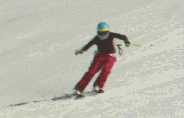

【基础平行•32•选修】双点杖

通过双杖同时向前点，强化引身。注意在基础平行阶段，点杖的时机是身体最伸展的位置，而不是启动转弯的时刻（基础平行滑行没那么快）。

要点：向前、向前、向前。

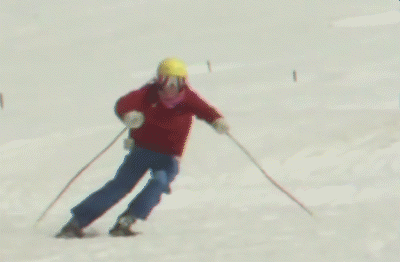

【基础平行•33•选修】超人拍手

在姿态练习30超人的基础上，增加换弯时向前拍手的动作，以提示换弯时姿态向前调整。这个练习综合了反弓、分离、引身，作为本阶段最终练习，再合适不过了。

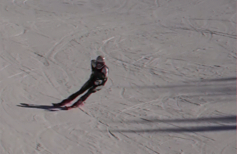

下一章将结束基础平行转弯阶段。以上这些练习能够很好的修正平行式转弯的滑行动作，不仅是基础平行阶段，后续无论是动态平行还是初中高级卡宾，甚至世界杯运动员，都可以在不同的坡度、速度下借助这些练习提高滑行能力，因此希望大家能够好好掌握它们。

## ※声明※

1）本人在知乎发表的文字，包括专栏文章和回答，没有授权任何其他机构转载，如果在别处看到，一定是没有版权的，本人保留依法追责的权利。 2）本文为草稿，随时有可能更新，谢绝转载，请勿联系。 3）欢迎大家讨论、补充。有疑惑就敞开了问，简单的会直接回答，复杂的也可以在未来的章节里解释。 4）部分配图来自于网络，如有侵权，请联系我删除。

【修订记录】 2020.05.02 第一次发布 V0.10

2021.07.06 更新扶外膝动图 V0.11

【本文结束】
