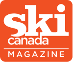
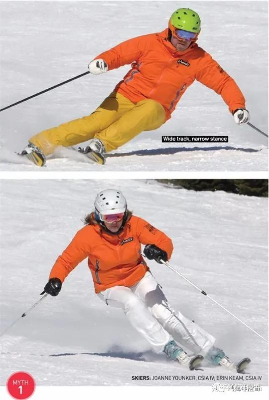
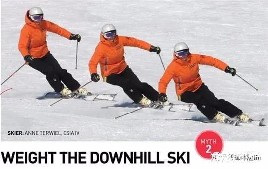
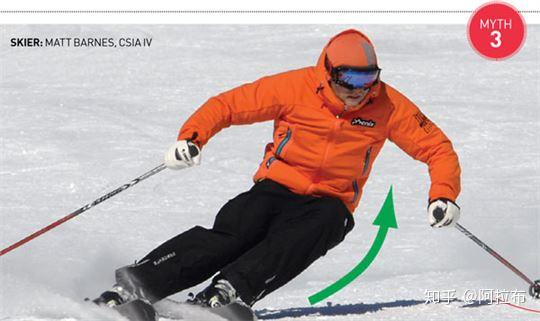
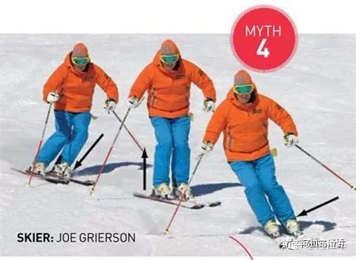

<!-- 来源: https://zhuanlan.zhihu.com/p/339319488 | 分类: 01_双板技术 | 发布: 2020-12-24 | 赞同: 171 -->

# 【翻译】双板滑雪的四个大众神话

本文由加拿大CSIA IV级指导员 Martin Olson 于2014年12月发表在 Ski Canada Magazine 。 阿拉布 于近日取得 Ski Canada Magazine 对本文的官方授权后重新翻译。

*感谢Ski Canada Magazine授权*

“ 高级阶段的滑行，很多要点与看起来的样子刚好相反——译者注 ”

## 神话之一：高手都是宽站姿

*photo: MARTIN OLSON * skier (top): Erin Keam, CSIA Level IV * snow: Sun Peaks skier (bottom): Joanne Younker, CSIA Level IV*

在那些试图提升自己滑行的优秀滑雪者那里，经常能看到一个错误，就是滑行时两脚分的太开。当你看到上面的照片时，可不要想错了，尽管他们两脚的距离很远，但 他们的站姿是窄的 。窄站姿可以促进山下板承重，并容许下肢做出高表现滑行所需的角度。试想一下在开始转弯的阶段将内板向上提，但要保持两条腿紧挨着。这不仅仅是机压雪上的冠军技术，在粉雪和雪包中也很有用。

## 神话之二：压山下板

在两脚之间转移承重的方式有两种：

- 通过向另一侧弯曲躯干、或者移动手臂来转移承重；
- 抬起一只脚，这样承重就会自动的转移到另一只脚上。

由于一些奇怪的原因，传统的教学技巧总是在推行某些版本的方式1。同样奇怪的是，世界上最好的滑雪者总是使用方式2.

在上图的照片序列中，Anne的重量（对雪板压力—译者注）主要落在山下雪板（她的左脚板）上，但是不管你相信与否，她并没有试图这样做。她完全是通过她的右脚板来控制压力的。通过保持窄站姿和放松右腿，很容易就做到了平衡，并且髋部会自然地向弯内移动，以实现更高的抓雪角度。

找一片适当坡度的机压雪坡，带一点速度来实践这个技术。你的滑行能力会迅速提高2级。不要总打算去蹬雪板——要想着当你放松的实现（内倾）角度并且雪板抓雪后，是雪面在推动你（转弯）。

## 神话之三：向内推腰

试图通过（向内）推山下侧的腰部来做出上图这种高表现姿态，是完全行不通的。 与直觉正好相反 ， 建立有效的反弓主要是依靠山上侧身体的作用 。要有意识的把内侧雪板和腿向上提，把内侧的髋向上提，并且把内侧的肩也向上提。注意内侧的手臂是如何强力抬起和向前，同时内侧雪板也向上提起，不是推，而是向前。这个关注点可以在很低的速度下进行练习。这也是实现强有力的姿态和高水平滑行的关键之一。

## 神话之四：早做承重转移

要想到雪板有两条刃，大脚趾刃和小脚趾刃。

- 要进行毫不费力的，没有犁式板型的入弯，关键是要尽早（将雪板）横滚到小脚趾刃，而不是过早（给新外板）加压（上图第1帧）。千万不要试图用大脚趾刃启动一个弯——会导致犁式入弯和旋转（应该是指由于半犁式入弯导致的上身过多的转动——译者注）。
- 下一步，轻微抬起内板，这会在外板（滑雪者的左脚板）横滚到大脚趾刃的同时，将承重转移过去（上图第2帧）。
- 通过有力地翻动脚踝压雪鞋内侧，继续在新外板上增加立刃角度，并继续释放内侧雪板上的压力（上图第3帧）。

即使一个普通人做起来也很容易，但这个动作值得好好掌握——这是通往高级水平和大神的必备基础。

【原文结束】

## 译者注：

也许有读者注意到了，这篇文章是我” 重新翻译 “的。没错，最早的翻译是2015年2月10日，当时是小年前一天，在绿野滑雪BBS的一篇帖子里。

感谢雪友的分享，这其实是一篇很棒的文章，说的也都是非常通用、也非常有用的一些原则，对今天的我们依然有效。前几天的训练中我再次记起这几个原则，就想着干脆申请原文的授权，正式把它翻译出来，也能温故而知新。

最后，请让我用比较熟悉的语言，把这四个原则再重复一遍：

- 内脚贴近外腿，宽板距是窄腿距（窄站姿）在大角度立刃后的结果；
- 主动轻内板，而不是主动压外板；
- 反弓要靠提升内侧肩胯，而不是压低外侧腰以下；
- 先放平板底，再转移承重。

首发微信公众号《阿拉布滑雪》。更多教程、知识、文章、视频，请微信搜索“阿拉布滑雪”并关注。
