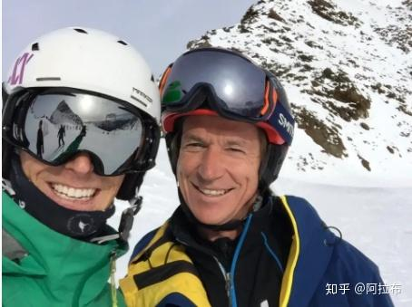
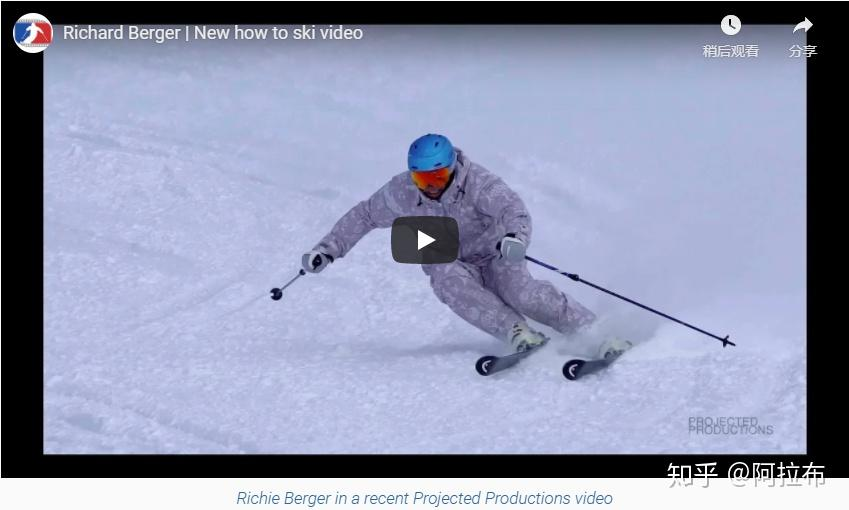

<!-- 来源: https://zhuanlan.zhihu.com/p/330526493 | 分类: 01_双板技术 | 发布: 2021-01-08 | 赞同: 8 -->

# 【翻译】里奇·贝尔在Solden的采访（2018年）

作者：Tom Gellie，阿拉布授权翻译

来源：BigPictureSking

BigPictureSking 是澳大利亚著名滑雪指导员 Tom Gillie 创办的在线滑雪教学网站。Tom Gillie 与 Richard Berger 共同参与了Project Productions 教学项目。

译者注：

里奇·贝尔（Richard Berger）在中国雪圈是位独一无二的传奇，除了他是中国人最早熟知的国际大神，还因为他在中国广为流传的大作《法国小回转教学》（又称：6级小回转）。一部中国人配音的、翻译自韩语版本的、在日本工作的奥地利人创作的滑雪教程，这本身就是欧洲技术于日本生根后在东亚传播的一个传奇故事。里奇·贝尔这个译名也是Richard Berger的日本译名再转译为中文的结果。

Solden是奥地利著名滑雪圣地，我也非常非常喜欢Solden雪场和Solden小镇。标题图片中的背景照片就是我自己拍摄的Solden冰川训练场。

本文忠实翻译Tom原文，文中内容不代表译者观点和态度。

*Tom Gellie 与 Richie Berger 在奥地利 Solden*

汤姆： Richie（Richard），你能告诉我你的背景吗？您的孩童时代是从竞技开始的？作为滑雪者，您感觉如何？ Richie： 我大约是像奥地利所有的小孩一样，跟着父母开始滑雪。然后我开始在滑雪俱乐部滑雪，并开始参加竞技训练。我开始滑雪和竞技训练，直到18、19岁，参加了一些国际比赛、FIS欧洲杯。第一次比赛是很久以前的事了。从技术上讲，我表现不错，但身体却很瘦。 汤姆： 那你一直在那里训练吗，比如，大量的时间在健身房里？ Richie： 不，我更像玩票，而不是一个勤奋的运动员。 汤姆： 哦哦。所以是您的技术才能将您带到了这个程度，但其他人只是更壮，更有力量。 Richie： 是的，他们比我有20、30公斤的优势。我没有机会的。 汤姆 ：那么你是什么时候决定走上成为一名指导者的道路的？ Richie： Yup 。 我直接去了圣克里斯多夫（滑雪学校）。 汤姆 ：您是否还记得有一些人，在您的培训中，对您的滑雪方式有切实的影响，或者在此之前您是否已经建立了自己的风格？ Richie： 我们曾经是一群年轻的竞技选手。最有趣的是，没有人彼此知道对方要去圣克里斯托夫。就这样，走下楼梯去吃早餐时，我们见了面，我就很奇怪，你在这里做什么？我们在比赛中认识，然后我们在那儿见面，我们一天一天地互相鼓励，一起滑雪。从比赛中感到疲倦，并期待获得乐趣。更多滑雪，滑野雪，滑自由式。 汤姆 ：那么，这是您真正喜欢的一种滑雪方式？蘑菇是您最喜欢的滑雪类型吗，还是您喜欢一切类型？ Richie： 实际上我从没真正练习过蘑菇滑雪。它只是突如其来。我更喜欢滑粉雪，滑陡峭的雪坡。 汤姆 ：您是什么时候对技术滑雪和示范滑雪感兴趣的，因为您被认为是这方面最好的之一。那是什么时候开始的？ Richie： 这实际上不是计划好的。我不知道结束竞技后该怎么办。然后是我的滑雪学校主任，因为我们也就18、19、20岁，所以对我和其他男孩来说，他也像是父亲的形象。他还向我们提供了一些教育，而不仅仅是滑雪。帮助女孩子以及其他的在成为一位年轻的成人时会出现的事情。他开始决定我们要做什么。他说，好的，现在你可以为国家滑雪教练的考试做准备。现在你已经准备好去到日本了。现在你可以走了。所以我们被送到其他地方去培训。 汤姆： 哦。他是一名非常称职的教练。 Richie： 是的。并不是我们自己决定的，是他建议去日本。 汤姆： 那是什么时候开始发生的事？他什么时候决定派你出去的？ Richie： 第一次是在1989年。 汤姆： 那你们当时做什么？只是在培训吗？ Richie： 不，这相当于奥地利滑雪技术的使者。因为圣克里斯托夫滑雪学校就像一所国家滑雪学校。周围的所有其他滑雪学校都是私立滑雪学校，但这是一所国家滑雪学校，所以我们被政府雇用。政府也派我们去不同的国家介绍奥地利的滑雪技术。这已经有相当长的时间了。在这段时间里，我能够建立人际关系并创建人际网络。现在这种滑雪学校没有了。 汤姆： 您参加过那里的技术比赛吗？ Richie： 日本人实际上不允许外国人参加比赛。他们开始在北海道或其他地方的省级比赛中允许这样，但在全国性比赛中则不允许。当他们这样做时，国际选手总是赢家。因此，他们希望将其保留为日本自己的国家级比赛。但是后来有个时间他们开始国际比赛，是1995年在野泽温泉举办Interski大会之后。他们在野泽温泉举办了两次或三次国际比赛。我知道韩国有一两次国际比赛，但后来他们停止了这种国际比赛。 汤姆： 那么感兴趣的不多？ Richie： 很难。他们不得不邀请来自欧洲和其他国家的外国人。对于韩国人或日本人来说，这并不是什么大问题，因为他们就在那里。没有人愿意为此付钱。这可能是导致他们停止的原因。 汤姆： 我想问你，作为一个年轻的滑雪者，你做了哪些体能锻炼或者准备？从竞技选手开始并意识到滑雪是您的职业后，您是否开始训练你的身体？ Richie： 不，并没有。 汤姆： 那现在呢？你现在训练吗？ Richie： 我的意思是说，对于小孩子不需要为了滑雪做特殊的训练。他们需要的是非常广泛的体育项目。所以他们玩得开心。他们应该学习打网球。他们应该打壁球以及所有这些东西，能用到所有的运动和身体机能，比如速度，力量和持久。他们应该通过体育运动、玩耍来训练，而不是去健身房或进行专门的滑雪训练。这是我的观点。 汤姆： 这就是您的训练。您会去参加许多其他运动。

*Richie Berger在最近的Project Productions视频中*

Richie： 我一直关注特定的滑雪者。不是很有力量，不是很壮的滑雪者。就像Ingemar Stenmark一样，他并不是一个很大块的很重的滑雪者。他骨瘦如柴，但技巧非常好。Michael Von Grunegin也非常瘦，但技术很棒。Ted Ligety也很瘦，也有很好的技术。因此，是的，成为优秀的技术型竞技选手不需要90或100公斤。当然，在速降比赛中，您需要增加体重，但在技巧项目比赛中则不需要。 汤姆 ：有趣。那么这些年来您的技术如何变化？你认为它变了吗？ Richie ：当然。我从事这项活动的时间相当长，我最开始时用的还是长直板滑雪。当我在圣克里斯多夫学习时，我们用的是207至210厘米的滑雪板，半径45-50米。如今，滑雪板的长度几乎缩短了40到50厘米，并且侧切更多。这当然会影响我的滑雪技术。 汤姆： 那么，您还记得哪些力图改变的历程，比如压力控制或更早的立刃？您的第一个重大突破是什么？ Richie： 在大弯中有一个明显的变化，小弯中不那么明显。滑小弯时，立刃变得越来越早。在过去，使用长滑雪板时，立刃是在非常接近转弯结束的阶段，而现在我们总是更早地开始立刃。在卡宾大弯中，建立早期立刃的方式有很大的变化。即使用很长的滑雪板时，我们也会卡宾，但更多的是在一个滑雪板上，也就是外板上。我们不能太多地使用内板。我们会抬起内板来保证压力只在山下板上。而这种分布在两条腿上，并且使用我们的内刃。对我来说，卡宾板可能是最大的变化。 汤姆： 那么，您现在关于大弯的感受是什么？你觉得是如何分布的？您可以简单地加上一个数字？ Richie： 这是一个很难的问题，因为我知道所有竞技选手，以及大多数人，他们会告诉人们把重量压在外板上，在外侧滑雪板上建立压力。我要做的是尝试在两条腿上分配相等和相同的压力。如果您在雪坡上滑行，那么山下板总是比山上板低。因此，您的山下板总是承受更大的重量，更多的重量被自动分配给了山下板。这就是为什么我认为，我需要主动在内侧滑雪板上建立压力。因此，我试图在内板上 主动 建立压力，并从地形和的离心力中获得外板上的压力。通过这种方式，我可以更加均衡的使用双腿滑雪。所以，我的外侧滑雪板受到外部的压力，而我的内侧滑雪板则受到我的主动压力。 汤姆 ：有趣。我一直是在大弯中这样做的比较多，而小弯中只有一点点。感觉就像是我的身体有更多的重量。因此，我的身体会变得更加紧张和有力，以控制压力或出弯的能量。 Richie： 是的，当然会更有力。您会更紧凑，更稳定。我知道那种只用一条腿，也就是我的外板滑雪的感觉。 汤姆： 有趣。那么小弯呢，您有同样的感觉吗？ Richie： 25年前，在小弯中时，我们被教导要给两个滑雪板相等的承重，因为在小弯中，您的距离不会像大弯那么远，您总是在滚落线附近移动。当然，那只是用双腿滑雪，不存在从山下板到山下板的承重转换。 汤姆： 您是否认为，现在使用回转板，您的滑行会比过去更加平滑。我看过您穿着老式滑雪套装时的视频，以及最近的穿着新式彩色滑雪服的视频。对我来说，现在的滑雪方式看起来更流畅。这是您特意这么做的吗？ Richie： 我认为这与材料的变化有关，因为使用较旧的滑雪板，您的立刃要晚得多。因此，您将获得更多的反弹。随后是来自地形和压力的沉重冲击。现在，有了更短，更结实的带侧切的滑雪板，我会尝试在滚落线附近立刃。然后并没有太大的压力反馈回来。通过这种方式，我可以平衡的更轻松。压力的建立也更加顺畅，而且容易得多。不会有很大的压力变化。如果您很晚才立刃，您将承受更大的压力，然后又没有压力了。并且，如果早一点立刃，就很容易始终保持几乎相同的压力，那么当然更顺畅。 汤姆： 在滑蘑菇时会感觉到同样的事情吗？ Richie： 我会尝试在雪包的背面建立压力。在临近雪包时建立压力然后轻身。 汤姆： 关于在雪包的背面做的这些，您有什么个人的提示？在背面让滑雪板受压？还是说更多是因为对即将到来的雪包要有良好的反应，因此可以在下一个雪包的背面推回来？ Richie： 好吧，我认为这是将重心翻过雪板、并将滑雪板和双腿拉回来的组合。 汤姆： 所以是放慢脚的速度，可以让身体走得更快。 Richie： 是的。大多数人的问题在于，他们有些害怕，所以会向后移动，然后就只能 梆、梆、梆、梆 。 汤姆： 我一直在想这样一个想法：当您用腿驱转时，大多数人仅仅谈论用上半个腿驱转。这就是大腿，可以在髋关节处分离，但也可以用膝盖关节下方的脚和小腿进行一些驱转。我的感觉是，一开始您会使用腿的上半部分，因为这更多的是立刃动作，您实际上放松了小腿，以使双脚和滑雪板的板刃翻转。然后从滚落线开始，当您开始希望增加压力并引导滑雪板向回转，您无需使用太多的大腿动作，而是更多地使用脚和小腿来将滑雪板带回到您的身下。 Richie： 是的，我同意这一点。 汤姆： 您会教授这种方式吗？或者您如何将这个想法传达给与您一起滑雪的人？ Richie： 是的，当然。我之所以进行解释，是因为我们经常进行解释，并且向他们展示您必须动动膝盖。左和右。但是您不能将膝盖向侧面移动。只有一种方法可以移动膝盖。要向侧面移动它们，您需要旋转您的大腿，您的整个腿部。这就是为什么您的膝盖在内侧。 汤姆： 好的。今天我在冰川上试图给我的组员讲解他们需要感受髋关节和膝关节的运动。要意识到腿部不止一个部位可以旋转。然后，我们练习了在转弯的不同阶段更加主动的使用身体的这些部位。 Richie： 这就像打高尔夫球，打网球。您开始教他们用肩膀带动手臂。然后，当您变得越来越好，您也可以打开手腕来加速。而这就是让球更快的关键。 汤姆： 是的。您会得到这种鞭子效果。 Richie： 是的。这也是出弯时的加速。 汤姆： 目前您在滑雪时在练些什么吗？ Richie： 当然，是的。我每天都在尝试练习和改进。并且改变。我试图每天改进我的驱转能力—不要滑动，不要卡宾，而是寻找它们的组合。当然，也要始终保持（两脚）相同的压力。但在平缓的斜坡，中等的斜坡上这很容易，而在陡峭的斜坡上却很难。并且尝试以较少的运动来滑雪。始终处于同一位置。 汤姆： 那么您这样做的意义是什么？换一种方式来解释？ Richie： 好吧，我始终专注于保持质心在同一位置，头部在同一位置，整个身体在同一位置。而且不要过多的弯曲和伸展我的腿。或者只是让它们在我的身体下面动作。转弯时我的加速好吗？像减震器。卡宾时，硬的减震器可让您在转弯结束时加速。如果它们太软，则会失去压力，失去速度。 汤姆： 想一想就觉得真酷。您会对装备做点工作吗，对滑雪鞋？例如，在合脚方面，您的脚形很好，还是要做很多工作？因为您已经有成千上万天是穿着雪鞋的。 Richie： 我的右脚踝大。在这里（指着他的脚踝）我磨了一下，所以我不会疼。 汤姆： 你做雪鞋的鞋底调整（Canting）吗？ Richie ：不。 汤姆： 站立在雪鞋里，您的腿会非常挺直？一直都是这样吗？ Richie： 是的 。 汤姆： 与您的客人一起时，您是否将其视为一个组成部分或需要注意的东西？ Richie ：是的。我认为材质非常重要。很重要。我是一个非常注意的人。材质是关键，我不喜欢所有没有好材质的那些东西。 汤姆： 那您对于滑雪板会关注什么呢？比如不是太硬，也不是太软？ Richie ：我并没有特别的滑雪板。我所有的雪板都是在商店里可以买到的。当然，这些都是竞技部的滑雪板，竞技部的回转雪板。我实际上很喜欢硬雪鞋，雪板也是。我喜欢较硬的滑雪板是因为我认为它们比柔软的滑雪板能给我更多的回弹力和更强的蹦床效果。在软的滑雪板或软的雪鞋中，我感到失去了压力。 汤姆： 就像您之前说的，想要保持身体不变。因此，滑雪板可以做更多的事情，而您不想要黏糊的悬挂。 Richie： 如果我有双硬的滑雪鞋，在滑雪板上的压力会更向前，向山下。 汤姆： 酷。有趣。 汤姆： 关于最后几个问题，您是否认为某些基本原则是必不可少的，例如当您给一同滑雪的人授课时，您确保要传递给他们的滑雪中的简单原则？ Richie： 嗯，这些原则当然就是基本技术。我认为基本技术是最重要的，并且我每天早上都在第一轮首次练习中练习日常基本技术，这是最重要的。从身体上讲，这就是为什么我说进行健身训练并不重要。因为对于滑雪，我认为平衡与协调是最重要的，而不是力量。所以，如果您在平衡和协调方面都很好，那么您可以成为一个非常优秀的滑雪者。 汤姆： 酷。好，谢谢您的时间。我很感激。
