<!-- 来源: https://zhuanlan.zhihu.com/p/250183894 | 分类: 01_双板技术 | 发布: 2021-07-07 | 赞同: 145 -->

# 【双板教程--16】基础平行的测试，诊断，提高方法

> 原文：[知乎 · 阿拉布](https://zhuanlan.zhihu.com/p/250183894)　·　发布于 2021-07-07　·　本文仅供学习交流，版权归原作者所有

（V0.10：20210707，第一稿，不定期修正和更新）

从平行入门开始，到非常标准成熟的基础平行滑行，可能会是相当漫长的积累期，这也是打基础的最好阶段。

前两篇教程已经把这个阶段最应该做的练习都详细讲解过了，相对于给大家一个描绘出详细的进阶地图，但是有时候我们即使手持地图，也不知道该往那里走，因为我们还需要知道自己的准确位置，才能规划出前进的线路。

所以，准确定位自己的当前滑行技术，是我们学习过程中不可缺少的一环。

## 基础平行能力测评

基础平行的标准，是在较缓的机压中级道上，以均匀的速度滑出连贯C弯，具体的姿态要求就是我们一再强调的八句口诀：

> 重心居中，外脚承重，适度分离，两板平行， 引身点杖，流畅画圆，弯形饱满，节奏稳定。

其中，检验基础平行滑行能力最核心的指标，其实是弯形，也就是滑行轨迹必须为圆润的C弯。但是我们没有办法通过某个练习来检查弯形是否合格，因此只能通过录像等手段、或者滑雪者自我感受来检查，如转过的角度是否足够，转弯时是否均匀连贯等。

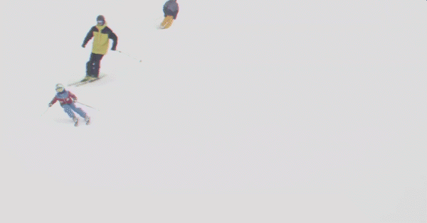

重心和外脚是姿态方面最重要的要求，可以通过练习 【基础平行•24•选修】单外板转弯 来检查。而对于分离，目前阶段尽量保持最小的程度就好，同弯形一样只能自己感受或者通过录像来检查。

## 问题的发现、诊断、改正

许多雪友认为只要发现了问题，就能找到改正的方法，这其实仅对简单的问题才有效。大多数的问题，需要先诊断问题原因，再进行改正。如果改正的效果不好，说明问题诊断的不准确，或者存在多个原因，都需要再次进行诊断。

滑雪作为一种运动，造成动作问题的原因可能有多个方面，简单的归纳为以下几大类：

- 意识不到位：没想到或不知道问题点，这样的最容易改正，可能几分钟到几小时就够了。

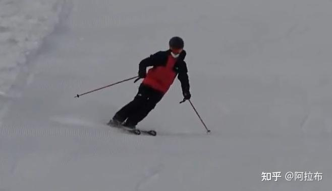

*“脖反弓”通常存在意识方面的问题*

- 技能欠缺：知道动作目标但是不知道如何实现，针对具体的技能进行练习就好，可能需要几小时、几天、甚至几周的时间来学习/练习一个技能。

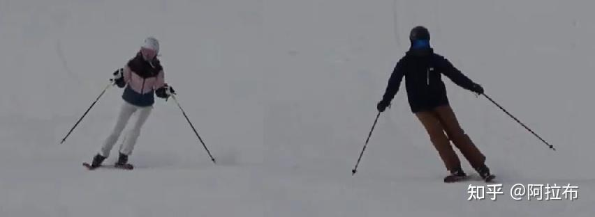

*A腿V板，典型的缺失外脚承重技能的表现*

- 运动习惯不合：日常运行习惯与滑行所要求的动作不匹配，需要大量的练习来修正不合适的习惯。比如不少喜欢踢球的人习惯右转不分离甚至带转，这是因为足球中右脚大力开球较多，而这个动作必须由上身（其实是核心）带动腿部发力，因此形成了相应的习惯。

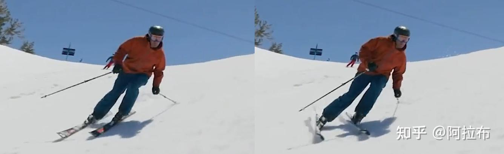

*上身带转*

- 运动能力不足：比较常见的是运动协调性、平衡能力等的欠缺，需要大量的重复练习，最好结合相应的旱地练习来提高运动能力。
- 身体素质原因：通常只出现于高级以上阶段，如力量、柔韧性、反应能力等可能存在硬伤，从而影响滑行表现。这些很难直接在雪上练习中直接改善，必须通过平日的合理训练，来提高相应身体素质。

## 一次只能改正一个问题

有人说，评价初级双板滑行时，祭出“重心落后，内脚承重”这句灵丹妙药就可以了。

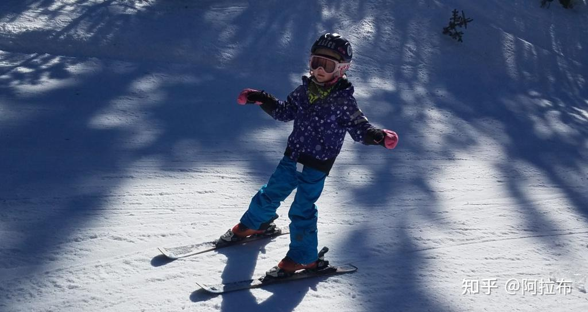

*重心落后，内脚承重*

这么说也有一定的道理，毕竟大部分的初级滑行，这两项通常都不会完全合格。

但是，我们能一次同时解决重心和外脚的问题吗？不可能的，每次滑行只能有一个目标，所以每次只能改正一个问题。那么，当前的重心和外脚，哪个才是主要问题？

这就是考验指导者经验和能力的时刻。

虽然说，重心问题通常比外脚承重的优先级最高，但诊断问题时不是这么直接考虑的，而是要用另一个问题来诊断：哪个问题对当前的滑行影响最大？

当前最影响滑行的问题，就是最需要改正的问题。

而在回答这个问题的时候，就可以应用前面提到优先级了。确定答案后，聚焦这个问题，思考或者测试问题根源，然后拿出改正的办法，实施一段时间就可以检查进展，看是否有效。

## 简易诊断-改正体系

这里给大家一个简单的诊断-改正体系，这也是我们拥有《阿拉布滑雪经》这个完整教程的好处。这个体系的核心是按照下面的优先级来诊断问题：

> 重心 > 弯形 > 外脚 > 分离 > 内脚（两板不平行）> 点杖 > 节奏

这个优先级的意义在于，前面的问题有可能会对后面的问题有干扰。比如严重的后座必然导致弯形不好和内脚承重。如果确认前项确实是影响滑行的最大因素，那么就不需要再分析后面的问题到底是本身就存在，还是受前面影响的结果。

（一）重心

当滑行时不能灵活的做出动作，几乎可以肯定是重心（前后平衡）有问题，其中最大的可能是重心落后，如后座等。

除了检查基础站姿外，重心落后的问题要分三种情况进行改正：

- 所有入弯都落后：改善练习是直滑降小跳（ 直滑降•6•必修 ）
- 入弯逐渐落后/单边弯落后：对应的练习是引身小跳（ 基础平行•15•选修 ）
- 弯中或弯末落后：对应练习为弯中小跳（ 基础平行•18•选修 ）。

（二）弯形

弯形不对通常会伴有其他问题，如内脚承重，如上身带转等，但本质上，还是转弯这个能力的欠缺。我们学习转弯能力是在犁式阶段，再没有比犁式转弯更好的方式来学习转弯能力了（ 基础犁式•2•必修 ）。必须同时强化外脚承重（ 犁式倒飞机：基础犁式•4•选修 ），没有外脚承重的犁式转弯是没有灵魂的。

对于意识原因导致的转弯急促，同样也可以通过犁式转弯来培养均匀连贯C弯的感觉。

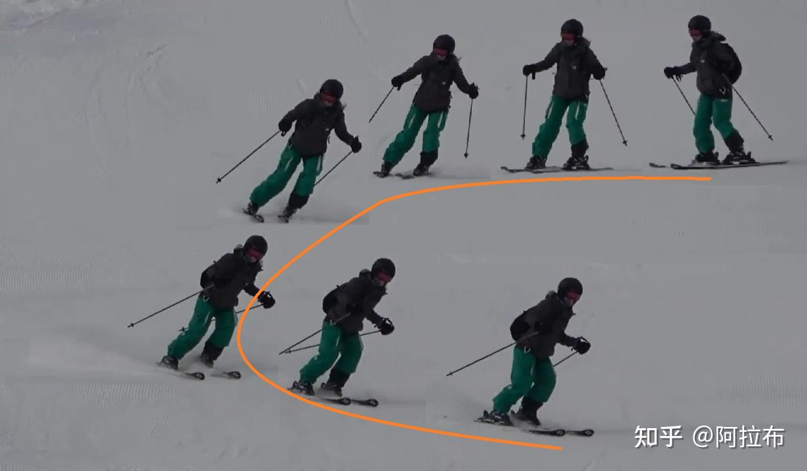

*典型的Z弯通常伴随着上身带转、内脚承重*

（三）外脚

外脚承重在基础平行阶段的滑行中并不是特别严格，只要外脚起到主导滑行的作用即可。外脚承重不足的表现通常有：

- 内脚主导承重，外脚主导转弯：A腿（两小腿不平行，从大腿就形成A字形态）
- 内脚部分承重：A板（即板尾打开，或称小犁式）
- 内脚主导转弯：V板（即板尖打开）
- 反弓不足或没有：内板干扰滑行等

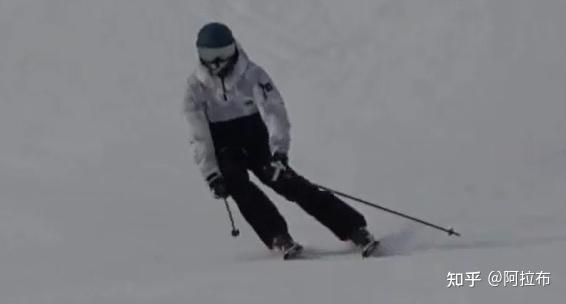

*A腿：踩着内板蹬外板*

外脚承重的改正方法，就是基础平行的 外脚能力系列练习 ，在原文中已经安排好了次序，从 练习20依次练到练习24 就可以了。当然，练习一定要做到位，其中最重要的是弯形一定要完整。没有弯形的外脚练习毫无用处。

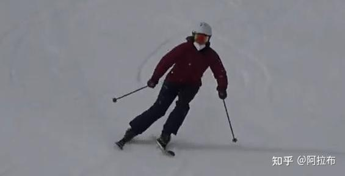

*软绵绵的外腿*

此外，换弯时的承重转移次序不对，会导致小犁式入弯。这个问题的改善要放慢换弯的过程，严格按照次序，放平板底后再将承重转移到新外板上。相应的练习是单外脚入弯（ 基础平行•22•选修 ）。

（四）分离

分离不足通常伴有内脚承重、带转等，前面应该可以同步解决。若没有这些问题，那么意识上调整一下姿态即可，或者超人练习也会有帮助（ 基础平行•30•选修 ）。

分离过度在排除内脚承重后，则主要有两个可能的原因：

- 意识上受“面朝山下”的影响做出了过多的分离，这种情况下，回到保持“适度分离”的意识即可，也可以做一些平端雪仗练习（ 基础平行•28•选修 ）。
- 反弓的姿态不足，内胯太低，压缩了内腿的空间，改善措施是Schlopy练习（ 基础平行•30•选修 ）。

（五）内脚

内脚的问题主要是破坏了两板的平行，如A板，V板，K腿等。

在内脚承重的情况下很难直接改正内脚问题，此时所有的练习和滑行都等于在练习内脚滑行能力。可能花费数十倍的时间，把内脚滑行能力练到很高的水平后，也会消除大部分问题，但显然这不是好办法，所以还是要先去解决内脚承重。

改善内脚承重后如果还存在这些问题，通常可以通过建立内脚姿态管理的意识和能力来进行纠正，在滑行中内膝尽量打开，内脚的脚心向上翻，同时通过脚尖的方向来保持两个雪板平行。这些练习需要重心、外脚、分离等问题都已经解决，能够熟练、均匀、连贯滑出正确弯形之后再进行，否则滑雪者根本不会有精力去关注内脚姿态。

有一些内腿姿态相关的练习，比如手向内掰内膝、或者内手贴在内膝外侧引导内膝打开等，因为效果不明显就不详细说明了，有兴趣的雪友可自行寻找和尝试。

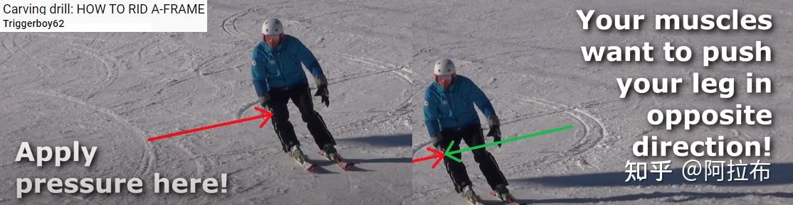

（六）点杖与节奏

节奏通常与稳定性、动作一致性相关。在坡度均匀的雪道上，一致的弯形才能形成正确的节奏。在转弯时可以给自己默念数字计时，每个弯都用相同的时间有助于形成稳定的节奏。如果是早上的面条雪，也可以根据压雪机的痕迹来滑行固定宽度的走廊。

点杖的主要目的也是引导节奏。不过，点杖的常见问题其实是与上臂的姿态相关：

- 两臂夹的太紧：滑行中两手握住雪仗的两端，平端雪仗，记住此时两臂的姿态。

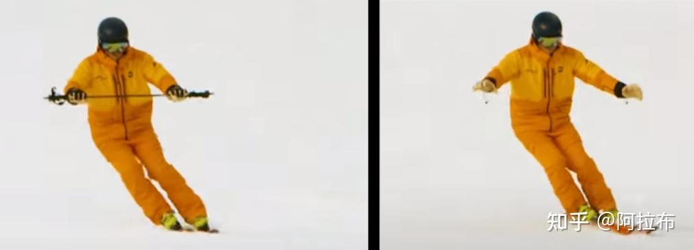

- 两手乱甩：只用手腕的摆动点杖，大臂和小臂是固定不动的。

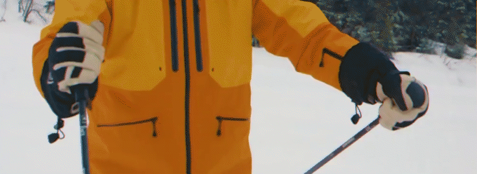

- 杖尖总触地/觉得雪仗长：雪仗不要垂直对着雪面，杖尖向两边打开一些。

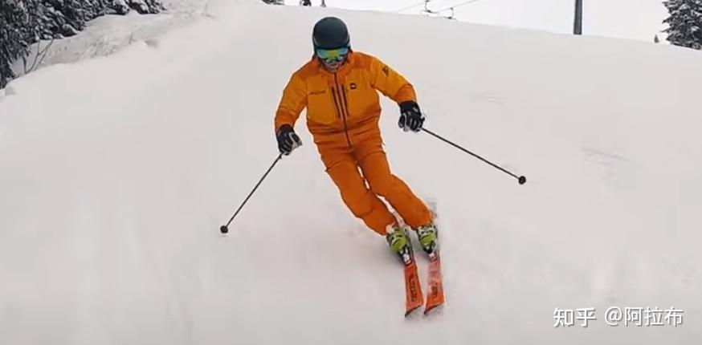

## 从练习到滑行

很多雪友有过这样的体验：明明练习做的都挺好的，怎么到了自由滑行时还是老样子？

这是因为，练习的时候其实还不够“好”。在教程开篇《 写在前面的废话 》中，我讲解了学习的四个阶段，“能、会、精、通”。练习中能够做出动作，仅仅还是“能”的阶段，也就是“在适合的条件下刻意去做就能正确完成动作”。当进行自由滑行时，条件改变，或者外部环境变复杂，难以保持对目标动作的专注，都会导致做不出练习时的动作。

所以，练习就要做到“会”的程度，即“无须在头脑中刻意指挥就能做出正确动作”。这样带入自由滑行时才有可能把练习的内容正确体现出来。

另外还有一个小技巧，就是自由滑行的前几个弯用练习的滑法，然后再切换成自由滑行，也能比较好的将练习内容带入滑行中。

最后，呈上诊断体系的索引图片，希望能帮助大家更方便的改善滑行。

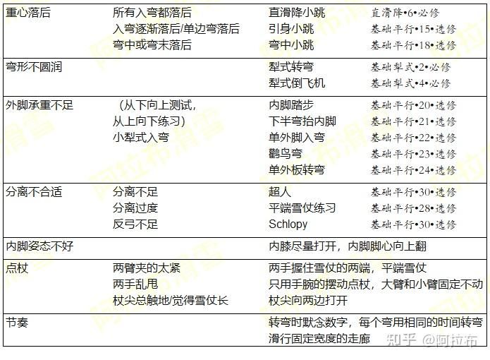

## ※声明※

1）本人在知乎发表的文字，包括专栏文章和回答，没有授权任何其他机构转载，如果在别处看到，一定是没有版权的，本人保留依法追责的权利。 2）本文为草稿，随时有可能更新，谢绝转载，请勿联系。 3）欢迎大家讨论、补充。有疑惑就敞开了问，简单的会直接回答，复杂的也可以在未来的章节里解释。 4）部分配图来自于网络，如有侵权，请联系我删除。

【修订记录】 2021.07.07 第一次发布 V0.10

【本文结束】
