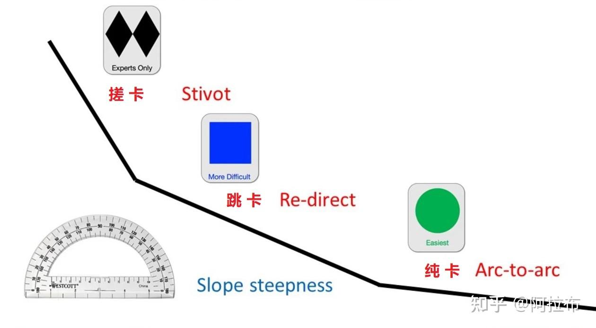
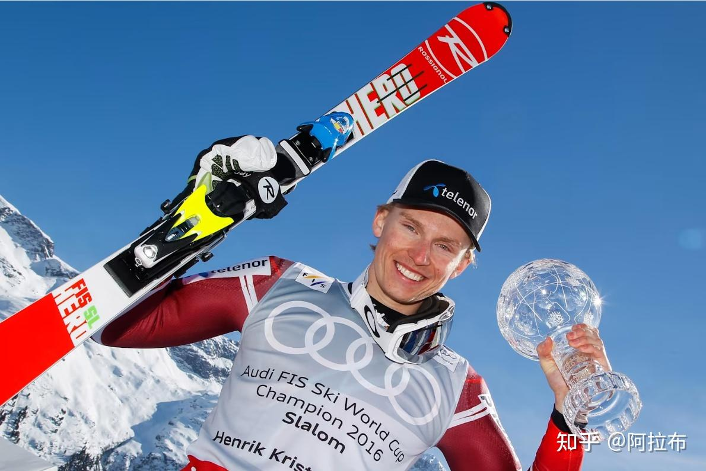
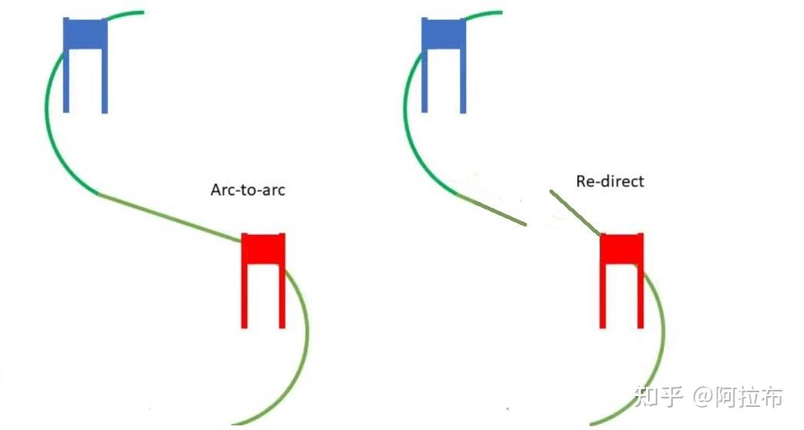
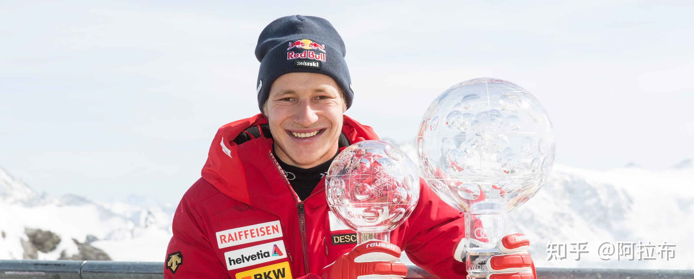
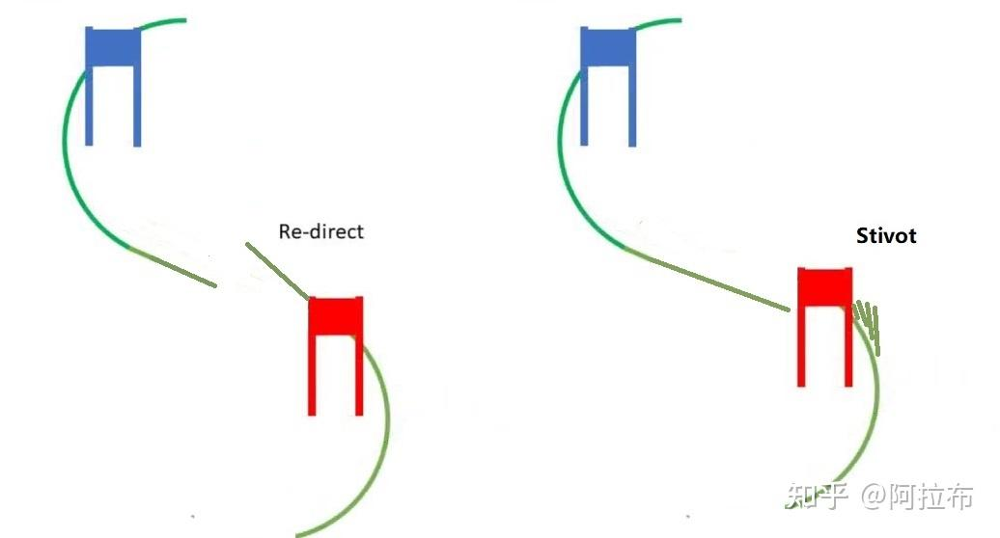
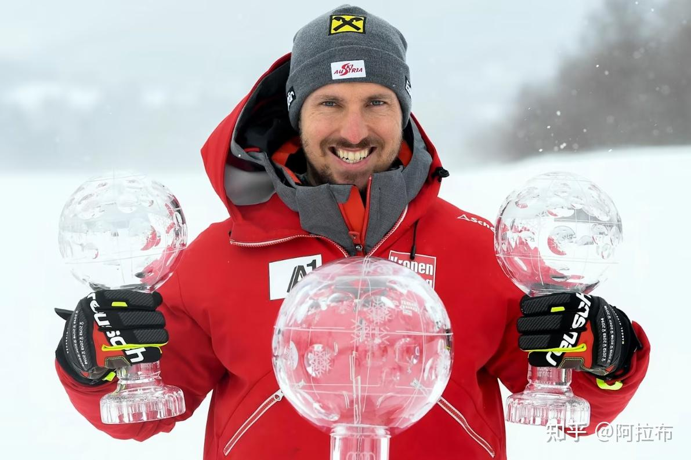

<!-- 来源: https://zhuanlan.zhihu.com/p/562767477 | 分类: 01_双板技术 | 发布: 2022-09-09 | 赞同: 27 -->

# 双板竞技解密——GS技术中的纯卡、跳卡、搓卡

高山滑雪大回转比赛中，运动员必须运用多种滑行技术才能赢得比赛，其中最主要的是纯卡、跳卡、搓卡三种，他们都是以卡宾滑行为主体，但采用了不同的入弯方式，以应对不同的坡度和旗门设置。

以Mikeale Shiffrin在2021年Solden的世界杯开幕赛的第二轮滑行为例，我们看一下这三种滑行方式的区别。

卡宾是最基本的竞技滑行技术，更少的搓雪，带来更快的速度。因此在换弯时，从卡宾到卡宾（Arc to Arc）也是最基本的滑行方式，即卡宾入弯（Carving Entry），我称之为纯卡。纯卡的好处是过渡流畅，速度快，相对节省体力，缺点是换弯需要的距离长，线路宽。纯卡滑行在入弯阶段雪板喷出的雪雾较少，并明显可以看到随转弯而增加。比较擅长纯卡的顶级运动员有Ted Legity、Henrik Kristoffersen、Alexis Pinturualt等。

当旗门间距不足以满足纯卡，运动员可以在入弯时，利用反弹起跳，并采用在空中将雪板旋转一定角度（Redirect）的方式来缩短入弯的滑行长度，这就是跳卡（Jumpping Entry），或者跳入弯（Jump to Arc）。通过合理的姿态配合，可以在落地后直接卡宾（有时因为技术问题或者雪质、雪面不均匀等因素会有少量搓雪）。跳卡的好处是线路更短更窄，缩短线路的同时不影响速度，缺点是体力消耗多，要求动作精确，容易失误，并且一旦失误较难挽回。跳卡入弯会有较大的瞬时雪雾喷溅，然后减少为正常的卡宾雪雾。

跳卡其实是卡宾小回转中的常规技术，但是因为重心与支撑面的关系不同、后续衔接动作不同，难度和风险就变得差别极大，因此小回转中的常规技术用在大回转中就成了“艺高人胆大”的高端技巧。目前世界最优秀的跳卡小王子当属天赋秉异的当红辣子鸡、奥运冠军、世界杯总冠军和GS水晶球得主，Macro Odermatt。

当坡度特别陡、旗门角度特别大时，就需要更加极端的入弯方式来裁剪线路：大角度搓雪入弯（Skidding Entry），通过空中大角度旋转雪板（Redirect），伴随落地搓雪侧滑来减压和调整姿态，然后再卡宾转弯（Brush to Arc）。这种技术我称之为搓卡，即先搓后卡的意思。它还有一个专门的称谓，叫做Stivot（据说是Steer+Pivot 的合成）。搓卡技术可以实现最佳线路，但是会损失较多速度，雪面冲击严重，需要抵抗的压力也大，体力消耗多，也有一定的失误风险，但小于跳卡。搓卡入弯会有强烈并持续的雪雾喷溅。

做出好的搓卡非常难，需要尽快平衡掉压力和冲击，这就需要更强壮的身体，更准确的刃角，更稳定的控制，以及更硬的雪板。搓卡技术第一人，是当之无愧的高山滑雪王者，连续霸占高山滑雪王座八年的 Marcel Hirscher。同样属于天赋秉异选手，外加超强体能和刻苦训练，一哥的搓卡非常自如，落点和卡宾开始位置异常精确，这一点到目前仍无人可及。

正确运用这三种技术，并准确的完成，是顺利完成比赛并取得胜利的关键。但对于每个旗门应当选择哪种技术，并非是一成不变的，有高收益高风险的激进的方案，也有求稳不求最快的保守选择，还有因意外而打乱计划，不得不临时改变策略的临场应变，这一切都取决于运动员的能力、经验、心理素质、甚至当天的状态。所以，一次完美的滑行非常难得，这也正是高山滑雪比赛的魅力。
