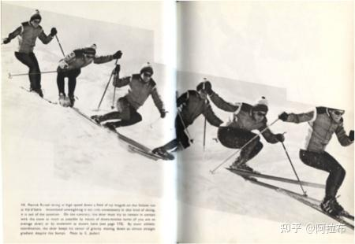
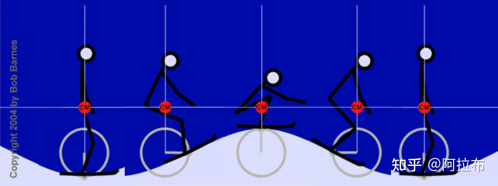
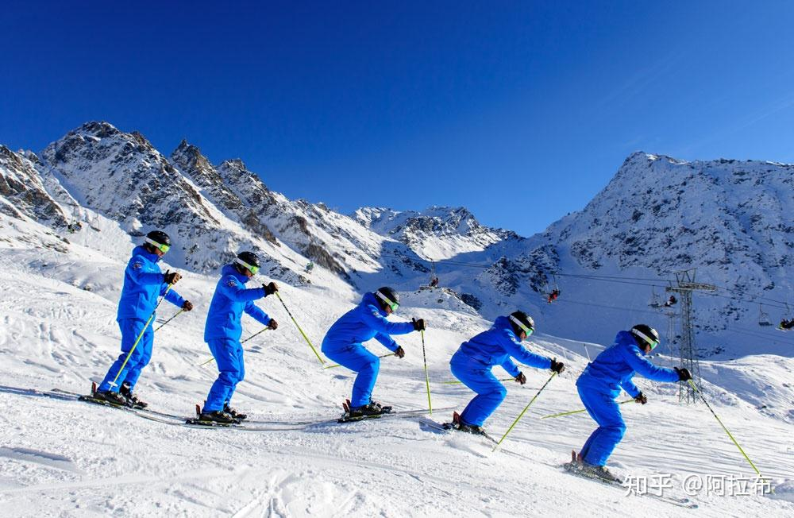
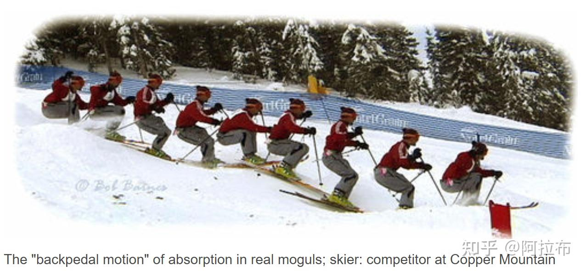
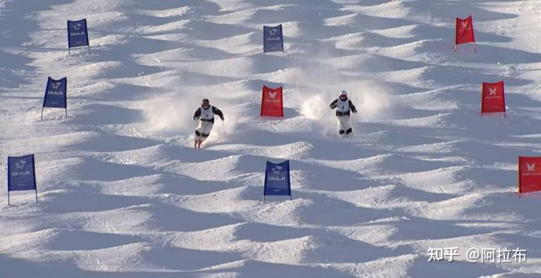
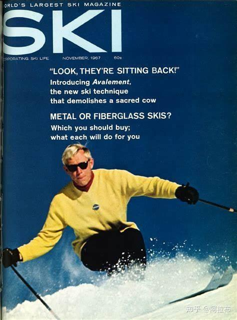
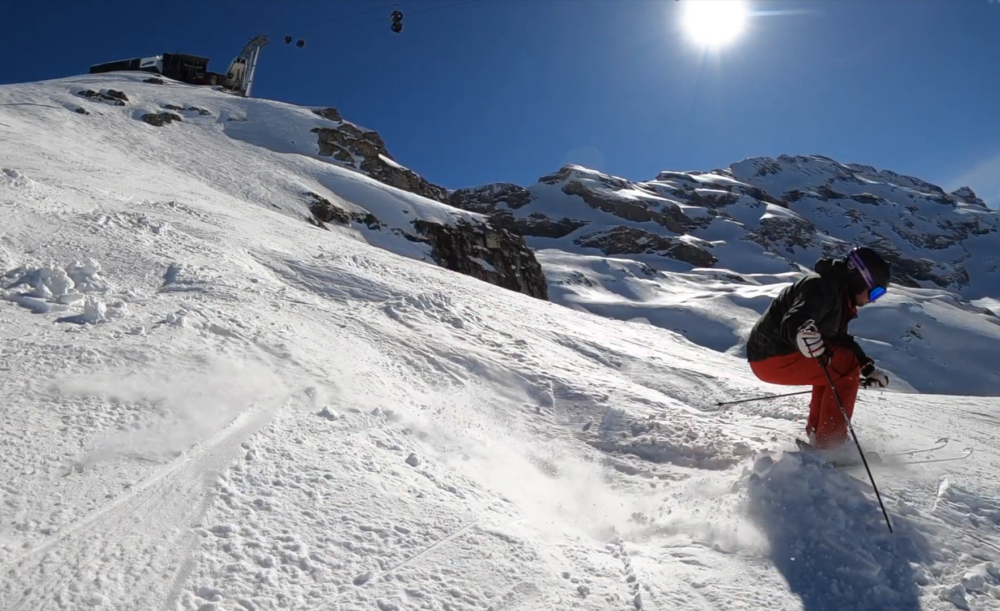

<!-- 来源: https://zhuanlan.zhihu.com/p/564047207 | 分类: 01_双板技术 | 发布: 2022-09-13 | 赞同: 29 -->

# 滑蘑菇时“吸收”到底怎么做？（已补充视频）

今天双板圈挺热闹，可惜不是什么好事。

> 教练D发了一个蘑菇滑行的教学视频，内容是“ 屈髋上包，屈膝下包 ”。另一位教练C通过不妥当的方式进行反对，于是开始互相视频平台挂人。。。 第二天两人已经认识到各有不妥之处，相互道歉并删除争吵视频，这事儿就翻篇了。

到这里还是两个人的私人恩怨，顶多有些两位的粉丝发言过分了点，甚至有人架秧拱火，其他人倒也没必要关心。但是后来，看到雪圈不少知名教练在某个圈子里评论D教的不对，其他一些感兴趣的雪友也在站队，嗯~~~这事儿就有必要捣腾明白一下了。

*1967年的吸收动作示范*

蘑菇里的“吸收”，英文是Absorption，来源于法文Avalement（吞咽），是60年代在法国诞生的技术，应该说经过仅5、60年的发展，已经非常成熟了，不应该有这么基础的争议。这个动作的原理是用身体的曲缩和伸展来应对蘑菇中的地形起伏，以获得平稳的重心移动。吸收动作主要由髋、膝两个关节的伸展和屈缩完成，脚踝的开合因为雪鞋限制只能少量参与。

典型的吸收动作如Bob Barnes这张动图所示：

从左侧包底开始，可分解为四个阶段：撞包，上包顶，下包顶，触底。具体的动作由屈髋、屈膝、展髋、展膝四个关节运动组成，实际滑行时某个阶段可能会两个动作协同，但下面只说以哪一个动作为主：

- 在包底时，两个关节的状态都是伸展的；
- 屈髋撞包，同时保持展膝状态（实际上也要少量屈膝）；
- 屈膝上包顶，在包顶的状态为 屈髋+屈膝 ，身体压缩到最短；
- 展髋下包顶，动图中是展髋和展膝同时做的，但原理上和实际低速时，都需要先展髋屈膝才能做到压板头；
- 展膝触底，回到两个关节都伸展的状态。

这也是大多数教练所认可的吸收过程。那么，教练D的“屈髋上包，屈膝下包”是不是就不对？

正好手头有张图片，与教练D的滑行比较类似：

他在包顶的状态，有点类似于 屈髋+展膝 ，也就是膝盖打开角度比较大，所以下包时必须屈膝，才能压住板头，让雪板贴住雪面。对于这种包顶姿态，确实是屈髋上包，屈膝下包。

那么屈髋+展膝的包顶状态对不对呢？前辈、大师Bob Barnes早就给出了说明，并起了个名字Backpedal motion：

因为比较陡的蘑菇，包背（撞包和上包的区域）比较小，可能来不及屈膝，就会直接屈髋撞包并上包，然后下包时展髋同时屈膝（可略早）。另外，下包时雪板压力小，屈膝会更快捷一些。尽管基本的原则是雪板尽量不离开雪面，但高级别竞技蘑菇，下包这段都是飞的，因此这部分的姿态其实很自由，同一个运动员在不同的环境下都可能采用不同的动作（如展髋或不展髋）。

*左侧运动员过包后在空中展髋屈膝*

所以，该怎么说？

以前跟朋友聊过，国内雪圈很多技术争论，就类似盲人摸象，有人摸到尾巴，有人摸到腿。不是说摸到腿的人多，大像就得长成柱子，对不对？

另外，双板滑行技术，几乎没有四海皆准的真理，针对具体的滑行方式，滑行阶段，或者滑行分格进行讨论才有意义。

多学习，少Diss。无知不是生存的障碍，傲慢才是。

*SKI Magazine，November 1967*

此文第二天下午教练C找我讨论了一小时Backpedal，很不错的技术交流，感觉意犹未尽，于是翻了一下视频，找到一个比较契合Demo，放上来帮助大家理解。

再次强调：

- 多种滑法都是可以的，怎么教取决于现场教练。
- 本文目的在于技术讨论，不是教学。
- 教学一般不需要讲这种细致末梢，除非学员有确定的需求。
