<!-- 来源: https://zhuanlan.zhihu.com/p/596757888 | 分类: 01_双板技术 | 发布: 2023-01-05 | 赞同: 26 -->

# 【转发】Reilly McGlashan：十一种双板滑行错误姿态的示范

> 原文：[知乎 · 阿拉布](https://zhuanlan.zhihu.com/p/596757888)　·　发布于 2023-01-05　·　本文仅供学习交流，版权归原作者所有

本文基于个人理解，对Reilly McGlashan 为他在线指导项目做的推广视频 what is your skiing mistake 稍作说明。

### 1-后座

后座是双板滑雪的第一天敌。

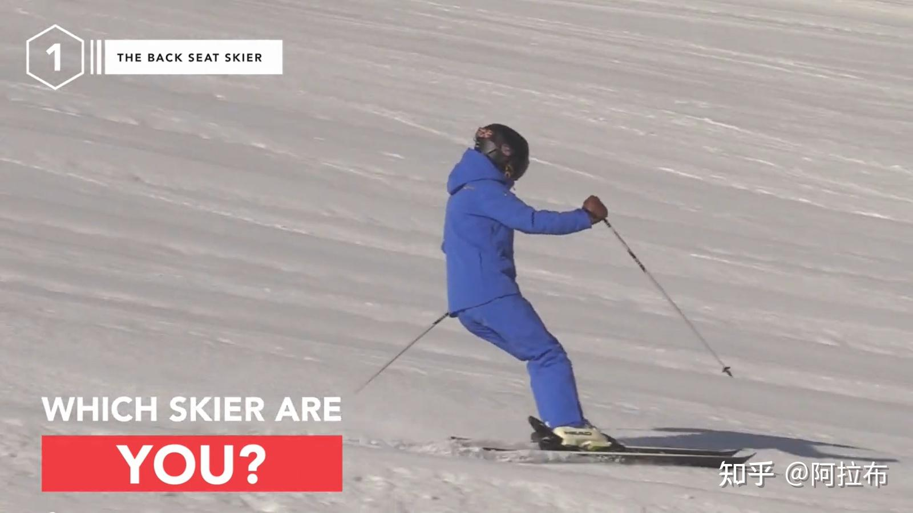

### 2-狂压雪鞋

外脚过度前压，那么问题的根源其实是内脚承重。

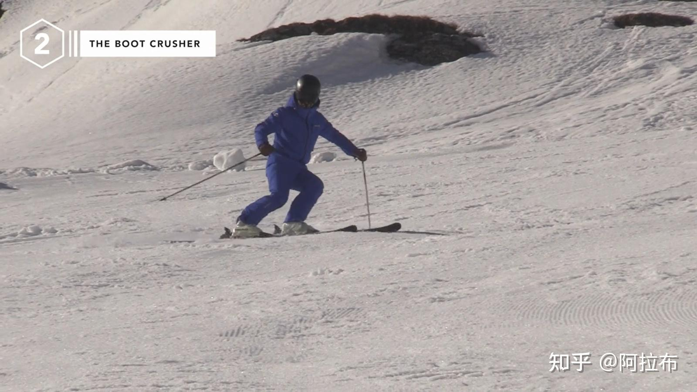

### 3-掉屁股

扭腰小回转中常见，来源于在没有完整弯形的情况下，错误的追求立刃幅度。

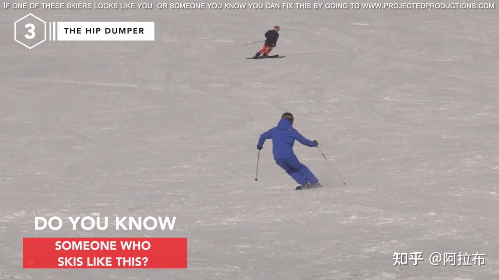

### 4-弹簧人

由出弯过多的下蹲导致。

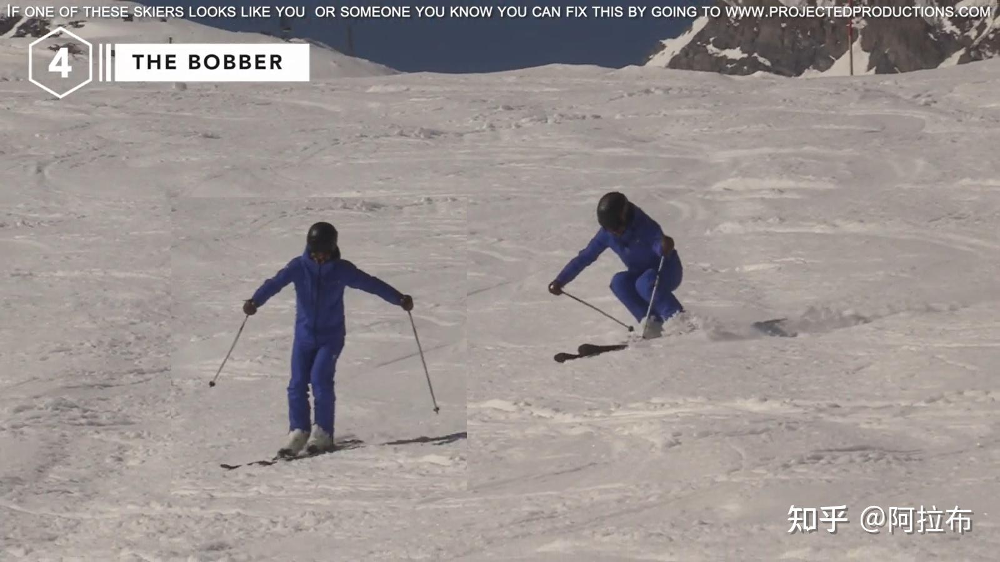

### 4-过度搓雪

（这里序号重复了）指的是破坏了弯形过度搓雪。

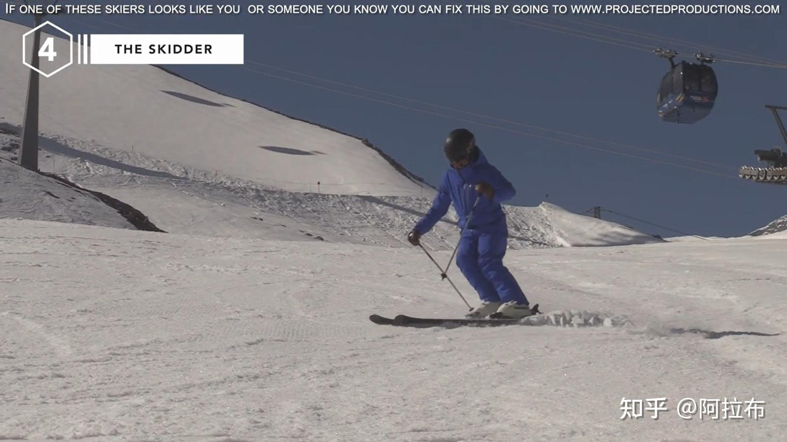

### 5-带转

上身带动雪板转弯。

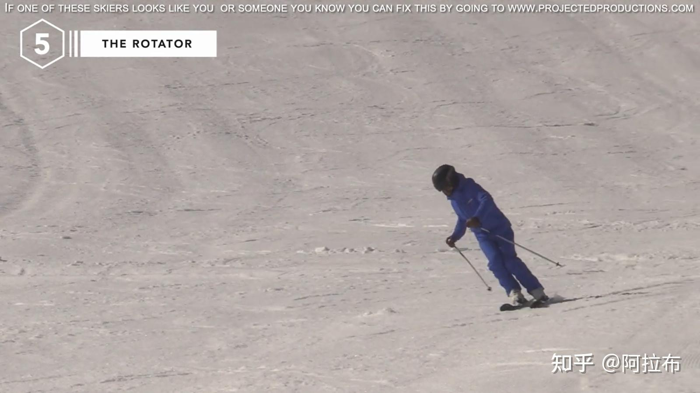

### 6-内倒

内倾 Inclination 是指身体的重心向弯内倾斜，内倒 Banking 则是身体直直的倒向弯内。内倾+反弓就是我们实现立刃+外脚承重的正常方式。而内倒几乎无法实现外脚承重。

也可以理解为：内倒 Banking =内倾 Inclination - 反弓 Angulation

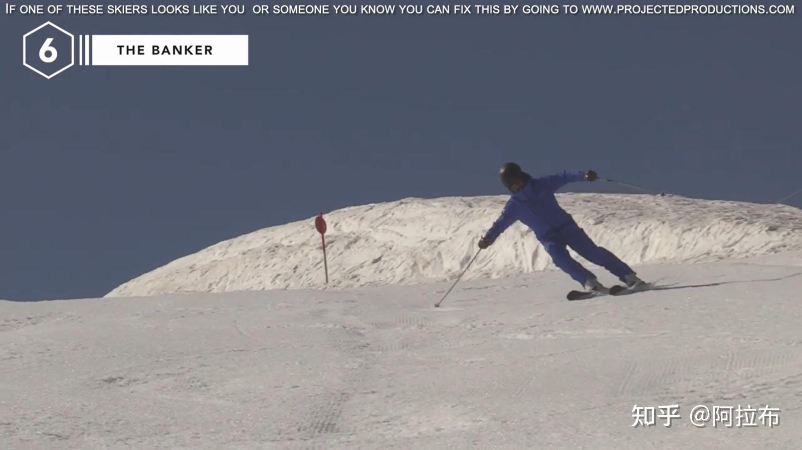

### 7-过度面朝山下

“面朝山下”作为一种提示，可以加强小弯等滑法的分离，但是“面朝山下”不是一个滑行标准。时刻保持“面朝山下”就会成为错误滑法。

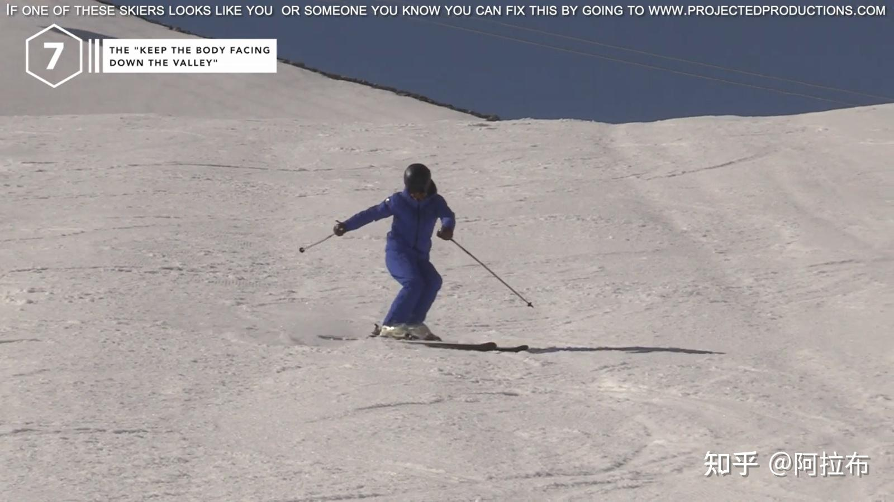

### 8-反向点杖

哈哈哈哈哈（我还能说什么呢）

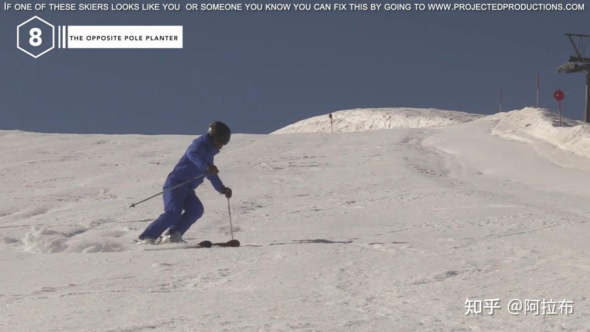

### 9-阿斯本游荡者

（为什么对阿斯本有意见？）其实是一系列错误的综合体现，比如后座，窄弯，腰分离等等。

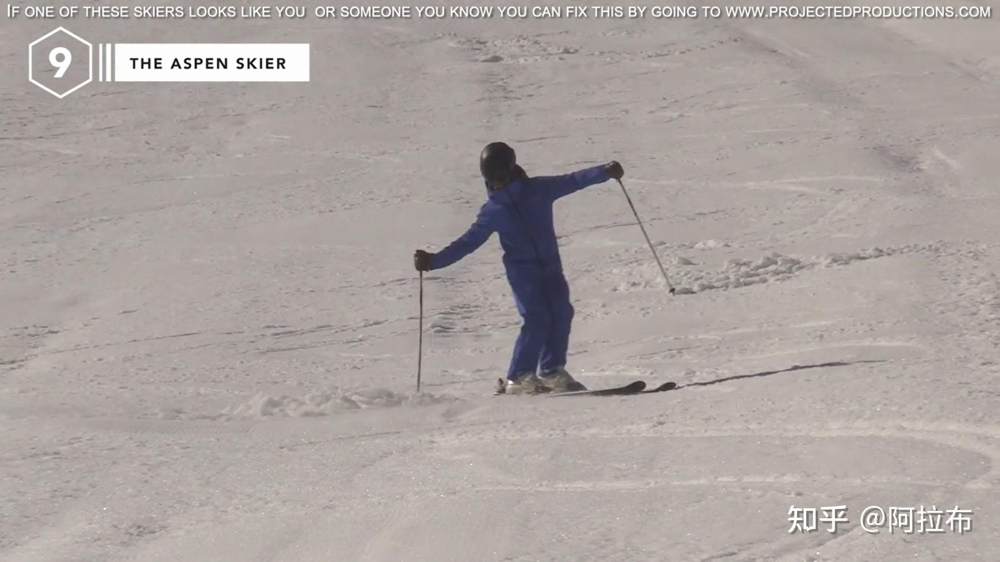

### 10-Z弯

Z弯是常见的弯形错误，通常与后座关联较深。（说实话演示的Z弯很不贴切）

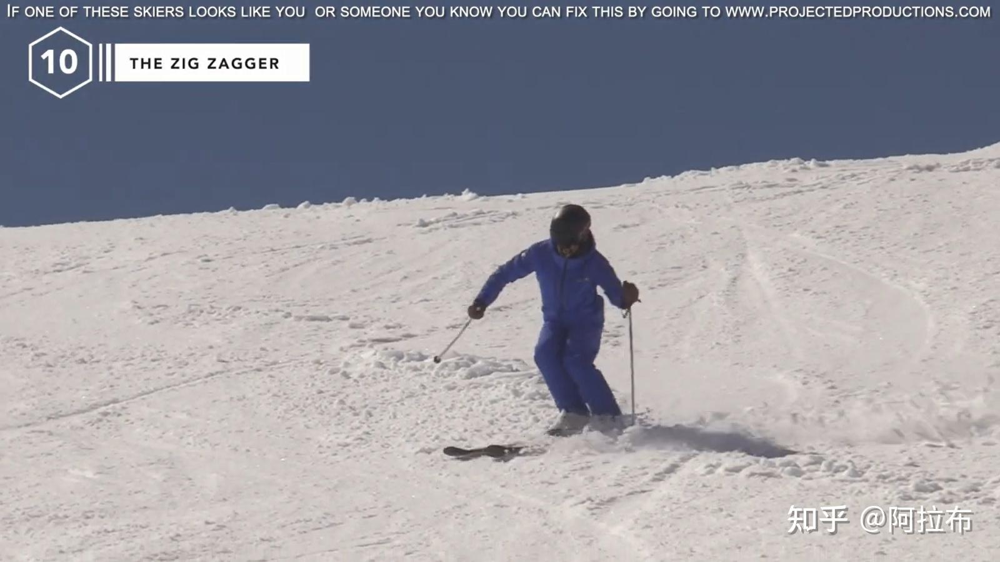

【结束，向大师致敬！】
