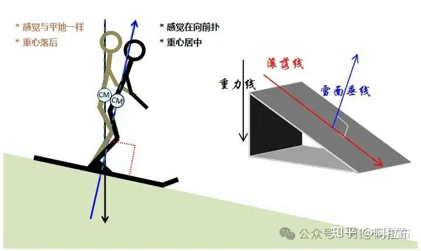
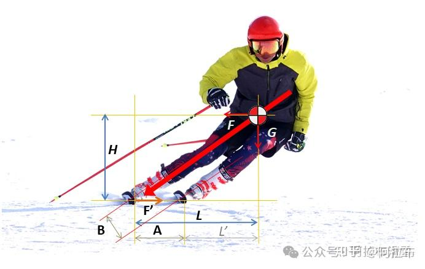
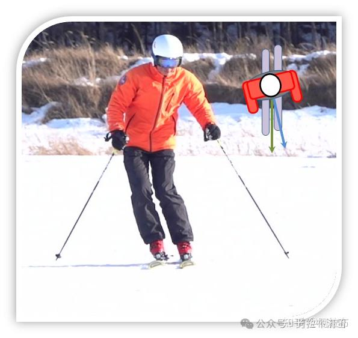
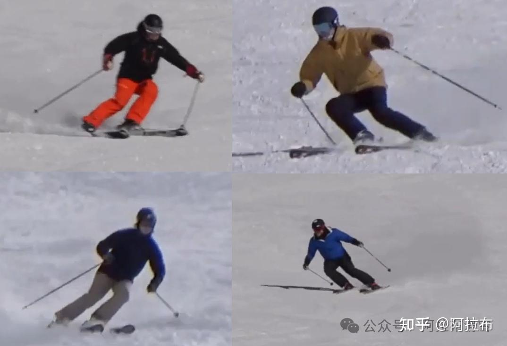
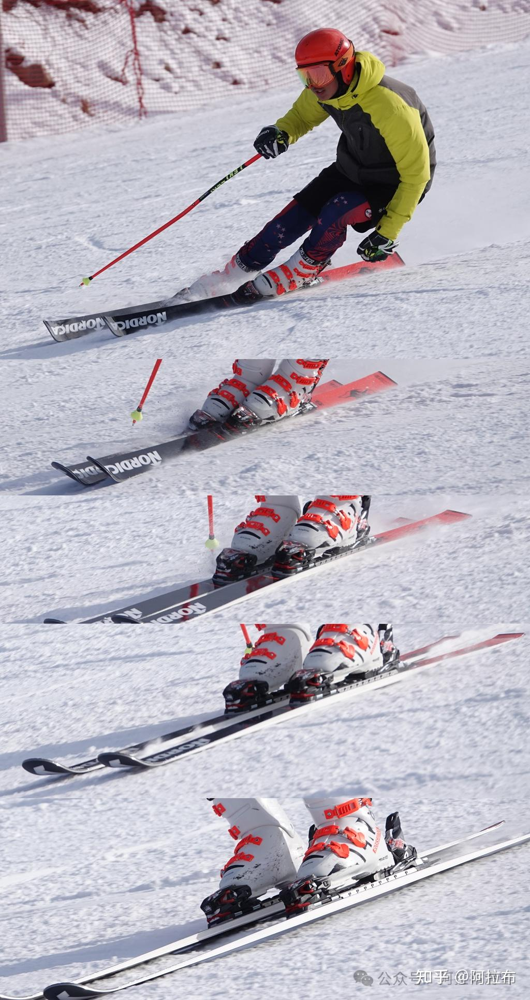
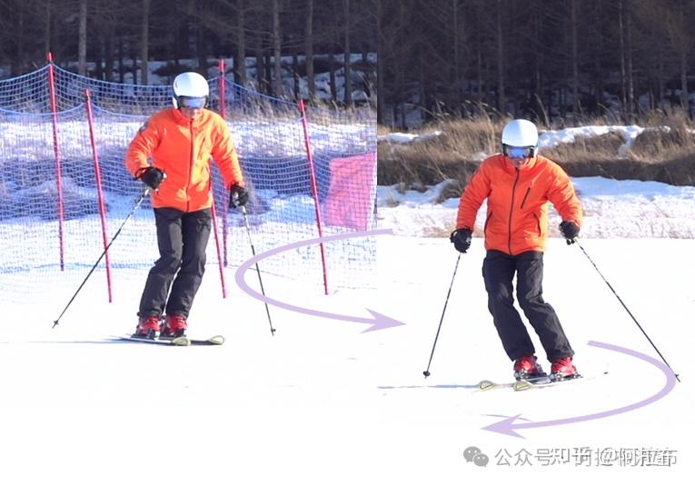

<!-- 来源: https://zhuanlan.zhihu.com/p/882814770 | 分类: 01_双板技术 | 发布: 2024-10-10 | 赞同: 88 -->

# 十六字真言：双板滑雪的核心要点

> 重心居中，外脚承重，适度分离，两板平行

## 重心居中

在平地上，站姿正确时，我们的重心垂直投影在足弓前缘。然而在雪坡上滑行时，如果重心仍旧按重力线投影在相同位置，那重心就会变成落后了。只有按照坡面垂线投影，才是正确的站姿，此时，在心理上，可不是稳定的，而是向前冲的状态。

没错，就是要向前冲：身体不向前冲的话，你的脚就先冲出去了，然后就是失控、摔倒。所以，一定要同步的让身体与脚上的雪板一起移动，才能保持稳定的姿态，才有可能时刻保证灵活和可控。

## 外脚承重

滑雪中的转弯近似于圆周运动，由于离心力的作用，平衡的支撑点自然而然落在外脚上。此时质心与支撑点的连线，最好是通过外腿，这样人体骨骼系统就可以承担主要的支撑力。要实现这一点，就需要将质心向身体外侧略微移动，形成身体向内，而上身反方向略微向外的姿势，类似一张少许拉开“弓”，这就是我们熟悉的“反弓”Angulation。反弓姿态是建立外板上平衡的最佳方式，同时能更好的让雪板切入雪面（抓雪），以及还有稳定上身等优点。犁式转弯天然是反弓的。进阶到基础平行阶段，需要我们有意识的保持犁式滑行时的反弓姿态，以实现外脚承重/平衡在外板上。

内脚的参与会让问题变的很复杂。少量的内脚压力足以让内板立刃和转弯，而过多的内脚承重通常来说会减少抵抗离心力的能力，降低支撑的稳定性，导致V板、减速、半径变大、甚至滑倒等问题。其实，双板滑雪内脚并非真的没用，越高级的技术阶段，内脚的作用就会越重要，但在基础阶段，还是应该以外脚为主，先练好外脚，再去管理内脚动作。

## 适度分离

平行式转弯的立刃，要求两板同时、同幅度的进行。因此，两板必须立刃角度一致，双脚着力点一致（意味着脚踝前曲角度一致，也就是两小腿也要平行）。而在保持基础站姿的状态下身体直接内倾，会发现我们的身体结构会导致内腿的姿态不能与外腿保持一致，这就要求我们的上半身需要稍稍转向弯外。这种上半身朝向与双板指向不一致的情况，称为“分离” Seperation（狭义的上下分离）。

如何做好分离比较复杂，对于不同的滑雪水平和滑行方式有不同的做法。比较简单的原则是，在滑行中做到 两小腿平行的最小程度 即可，所以具体要求是以小腿平行为准的适度分离：既不能分离不足，也不可以分离过度。前者导致转弯困难、弯形过大，后者则出现板头差太多、白色三角区等。

如果分离过度还叠加了内脚承重（上图），出现的问题会更有迷惑性，比如被错误解释为“重心向前太多”、“小腿过度前压”等，在这些错误的解释下，滑雪者难以直接解决问题，浪费大量时间和心气后却只能越练越迷茫。如果严格按照十六字决的次序和要求逐一改善，这个看似复杂的问题自然迎刃而解。

## 两板平行

平行式转弯的核心要求，是双板同侧板刃平行和同步地转弯。因此，这三个动作必须是两板一起做到，同步立刃，同步转弯，同步释放，不能一个板一个板的进行（step）。

而两板的同步动作，必须在重心、外脚、分离等正确姿态的前提下，再增加内脚管理来实现，最终形成内板立刃角度、板距、板头差等滑行表现要素。

到这里，就可以基本实现完美的平行式滑行姿态了。

完整的基础平行式滑行口诀为：

重心居中，外脚承重，适度分离，两板平行，引身点杖，流畅画圆，弯形饱满，节奏稳定。

详细信息可参考技术文章：
