<!-- 来源: https://zhuanlan.zhihu.com/p/974672971 | 分类: 01_双板技术 | 发布: 2024-10-12 | 赞同: 86 -->

# 双板滑雪为什么难

> 原文：[知乎 · 阿拉布](https://zhuanlan.zhihu.com/p/974672971)　·　发布于 2024-10-12　·　本文仅供学习交流，版权归原作者所有

“ 双板滑雪为什么这么难？除了不适应、不好看、不好学，国人还需面对更深层的原因。 ”

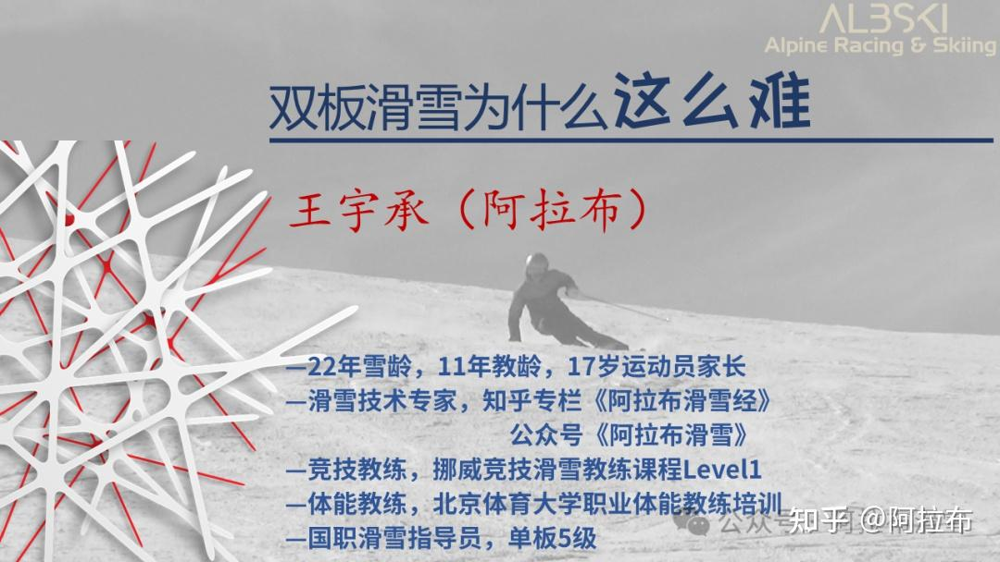

这里所说的双板滑雪，主要是指大众双板滑雪运动之下的高山滑雪Alpine Skiing，高级阶段还会包括蘑菇Mogul和高山自由Freeride。同属于双板滑雪的运动还有越野滑雪Nordic Skiing/CrossCountry，登山滑雪Apline Touring，以及自由式滑雪Freestyle（其中包含蘑菇，公园Park，高山自由等）。

## 01 一难：持续变化的不稳定环境

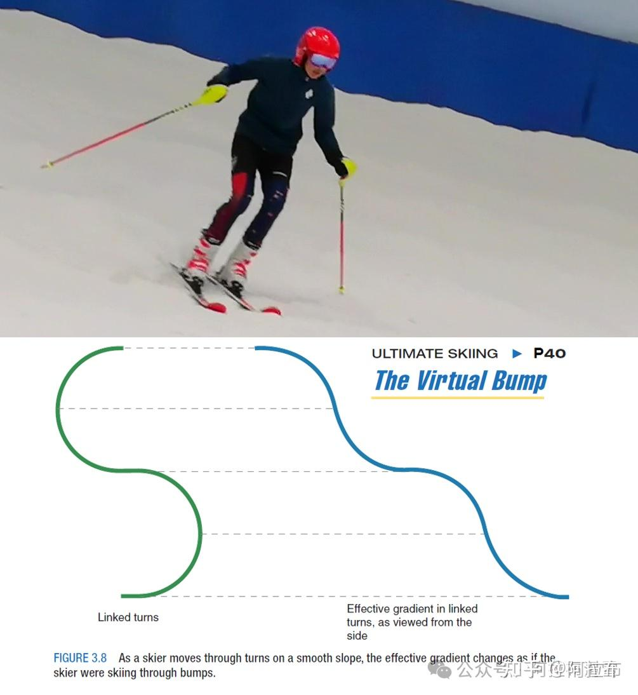

*《Ultimate Skiing》（滑雪宝典）*

高山滑雪又叫做下坡滑雪Downhill Skiing，是脚踩滑雪板在铺雪坡道上进行的一项运动。在坡面向下滑动时，我们会持续处于不稳定环境。在这个与平地完全不同的新环境中，必须采取特定的姿态才能保持与雪板一起滑动。而且滑雪是连续的S型转弯，这个过程中沿滑行方向的坡度在持续变化，更加大了难度。尤其是在入弯前，更需要将整个身体主动向山下倾倒，才能及时获得滑行控制能力。

## 02 二难：对抗外力获得动态平衡

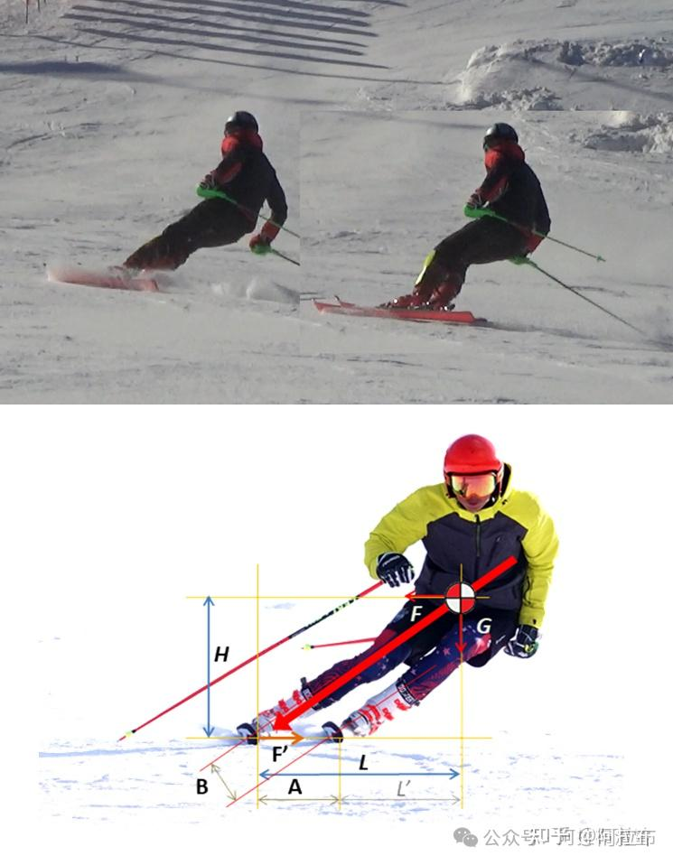

在滑行中，我们不仅受到重力和支持力，转弯时还有离心力的作用，会造成将身体甩出弯外的感觉。在坡面上持续运动时，处理好这三种力并达到动态平衡，的确是有挺有难度的。滑雪者不仅要学习这种新的运动模式，还必须通过大量的练习来让它变成身体记忆，才能在不断变化的环境中从容不迫、游刃有余。

## 03 三难：滑好看不容易

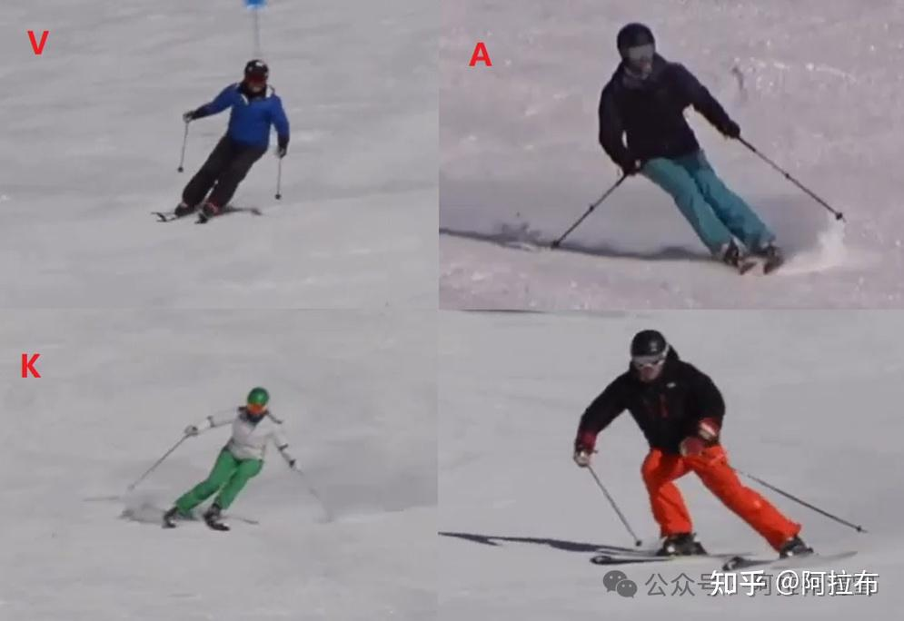

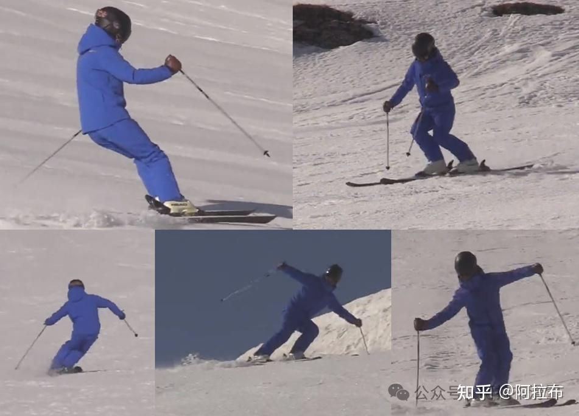

对中国滑雪者而言，滑雪时能拍出漂亮的照片或视频是一项很重要的要求。但是不像单板，穿好雪板之后怎么动都很帅，双板滑雪想做出协调美观的动作太难了。一方面是双板动作的自由度比较高，需要协调更多的身体部位，另一方面还因为在陌生的危险环境下身体会紧张，导致动作僵硬变形。此外，大多数没有训练过的滑雪者不能正确感知自己的动作姿态，这也是导致双板动作总是奇奇怪怪的一个重要原因。

## 04 四难：学习周期长，技术等级依赖严格

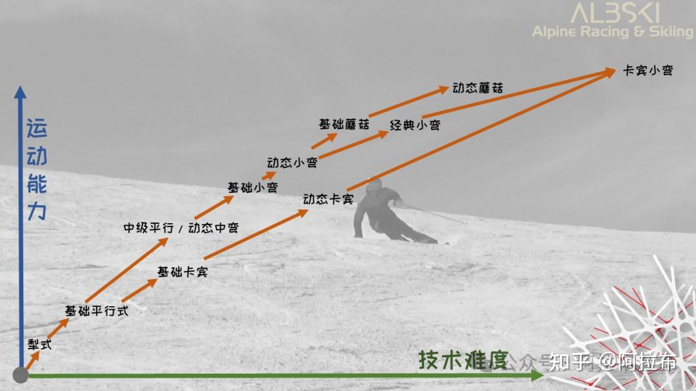

双板滑雪的滑行自由度大，上限高，需要学习的内容也更多。然而这些学习内容的前后依赖关系非常严格，必须是逐步升级。并且滑行进步不仅仅是技术难度的增加，还有运动能力的提升，往往这才是进步最慢的地方。即使学习过程中跳过某个滑行方式，也跳不过技术水平和运动能力的发展时间，实际结果也快不了。

## 05 五难：爱卷“高级”技巧，忽视基础能力

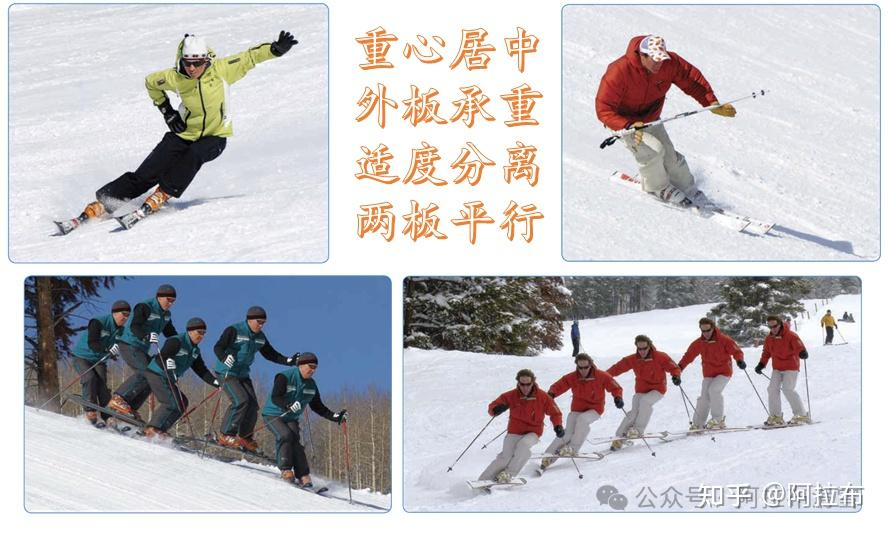

在欧美滑雪大国，滑雪更多的是冬季休闲或与朋友家人游玩的一种技能，对滑雪的要求是能在各种地形滑行即可，不会要求好看和表现力。而在国内，对滑行表现力的追求甚至有点偏执，导致很多人去卷直接提高表现力的技术，比如大内倾等。但对绝大多数人而言，表现力无法提升的原因恰恰是基础滑行能力和身体的运动能力这两方面的不足。而提升这些基础能力的最佳方式，是从基础平行开始就严格做到这十六个字：重心居中、外脚承重、适度分离、两板平行。

## 06 六难：中国特色的低水平学习环境

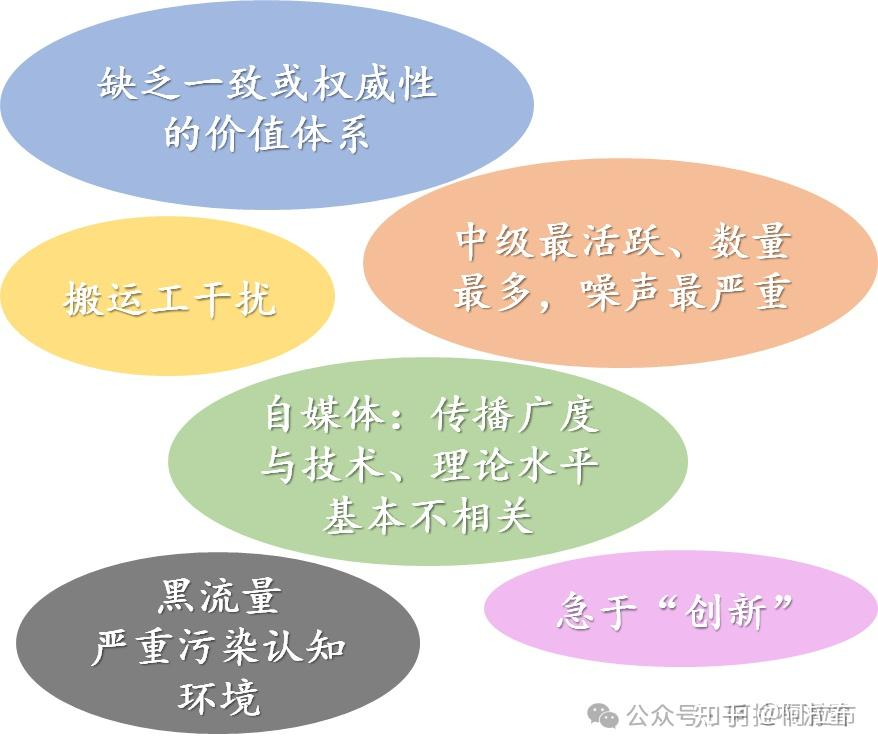

中国大众滑雪起步比较晚，人才发展也非常缓慢，国内头部大众滑雪教练（规范叫法：滑雪指导员Instructor）也只是国外的中级水平。虽然这两年少量教练取得了国外顶级指导员证书，但也仅仅是学生生涯毕业而已，离顶级还相去甚远。另外，早期出国学习的先行者良莠不齐，比如把正常练习按照自己的理解改做错误动作然后广为传播，又或者为了自己的地位不择手段贬低和打压其他优秀指导员，还有开创PUA教学等等。所以国内滑雪教练目前来说只有网红没有真正的大师，这就导致了国内缺少一致性或者权威性的价值观体系，也就是对“什么是滑的好”没有统一的判定标准，并由此导致一系列的问题，包括但不限于：各说各话，谁嗓门大谁“对”，奇葩言论层出不穷；搬运国外教学视频分不出蜜蜂还是苍蝇；局部结论无限放大；故意用惊人之语吸引注意；甚至不惜哗众取宠专门吃黑流量等。对于大环境问题，个人确实无可奈何，只能多听多看，不要轻信。对于黑流量不要因为批判而转发，置之不理即可。

## 07 七难：高端滑行距离世界水平太远

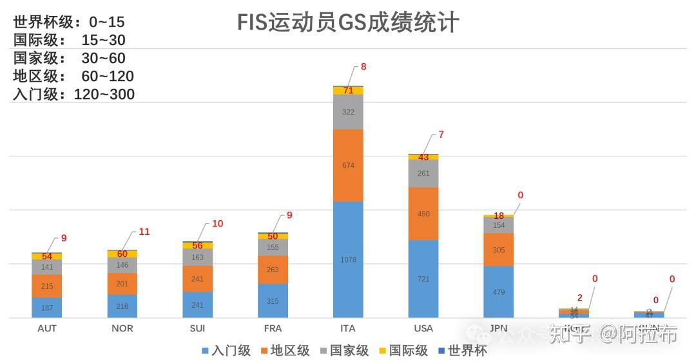

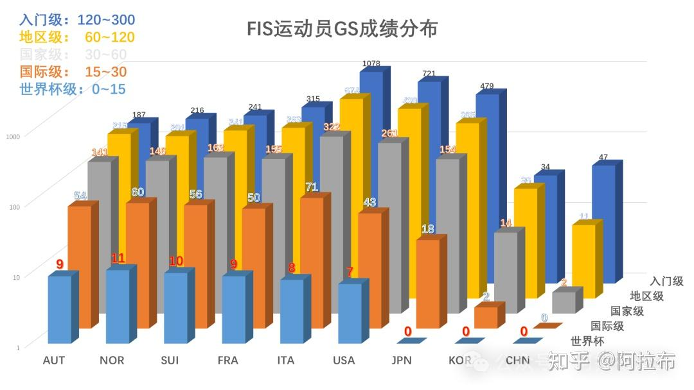

双板滑雪真正的难，难在竞技。以高山滑雪大回转成绩为例，对比世界六强（奥地利、挪威、瑞士、法国、意大利、美国）和东亚三国，可以发现日本还是比较强的，如果能出两三个世界杯级运动员就可以跻身世界强国第二梯队。韩国比日本刚好落后一个梯次，而中国又比韩国落后一个梯次。当然我国教练员和运动员一直在努力追赶，国内经济发达地区的家长和孩子们也开始积极参与这项运动，相信未来的发展一定会更好。

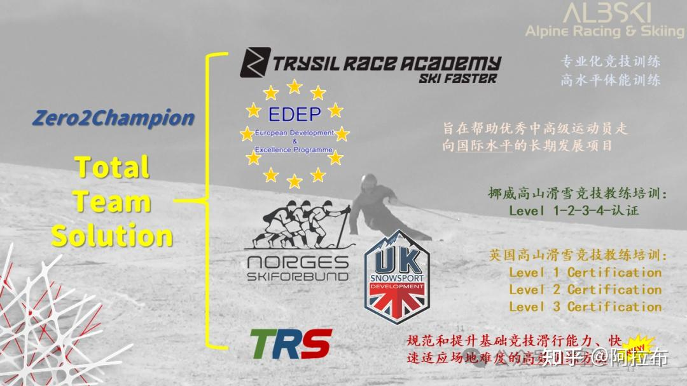

我在经历六年的竞技训练之后，也与挪威合作伙伴一起在思考针对中国现状有没有更好的发展模式，目前有了一些方向，也希望未来能够助力中国高山滑雪竞技运动的进步。

2024.10.11 第一次发布
