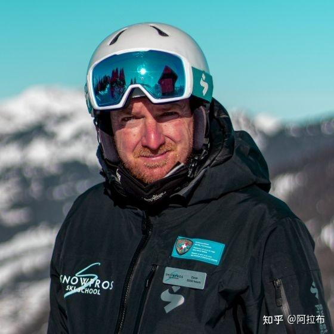
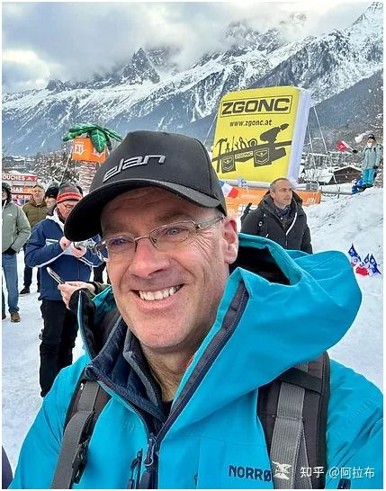
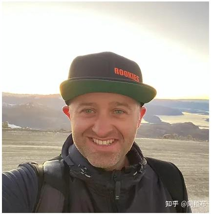

<!-- 来源: https://zhuanlan.zhihu.com/p/3686034648 | 分类: 01_双板技术 | 发布: 2024-10-28 | 赞同: 2 -->

# 【翻译】了解PSIE——与Derek和Jamie的访谈

> 原文：[知乎 · 阿拉布](https://zhuanlan.zhihu.com/p/3686034648)　·　发布于 2024-10-28　·　本文仅供学习交流，版权归原作者所有

2024-05-01

Dave Burrows, Director and Owner - SnowPros Ski School

Derek Tate, President - PSIE

Jamie Kagan, Director - PSIE

Dave Burrows：

本周的第 63 集，我采访了 Derek Tate 和 Jamie Kagan。你可能已经在社交媒体上看到，加拿大专业滑雪教练的这些人已经在欧洲成立了一家姊妹公司，称为欧洲专业滑雪教练，欧洲专业滑雪教练的框架或多或少与加拿大的专业滑雪教练相同，只是它会有一些欧洲的调整，但本质上框架和途径以及所有这些东西都是一样的。这些已经公开不乏，他们将推出越来越多的相关信息。这个播客的发布可能会契合他们更多信息的上线，所以我借此机会与 Derek 和 Jamie 交谈，坐下来了解他们想要做什么，它到底是怎么回事，以及是否，

事实上，你知道，他们这样做的目的，因为我们在欧洲并不缺乏滑雪指导员协会。

我们在采访中谈到了这一点，并谈到了他们正在努力做什么，以及他们的产品与其他协会有何不同。我们讨论了这条途径是什么样的，并对持续的专业发展和培训进行了一般性的评论。我认为他们正在努力朝着他们要去的方向努力，这真的非常非常有趣。就我而言，我肯定会参加他们在秋季提供的一两个课程，只是为了了解更多信息，在总体上更新我的专业知识，并从不同方向获得一些东西，而不是我以前从 BASI 和爱尔兰协会以及雪上运动中获得的那些。

一旦音乐响起，我们就要直接进入采访。采访大约一个小时，有点长。我非常非常希望您喜欢对 Derek 和 Jamie 的采访。这是一次愉快的谈话。我已经在这个播客的注释中放了链接，你可以在哪里找到更多关于这些人的信息，正在做什么以及他们正在努力做什么。因此，事不宜迟，请享受与欧洲专业滑雪教练协会的 Derek 和 Jamie 的聊天。

这里是总监 Jamie Kagan。下午好。我们在这里讨论 PSIE。我们已经在之前的播客中讨论了 PSIC。只是为了给新来的听众一些背景信息，因为之前听过播客的人，会知道我和 PSIC 的人一起做过一期节目，那时候他们还刚刚开始，真的很早期。我不说那时候只有一些想法，但如果你回头听那个播客，可以肯定的是，我们当时谈论的内容并没有太多的细节。他们有自己的想法，也有自己的方向，他们正准备公布所有细节和信息。现在你们正处于类似的时期，但据我所知，你们所做的......PSIE，你基本上是在采用他们的框架，这样我们就可以详细讨论这一切是什么样子的，以及类似的一切。这比我当时与那些人的最初对话要成熟得多。这样说公平吗？

Jamie Kagan：

是的，完全。是的，正是这样。是的，我们正在利用他们的结构、他们的途径，将其带到欧洲。但随着我们的经历，我们可以更深入地研究这一点。

Derek Tate：

为了让听众更容易理解，你知道的，到处都是首字母缩略词，PSIE 和 PSIC 只是为了提醒你它是欧洲专业滑雪教练。

Dave Burrows：

这是真的，是的。我假设他们已经知道了一些的假设知识，我还跳过了介绍你们自己和成员的部分。现在 Derek，我们知道了，Derek 曾来到过播客，就像一个两届的老兵

Derek Tate：

.没错，我仍然在拼命想赶上 Julian Griffiths，但我认为我永远无法达到那里。

Dave Burrows：

他就像我的替补，所以如果我有一点时间缺，我就去找他，他会很高兴地交谈，所以我认为你永远不会赶上他。

那么，Jamie，你在 Nendaz 那儿工作。我很了解你，但也许你可以告诉听众更多关于你在那里做什么以及你最近在做什么。

Jamie Kagan：

是的，很酷。稍微讲一下我的经历。我从 2000 年代初就开始从事这个行业，实际上是在加拿大开始的。我在班夫开始，然后来到了一个叫 Silver Star 的度假村。我在 CSIA 完成了我的四级考试。然后在 2014 年、2015 年，搬回了欧洲。实际上，我在 Dermatt 为 Julian 工作了几年，担任技术总监，然后在 2017 年我与那里的某人担任联合总监，然后在 2018 年搬到 Haute Nendaz，实际上第一年在这里为 Julian 经营滑雪学校，然后我们最终在那个赛季结束时拿到了特许经营权。从很久以来，我就一直在这里。所以在Nendaz，我们有滑雪学校，“欧洲雪上运动”。然后有我的公司 Sommet et Neige，这是一家零售和租赁店，然后还有一个高效的培训中心。所以我们在赛季初期和整个冬季举办补习课程，以及三级和四级训练计划。

Dave Burrows：

对于那些不知道的人来说，Nendaz 是一个非常美丽的地方。我在那里滑过，你知道的......如果你愿意，你可以从山顶的一侧开始有一些可爱的滑行。在顶部有那个非常好的区域来教人们，然后从真正超级简单、宽阔的蓝色雪道回到缆车的底部。风景很美，有些美丽的树林什么都。这真的很好，那里也有很多非常棒的缆车，不是吗？

Jamie Kagan：

真的很好。我想在我们搬到这里之前，我已经在巴伐利亚滑过很多次了。我们地理位置优越，因为可以在 20-30 分钟内的行程到达所有四个山谷。然后显然，我们还有一个超级方便的中央住宿区和小镇。所以你知道这个区域很大，当然从训练的角度来看，我认为我们的位置非常好。就像你说的，我们在 Nendaz 的前面有梯次爬升和树木，好处是每个人都从 Nendaz 出发，然后去更远的地方。所以我们实际上可以经常在这里见面，却没有那么多的人流，这很酷。如果我们需要去人群中，当我们需要进入某些地方时，我们会前往 Berbier。

Dave Burrows：

确实是的。我想从这个角度来看，它有点像我们现在的 Porte de Sleigh。很多人使用，瑞士人，当然从 Le Crozet 和 Choperie 的角度来看，他们到达那里是为了快速进入法国，然后去法国那边吃一顿便宜的午餐。他们就是这样......你会看到今天早上所有的人流都消失了，然后那些知情的人留在瑞士一侧，享受像样的雪。是的，这很酷。你的赛季怎么样，Derek？我们在这里、那里和任何地方都在关闭滑雪季节。我们在 Creezee 还有一个星期。你怎么样？进展如何？

Derek Tate：

是的，正如你所说，有时有点挑战性，只是气温高得离谱。但是 Chamonix 有足够的地形，所以积雪很好。Grand Monde 一如既往地是一个非常好的地区。所以我一直在......就在周末。这还算不错，Grand Monterey 将开放更长时间。我认为我们遇到了像 Les Euches 这样的地方，Saint-Gervais 本身确实经历了一个充满挑战的赛季。但另一方面，Les Contes-Munis 很好。同样，它足够高，以至于这里的实际积雪非常好。只是一个有点奇怪的赛季，它从来没有足够冷。

Jamie Kagan：

从我所看到的情况来看，它已经遍及全球。就像每个人，我在世界各地的所有朋友一样，没有人度过了一个美妙的冬天。就像过去几周美国一直在大雪中一样。加拿大开局很慢，我认为情况更好，但这不是一个伟大的赛季。然后，即使我在日本呆了一个星期，他们那里的冬天也相当糟糕。所以今年似乎有点全球化。

Dave Burrows：

这很有趣，因为是的，我的意思是，我们有一个轻松的冬天，然后北美的土地恢复正常，但即使在那里，他们似乎也没有度过一个特别美妙的冬天。我想是这样的，有趣且具有挑战性。我的意思是，我想从滑雪学校校长的角度来看，当你有这种长时间的高压和好天气时，你不会遇到......那么多种天气取消或类似的事情。所以对我来说，我认为这很棒，你知道的，就像我真的不介意一样。但它确实限制了你拥有的真正美好的粉雪天数的数量，你知道，无论如何，今年的粉雪天数很少。当然，这就是我的经历。

所以你们能不能讲讲，那么对于“欧洲专业滑雪教练”来说，这是怎么回事，我很想知道背景，我很想知道它是怎么来的，它是如何到达的，是如何形成的，它是什么。显然，那里有某种加拿大联系，而且 Derek 认识每个人，所以我猜这可能是它产生的一种方式。但是是什么让你们朝着这个方向走呢？

Derek Tate：

Jamie，你也许想开始吗？

Jamie Kagan：

当 PSIC 推出时，我实际上在新西兰，刚刚结束那里的冬天。我有几个朋友参与了 PSIC 的早期设置。所以我知道了这件事，最初对我来说，我被邀请了，我去了加拿大参加他们的 LPT 培训，以获得他们的持牌专业培训师资格。我想更多地了解它。我对他们的哲学、他们的目标、他们一直在谈论的冒险感到非常兴奋。所以我对这个新项目感到兴奋，并学到了更多。当时我正在尝试为即将到来的 10 月出售南美州的一个新补习课程。之后想在加拿大有一个工作营的机会，只是因为我在那里的几年里有一些人脉。所以我在 11 月去了加拿大，花了三天时间进行他们的培训，结识了很多朋友。对此越来越兴奋。然后 Derek 在 12 月为我举办了一级考试，实际上在伦敦，Derek，是吗？

Derek Tate：

是的，十二月，没错，是的。

Jamie Kagan：

我们最后只是聊了聊，你知道，Derek 已经成为会员，被邀请成为 Sovereign Institute 的一员，所以我们聊了起来，我们想，你知道吗，也许这可以在这里完成。最初，就像我说的，我只是要成为他们在欧洲的许可课程提供者，只是 PSIC 的许可课程提供者。然后我们就在想，嗯，你知道的，如果这是一个机会，也许我们可以做一些不同的事情。然后他们从那里开始行动。

Derek Tate：

对我来说，我不像 Jamie 知道的那么早，因为他肯定在新西兰的时候就知道了。我其他人一样，是在最初的新闻稿出来时才知道的。但后来当我看到谁参与其中时，我非常感兴趣，因为当我在Levi 的Interski 时，我对设置它的人非常了解。我有机会和他们一起滑雪，和那些人在一起。所以我非常想了解更多。然后我开始看到他们的价值观真的与积极心理学密切相关，这显然是我的事情之一。所以我非常兴奋，因为这是一个重新开始的组织，并且真正接受了个人的全面发展。某种好的性格优势和价值观，我想，是的，我想参与其中。事情就是这样发生的。然后，正如 Jamie 提到的，他们正在建立他们的滑雪专业学院，我有机会在 1 月份成为第一个为此提供内容的人。然后，是的，就像 Jamie 说的，我们刚刚开始聊天，然后说，哇，这实际上可能会在欧洲这里发生，没有理由不。那么，我们为什么不与他们取得联系，看看他们是否认为这是一个好主意呢？他们说是。在我们深入了解它是什么样子的细节之前，我们也可以，你知道，你基本上是在沿用 PSIC 的项目所拥有的，他们所有的教练途径，或者你想怎么称呼它，基本上在欧洲这里复制它。所以它实际上是可以互换的。

Jamie Kagan：

是的，正是这样。所以，我的意思是，如果你愿意，我们可以更深入地研究这个途径。也许这是他们拥有的相同的四级系统。我们将添加与在欧洲工作相关的其他模块。比如，我们将在今年夏天编写一个相当于 EMS 的东西，实际上是欧洲山地安全European Mountain Security。因此，我们将有一门课程......明年冬天可供想在欧洲工作的人使用，我猜它将与委托应用程序当前设置的内容相匹配。我们也会为任何想在欧洲工作的人增加语言测试，可能还会增加第二门学科，你知道人们可以和他们喜欢的人一起做第二门学科，我们会认可它。只是为了让我想它更符合欧洲模式。但我认为这很酷的一点是，这不仅仅是成长途径，它将是双重会员资格。所以如果你在加拿大参加课程......您也将成为 PSIE 的会员，反之亦然。我认为这是以前从未做过的独特事情。

Dave Burrows：

好。然后，好吧，如果我是 PSIC 的成员，那么我也将成为 PSIE 的成员，反之亦然。这大概给了我机会，例如，如果我有能力去加拿大。我认为我太老了，但如果我有能力去加拿大并获得工作签证或其他东西，我可以把我的资格证书随身携带，它会被加拿大的学校认可。对吗？

Jamie Kagan：

100% 是的。当我们与 PSIC 的人讨论这个问题时，我们现在显然与他们定期会面，我们讨论了这种无国界的资格认证过程。因此，无论您身在何处，都可以继续接受教育。与其中一个组织。这是新事物，但我认为，你知道，我会说这是一个问题，但这肯定是我必须处理的事情。

当我从加拿大来到这里时，我是加拿大的四级学生，但我从未在欧洲工作过。所以我必须弄清楚要走哪条路。在当时，虽然加拿大四级得到了认可，但很难获得与欧洲资格同等的薪水。所以我最终完成了我的基础四级，通过了它。然后我做了我的瑞士Brevet和我自己的Sleight。所以，你知道，必须花更多的钱，花更多的时间去重新获得欧洲的资格。我们每个赛季在伦敦训练的男生和女生，他们都会去新西兰、澳大利亚、日本、加拿大工作，他们可能在相当长的几个冬天都是临时的。我经常收到消息说，我该怎么办？我应该去澳大利亚用 APSI 完成我的三级吗？所以这些问题已经存在了很长一段时间，我认为这非常酷和独特的是，它将成为第一个人们不必担心这个问题的组织。他们应该能够继续他们的教育发展，而你听到的是同样的东西，这非常好。您不必重新学习新系统即可通过考试。所以，是的，我对此感到兴奋。这很酷。

Dave Burrows：

是的，它肯定是独一无二的，对吧？我的意思是，我想......在其他组织内部，我知道 Swiss Snow Sports 有一个国际等效或认可计划，我认为BASI也做了类似的事情，但这是一种更像一个，它是由坐在办公桌前的人评估的，对吧？所以，当然还有瑞士，我认为你可以走两条路，所以并不总是很清楚。所以你可以像政府路线一样走，这更贵，我听说更武断。然后，你去瑞士的雪上运动协会，那里的资格认证更像是更加固定的对等性，他们知道，因为我想他们看到了更多的实例，对吧？但是，有趣的是，以前从来没有任何事情真正地在两个国家之间直接移动。您认为这是否将始终仅限于加拿大和欧洲，或者您认为它会推广到其他地方，例如南半球滑雪或其他地方？你有没有想过这个问题？

Jamie Kagan：

嗯，我们今年在新西兰与 Rookie Academy 一起开发新场地，所以将在那里进行资格认证。我还不知道他们到底在开什么课程。我自己会在 8 月份去那里，但我知道他们正在那里运行，我认为是第二级和第三级。然后，是的，我们正在洽谈明年在日本也举办一些活动，这将非常有趣。这将更像是一个联合的事情。因此，PSIC、PSIE 将在那里合作开发一些课程。我认为这又是它相当独特的地方。您可能会发现，在某个时候，您会同时进行 PSIC 和 PSIE 考核。所以，你知道，对我们来说重要的是与大洋彼岸的那些人合作，因此定期会面，你知道，Kirk 和我可能会在 11 月来到加拿大，与那里的每个人见面。是的，所以这很酷。这非常有趣。

Derek Tate：

我想补充一下 Jamie 在那里所说的，我们还看到了培训师，PSIE 和 PSIC 的持牌专业培训师也是互通的。所以如果我是一名PSIE培训师，而我恰好在加拿大，我可以为 PSIC 提供一门课程。所以从这个意义上说，它是可移植的，而不仅仅是作为具有您资格的会员。所以它是......

Dave Burrows：

是的，当然，因为显然你在教同样的东西，对吧？那是。。。是的。它应该是相同的。

好的，但是就像，所以说......我不知道它是如何运作的。我确实有点了解它在新西兰是如何运作的。但他们是......我要跳到我脑海中的一个话题，但是我们在交谈时，当我在最初的采访中与 PSIC 的人交谈时，这实际上很好，因为它几乎就像第二部分，因为如果你是一样的，我得到了第二部分，无论如何我都要和那些人一起做。 所以这太棒了。当我们与他们交谈时，他们的明确目标之一是关于工作。他们的用语是“与滑雪行业一起”。当我们扩展它时，与他们合作就像与滑雪学校交流，或者说没有多少滑雪学校，因为是加拿大的情况，所以更多的是与雪场或度假村交流，这与我们欧洲人所理解的概念略有不同。并更多地了解他们希望从全面的滑雪教练那里得到什么。而不是说欧洲的同类产品，每个人都在做自己的事情。

现在，例如在新西兰，那里的某些地方，我认为没有那么多独立的地方，但我认为有些地方是，你知道的，你会比我更了解它，我没有在那里滑雪。但该公司拥有这座山和所有的基础设施，而且与美国和加拿大的形式相同。那么，他们是否会接受 PSIE/C 在这方面的资格证书呢？这是你正在努力的方向吗？您在哪里有相同的框架模型？

Derek Tate：

关于 PSIC，在澳大利亚和新西兰有一些滑雪学校正在认可 PSIC。因此，作为双重成员，我们希望情况也会如此。我们真的在联系所有的滑雪学校，只是为了让他们更了解......双重会员资格将起作用。我知道 PSIC 的 Mark 已经开始了这个过程。

因为这是相同的途径、相同的资格、相同的材料，我们希望人们能看到其中的任何不同。但我知道，今年冬天已经有人去了新西兰和澳大利亚，他们是 PSIC 的成员。所以我认为这些关系已经在那个半球建立了。但你完全正确，在欧洲，我们夏天的工作就是做同样的事情。但我们已经这样做了，我们已经开始与瑞士和欧洲的滑雪学校就认可资格进行初步讨论，因为会有欧洲的 PSIC 成员可能在加拿大参加过补习课程或其他活动，这个冬天刚刚结束，那些可能会申请明年冬天工作的可能会。你甚至今天可能会得到一些好东西。

Dave Burrows：

我想说，如果有人有欧洲护照，你打电话给我。不要打电话给 Jamie，给我打电话。

所以，我想这就是它会稍微多一点的地方，我认为你有这样的公司结构和公司设置，对吧？所以，如果我去 Vail Corp 说，嘿，我们有这个了不起的东西，你知道的。这对他们来说很容易推销，他们可以说，是的，好吧，我们可以识别我们想要谁，因为我们拥有这座山。但如果是这样，那对你们来说就更难了。我想，假设你整个夏天都在努力，但你已经有了国家结构和独立机构来监管山上的滑雪教练，你从哪里开始呢？我可以想象，这一定非常复杂。你想去那里吗？

Jamie Kagan：

是的

Derek Tate：

不是。

Dave Burrows：

我注意到了，这个问题留给Derek。

Derek Tate：

会涉及很多工作。Jamie在说是这方面。是的。我也同意，对不起。当然，这涉及到很多工作，因为那里有很多滑雪学校。因此，这在很大程度上是为了让人们意识到我们的存在，以及人们正在获得这些资格。所以，是的。肯定会有很多人可以联系，但你知道瑞士的滑雪学校通常可以雇用他们想雇用的任何人，所以这肯定是一个开放的市场。奥地利在雇用谁方面也非常灵活，所以只要人们有正确的护照，那么你知道，我认为这只是所有这些滑雪学校的认知游戏，让他们知道我们可以去那里。

回到你的另一个问题，加拿大的人所做的，他们称之为他们的行业指导委员会，这就是你所指的，由滑雪学校主任、度假村所有者和各种人帮助指导他们了解滑雪专业人士可能需要什么。我们将在欧洲这样做，我们已经联系了一些滑雪学校和人们，看看他们是否有兴趣成为欧洲版的一部分。因为它是不同的。您可以在采尔马特获得的客户，它可能与您在 Nendaz 或 Porte de Sleigh 获得的客户大不相同。拥有一位知道如何在这些不同度假村内运营的教练很重要，我们认为我们在开设课程时可以增加价值，以便为所有雇用他们的滑雪学校提供更好的专业人士。这是我们在欧洲非常独特的东西，就像从英国或比利时下来的学校项目一样，他们乘坐大巴去度假村。这是一个非常独特的产品。你的大多数学生都经历了在那些地方工作几周的过程。

同样，有些东西没法在培训课程中教授，但也许我们可以添加一些东西作为额外模块的一部分，一个电子学习模块，或者我们可以在雪地上添加元素，让教练为那种环境做好更充分的准备。所以，我认为这就是行业指导委员会在欧洲将具有很大价值的方式。就像那些在加拿大战斗的人一样，他们从行业指导委员会那里获得反馈，了解哪些有效，哪些无效，他们希望看到更多，这绝对是我们想要走的路。

Dave Burrows：

是的，我支持你。老实说，我确实在自己的滑雪学校遇到了一些困难。我们有一些新人。我很好奇，因为并非所有人都为此而苦苦挣扎，但我认为其中一些人是有价值的，我认为我们都做对了，在某个时候去做一致不加区别的学习和教学也是有价值的。你必须去一个他们只会把人扔给你的地方，你可以在他们的时间里犯错。你知道，我已经做到了。我已经做到了。我已经完成了相当多的几个小时的集体课程，三种不同的语言，不同的年龄，你知道的，八到十个孩子一组。一个去上厕所。你们都得走了。诸如此类的东西，对吧？不这样做的人进来了。想想你没有意识到，当你来到一所只提供私人课程的滑雪学校时，你是多么幸运，就像我的一样，对吧？除非你已经看到了它的另一端，否则要欣赏你所拥有的东西是非常棘手的。另一端是发达市场，你知道的，滑雪教学，我想我们都做过。我认为更好的教练已经做了一些这样的工作，他们确实做到了。你知道，他们会制定策略来应对这种事情。这当然很重要。有很多滑雪学校做这种工作量很大的工作。这不是一件很容易的事情，要有这样的心理过程，比如，在我必须做的所有这些与教学无关的小组管理中，我能得到多少，我能完成多少教学，你知道吗？而且非常艰难。

Jamie Kagan：

是的这很有趣，就像，你知道的，我们这里有我们的提高课程。当然，你知道，从我们的用户画像上看，他们都是 20 岁出头，这是他们的第一年的补习课程，然后他们为我们或其他滑雪队和度假村之一工作，他们主要做私人课程，然后他们可能会和我们在一起几个赛季，培训到他们的三级并为我们工作，我们会尝试将他们推到新西兰， 澳大利亚、加拿大，至少去体验一下你所描述的那种境遇，因为它确实使他们在光斑下更加圆润，而不是总以为，因为老实说，就像在瑞士一样，他们所经历的是为期四天的私人冰上午餐，一两个人。这与教练在澳大利亚的遭遇并不完全一样，比如身后有 12 个孩子。

Dave Burrows：

就是这样。我认为这就像一个，你会怎么称呼它？这就像你得做的启蒙活动。你得做那些艰难的起步，对吧？你知道，我记得 PK 给我讲了一些故事，关于在奥地利工作，睡在老鼠出没的谷仓里，还有各种各样的东西，比如，你知道的，只是为了以某种方式爬上梯子。我不知道，但当你进行这次对话时，你冒着风险，你冒着听起来像那种对着风大喊大叫的老人的风险，哦，你们不知道你出生了，你知道，我们这个时代曾经经历过许多困难的事情。嗯，我想我每年都会对我们新进来的团队说这句话。

Jamie Kagan：

我总是讲我们在加拿大第一年的故事，我们住在塔里的一家汽车旅馆，这是一个卡车停靠站小镇，所以它是一座大塔，但那里不是一个巨大的回合。但我们得洗漱。还有我们在浴缸里洗衣服。是的，因为周围没有其他东西。但那是，你知道的，当你 19、20 岁的时候，那很好，你有点适应了。

Dave Burrows：

是的，就是这样。绝对是这样的。这太有趣了。但是，这真的会是你暑假的工作，我猜，你必须四处走动，与什么人交谈，比如国家机构或像我这样经营滑雪学校的人，或者只是每个人。就像，我猜你有一个很大的清单。我猜两者都有。

Jamie Kagan：

是的。两者兼而有之。是的。我指的是与滑雪学校以及 Derek 和我之间的对话。我们认识很多滑雪学校的所有者，所以我们可以接近他们。PSIC 的人有效地做了一个装备包，其中详细列出了他们课程中涵盖的内容到新西兰和澳大利亚的滑雪学校，以及这里做类似的事情，这样人们就可以非常、至少在纸上很好地掌握所传递的内容。

有趣的是，我认为 Derek 和我，当我们一开始谈论这个问题时，你知道，与我们和 PSIC 相关的人，我们都不是这个行业的新手，我们都在这个行业工作了很长时间。所以你知道，我认为我们，当然还有加拿大的人，他们可以支持他们创造的精彩内容，最终发布的质量才是最重要的。因此，只要我们坚持我们培养的教师的素质，我认为我们可以接近这些学校，然后......是的，并向他们保证，如果他们想避免这种情况，会有一些优秀的教练可供他们使用。

Dave Burrows：

你介意吗，让我们稍微深入一下这方面的细节，比如，如果将四个层次分解，我们在各个层次上可以期待什么。那么，如果有人来找我，他们有正确的护照，或者，类似瑞士工作许可证的金票这种，他们正在寻找……他们对我说，是的，我有 PSIX，各个级别等同什么？里面有什么？你介意把它分解到那个细节级别吗？

Derek Tate：

我认为技术结果将与现有的其他四级分层系统非常相似。所以，你可以预期具有 1 级的人会是相当相似的结果技术标准。1 级将，如果我错了，你可以纠正我，将是 4 天。这就是我们正在做的事情。因此，它将类似于其他组织正在做的事情。第 2 级，又是 6 天，所以这和其他人正在做的事情很相似。我们从字面上看，我的意思是你现在实际上可以去 PSIC 网站，你可以看看 PSIC 的实际细分......这些课程的结果或计划是什么。

Dave Burrows：

酷。好吧。我看到，可以在 14 岁时参加第一级考试。是吗？

Jamie Kagan：

在加拿大，你可以。是的。价格会有点不同，因为当地有标准保险。关键是主导的学校， 14 岁就可以在加拿大担任助理了。他们不一定自己教书，但他们在初学者的领域工作。管理度假村和一切要容易得多。

Dave Burrows：

是的，当然，几乎就像学徒一样，我猜，在接下来的一两年里，他们会一直在行业之中。是的，酷了。哇。

Jamie Kagan：

然后我知道 Derek 说的，对于第3级，对我们来说，什么是有效的计划准备，它被称为计划技能，然后是三天的教学技能，然后是三天的评估。因此，在欧洲，将进行为期 6 天的课前训练，然后进行为期 3 天的单独评估，但我们也可以在整个赛季中将它们分为 3 天、3 天、3天，以便人们更容易管理，这样人们可能不会在大块时间内有效地休假那么多。

Dave Burrows：

我很想知道你是否要把评估分开，因为我认为这是我以前遇到的最大麻烦之一，当然是关于BASI的，不是那么多，是关于瑞士的，你提出计划，你就必须能够做到，对吧？但是BASI的那个总是有点混乱，因为有一些教学正在进行，但他们同时也在评估它，这就像一个非常非常奇怪的环境。对我来说，这似乎不真实。到最后，你会得到这种，哦，是的，你成功了，或者你没有成功，但你从来不知道。我一直觉得这很有趣。我一直认为，我认为这就是他们对其他加拿大事物的处理方式，他们有一套固定的评估，不是吗？

Jamie Kagan：

这就是他们带来的评估。嗯，我参加了加拿大超级 CSIA，就是这样。它的滑行就像一场滑雪比赛。然后是教学日，您将由几名考官进行评估。因此，我们的评估将是三天的评估，或者对于四级，将是四天的评估，但这是持续评估。所以可能更接近你在Bayesian的体验。所以，你必须在滑雪中取得一些结果，教学也是如此。当天或四天的结构将是绕山滑雪，设置有望实现这些结果的环境和场景。但我认为你是对的。最难的是，这种形式对教育工作者来说比对候选人来说更难，因为如果你在最后出来，但你仍然不确定自己在哪里，也许教育工作者在这四天里没有做好他们的工作。这是很了不起的。显然，作为训练机构的一部分，我们必须努力确保它做得好。但 PSIC 的家伙们本赛季一直以这种方式运行，作为持续的评估。

Derek Tate：

补充一下，持续评估绝对是一种比滑行比赛更好的方法。但正如 Jamie 非常正确地所说，进行持续评估需要相当程度的技能，培训师的技能。我认为这就是为什么一些协会回避它的原因，因为将人们排成一排，让他们试一试，然后评估这次试探要容易得多。而要持续地这样做，并确保人们知道他们是如何做的，这样最后就不会像一个惊喜，这确实需要很多技巧。但这并不意味着我们不尝试这样做。因为归根结底，这是一种更好的评估方式，因为你有很多机会达到目标。这就是我们的目标，我们想做到这一点，我们想把它做好。

Dave Burrows：

我希望关注这点，所以现在我正在看，我处于第3级之类的东西，所以在第1级中它很模糊，但是......有些事情你必须能够正中靶心，但在这里，就你应该能够在第三级做什么而言，它变得更加具体。

Jamie Kagan：

就教学而言，滑雪的结果，是的。但我要回到你原来的观点，你知道，作为一个四级系统，它将与那里的大多数其他四级系统保持一致，所以一个级别应该能够教到，开始介绍。到外脚主导的平行转弯。第二级稍微超出那一点。然后显然，第三级。第四级应该是更高级到能够指导3级的教学。显然，他们之间有的东西是 LPT 课程，这是一个获得许可的专业培训师课程。这并不一定意味着您会立即成为一名培训师。这是一门额外的课程，您可以参加，您可以在其中学习如何向受过培训的讲师提供信息。

Dave Burrows：

好的，所以这介于 3 和 4 之间？

Jamie Kagan：

目前在 PSIC 中，它介于两者之间。我们实际上还没有讨论过我们将自己定位在哪里。我认为我们也会这样做。这并不能保证你是那个地方的培训师，但它会给你新的工具，对吧？因为必须以某种方式向客户传递信息是一回事，但现在从培训师的角度来做这件事，以便有人可以学习，这是一项新技能。我认为这实际上可以帮助人们进入他们的 4 级教学模块。拥有那种额外的技能。

Derek Tate：

我认为这对滑雪学校来说也是一件非常有吸引力的事情。滑雪学校经常培训人们成为教练，让他们参与到课程中，并让参加过这个特定课程的人，因此拥有这些技能，而他们可能不会为该协会提供这些课程。 他们仍然参加了一门课程，帮助他们更好地培训已做好准备的讲师。你知道他们正在参加考试，任何协会的考试。

Dave Burrows：

这是真的。我不得不掸掉我的教练帽，称之为George，上的灰尘，因为我们有两个明显不同的级别，所以结束一个后立刻转到另一个，比如一个短期诊断营什么的。你知道的，这并不好，它有点吓人。站在你的同行面前，讲述关于标准小弯的想法，以及所有机制如何组合在一起。特别是当你在头脑里编造它时，才发现你之前没有做任何准备。但是，这实际上真的非常非常有趣。我没有做好准备的那一点，所以我有点努力做其他事情，但我没有准备好的那一点，就像那些空白的脸，就像完全没有任何东西回来。在我看来，我把它想象成这样一个非常酷的论坛，我们可以真正深入了解什么是标准小弯，以及所有的东西是如何组合在一起的。最后，只是我和一群镜像顾问交谈。我当时想，啊，好吧，伙计们，我走了，我带走了一点收获，实际上我很惊讶你们竟然什么都不知道，这就是我带走的一点。

所以，我认为，有个巨大的知识阶梯，在第二级和第三级之间，也许又是三级和四级，或者三级和Brevet ，或者随便你怎么称呼它，我认为这可能是做冬季工作的人之间的区别，他们知道的只是提供标准的课程。但我认为，如果你要说三级或这个 LPT 级别或四级，你就会对它很感兴趣。我认为这就是区别。在业余时间，你跳出去研究事物如何结合的机制以及原因，然后你想起在那儿学到了那个东西，现在它与此有关。我认为有一个......当你跳到更高的层次时，还有另一个层次想要深入学习并将其连接在一起。我认为这就是让我印象深刻的不同之处。这就是我从那天诊断营中得出的想法。我不知道你们在参加的一些考试中是否会遇到同样的空白脸，我觉得你会分享你的经历?

Jamie Kagan：

是的。你当然知道。不过，这可能也有很多因素。不想在一群人面前举手并对此发表评论，人们会为此付出很多努力。但我确实同意，我认为肯定存在知识差距。实际上，前几天我们在 PSIC 电话会议上谈到了这一点，关于二级讲师的知识，以及我们如何通过一些电子学习模块或额外的东西来改进这一点，这些东西可以为他们提供更多的工具，无论是技能分析还是如何......将自己展示给一群人。你知道的，我想这就是我们必须尝试添加的部分。

Dave Burrows：

我认为非常有趣的一个问题是，有一个缺口，我认为在级别之间或第二级别之间存在缺口，我知道你只能投入这么多，对吧？所以我想有些东西必须去掉，但当身体穿着滑雪靴时，身体会以某些生物力学方式工作。它做不了某些其他事情，因为做不出来那样的动作。某些点只能与其他点一起工作，而某些点只有在曲缩或其他情况下才能以某种方式工作。而这些深奥的东西不会过滤到第二级，因为你只是没有时间提供所有这些东西，我猜，对吧？当您提供 1 级和 2 级考试时，您可能没有时间去深入研究，因为您有什么？我想考生也会这样想。

Jamie Kagan：

是的，没错。

Dave Burrows：

我猜这可能是一个模块，在某个时候，你可以放入某个东西中，然后说，看，ISIA 中有一点，它曾经在 ISIA 中。我还有一本书在某处，就在那边。身体结构简介。然后是另一个，另一个蓝色的。这曾经在BASI 3 中，但他们把它去掉了。我仍然有它们，我已经从头到尾读过它们。他们就在那里。那是 Derek 考核我的 ISIA 级别的时候。

Derek Tate：

我认为 PSIE 很酷的一点是，PSIC，我现在把我自己的首字母缩略词混在一起，但它们是他们正在创造的那种电子学习的东西，非常好。因此，人们在课程之前所做的准备工作真的非常好。这意味着我们实际上可以包含更多内容，因为正如你所说，内容太多了。在课程期间，您必须尝试并提供很多东西。所以我认为电子学习组件真的非常非常有价值，而且做得非常好。所以，是的，显然你必须来课程才能找到答案。

Jamie Kagan：

我认为您所说的很有趣，我们刚刚与行业指导委员会的某人进行了一次对话。电话里的反馈是，我们现在几乎已经做好了客户服务。从资格认证所用的滑雪板，某人应该具备的一些技术内容、分析内容、或他们应该具备的或者能够分析滑雪者可能缺乏什么的技能。我认为很多协会在培养讲师方面做得很好，能够为客人创造良好的体验。我们可能在这方面走得有点太远了，我们需要找到一种方法来获得滑雪背后的最少知识。那 2 级标准。对我们来说，这一次通话就非常有趣。然后我们回到 PSIC 的人那里说，看，也许这就是我们在暑假做的事情，并创建一个关于此的模块，以更好地为二级教师做好准备。

Dave Burrows：

是的，我认为这真的很有道理。客户体验很重要，但我认为您必须能够通过发现对客户很重要的东西来支持它，对吧？

因为在我们所处的现代，现代，我听起来多大了？你看到的任何地方都有人拍自己的照片放在社交媒体上，对吧？因此，例如，你的滑雪教练在技术上知道，你可以在滑雪中看到一个神奇的东西，然后可以说，你知道，如果你只是多弯曲一点脚踝，你就会有一个更好的转弯。这是否仍然重要，还是为了向他们展示最好的点？我知道你必须评判每一个，但我想知道作为一个社会，我们将朝着哪个方向发展，以及这些技术知识现在有多重要。我想你已经有来一点想法，但你很快就会被发现，对吧？如果一个半合格的滑雪者出现在课堂上，而你缺乏技术知识，你很快就会被发现。

Jamie Kagan：

是的。不过，这很具体，不是吗？我回想起我在新西兰、加拿大和欧洲等地任教的经历。客户差异很大，他们的期望也非常不同。所以你是对的，有时你可能会把太多的技术重点放在错误的客户身上，他们想要的只是导游。是的。不要说话，不必考虑他们会怎么样，因为他们在城市里有一份高等级的工作。而你去新西兰，你知道那里的山更像苏格兰高地。他们可能有点淳朴，但已经准备好了，他们想学习。所以你全力以赴，但得到的只有同样的果冻似的的整天都在笑。你的技术知识需要很好，因为你必须当场思考，才能让它仍然对客户有吸引力。所以我认为两者都有空间，但就像你说的，我们只需要确保那里的消费者有效地得到这两种工具。因此，根据他们工作的地方，他们可以适应。

Dave Burrows：

是的，当然。这是我们本赛季一直在努力解决的问题。我们所做的培训比以往任何时候都多，但仍然......对我来说，这感觉还不够，因为我们太忙了。你们可能也是一样的，对吧？比如，当你一直在工作时，你是如何找到时间培训人们的？你知道，就像今年伙计们又一次跪下了一样，我必须找到一种方法，在滑雪季节做出更好的平衡。但是，如果你是滑雪季的滑雪教练，你会怎么做？您想要更多的培训还是想赚更多的钱？我认为他们中的大多数......会说钱，但我不知道。

Jamie Kagan：

不，我想我试图用 PSIC 做的是，尽管最初他们有一种说法是先教育再获得资格或类似的东西。我认为这真的让我很受关注，因为我认为协会仅仅培训做得还不够。最后通常会有一个徽章或证书，因为那个人对人们有一点压力，让他们去参加一个课程，然后......当然，我们将通过 PSIE 在欧洲做的，我知道他们在加拿大已经在做的，只是提供培训课程。两天、三天就来了，无论是在技术方面的教学，你都会获得更多的知识。因为你是对的，一旦你进入冬天就很难了，真的很难发展自己。但是，如果你能找到短期课程来做季前赛、赛季末，甚至一月份安静的几周，你就会知道它肯定可以做到，作为一名教练，你会更容易地晋升。

Derek Tate：

大概可以更好深入这个话题，当我们启动会员资格，一旦 PSIE 可用，会有很多已经获得其他协会资格的讲师来加入我们，因为你将能够获得更多的培训，你知道你会成为一名更全面的讲师，但是我们不会对那些人说放弃你所属的协会。您可能同意 Dave，以及作为一名滑雪学校的所有者，您拥有的一些最好的教练是多个协会的成员，并且实际上从各种来源接受了培训。这就是我们要传达的信息。我们想说的是，您可以获得更多培训。所以快来加入我们吧。正如 Jamie 所说，我们试图让人们热爱学习的一面，这是关于教育的旅程。是的。这就是我们想要尝试和实现的目标。

Dave Burrows：

从我的角度来看，这肯定是我会做的事情。我非常喜欢。你们有没有参加过瑞士雪上运动进修？好。不用进修。喝咖啡会让你进修（精神焕发）。没有人参与其中？以及您认识的人？我喜欢这种场合。它们很可爱。我确实从上一次中学到了一些东西。但我在过去的 10 年里没有参加过几次进修。如果你能带走一些东西，你就很幸运了。

但在过去几年里，我真正想做的事情之一，我差点报名参加，现在是谁，是 Scott Hammond 吗？他最近在 Hintertux 做了 telemark 二级吗？二和三。（是的，他于 11 月在 Hintertux 做了）。是的，我当时想，哦，我真的非常非常想去做这件事。但大概是 10 天。我认为基本的两个，一个是当它在某个东西上运行时，我在想，嗯，为什么我......我不是要求被免于整个课程，对吧？但我知道很多东西。为什么我必须去做两组，每组五天？或者我不能只参加技术方面的学习吗？我不想听起来像个大牌，对吧，我是个大忙人。我没有 10 天的时间去推掉所有安排去滑10天雪。而且，你知道，对我来说，如果有人提供培训，任何类型的培训。那就像一个我可以相对容易地去的地方的三天，我肯定会去学习，因为这就是我开始这个播客的原因。我之前就跟你说过了，Derek ，不是吗？只是为了了解更多信息，提高滑雪水平或学习新知识，但我不想在 10 天的时间里做这件事，因为我没有时间。我怀疑我也不是唯一一个有这种想法的人。

Jamie Kagan：

不，我想你是，你可能不会。

Dave Burrows：

所以，是的。您能否让我们稍微回到正轨，PSIE 的这种压倒一切的概念......The adventure。当我和他们交谈时，他们最初是在谈论这个问题，但您能为我们总结一下这是什么以及概念是什么吗？

Derek Tate：

对我来说，这个冒险The adventure的整个想法是，我们想传达这样一个信息，每次有人作为教练和你一起滑雪时，这应该是一次冒险之旅，应该是一次有趣的旅程。所以这就是客户、学生、无论你想怎么称呼他们、客人的主要目标，他们都想玩得开心。我们作为教练在那里确保他们的安全。所以，你知道，安全享受学习的旧首字母缩略词是 S.E.L.。对教练员而言，这是绝对正确的。这是命令。但就学习者或客人而言，首先是享受。因为他们希望您照顾到安全方面。他们想玩得开心。因此，如果这将是一次非常好的冒险，那么乐趣必须是他们所得到的。是的。所以这是它最重要的方面之一。

Jamie Kagan：

我 100% 同意。但我认为这贯穿于从客户到讲师培训的整个过程中，一直到他们的认证过程。是的。这是一次冒险。这可能很难，但学习起来可能非常有趣，而且我认为在高端学习会有点丢失乐趣，因为上面附有徽章或证书。因为有这些，你就失去了想要学习和变得更好的乐趣。那张票的压力。这就是为什么我爱上了他们在获得资格之前就拥有的那种教育概念。你知道，无论是 3 级还是我遇到的试图达到 3 级和 4 级的人，都没有成功，然后他们就不再尝试学习更多了。也许是因为他们无能为力，但这个过程可能很困难。老实说，这可能很困难。但是，如果我们能尝试将这种冒险带入其中，那么它......这可能很困难，但也有一些乐趣，然后希望这能提高行业讲师的素质，并反映在通过演讲池进入的客户身上。

Derek Tate：

对我来说，这就是我们谈论固定心态和成长型心态时的区别。我们希望培养具有成长型思维模式的人才。正如 Jamie 所说，这并不意味着它不会困难，也不会有挫折，但你的心态会说，好吧，好吧。我可以应对，我可以处理它，我可以变得更好。所以，是的，正如你所说，这场冒险贯穿始终，不仅适用于与客人一起工作的教练，也适用于直接通过系统的教练。人们无论身在何处，都应该是一段愉快的旅程。

Dave Burrows：

当你去加拿大体验第一次体验这个系统时，这是如何体现出来的。你去那里做一个执照课程，提供一门课程，或者其他什么，或者某种等价物。但这贯穿了那次会议吗？感觉和去有什么不同吗？通过你以前做过的其他一些事情。

Jamie Kagan：

这很有趣，因为我去了那里，那是 LPT 培训。所以实际上，那里的大多数人已经是组织内的培训师。然后，我想对于当时的人来说，这是他们第一次展示这些材料。所以关于冒险是什么，我们进行了很多讨论。几乎 Derek 就在那时提出的，也是我们都确定的，事实是我们必须有一个有趣和安全的环境来促进学习。但是，如果我们可以通过里程碑来创造享受感，那是他们经常使用的一个大词，我真的很喜欢，就是人们在滑雪者的进步过程中达到的里程碑，并庆祝这些里程碑，无论它们多么小。这是我从中学到的一大东西，我认为这真的很酷，实际上。因为对我们来说，里程碑可能是从上到下滑行，你知道的。一个从底部到底部的烛台，你知道的，在控制之中。而对于第一次穿上滑雪板的学习者来说，滑行的乐趣会非常刺激。这就是我们必须利用和制造的东西，创造一个环境，让他们每次都能感受到享受并庆祝这些里程碑，因为这是他们滑雪之旅中能够探索这座山的一步。

Dave Burrows：

确实如此。这很有趣，因为我经常以同样的方式思考它。你知道，当你与客户合作时，你把他们从 A 点带到 B 点，这是一件大事，对吧？每次，你知道，比如说你有一天的人，然后你第二天回去，当他们完成接下来的三个小时时，他们已经完成了三个小时，他们比前一天多了 100% 的经验，而且回报递减。但从本质上讲，您正在努力实现...你正在努力寻找一个可以去探索整座山的地方，对吧？这就是我们想要的。滑雪最初被认为是从 A 到 B 的一种方式。这就是 4,000 年前在挪威或其他任何地方的用途。木板不会粘在你的脚上，对吧？我想去那边，但我在这片白雪皑皑的风景中，那么我怎么去那里呢？你可以做任何你想成为的人，但我认为这是......将这些步骤放在一起很重要。这就像你如何分解一项技能，对，在任何给定的教学场景中。你把整个东西分解成它的组成部分，然后你把它们重新组合在一起。然后最终你会达到最终目标。你就是这样做的。如果你从整件作品开始，今天我们实际上也要滑雪到那边的那家餐厅。这看起来真的非常非常吓人。但是，如果我把它分解成几个小步骤，那么在每一个步骤中，我们都可以庆祝并说，嘿，这真的非常非常酷。这太好了，不是吗？这不是一个更好的做事方式吗？

Jamie Kagan：

100%。我的意思是，我们的角色是让登山者上瘾，对吧？我们让每个人都高高在上。所以任何登山者进门，你都可以让他们感到兴奋，第一次在滑雪板上滑行时的那种轻微的兴奋，希望他们终生着迷。这就是我们需要实现的。

Dave Burrows：

这是肯定的。如果可以的话，让我举一个实际的例子。我只真正了解瑞士，所以我不知道任何其他国家是如何运作的，现在真的不是了。我想 Derek 会更了解法国。但是，如果我有的话，你和我一样了解Jamie ，因为你在Lindar有滑雪教练，但作为瑞士滑雪学校的所有者，我们必须做的是，当我们雇佣一名员工时......我们必须将其提交到一份清单上，我们必须将该清单提交给州政府。所以在 Valet ，它是 Montaigne Pro，我们必须将每个人都放在一个名单上，而在 Ball ，这是另一个，所以你必须将人们放在一个不同的名单上。但是，在那个名单上，你和我一样知道，你有 Brevet 的人，所以你会出现在那个页面上。然后是一个中间页面，它就像合格的讲师，或者我认为它就像，他们怎么称呼它？对我来说是指导员。因此，具有某种 ISIA 认可的资格或类似的东西。然后是第三页，就像非正式的，他们在那里做了一个内部的滑雪学校培训。如果我有一位 PSIE 教练，这是非常具体的，所以对所有加拿大人和美国人以及所有其他正在听这个的听众感到抱歉，这就像真的在杂草丛中一样。但作为瑞士的滑雪学校老板，我应该把......我可以将 PSIE 放入我需要为已形成的教练输入的资格框中吗？是的？或者我们，他们会进入下一页吗？

Jamie Kagan：

我认为这是一个很好的问题，我现在无法回答。我想我一直都明白，表格 A 是经历了一个过程形成的东西。是的。我不认为，我可能是错的，我不认为这是特指 ISIA 资格或认可的资质。

Dave Burrows：

不，我也不知道。这就是我问这个问题的原因。我很好奇。

Jamie Kagan：

我想过去我实际上遇到过。一些与我们一起做过一些三级培训的讲师没有 ISIA 资格，我把他们的资格机构填进去，一切都很好。但这将是我们需要处理的事情之一，今年夏天我会发送电子邮件来弄明白这个事情。

Dave Burrows：

我甚至不知道那会是谁。那会是 Montaigne Pro 还是 Swiss Snow Sport？

Jamie Kagan：

Montaigne Pro，我猜，是的。

Dave Burrows：

我想也是的。因为在我想象中，这就是你的工作将要去的地方，对你们俩来说，不是吗，就是要弄清楚，我猜，法国也有类似的过程。如果你有一个全证书的人来了，或者一个 PSIC、PSIE 4级 的人来了，想在法国工作，他有正确的护照或其他东西，我猜，我不知道你会去哪里。

Derek Tate：

嗯，法国在很多方面都是如此。要简单得多，因为对于进来的外国教练来说，你要么有四级，要么没有。所以，除非你加入，以 stagiaire 的身份工作，否则你需要四级资格。因此，我们将要做的是确保我们的系统符合授权法案的要求，即法律。所以这就是我们在那里的途径。因此，只要一切都满足这一点，那么未来的 PSIE 4 级将满足这些要求。

Dave Burrows：

那么我猜它需要进行速度测试吗？

Derek Tate：

是的，一点没错。但意大利也是如此。哦，是的，当然对。所以它是一样的，那些相同的要求仍然存在。您需要进行速度测试和山地安全课程。对我们来说，它只是确保我们能够访问与其他组织相同的访问权限。

Jamie Kagan：

是的，这就是为什么我们要创建一个室内课程，它将由 International Mountain 运营，所以它符合什么？欧盟目前要求是一套 In a set 标准。是的，CTT Off-piste 课程必须有。好，我们将创建它，然后我们的工作之一将像 Derek 所说的那样达到欧盟要求以获得认可。

Dave Burrows：

你已经涉及的地区，只是从字面上看，我的脑海里提示了，你可以用Non-Falser资格工作的地区。例如，你去奥地利，你可以带上邀请信，然后你就可以开始了，对吧？在奥地利的滑雪学校，我猜你会和他们一起做某种认可。另一个可能是 Aosta Valley 或意大利的其他自治区......我猜你现在也在用一个Non-Falser工作。另一个是哪里，特伦蒂诺？那是有时是日耳曼语的吗？会有很多人打电话给你们。哦，我的上帝。

Derek Tate：

谢谢，Dave。

Jamie Kagan：

我们了解情况。我们在这里，我们已经在这个行业工作了足够长的时间。我们必须去做工作才能得到我们的认可，但我们知道该去哪里。我们知道我们没有对此视而不见，我想这是一件好事。

Dave Burrows：

是的，而且，我想你得把这事弄清楚。您是否说过您正在开设一些附有 PSIE 资格的补习课程，它们将在 11 月运行？所以我想在这些课程开始之前，你得把很多事情都整理好，否则，那些候选人会买什么，对吧？

Jamie Kagan：

是的，我的意思是，只要我们能在加拿大找到工作机会，你知道的，事后。哦，是的？所以这应该有一本护照。显然，这会更容易，因为人脉已经存在，通过PSIC。如果他们有打工度假签证，他们可以在日本工作。是的。第一年的 PSIE、PSIC 资格。但是，是的，肯定的，对于欧洲的人来说。但是瑞士，我希望这不会是什么大问题。

Dave Burrows：

不，不应该。这方面没问题了，我们转向更大的问题，你从哪里获得你的补习候选人？因为我们在这里遇到了同样的问题。你知道，在这里招聘滑雪教练，与其说是资格，不如说是资格在我们现在必须考虑的事情中是次要的。护照。和数量，是的，就像你说的，首要的是护照，因为这就是现在的一切。我们不得不在我们的团队中做出一些妥协，但就像我们有一个我们喜欢招聘的水平，但你有时必须看着人们说，我们还没有达到我们真正想要的水平，但你有正确的护照。所以，你知道，来吧，我们会在内部尽可能地培训你，你知道，希望我们能从那里开始带你。这是自从英国脱欧规则得到加强以来，我面临的最大挑战。因为否则，在那之前，只有源源不断的合格人才，你可以从帽子里抽出来，对吧？而且它们都是相当可以互换的。

Jamie Kagan：

是的，肯定有，我认为这肯定在某个时候会改变，我们拭目以待。

Dave Burrows：

是的。如果我不问你最近的 ISIA 声明，那将是我的失职，那些家伙刚刚发布了一些关于 PSIE 的东西，它谈论他们如何......为每个国家分配教练协会。我猜 Derek 这可能更多地属于你，因为你非常了解这些事情，但就像这一切是怎么回事，你又怎么想了，这会让你何去何从？

Derek Tate：

我想在现实中，简单的答案是 ISIA 在那里所做的只是陈述他们存在的规则。所以它们是他们目前拥有的法规。我可以明确地说，每个国家/地区只能有一个组织成为 ISIA 的成员。但是，我认为情况正在发生变化，我想我们处于这种变化的最前沿，因为其他组织开始存在，他们正在培训和认证滑雪教练。我认为这种格局意味着未来会发生变化，但目前这是他们的结构，我们尊重这种结构。他们是这么说的。在某种程度上，他们的声明实际上只是对他们目前所做的事情的事实陈述。

Dave Burrows：

我想过，你把欧洲专业滑雪教练放在一个现有没有协会的国家。

是的，我想你可以。

我正在努力想一个。

Derek Tate：

那也许是可能的。但是，正如我们一直在讨论的那样，对于经历资格认证过程的人来说，最重要的事情是展示他们所接受的培训的价值和他们所取得的成果。然后就看雇主了，决定他们是否想雇用这些人。在世界许多地方，这取决于雇主是否可以自由地这样做。因此，正如我们所说，我们的重点将放在潜在雇主身上。这些组织的结构类型不是我们无法控制的。但正如我所说，这是一个不断变化的环境。PSIC 在第一年就已经拥有非常多的成员，我们将拥有大量的成员，因此在我们之间，作为一个组织，未来将有相当多的成员。

Dave Burrows：

我猜想，在您的网站上，您最终会有一个列表，其中包含无论如何都认可该资格的所有地方。所以我想他们是否......他们是否强制执行自己的规则，因为如果它在本地被接受，那就不重要了，不是吗？

Derek Tate：

是的，没错。因此，这可能会在未来引发一些讨论和变化，但你知道，行业总是会随着时间的推移而发展。我认为事情就是这样发生的。我们在其他行业也看到了这种情况。我们接受急救培训，例如，那里有很多急救培训提供者，他们的所有资格都在一定程度上得到认可。从某种意义上说，我们所做的就是为人们创造另一个选项，让他们可以选择。

Dave Burrows：

很明显，加拿大专业滑雪教练已经取得了巨大的成功，对吧？他们有很多成员，他们正在做一些好事。所有的东西都在那里，看起来他们正在取得很好的成绩。你们希望它能发展到什么程度，你们希望它能在欧洲做同样的事情吗？

Derek Tate：

是的，我想我们希望它是。你说得很对，他们已经取得了很大的成功，因为他们去年秋天才真正开始提供课程。他们不久前超过了 1000 名成员的里程碑。现在，我不确定他们现在的成员有多少，但对于第一年来说已经相当不错了。我不知道我们是否会做这么大的事情，但我认为我们......我们肯定会获得相当数量的会员。所以，是的，联合会员制对人们来说将是一件非常有吸引力的事情。资格的可移植性，这肯定会成为人们感兴趣的东西。

Jamie Kagan：

它也可以成为更大社区的一部分。我想就像 Derek 之前说的，我们并不是说加入我们......成为其他协会的成员，但当您在该行业工作时，作为另一个组织的成员，我们知道我们大多数人都是多个组织的成员，如果我们能在行业内创建一个更大的社区，你知道，我认为这是一件好事。

Derek Tate：

是的。我认为，我们也想让人们了解这种心态，因为会有人将 PSIE 视为一种威胁，所以让我们避免这种威胁。但现实情况是，蛋糕的尺寸可以像我们都希望的那样大。因此，如果我们都做好工作，我们就可以增加这个行业。因此，如果我们存在的一部分帮助其他人审视自己并说，好吧，我们怎么能变得更好呢？那就太好了，因为我们想鼓励彼此尽我们所能。我指的是每一个存在的协会。它可以是协作的、支持的，我们可以让更多的人进来。显然来滑雪的公众增加，因此需要教练。我想说，这就是愿景。

Dave Burrows：

是的，当然，当然。而且看起来更像是适合的东西。我真的非常非常兴奋，你知道的，为了学习而训练的想法，我认为对我来说这太棒了。我完全赞同这样的事情。就像如果这种情况发生在我附近的任何地方，我肯定会在那里，因为我只是渴望学习。您知道当您从教练系统的顶部跳出来时是什么感觉吗？你不再做以前在上升过程中做的那种定期的课程出勤工作。就像我说的，对我来说，就是去认识志同道合、渴望学习的人。那肯定是我非常非常感兴趣的事情，特别是如果它不占用时间，你知道的，特别是如果你不在滑雪季节中期工作，也不需要 10 天，你知道的。这对我来说超级有趣。

所以，是的，真的很好。

先生们，告诉我，这一切是什么时候开始发生的？

Derek Tate：

嗯，基本上我们会准备好明年冬天的一切。那是它真正起飞的时候，所以从我们获得许可的专业培训师培训到课程，一直到各个级别。所以，我们将提供一种相当完整的计划。

Dave Burrows：

那么人们可以去哪里了解呢？大概你们马上就要启航。会是加拿大专业滑雪教练网站的一部分？或者您将拥有一个包含您所有信息的单独网站？

Derek Tate：

不，这是一个单独的网站。这 PSIE.pro 。好。所以除了字母的变化外，它与加拿大的基本上相同。

是你在做？

是的，那只是网站。所有信息都会在那里。它的外观和感觉与加拿大的相同，但具有我们在这里设置所需的明显东西。

什么时候上线呢？

它将于 5 月初上线。但我们将在整个夏天在那里添加东西。因此，它不会是一个完全成品，但我们将在夏季的几个月里提供越来越多的课程和会员本身信息。所以所有的产品都会在那里。所以正如你所说，一个忙碌的......我认为这对我们俩来说都是一个美好的夏天。

Dave Burrows：

如果你是技术问题或类似的问题，是的，你会度过一个忙碌的夏天。我记得我们聊过你做一些尝鲜活动或类似的事情吗？这是一回事还是我有？

Derek Tate & Jamie Kagan：

是的，我们正在举办尝鲜活动。所以我们有一个基本上在 5 月 4 日和 5 日在Trevignano举行的活动。我们计划再来一次，Jamie，我想是在秋天的某个时候。是的，我们在秋季有 LPT 培训，所以这将是我们的第一个许可课程，许可专业培训师。是的，但还有另一个类似的东西，是的，发现和了解这一天。我已经计划好了。今年夏天，新西兰也可能举办一场 PSIC-PSIE 合作活动。

Dave Burrows：

太好了，如果我在 5 月 4 日或 5 日有空，我会在那里，但我不在。我得等到秋天才能知道它到底是怎么回事。是的，听起来非常有趣，我真的非常高兴您选择与我分享这个新的冒险。谢谢。

Derek Tate & Jamie Kagan：

别客气。感谢您邀请我们。

是的，谢谢。

Dave Burrows：

就像我说的，享受你的夏天。听起来你有很多工作要做，谢谢你，我祝你一切顺利。
