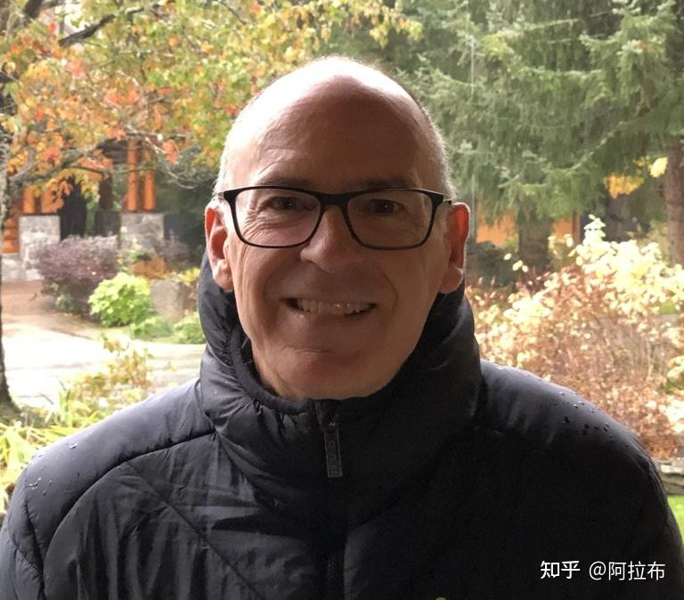
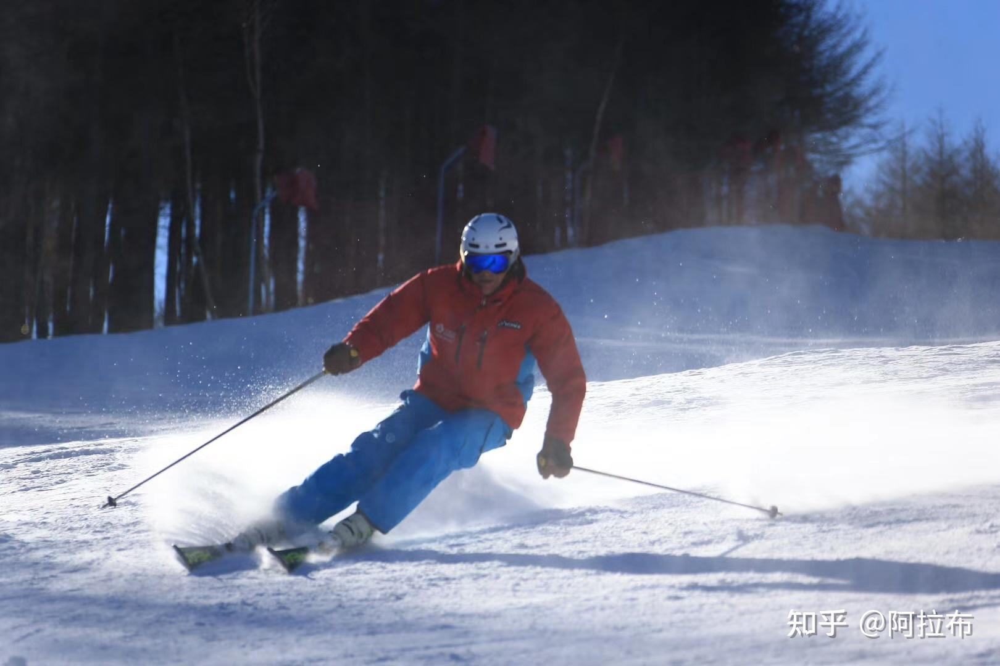
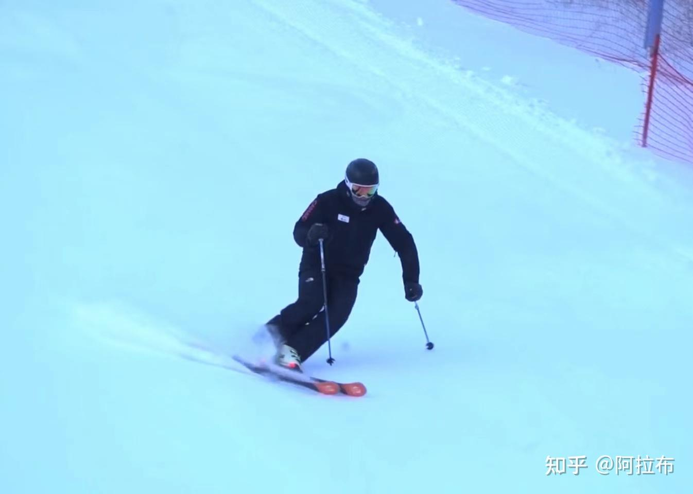
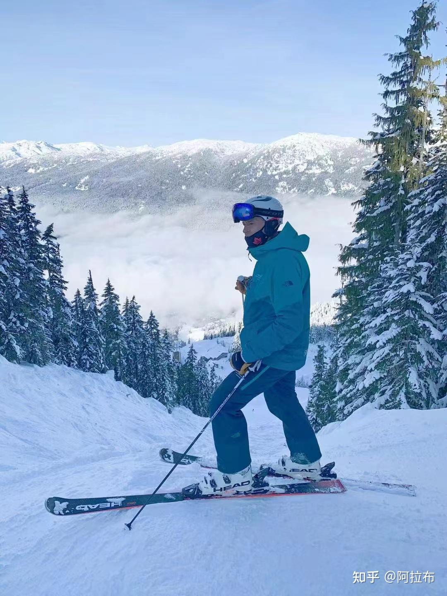
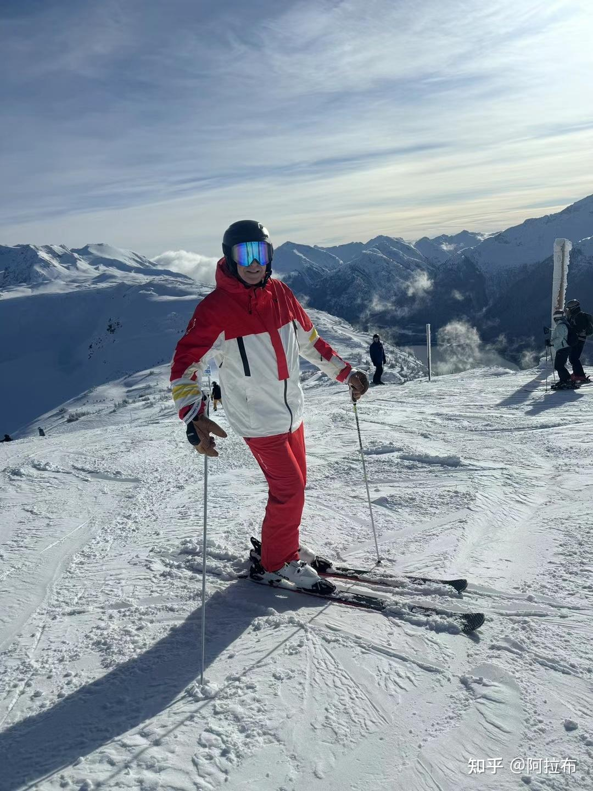

<!-- 来源: https://zhuanlan.zhihu.com/p/11444808441 | 分类: 01_双板技术 | 发布: 2024-12-08 | 赞同: 5 -->

# CSIA四级大师Otto访谈：CSIA十年技术纵观与新动向（文字版全文）

2024年11月底，趁CSIA四级大师Otto Kamstra在崇礼举办训练营的机会，我请CSIA3级指导员赵乾老师约Otto进行了一次深度访谈。内容主要是CSIA技术、教学等领域在十年来的一些变化。

感谢Otto和Ken，这次访谈非常开心，大家讨论了很多深层次的内容，远远超出我的预期。博学、睿智、敬业、亲和，Otto是位真正的大师。能与Otto找到很多共同语言，也让我颇感自豪。

Tristan： 朋友们，大家好，我是 Tristan。我在社交媒体上运行着一个滑雪栏目，阿拉布滑雪。这位是来自 CSIA 的 Otto。

Otto： 嗨，很高兴认识你们。是的，我是 Otto Kamstra。我是加拿大滑雪教练联盟CSIA的4级认证教师、4 级考官、ACA 3 级，我还来到美国并完成了他们的 3 级考试，以更多地了解其他人如何谈论滑雪。

Tristan： 我听说你也担任了一段时间的 CSIA 主席？

Otto： 是的，我在 CSIA 的董事会工作了很多年，我担任了大约四年的董事会主席，与那里很多非常优秀的人一起工作。我学到了很多东西。

主席这个职位，你觉得你应该指导别人，但我有很多人帮助我。我只是试着把我从滑雪教学中学到的好的东西放回这个行业，这些年来对我来说太好了。我只是想回馈社会。

Tristan： 我大概是在 2014 年开始学习 CSIA 理论或技术，那时我阅读了 2012 版技术参考书。在那之后，我写了几篇关于我如何理解 CSIA 技术的文章，其中一篇文章是关于基础平行转弯。但当时，基础平行转弯并不是 CSIA 系统中的一个术语。但几年后，我发现了一些视频片段，也许在 2010 年之前，CSIA 中真的存在过这个术语，基础平行转弯，但在那之后发生了一些变化。所以我想问你发生了什么，是什么原因造成的？

Otto： 嗯，这是个好问题，当我们谈论滑雪教学或技术时，我们会用文字来描述某人可能会做出的转变，或者某人在滑雪中取得的进步。

有一段时间，你知道，在我们的手册中，我们曾经把基础平行作为参考。一般来说，这种基本的平行是某人最开始学习平行的样子。所以他们从犁式过渡过来，他们不再做犁式。这是一个包含相当多侧滑的转弯，但滑雪板是平行的。他可能会在一些简单的滑行上做到平行，但可能在遇到了一些麻烦的时候还会有一点犁式。我们通常会引用这些术语，来标记正在参加课程的人。所以，也许在那个时候，一级被标记为基础平行、（然后是）二级、三级。

多年来，有时技术委员会会确定有更好的词来定义或我们想要标记的区域。我想当时我们讨论了技术参考，这是在进阶量表上稍高的东西。它给出了更好的，或者要求培训师提供更好的技术示范或更好的技能组合。我们用了（新的）那个。而且我不认为基础平行转弯被扔掉了，只是关注的重点发生了变化。

如今，我们从技术参考中出发，特别是在过去五年中，（定义了）中速、中弯，但这并不能真正定义我们在哪里。中等对不同的人意味着不同的意思。所以现在我们使用的是一种叫做“示范平行”的东西。Demostration这个词就是滑雪教练为他们的学生进行平行演示的时候。

再说一次，有人可能会说，嗯，我不确定那有多快或多慢，对吧？同样，我们有术语，中速、中半径之类的东西。所以，你知道，我们现在刚刚在 CSIA 网站上发布，是标准视频（说的是最新的2级平行视频），展示了这些视频的速度和半径，我们已经标记了它们。

无论如何，在我参与 CSIA 的这些年里，我们总是试图把定义弄的明明白白。所以，我认为在整个滑雪运动中，如果我认为我们所有人都真的需要努力做一件事，那就是定义我们在任何地方用来描述我们的词语，这些词语的含义。因为这样，作为专业人士，我们可以更好地沟通。它不是那么模糊。

我们之前谈过，Tristan，你说过，你写了一些东西，你有一个定义页面，它准确地列出了所有内容的含义，我的意思是，这就是我认为我们需要做得更好的地方。

Tristan： 是这样。好的，因为长期以来， 中国滑雪者都知道CSIA的平行转弯中， 中级平行转弯是最重要的。也许它有点困难，但在中国滑雪者看来，这是CSIA最有名的滑行方式。那么，正如您所说，它将更改为演示平行转弯，您还会像以前一样使用中级平行转弯吗？

Otto： 是的。我不认为使用像中级平行转弯这样的描述性词有什么错。

当我们在雪道上时，我们大概知道什么是中级滑雪者。中级滑雪者会从一条更容易的蓝道/中级道上滑下来，它会来回转向，而且非常流畅。也许当他们在非常陡峭的雪道，他们会感觉到一些挑战。

任何时候我们有了这些术语，基础平行、中级、高级平行，它们都是人们要经历的阶段。这不是一个指定的点，而是一系列的点构成的区间。因此，如果我使用标尺，则中级平行在这里，然后基础平行会在这里。所以你从基础到中级，再到高级，然后到专家，对吧？专家的范围，从驱转的转弯，可能是细的轨迹，到卡宾轨迹。这取决于你所在的雪道，你决定要用什么技术。事实上，一些专家可能会从驱转的转弯开始，然后过渡到底部的卡宾转弯，因为如果是从上到下都是卡宾的，你会需要稍微控制一下你的速度。

所以你的问题是正确的，什么是中弯？它在那里吗？我想作为一名滑雪老师。你可以用它来定义你的学生在前进过程中的任何时间点所处的位置。

Tristan： 是的，因为根据我的理解，我们需要一些里程碑。我们从犁式转弯开始，一步、一步、一步，前进。然后我们实现中级，也许是一个称为中级平行的里程碑。

Otto： 对，是的，绝对是。尤其是当我们交谈时，你知道，当我们作为滑雪老师时，有时我们会陷在与我们滑行相关的思考中。但作为教师，我们的主要工作是帮助我们的学生取得成功。

当我们制定这些术语时，我有一个，假设我有一个学生，他是一名基础平行学生，我们看到一个滑雪者经过，哦，是一个中级平行滑雪者。这就是我们的下一个目标。所以，就像你说的，这就是里程碑。

所以我们想把胡萝卜放在我们的学生面前，让他们说，嘿，这就是你下一步要去的地方。他们看着那个，然后说，哦，我可以做到。如果你把“卡宾”这个里程碑放在他们面前，它也许也能做到，可能对一些人来说可能没问题，但对另一些人来说可能太过牵强了。他们想学什么，是的，我不能教那个，但他们下一个目标可以学那个，对吧。

所以这就是这些小术语的含义，我认为它们真的很好用。在专业人士中，它有助于确定我们的学生在哪里，以及他们将要去哪里。

【第一部分结束】

Tristan： 好的，这样就很清楚了。那么，我回到“技术参考要点”。因为我发现我学到的版本，可能是 2012 年版，根据我的理解，这是一个非常好的版本，因为它包含了所有五项技能和四项原则。但在这个版本之后，它发生了很大的变化。他们削减了所有其他部分，只有 4 个原则。然后是下一个版本，4 个原则和 3 个控制。

Otto： 四个技术参考点？然后是 3 个技能？现在是 5 个技能。（是）

所以，你知道，对于一般人来说，如果有人通过了我们的系统，也许他们参加了第一级，也许他们有技术参考，他们等了一段时间，然后他们获得了三项技能，然后他们回来了，他们学习了这五项技能。

你知道我要对观众说的是，这听起来可能令人困惑，但是我们的身体在生物力学上并没有改变。我们的身体是一样的。所以它以同样的方式运动。我们可以做同样的动作。可能会有一些差异，你知道，我高，有些人矮，有些人更宽，有些人更强壮，诸如此类的事情。因此，在那些不同的体型中，我们的一些动作可能会略有不同。

我们讨论过的这些术语、3 项技能、5 项技能、或技术参考要点都没有错。事实上，它们都非常相似。因此，我总是将技术参考要点定义为描述运动中的动作，就像我们在看电影一样。所以我用所有的关节来保持平衡，我想就是其中之一。转弯是由下半身引导是另一个。然后另一个是分离。分离允许做出反弓和用板刃抓雪。 然后是压力控制。

所以你可以看到，这里面有站姿和平衡。有旋转或旋转控制创造了分离的东西。有立刃，也有压力。然后与这一切交织在一起的是时间和协调。然后与这一切交织在一起的是时间和协调。

然后当我们再来看技术参考要点，回到技能这个词。当我们看其他运动时，身体动作通常被分解为技能这个概念。尽管技术参考讲的实际上是技能，但我们只是使用不同的术语来描述它，而不是技能这个词。我认为技能可能更普遍地被接受，因此技能被分为三个。

现在有趣的是，压力控制在压力中包含了平衡。因为当我在滑雪板上向前移动时，压力会发生变化。如果我向上移动，压力就会发生变化。同样的事情是，如果我转动我的腿，它使我能够产生分离。因此，当我转身和向弯内移动时，我们的技能是相互关联的。不会存在一个与另一个无关这样。

但我认为对于学习如何滑雪的人来说，如果我们把这些组成部分中的一些分开来看，它能帮助你定义我可能正在寻找的运动模式是什么。尤其是对于新教练来说。我们都知道什么是运动站姿，对吧。运动站姿可以让您保持平衡并正确移动。而且它很容易被观察到，而不会与压力混淆。然后，一旦我们有了那个姿态，我们就会说，好的，我在这里，在我的滑雪板上有正确的平衡点可以让我转弯，让我可以分离。（中文分离）。然后通过分离，我可以获得板刃控制，然后压力可以调整它。所以我可以把它划分出来，特别是对于新的 1 级、2 级 指导员。它更多地存在于这些小盒子中。然后一旦我们进入第 3 级，我们就会开始看到这些东西相互作用、聚集在一起、紧密结合发挥作用。

Tristan： 所以第 3 级更难。

Otto： 是的，正确。但一开始你需要分开，然后你把它们重新放在一起，然后你就可以流畅滑行了。

Tristan： 那么我能否理解为，技术参考要点的变化，仅仅因为他们想用不同的方式用不同的方法、或者不同的视角来解释滑雪。但在这些变化之内，还有一些细节部分得到了进一步发展，（实现）更加精准的运动，就像你提到的，压力（控制）中包括来前后（平衡）。

Otto： 是的，你的问题是对的。通过分解这一点，我们可以进一步定义滑雪和运动。教授滑雪或彼此谈论滑雪最困难的部分是表达它，以及我们如何定义它。

我们一直在寻找最好的教学方式、交流方式，并了解学生的学习方式。我教课时和我们彼此交谈时没有什么不同。我们希望避免沟通不畅或误解。

所以，你知道，随着加拿大滑雪教练联盟的这些变化，它有点潮起潮落，尽管身体的运动是一样的。所以对于我这个非常了解滑雪的人来说，这并不是真的令人困惑。这只是另一种说同道合的方式，对吧？

我有时会想起在雪地上和学生在一起的时候。我可能会说些什么让他们朝一个方向发展动作。然后我试了几次，我不确定他们是否理解，我可能会尝试其他方法，或者我可能会添加一种感觉。所以我总是和我的学生一起寻找，找出什么样的东西能引起他们的共鸣，他们明白什么可以让他们达成目标，或者帮助他们做出改变，使他们成为更好的滑雪者。

Tristan： 特别是对每一个确定的、单一的人、每一个人。

Otto： 你知道，在世界上，我们都关注最好的滑雪者、最好的竞技选手、最好的日本的大众滑雪技术赛手，最好的自由滑雪者，即使在万龙，中国也有一些非常优秀的滑雪者，你观看他们滑行，我们也可以看看他们，我们可能同意他们是一名优秀的滑雪者。所以我们都朝着同一个方向前进。对吧？然后我们只需要互相合作，说，嘿，这就是他们用来实现这一目标的动作。因为我认为这些动作，我们喜欢的东西都是一样的。

然后，我们面临的另一件事是，我们从一种语言转换到另一种语言。但我想对所有观众说这句话，所有正在通过认证过程的人，如果您是考官或教师，请让您的学生谈论滑雪。我们之间和我们国家之间谈论滑雪的次数越多，对吧？它可以帮助我们所有人都变得更好，对吧？我不断学习更多。

【第二部分结束】

Tristan： 是的，这太好了。那么，您认为在过去 10 年中，CSIA 的滑雪风格有没有一些变化？或者不，只是保持稳定？

Otto： 你知道，我认为从生物力学看，看我们如何移动，这没有变。我认为滑雪装备在不断发展。你知道 2000 年左右发生了很大的变化，对吧？1998 年至 2005 年。是的。他们那时候开始改变了滑雪板侧切形状，现在滑雪板的侧切形状进化了一点点。

但有一个范围在那里。我的意思是你在自由滑雪时可以用宽的滑雪板，但如果我们谈论的是技术性的东西，那么我们就要用到卡宾滑雪板。但我们会有所区别。你想转大弯，你会用到一个 18 或 20 米的滑雪板，但如果你想做非常高难度的卡宾，你会用到一个 12 到 14 米、15 米的滑雪板。现在的这些滑雪板真是太棒了，对吧。过去你必须很强壮。现在你无需拥有完美技术也可以享受它们。你知道，学习的乐趣之一就是在技术上变得更好。但是，您不必在技术上完美才能享受滑雪。没关系的！这很正常。

Tristan： 是的，因为我们要享受这项运动。我们不是为了实现一些其他的外部目标而滑雪。

Otto： 是的，我们作为滑雪指导员有点......怎么说呢？你知道，我们也是技术极客。但归根结底，比如你一大早就出去滑面条雪，和几个朋友在一起，你在那里卡宾，在你自己的心目中，你是一个英雄。这很好，这就是我们想要的。你应该对你的滑雪感觉良好，因为你可能大部分事情都确实做的不错。

如果我对滑雪教学界说一件事，或希望一件事，那就是请停止在社交媒体上互相批评。请说好听的话，因为这就是老师的工作。他们对那个人正在做的事情说好话。鼓励我们，鼓励我们变得更好，尝试一些东西，玩得开心。不要因为你不喜欢他们说的话而在社交媒体上穷追猛打。哦，我的上帝。

Tristan： 我们需要每个人，每个滑雪者，永远热爱这项运动。我们不想把他们踢出去。

Otto： 是的，有时候，有人发布了一个视频，每个人都在视频下面喷他们……享受它，享受它的价值。这个人很快乐。今天早上我就在那儿，对，在我自己的小世界里，我犯了错误，我确信我犯了错误，但我觉得我在天堂。对吧？

而那个正在魔毯道上的一个犁式转弯的人，他们是这样的，他们睁大了眼睛，因为他们认为他们以每小时 100 公里的速度滑行，你知道的。（好，好，真棒）。

是的，让我们鼓励他们，也鼓励我们自己，我们将一起，继续突破自我能力的边界。

Tristan： 那么教学方法怎么样呢？教学方法有一些变化？

Otto： 哦，我的上帝。你知道，技术很简单。教学很难。教学永远是一种进化。根据我的经验，沟通是一件困难的事情。我们正在努力传达做出更好的，更高级或更专业的转弯或其他什么是什么感觉。

而且，每个人都是独立的个体。可能有相似之处，但每个人都是独立的个体。我们必须记住他们是一个个体。他们不仅仅是我们试图在工厂中运行的数字。我们需要与他们建立个人联系。了解他们是谁，是什么让他们打勾，是什么让他们有动力和快乐，并引导他们做出更好的滑雪转弯。

另一部分也是，我说不好中国为什么会这样，自 2017 年以来，我在这里教课已经有一段时间了，我喜欢这里的学生，因为他们喜欢学习。作为一名教师，没有什么比想要学习的学生更好的了。作为教师，那我就在天堂了。

但我在加拿大的时候，情况有所不同。从学校出来的孩子，有不同世代的学习方式不同。在加拿大的教育系统中，有教育、学习专家来设计课程，随着他们对孩子的了解越来越多，课程也会发生变化。然后当这些孩子在学校学习这个课程时，他们接受的教学方式不同，因此他们的学习方式也略有不同。所以我们总是必须进化。它似乎总是介于 10 到 15 年之间，这时会发生重大转变。你得说，哇，这些孩子不一样，对吧？（是的。）孩子们会变成成年人，成年人都是孩子变成的。

因此，我们不得不调整我们的课程。现在我们谈论协作教学过程。它不是自上而下的等级教学，而是有一些影响性，但通常它让他们参与进来，对吧。在那个教学过程或那个学习过程中，问他们问题，说，嘿，试试这个。会发生了什么？所以让他们参与这个过程。或者我希望你在这里滑行，做这个，告诉我会发生什么。

所以这里有积极思考的过程，然后他们自己决定，是的，那个有效吗，或者没有，那个不起作用。我们从教育专家那里学到的是，当学生用他们将要做的事情和感受来引导学生时，他们就会去，并在做的时候有积极的思考。他们自发学习的时间会持续更长，而不仅仅是让教练跟在他们身后（发指令）。

Tristan： 是的，这不是通过指令学习的，他们是通过自己的感觉学习的。

Otto： 是的，现在我们把他们引向那个方向，对吧？但他们得出结论，是的，我做到了，或者不，我没有做到。然后如果他们没有实现，那么你可以说，好吧，好吧，试着朝这个方向转变，看看你是否能在足弓后面获得平衡，对吧？或者看看你是否可以保持住平衡，或者看看你是否可以更快或更容易地转动双腿，从而在整个过程中变得更顺畅。所以他们回来说，是的，我按那样做到了。是的，我明白了。好。哦，你是一直还是一半时间都做到了？好的，很好。让我们...对吧。

因此，我们帮助他们。没有对错之分，但他们是做决定的人。这就是我们正在教授的最新方法，我相信它会随着时间的推移而发展和变化。

【第三部分结束】

Tristan： 好的，现在应该是最后一个问题了。我想对于 CSIA 内部，也有一些变化或演变。那么，您能分享一些事情，一些来自您的消息吗？

Otto： 是的，CSIA，你知道，它一直在发展。去年它的一些管理层发生了变化。我们有新的管理总监 Nigel Loring，他真的很好。他擅长制定政策，激励他的员工。我们还有另一个女孩负责，当然是 Betsy Linnell。还有 Jason Young，他是我们编写手册的技术人员。

我们有一些新视频刚刚与标准一起发布。我们已经更新了所有材料，你知道，课程指南正在制作中。你会看到，今年 1 级课程进行了一些修改，更多地放在教孩子上，因为我们实际教孩子们更多。然后在 2 级和 3 级，今年没有太多变化。我们将在夏天关注这些部分。

我们想做的是，我们想真正做到这个，CSIA，我肯定想让它变得透明和公平。我相信可能会有一些评分标准将出来。如果可以，他们会为它制作一个视频。所以你可以看到的标准。这真的很透明。第二级和第三级的标准刚刚做好视频在 CSIA 的网站上公布。所以它是透明的。

你可以去看看。你可以拍一段你自己的视频，然后进行比较，对吧。如果你不确定，那么你可以请课程导师来审查和比较，然后说，好吧，也许你需要多一点时间，也许你已经准备好去考试了。

这就是今年发生的一些重大变化。哦，还有另一个，地形公园。以前一直有地形公园1，现在有一个地形公园 2。是的。 Ken，我认为你要去学地形公园。

Tristan： 哦！真好。所以，真的很棒。好的，谢谢你。很高兴听到你告诉我们这么多事情。中国的许多朋友在您的教导下取得巨大的进步。你确实帮助了这么多中国雪友。所以再次感谢你。

Otto： 好的，谢谢你。感谢观众。你知道，我有微信，我的微信号是“skiwithotto”。

有问题，问我，（问他），没问题。我收到很多信息，但我会回复每个人，或早或晚。

Tristan： 好的，太好了，那么，任何问题，请告诉我们。

【第四部分暨全部访谈结束】

