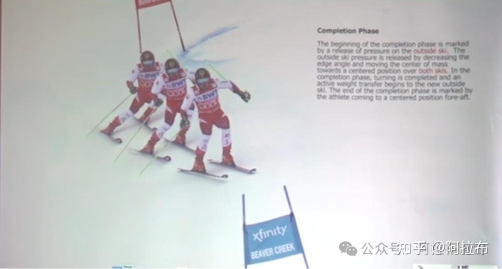
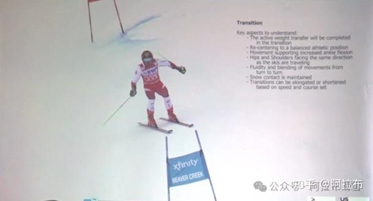
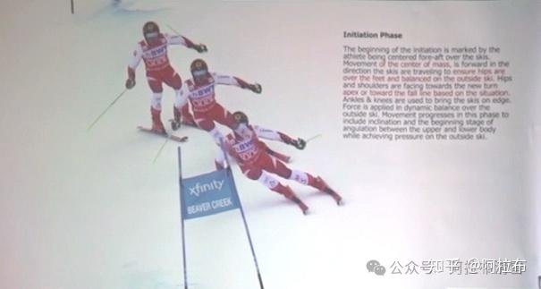
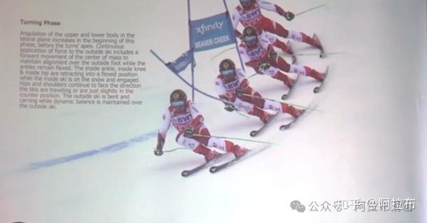
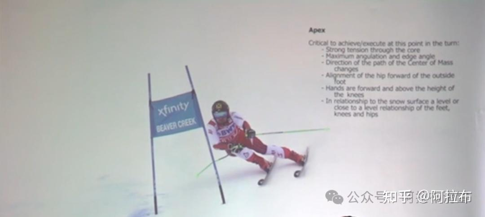
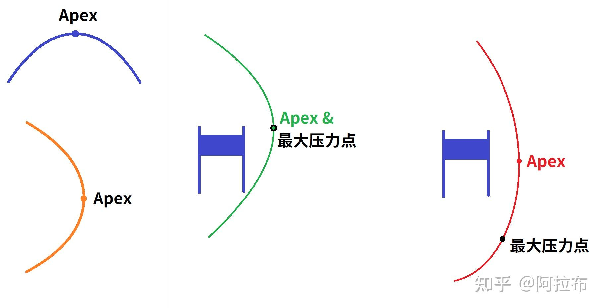

<!-- 来源: https://zhuanlan.zhihu.com/p/1904213755971231984 | 分类: 01_双板技术 | 发布: 2025-05-09 | 赞同: 10 -->

# GS弯分解：来自美国男子国家队主教练

目前美国国家队教练培训教程中采用的GS转弯分解采用了美国男子国家队前任主教练、USSA名人堂成员Phil McNichol在2019年美国高山滑雪教练研讨会上的讲解。


一般认为，GS弯可分为入弯Initiation、转弯Turning、出弯Completion三个阶段。但是在入弯和出弯之间，还存在一个非常重要的换弯Transition阶段，因此这段讲解的内容包含五部分：

- 出弯阶段 / Completion Phase（完成）
- 换弯阶段 / Transition Phase（转换）
- 入弯阶段 / Initiation Phase（初始）
- 转弯阶段 / Turning Phase
- 弧顶/Apex

公开的视频并不完整，但是我们可以从课件上的文字中提取主要内容。

出弯阶段 / Completion（完成） Phase



```
The beginning of the completion phase is marked by a release of pressure on the outside ski. The outside ski pressure is released by decreasing the edge angle and moving the center of mass towards a centered position over both skis. In the completion phase, turning is completed and an active weight transfer begins to the new outside ski. The end of the completion phase is marked by the athlete coming to a centered position fore-aft.
```

完成阶段的开始标志着对外侧滑雪板施加压力的释放。通过减少立刃角度并将质心移动到两个滑雪板的中心位置，从而释放外侧滑雪板的压力。在完成阶段，转向完成，并开始向新的外侧滑雪板进行主动的重心转移。完成阶段的结束标志着运动员在前后方向达到中心位置。

换弯阶段 / Transition（转换） Phase



Key aspects to understand: - The active weight transfer will be completed in the transition- Re-centering to a balanced athlete position- Movement supporting increased ankle flexion- Hips and Shoulders facing the same direction as the skis are traveling- Fluidity and blending of movements from turn to turn- Snow contact is maintained- Transitions can be elongated or shortened based on speed and course set

换弯阶段的关键要点：

- 主动的重心转移将在转换中完成

- 重新居中至运动平衡姿势

- 支持逐渐增加的脚踝屈曲的动作

- 臀部和肩部面朝滑雪板行进的方向

- 动作的流畅性和两个弯之间动作的衔接

- 保持雪面接触

- 根据速度和赛道设置，转换可以延长或缩短

入弯阶段 / Initiation（初始） Phase



```
The beginning of the initiation is marked by the athlete being centered fore-aft over the skis. Movement of the center of mass is forward in the direction the skis are traveling to ensure hips are over the feet and balanced on the outside ski. Hips and shoulders are facing towards the new turn's apex or toward the fall line based on the situation. Ankles and knees are used to bring the skis on edge. Force is applied in dynamic balance over the outside ski. Movement progresses in this phase to include inclination and the beginning stage of angulation between the upper and lower body while achieving pressure on the outside ski.
```

入弯的开始标志是运动员在滑雪板上重心前后居中。重心的运动朝着滑雪板前进的方向，以确保臀部在脚的上方并平衡在外侧滑雪板上。臀部和肩膀根据情况朝向新弯的弧顶或滚落线方向。脚踝和膝盖用于使滑雪板立刃。在外侧滑雪板上动态平衡地施加力量。在此阶段，运动的变化包括内倾和在开始阶段形成上半身与下半身之间的反弓，同时在外侧滑雪板上施加压力。

转弯阶段 / Turning Phase



```
Angulation of the upper and lower body in the lateral  plane increases in the beginning of this phase, before the turn's apex. Continuous application of force to the outside ski includes a forward movement of the center of mass to maintain alighnment over the outside foot while the ankles reamin flexed. The inside ankle, inside knee & inside hip and retracting into a flexed position while the inisde ski is on the snow and engaged. Hips and shoulders continue to face the direciton the skis are traveling or are just slightly in the counter positon. The outside ski is bent and carving while dynamic balance is maintained over the ouside ski.
```

在这个阶段的开始部分，在弯的弧顶之前，上半身和下半身形成的反弓在逐渐增加。继续对外侧滑雪板施加力量，包括将重心向前移动以保持在外侧脚上的对齐，同时脚踝保持弯曲。内侧脚踝、内侧膝盖和内侧臀部收回，保持弯曲姿势，同时内侧滑雪板在雪面上并参与转弯。臀部和肩部继续朝着滑雪板行进方向，或者稍微朝向相反方向。外侧滑雪板弯曲并卡宾滑行，同时在外侧滑雪板上保持动态平衡。

弧顶/Apex



```
Critical to achieve/execute at this point in the turn:- Strong tension through the core- Maximum angulation and edge angle- Direction of the path of the Center of Mass changes- Alignment of the hip forward of the outside foot- Hands are forward and above the height of the knees- In relationship to the snow surface a level or close to a level relationship of the feet, knees and hips
```

在这个转弯的关键时刻实现/执行以下几点：

- 核心强烈紧绷

- 最大的反弓和立刃角

- 质心路径的方向发生变化

- 髋部与外侧脚向前对齐

- 双手前伸，超过膝盖的高度

- 相对于雪面，双脚、膝盖和臀部的关系处于水平或接近水平状态

Apex在英语中是个几何意义上的日常用词，表示弧线的最高点，用于滑雪时则表示转弯轨迹中最远——也就是最外侧的点，可翻译为弧顶。当转弯进行到Apex点时，雪板指向滚落线方向，因此也基本等同于“当转弯到滚落线时”。Apex点作为上半弯和下半弯的分界点，具有非常特别的意义。

国内因为前些年（阴差阳错之下）某些不学无术者的误导，不少雪友对Apex这个词存在误解，误以为是转弯中的压力最大点，位置在3点到4点，这显然是不对的。在GS弯中，理想的压力最大点发生在Apex，但是对于水平还没那么高的运动员，实际发生的压力最大区域通常在3点到4点之间。而对于大众滑行，压力最大区域更多的是在4点到5点。所以请记住，Apex弧顶是几何意义的点，位置是固定不变的，而最大压力点/区域 Max Pressure Point / Area 则根据滑行水平或者技术不同，会发生在弯的不同位置。



这么多年了，国内的双板滑雪理论圈还是像个烂泥塘，最重要的原因是水货太多。多挤挤水，对大家都有好处。
