<!-- 来源: https://zhuanlan.zhihu.com/p/1955384646238991918 | 分类: 01_双板技术 | 发布: 2025-09-27 | 赞同: 29 -->

# 【翻译】美国FWDI《竞技滑行基础》九个关键概念

## 00—总纲

美国双板与单板滑雪协会远西分部发展倡议（FWDI） 在 Melissa 和 Martin Huml 的支持下，创建了《滑雪竞赛基础—青少年滑雪者指南》，旨在帮助14岁以下的滑雪选手，但对所有年龄段都有益。Ron LeMaster 的精彩照片引导教学，Ron Kipp提供文本支持。

> 当你将滑雪转弯拆解成关键属性时，就变得容易理解。远西发展计划使用Ron LeMaster精美的照片蒙太奇来阐述这些滑雪转弯的基本概念。 有九个关键概念。超过九个，竞技滑雪技巧就会变得太复杂；少于九个，则仍有重要的元素不能包含其中。通过使用通用术语，教练确保运动员不必在每位新教练面前学习新词汇。这种共同语言也使教练们能够有效地相互沟通 。

### 九个基础概念 The Nine Essential Concepts

- 上身面朝山下 Upper Body Facing Downhill
- 脚踝前屈相等 Equal Ankle Flexion
- 弯的连接/转换 Turn Connection/Transition
- 内倾 Inclination
- 反弓 Angulation
- 长短腿 Long Leg/Short Leg
- 滚落线上的压力 Pressure in the Fall-Line
- 立刃角度 Edge Angle
- 在外板保持平衡 Balance Against the Outside Ski

## 01—上身面朝山下

当我们说“面向”山下时，并不是指身体正面正朝山下。相反， 上半身应该稍微偏斜向山下 。这意味着从滑雪者的下方看，号码布的前面应该大部分是可见的。

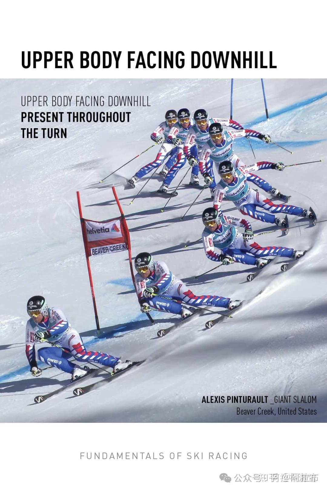

*Alexis Pinturault Beaver Creek, Colorado Photo Montage: Ron LeMaster*

技术说明： 腿部向左右转动，而躯干和骨盆（上半身）则独立地向相反方向旋转。这种旋转使上半身向山下偏斜

何时去做： 整个弯。

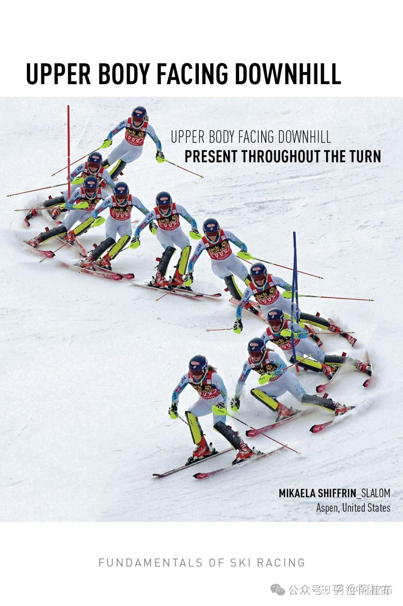

*Mikaela Shiffrin Aspen, Colorado Photo Montage: Ron LeMaster*

例外情况： 上半身并不总是严格正朝向山下。它仅在每个转弯周期内的短暂时刻正朝山下。然而，在整个滑行过程中，它应该保持偏斜向山下。

观察要点： 从山脚下，你应该能看到躯干和盆骨的前面。请专注于盆骨，因为它是至关重要的。上半身朝山下的角度取决于山坡的陡峭程度和滑雪板与滚落线的角度。

为何重要： 要转动滑雪板，必须有一些稳定的东西作为转动的支撑——上半身。想象一下就像在旋转的办公椅上转身；稳定的上半身使得腿部能够有效地转动。

常见问题： 如果上半身和滑雪板朝同一个方向，就更难操纵立刃的滑雪板。

同义词： 反向旋转/反拧

反义词： 旋转，上半身旋转

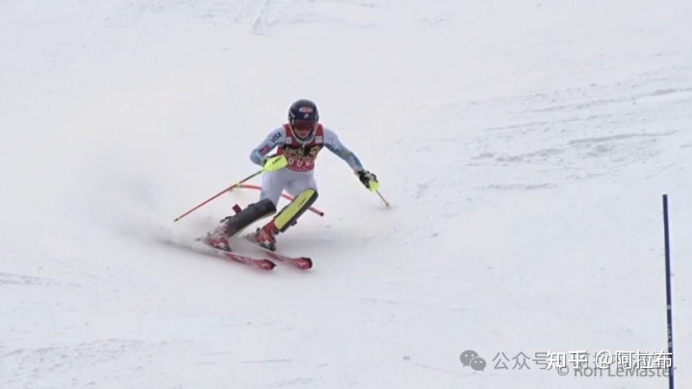

*Mikaela Shiffrin Aspen, Colorado Video: Ron LeMaster*

Drills to Practice :

- Arms crossed
- Hands behind back
- Palms together
- Hands on hips
- Poles parallel to slope
- Poles in front and behind
- Arms crossed across chest with short turns
- Backward parallel skiing
- Double pole plants
- Hop turns
- Ski moguls without poles
- Holding poles like a tray
- Javelin turns
- One ski short turns
- Framing drill
- Pole draggers

方便记忆的提示词：

- “继续盯着山底的那个标志。”
- “想象手电筒在你的髋部。”
- “保持上半身看起来静止。
- “在空间中保持上半身静止。”

## 02—脚踝前屈相等

在滑行中维持相等的脚踝屈曲是实现生物力学对齐站姿的关键，这有助于上半身面朝山下。

理解转弯： 在滑雪转弯时，一只滑雪板总是在坡上高处，而另一只则在低处。当滑雪者在转弯中移动时，滑雪板之间的距离会不断变化。在整个转弯过程中保持双脚踝的角度相等，确保较高的滑雪板始终领先于较低的滑雪板。这种姿势使得骨盆能够高效对齐，支持从骨盆到肩膀的适当屈曲和角度调整。

主要关注前屈？

尽管我们经常谈论屈曲，但真正重要的是两只脚踝产生的张力。由于张力是看不见的，我们观察到脚踝前屈作为一个可见的指标。

当我们谈论滑雪中的屈曲时，实际上我们关注的是肌肉张力。张力是肌肉中的电活动量。使用肌电图（EMG）进行的研究表明，优秀滑雪运动员之间的区别在于他们内侧滑雪板上的张力水平。当胫前肌使脚踝背屈时，它保持内侧滑雪板的脚踝屈曲并处于强大且生物力学对齐的位置。这种张力对保持这种对齐至关重要。

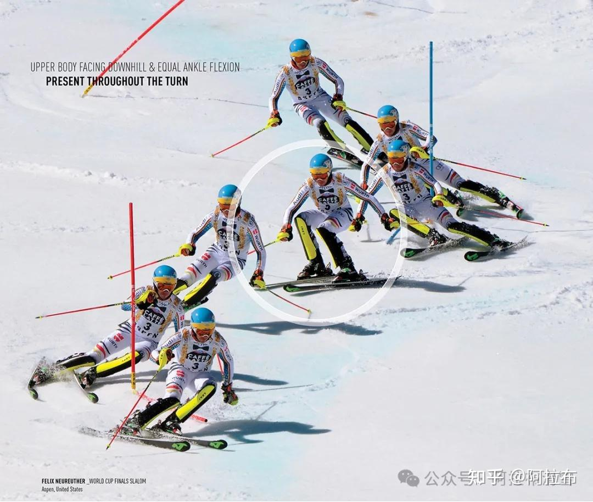

*Felix Neureuther Photo montage Ron LeMaster*

何时发生： 在整个转弯过程中以及换弯时，相等的踝关节屈曲是至关重要的。

例外情况： 在极端立刃角度的情况下（比如指背触地），内侧脚踝可能会打开或角度变成更钝。这是因为滑雪者的骨盆解剖结构允许在前后平面上进行更显著的髋关节屈曲，而不是在侧向方向。

观察要点： 在所有转弯阶段，特别是在转弯远远越过滚落线的末尾或过程中，注意双踝的屈伸是否均等。请特别注意运动员施加压力是否晚了。

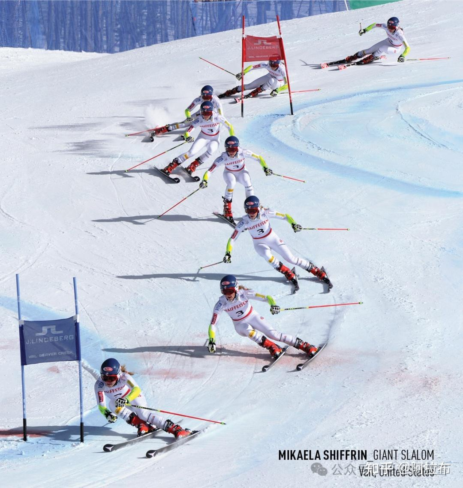

*Mikaela Shiffrin Photo Montage: Ron LeMaster*

为何重要： 不相等的踝关节弯曲使滑雪运动员处于生物力学效率低下的姿态，降低了力量和表现。

如果两个脚踝前屈不相等会怎样？

如果内侧脚踝缺乏屈曲和张力，可能导致内侧滑雪板过度领先。这会导致在寻求极限立刃角度时，内侧脚不必要地向前移动。然后挑战就变成恢复相等的脚踝角度，以启动下一个转弯。简单地将脚拉回只是一个暂时的解决办法。最好事先在内侧脚踝创造必要的屈曲和张力，以防止其向前移动得过远。

常见问题：

- 烟筒管
- 后坐的姿态
- 臀部下坠

Drills to Correct the Issue

- Push me, pull me
- Shuffle turns
- Telemark imitation

额外提示：

- 观看视频，尤其是在转弯结束段，经过旗门后，要注意这些潜在的问题。
- 使用一些提示，例如“在脚背处弯曲你的雪鞋”，“让你的脚趾部分变沉”，以及“感觉像是在夹着一个足球。”

## 03—弯的连接/转换

释义： 弯的连接/转换是指一个转弯结束而下一个转弯尚未开始。在这个时候，这个转弯既不是右转也不是左转。滑雪板平放在雪面上，滑雪者的重心位于两只滑雪板之间。

为何重要： 弯的连接必须高效。质心在两只滑雪板之间横向居中，并在纵向位于滑雪鞋上方，使滑雪者在接下来的转弯中有更多选择。

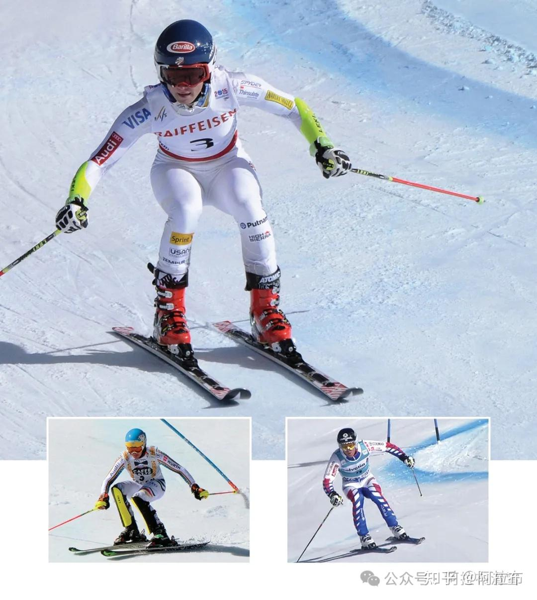

*Shiffrin, Neureuther, Pinturault Photos: Ron LeMaster*

时序： 从一侧边刃转到新一侧边刃的过程应在一个滑雪板长度内完成。超过这个长度，最佳路线就会受到影响。在大回转（GS）中，这大约是十分之一秒。在每秒18到19米的速度下，滑雪者每十分之一秒会滑行一个雪板长度。如果转换花费了两个十分之一秒，滑雪者将滑行两滑雪板长度，从而偏离了他们的轨迹。

何时： 在两个弯的中间。教练应该观察滑雪选手如何以及在什么地方解除雪板的立刃，并开始重新调整方向或再次立刃。

例外： 赛道上的第一个和最后一个弯。

观察要点： 弯的连接/转换应该在一个滑雪板长度内完成。注意观察侧向和前后移动。

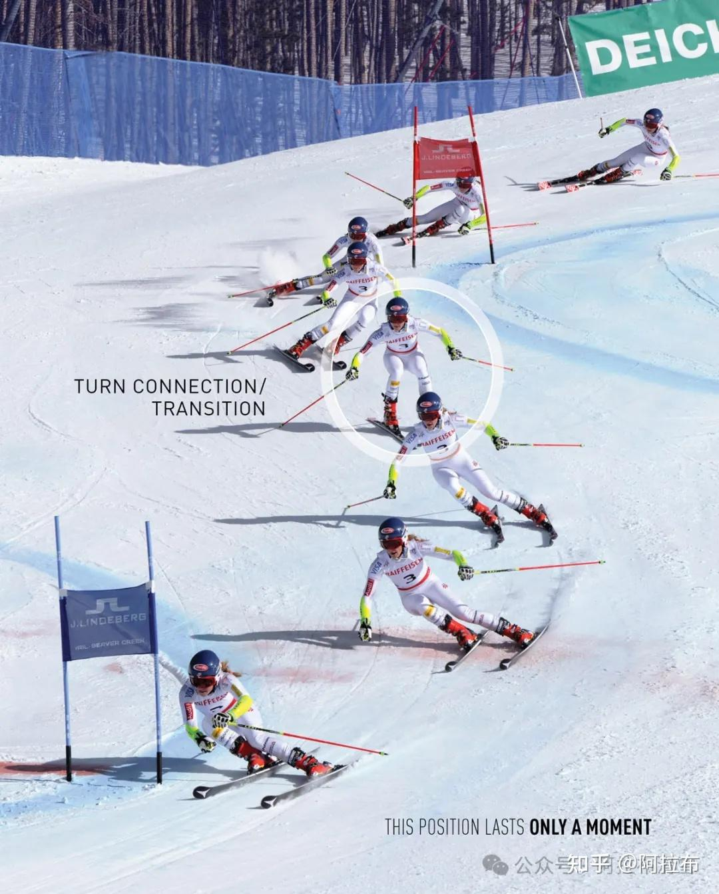

*Mikaela Shiffrin Photo Montage: Ron LeMaster*

为什么： 由于弯的连接不够高效，许多滑雪运动员无法保持理想的路线。

低效的转换看起来是怎样的： 转换跨越很长距离或者弯之间有死角。

低效转换的后果： 当转弯初始的时间较长时，到前方旗门的距离减少，滑雪选手转弯的时间就会更短。

同义词： 切换、上交换、完启（俚语，完结和启动的结合）

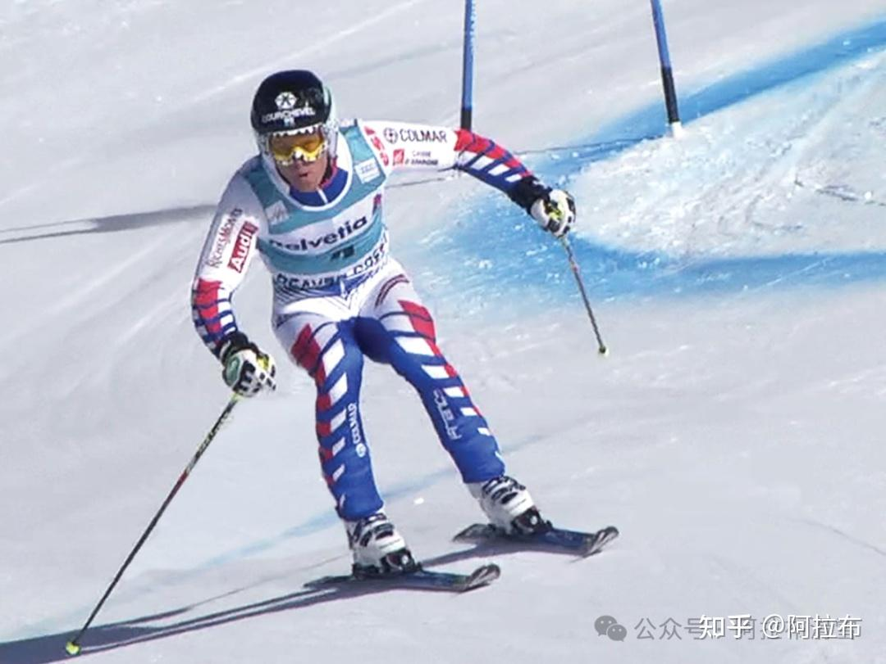

*Pinturault Photo: Ron LeMaster*

### Drills:

- 1000 steps
- long radius to short radius turns
- patience turns
- patience turns on inside and outside skis
- transition box drill
- blue line drill.

教授重点： 获取立刃和立刃角度虽然很重要，但有效地解除立刃或者减少立刃角度同样重要。

话题点或提示词： “将一个转弯的结束变为下一个转弯的开始，” “在方向改变后立即开始朝新转弯移动，” “向山下移动，” “把你的脚收回。”

## 04—内倾

释义： 这个初始动作是为了在身体形成角度（反弓）之前开始转弯。

内倾看起来的样子： 身体以合理的笔直姿态向新弯内倾斜。

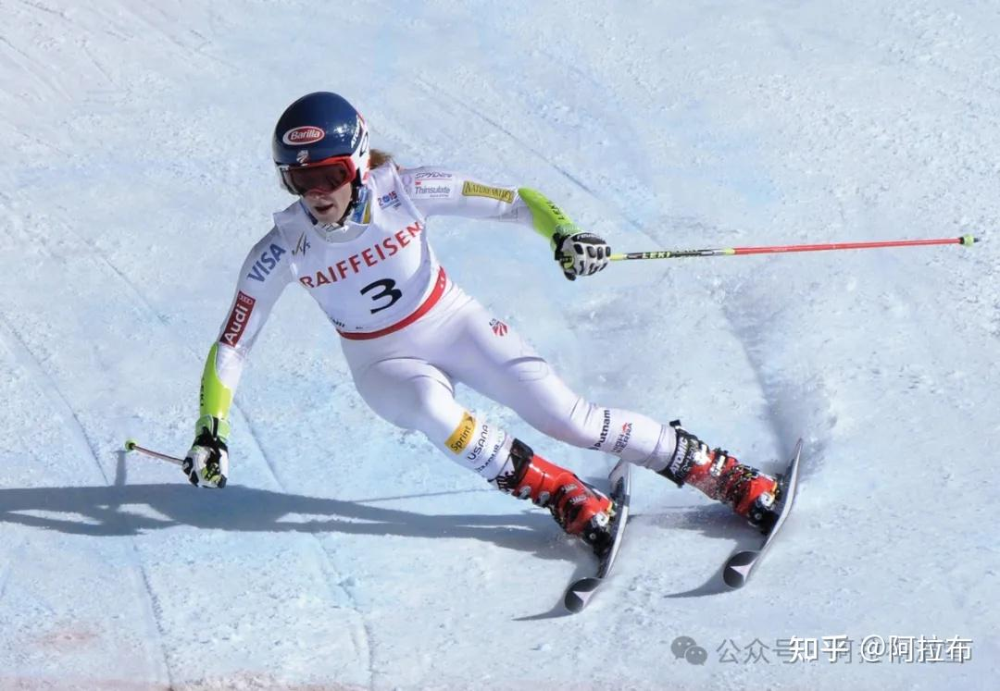

*Mikaela Shiffrin Photo: Ron LeMaster*

目的： 移动质心来帮助形成新立刃角。

如何开始内倾： 身体的倾斜从雪鞋开始。由脚踝的横向运动和质心向前移动来引发立刃。腿部和上半身随之而动。

质心移动多少？ 根据转弯大小、速度或雪面等因素，移动程度取决于滑雪者对即将到来的转弯半径的期望。

何时开始内倾？ 当滑雪者将上一个弯/连接转换 与 即将到来的下一个弯的启动 连接起来时。

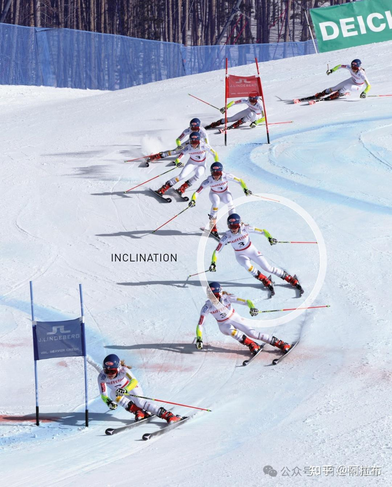

*Mikaela Shiffrin Photo Montage: Ron LeMaster*

内倾不是： 内倾斜不应与“ 内倒 ”混淆。内倒是一种不理想的身体倒伏，通常是由于 转弯启动时过度旋转 或 转弯后期试图制造更高立刃而未果 造成的。

例外情况： 非常直的方向变化，比如蛇形门，只需要稍微移动下半身便可以形成立刃角度并开始转弯。

观察要点： 在转换之后，整个身体立即进入新的转弯。具体来说，质心向前和向山下的移动与腿部的伸展相一致。

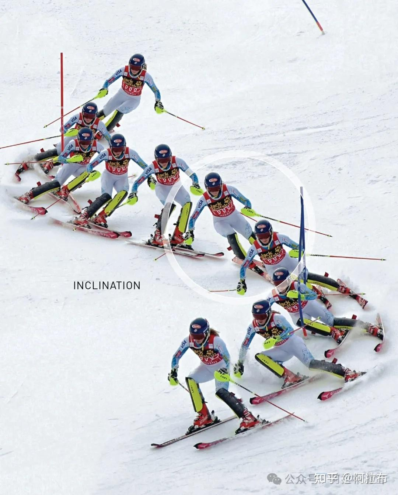

*Mikaela Shiffrin Photo Montage: Ron LeMaster*

为什么要用内倾： 尽管教练会看到整个身体的运动，但滑雪者的质心移动是至关重要的，它定义了新的转弯半径和方向。

未能正确执行时的样子： 后座的站姿会导致不平衡和不运动的姿态。为了获得立刃，滑雪者可能会尝试过快地进入反弓姿态，导致只用臀部或膝盖开始转弯。

注意：

由于目标是将质心移动到即将到来的新弯的内部，请注意“旋转推出”。这发生在滑雪者用旧的外侧滑雪板发力以启动转弯，然后上半身朝新弯内部旋转。几个原因导致这种动作是低效的。滑雪者的质心向山上移动而不是向山下，而上半身的旋转使得在转弯的最佳点施加压力变得困难。此外，旋转妨碍了板刃的正确接触和控制。他们的质心必须走更长的线路，使得实现所需的立刃角度更为困难。

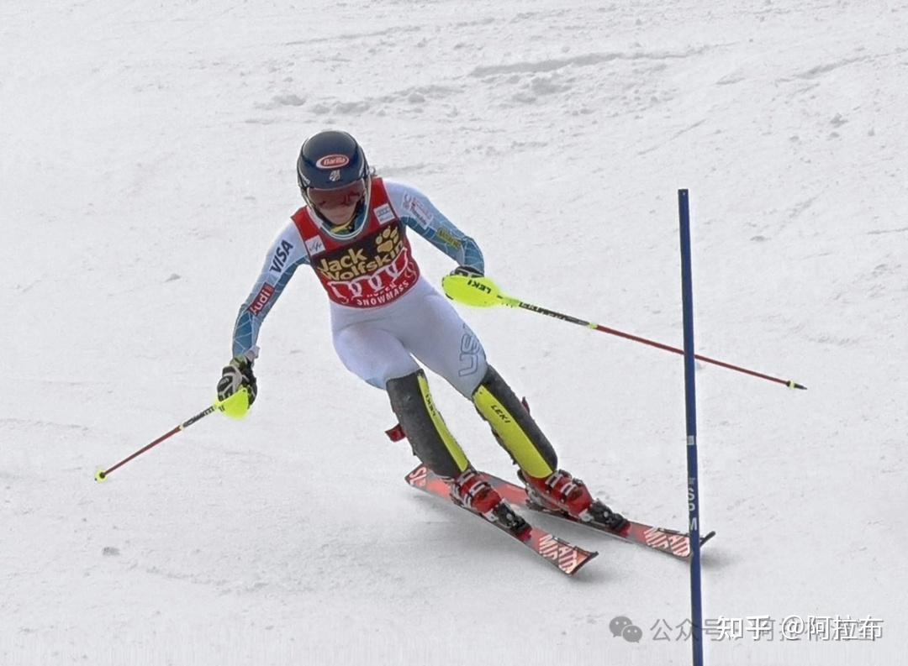

*Mikaela Shiffrin Photo: Ron LeMaster*

同义词： 翻倒、上交换，内倒（使用不当，内倒来自于倾斜）

### Drills:

- 1000 steps during a turn
- White Pass turn
- One-ski skiing
- Patience turns
- Javelin to reverse javelin
- Inside ski tip down heel up.

话题点或提示词： “向山下移动，” “掉进弯中。” “用脚和/或膝盖释放旧的外侧滑雪板，” “跳进湖里，” “想象一根橡皮筋将重心拉向新弯的中心。”

## 05—反弓

反弓的简单释义： 上半身与下半身之间的角度。

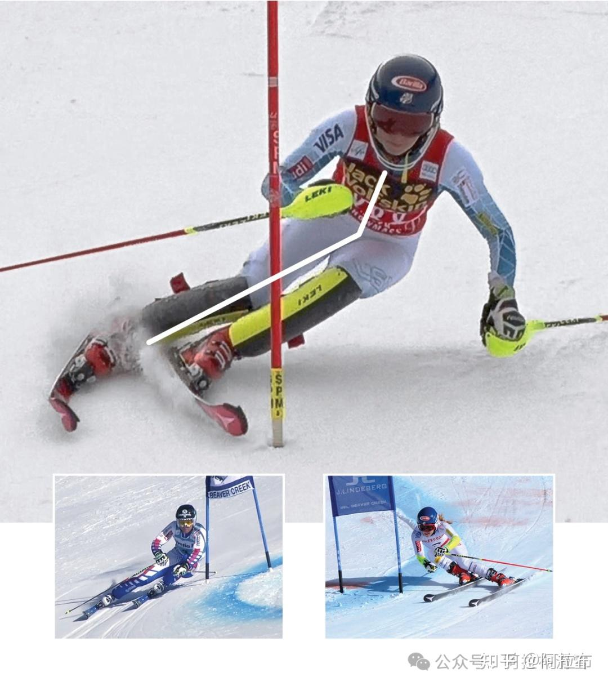

*Mikaela Shiffrin and Alexis Pinturault Photos: Ron LeMaster*

定义反弓： 骨盆与大腿骨的关节夹角。弯折或屈曲是正面和侧面动作的组合。

何时反弓： 在滑雪者通过内倾将质心 （CoM） 移动到即将到来的转弯内后，反弓可能会发生。

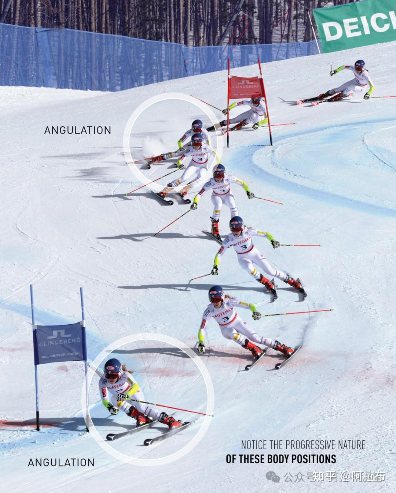

*Mikaela Shiffrin Photo Montage: Ron LeMaster*

反弓的功能： 通过将力作用排列或引导到支撑面来产生压力冲击。

时序： 反弓决定圆弧的位置、长度和半径。理想情况下，当通过旗门和滑雪板位于滚落线时，通过反弓制造出压力/冲量的峰值。

动作次序是关键： 反弓在内倾之后出现。内倾开始立刃，然后是反弓，以决定压力。

反弓并非总是必要：

滑雪者必须内倾以移动质心 CoM 并翻转滑雪板。之后，滑雪者可能需要也可能不需要反弓。滑雪者使用反弓不是为了转弯，而是为了改变它。内倾开始转弯，而反弓调整姿势或平衡，因此上半身在转弯之间的移动距离更短。

例外： 常见于速度项目中的大半径转弯。

观察要点：

上半身和下半身之间的侧面大致角度。滑雪者应对齐并将下半身堆叠在滑雪板上。上半身应或多或少处于解剖位置。滑雪者应该保持脊柱微曲，不要将椎骨推到最大活动范围。从正面观察时，肩部和骨盆（号码布区域）应形成一个适度的矩形（不要使用夸张的姿势使围兜起皱，例如脊柱侧弯或“折腰？”）。

减少质心移动距离：

随着上半身和下半身的分离，上半身相对于下半身的角度更加直立。这意味着在转弯过程中，上半身的移动距离将比滑雪板少。

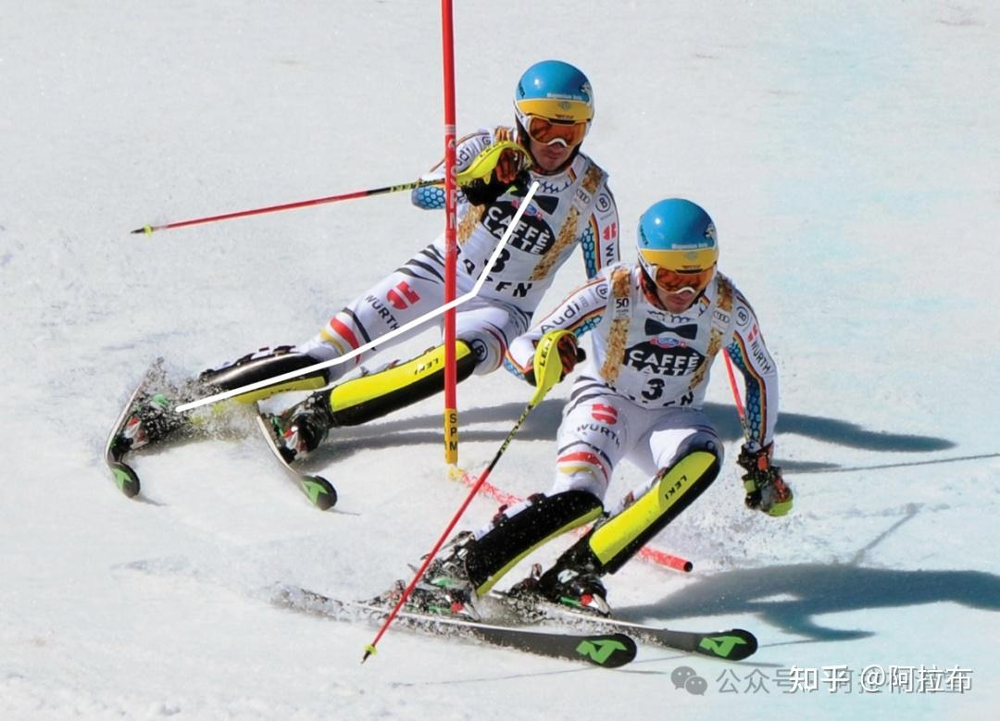

*Felix Neureuther Photo montage: Ron LeMaster*

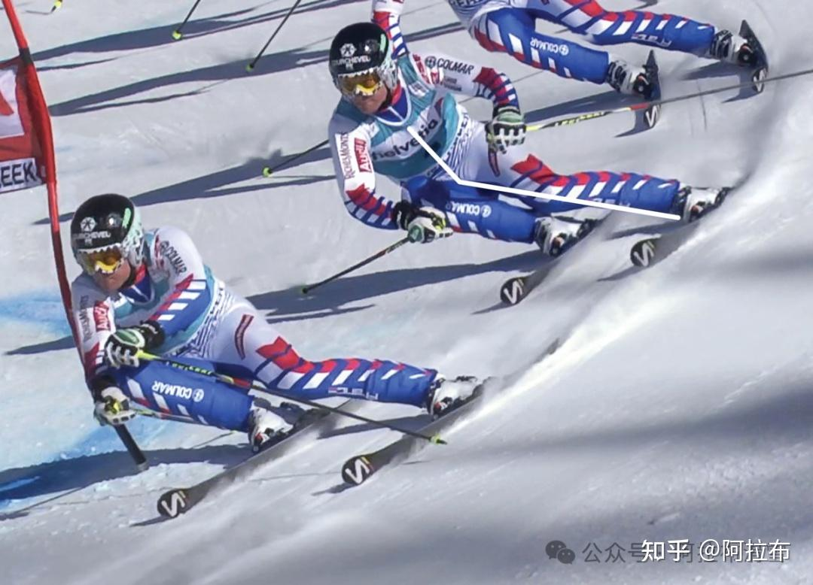

*Alexis Pinturault Photos Montage: Ron LeMaster*

反弓不是： 不是从侧面弯曲脊柱

执行不当会是什么样子： 身体是直的，因此上半身/下半身分离受限。缺乏反弓会导致内倒、不平衡和不理想的身体倾斜。

反弓做不到位的结果： 滑雪者在转换过程中需要更长的时间，变得不平衡，无法有效地抵抗外力。由此产生的搓雪会降低滑雪者的线路。

同义词： 逗号姿态，C形

### Drills to use to develop angulation:

- 1000-pole plant drill
- javelin
- hockey stops
- visual acuity drill
- Skiing with bamboo for poles
- Schlopy drill
- carrying the torch
- over the shoulder
- outside pole drag.

话题点或提示： “感觉你的铰链位置”和“在小弯时从前视图或后视图中保持脊柱线竖直”。

不要使用这些说法： “捏一英寸”或“感受骨盆和肋骨之间的脂肪挤压”。这些短语容易造成不健康的脊柱侧屈。

## 06—长短腿

释义： 为了制造外侧滑雪板的立刃角度，滑雪者通过屈曲内侧的髋部和膝盖来缩短内侧腿，为外侧腿和滑雪板的横向移动创造空间。

描述长/短： 长腿就是是比弯曲腿或短腿更加伸展的腿的一般说法。

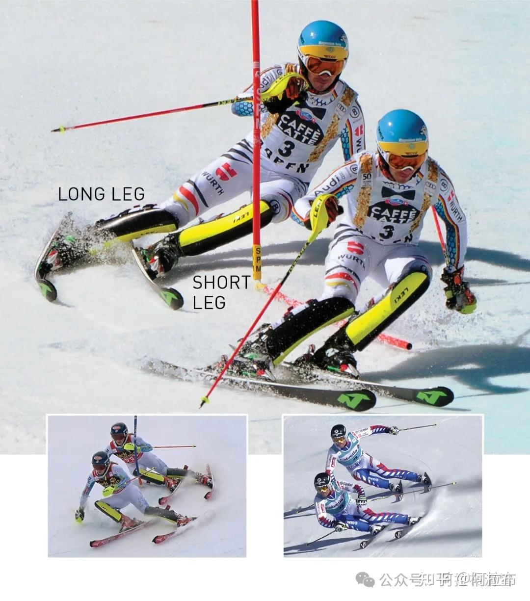

*Felix Neureuther, top Left to Right Mikaela Shiffrin and Alexis Pinturault Photos: Ron LeMaster*

为何有长的伸展的外腿？

由于股骨（大腿）堆叠或更直线排列在胫骨/腓骨（小腿）上，因此较直的腿在生物力学上更强。此外，由于外侧腿的伸展或延长，重心会向转弯的几何轴心移动。根据角动量守恒定律，滑雪者可以通过伸展腿来保持速度，甚至可能增加速度。

为什么有短的曲缩的内腿？

在高立刃期间，腿长的变化最为明显。限制这些高立刃状态的因素是内侧腿制约了外侧腿的横向移动。然而，内侧腿的“缩短”会使得外侧腿移动更多。髋关节的屈曲以及并发的膝关节弯曲会产生这种运动。同样需要重视的是，踝关节前屈相等的概念可能会在最高立刃角度时失效。内侧脚必须向前移动，以适应滑雪板和雪鞋外侧的压力。然而，双踝的张力是必不可少的。由于髋关节在前/后（矢状）平面的弯曲程度比在外侧（额平面）大得多，因此“上半身朝山下”的概念非常必要。

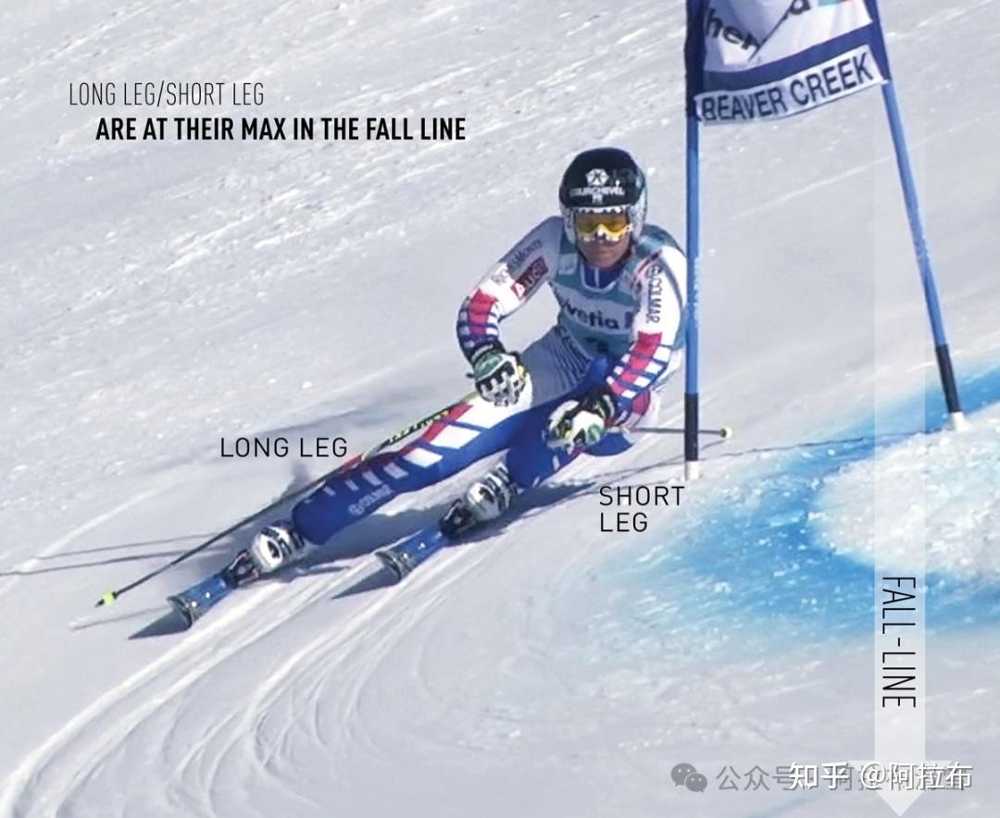

*Alexis PInturault Photo: Ron LeMaster*

伸直腿的注意事项：

如果滑雪者推雪板时用力过大，雪板会切入雪面比所需更深，从而增加摩擦力、减慢滑雪者的速度。过度的推力也会导致滑雪板偏离预期的半径，从而导致新的、意外的半径，从而进一步减慢滑雪者的速度。

何时加长外侧腿和缩短内侧腿： 与反弓的增加同步发生。

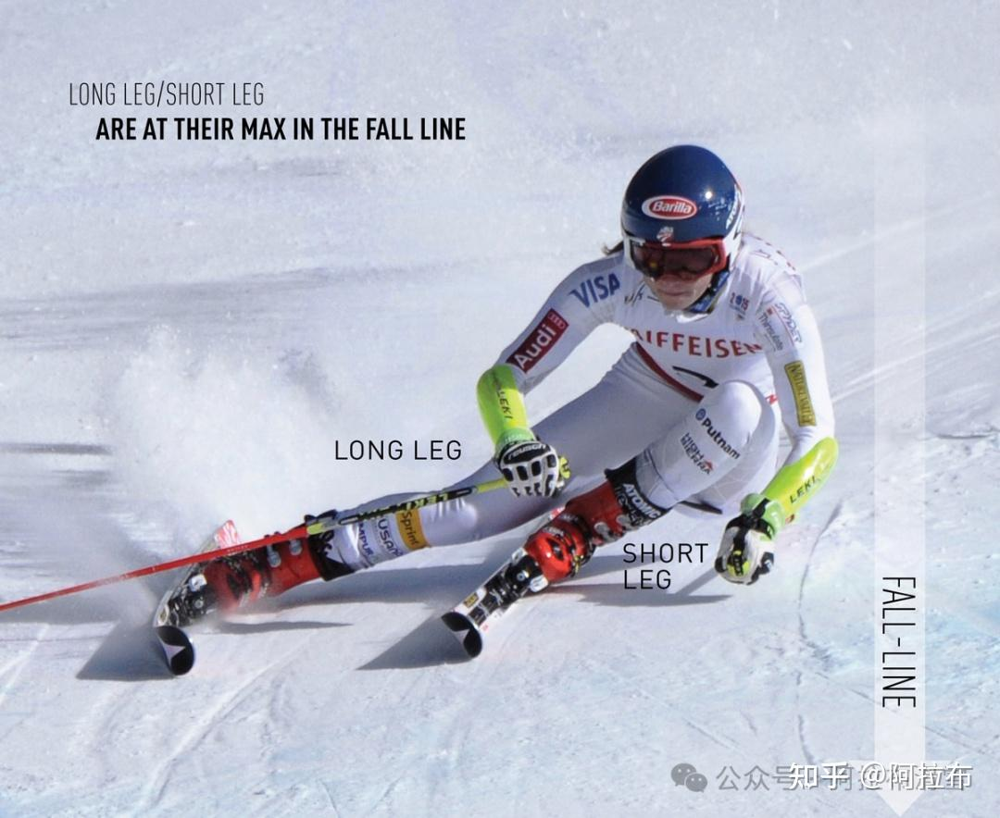

*Mikaela Shiffrin Photo: Ron LeMaster*

例外： 直弯，如蛇形门。

观察要点： 当转弯从内倾进展到过门（滚落线），笔直或伸直的外侧腿与弯曲的内侧臀部和膝盖同步发生。

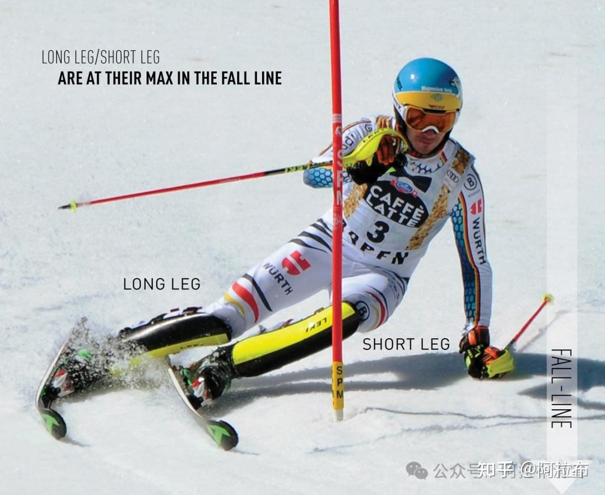

*Felix Neureuther Photo: Ron LeMaster*

为什么外腿长/内腿短： 长而结实（更直）的外侧腿会产生非常强的“骨骼堆叠”，为外侧滑雪板创造空间，使其向上翻转到所需的立刃角度。

如果内侧腿没有缩短会是什么样子： 压力在内侧滑雪板上并内倒。

如果动作不正确会发生什么： 导致立刃角度变小。

长短腿的同义词： 蹬自行车。

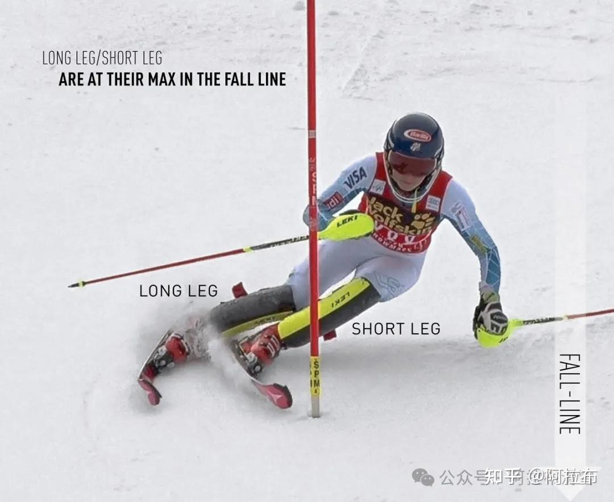

*Mikaela Shiffrin Photo: Ron LeMaster*

Drills:

- White Pass turn
- Javelin
- Skiing moguls
- Show you bases
- Knee to boot.

话题点或提示词：

“感觉就像在踩自行车”（据说是从 Ted Ligety 那里听到的），“在你的大腿内侧平衡一杯水。”

## 07—滚落线上的压力

释义： 当滑雪者在滚落线对滑雪板施压时，就会在滑雪转弯中改变方向。这种压力（压强）可以反弹或将滑雪者投射到新弯，就像球从墙上弹起一样。

什么是压强（口语中的压力）?

压强定义为单位面积上的力。以板刃为基准向上翻转滑雪板，会减少面积并增加压强。这会减少雪中的支撑量，从而增加压强。

中文滑雪圈几乎不用“压强”这个词，都用“压力”来替代。虽然大部分情况下不会引起歧义，但对于“施压”而言，很多人因此而无法理解为何立刃会增加压力：其实压力没有立刻增加，增加的是 压强 。——译者（阿拉布）

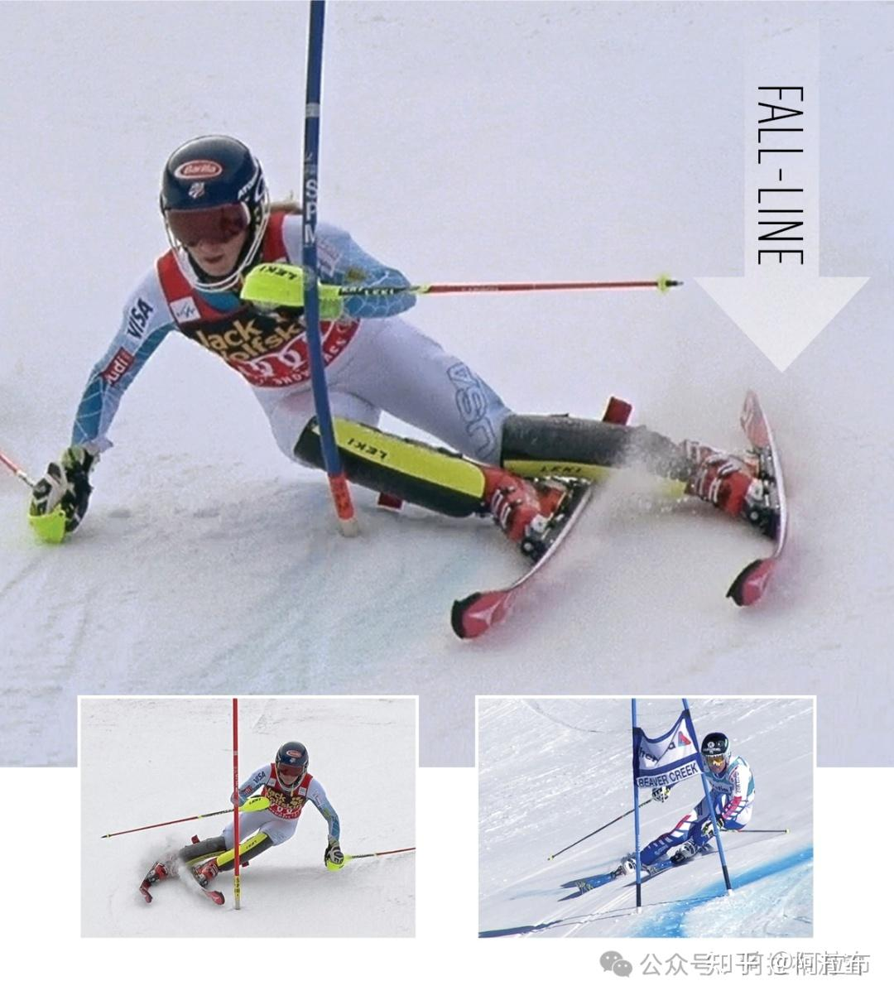

*Mikaela Shiffrin and Alexis Pinturault Photos: Ron LeMaster*

什么是滚落线？

滚落线是球从斜坡上滚下来的可能路径。一条滚落线或球向下滚动同时也可能会向左或向右，就是双滚落线。从最严格的意义上讲，滚落线将与通过旗门（的位置）重合。

何时施压？

施压可能在转换后立即开始、或晚一些开始。在任何一种情况下，最大压力都应该在滚落线上。转弯必须是圆形的，下半部分与上半部分相同。

早施压是否是关键？

“早施压”是滑雪比赛中常见的陈词滥调。一旦滑雪运动员对滑雪板施加压力，他们就会确定半径和转弯位置。这可能是好的，也可能是坏的。

施压距离：

压力应该朝向滚落线并在滚落线上最大化，但它可以从更高的位置开始，并在转弯时向下延伸。相反，延迟压力会缩短半径。

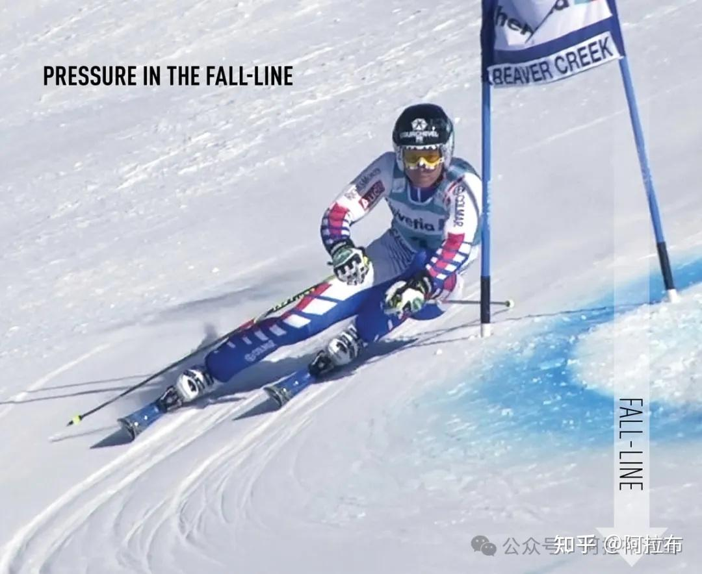

*Alexis Pinturault Photo: Ron LeMaster*

晚施压会如何？

晚施压会导致滑雪者向山上移动，而不是向新弯移动。

这种晚来的压力会导致滑雪运动员从转弯底部爆炸（蹦飞）。在世界杯上，这通常被称为“去往红色小屋”或“进入红色B网而结束”。

冲击很重要：

冲击是一个将力和时间相关联的物理学术语。当您施加力的时间较短时，它会增加。我们希望在滚落线中施加这种压力脉冲。

这里实际上说的是当动量(=冲量)转化为作用力时，作用时间越短，力越大。因为并非是物理定义的冲量，所以翻译为“冲击”。——译者

冲击依据滑行水平的变化：

年轻、技术较差的滑雪者通常比更精英的滑雪运动员更弱。为了在滚落线施压的情况下完成圆弧转弯，成功的年轻滑雪者会在更长的距离上释放压力。与此同时，世界杯精英滑雪运动员将滑出一条更直的路线。它们将延迟转弯冲击，从而形成更短半径的转弯。这可能会有超过 2G 的力或两倍于他们的体重。

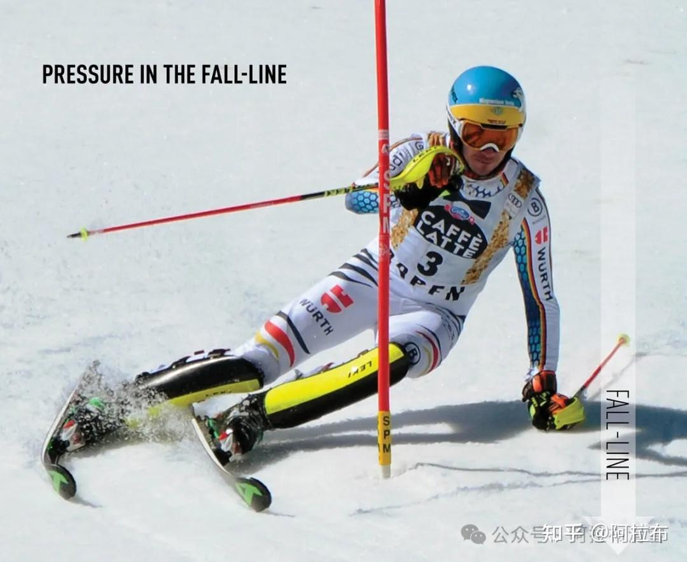

*Felix Neureuther Photo: Ron LeMaster*

弯形： 脉冲或最大压力阶段应该是圆形的。任何对圆形冲击的偏离都会导致滑雪板重新建立自身，产生一条新的路径并降低速度。

卡宾转弯： 您必须使用压力在滚落线上滑出弧线或卡宾，这意味着滑雪板尾部必须在同一路径上跟随板尖。

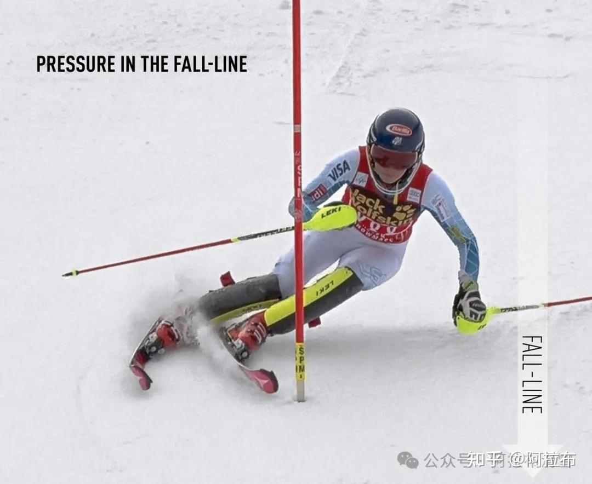

*Mikaela Shiffrin SL Photo: Ron LeMaster*

例外： 方向变化很大的转弯，比如延迟门或侧坡转弯，以及终点前的最后一个转弯。

观察要点： 滑雪板的最大弯曲、反弓和最高立刃角度与滚落线重合。

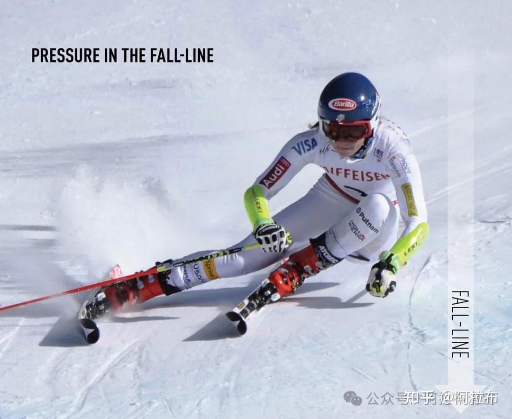

*Mikaela Shiffrin GS Photo: Ron LeMaster*

为什么较晚的压力不可取？

由于滑雪比赛中的力量很大，如果压力较晚，运动员会向山上反弹。

如果压力晚于预期值会怎样：

他们在滚落线或门之后延长或收紧转弯。运动员弹回山上。

如果不这么做，会发生什么？

滑雪者要么向坡上蹦飞，要么需要减小立刃角度，这会导致搓雪转弯。

### Drills:

- Apex drill
- skiing on flat terrain
- tightening the turning arc
- phantom gate clear

话题点或提示词：

观察你的喷雪，倾听你的滑雪板，感受转弯后你身体投射的方向。

## 08—立刃角度

释义： 滑雪板底面与雪面之间的夹角。它的范围从立刃角度为零的放平滑雪板到随着滑雪板倾斜而具有更显着的立刃角。

立刃角在何时发生？

立刃角在转弯循环的每一刻都在不断增加或减少。

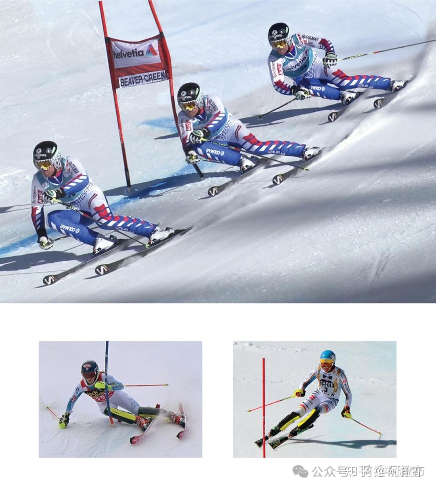

*Alexis Pinturault, Mikaela Shiffrin and Felix Neureuther, Photo: Ron LeMaster*

立刃角为什么重要？？

立刃角可创建搓雪或卡宾转弯。增加立刃角会减小转弯半径。

什么是转弯半径？

转弯半径是立刃角度与滑雪板半径的乘积。简单地说，它是立刃角的余弦值乘以雪板侧切（半径）。例如，15 米滑雪板在 45 度立刃角的转弯半径约为 10.6 米（cos(45°) = .707）* 15 = 10.6。

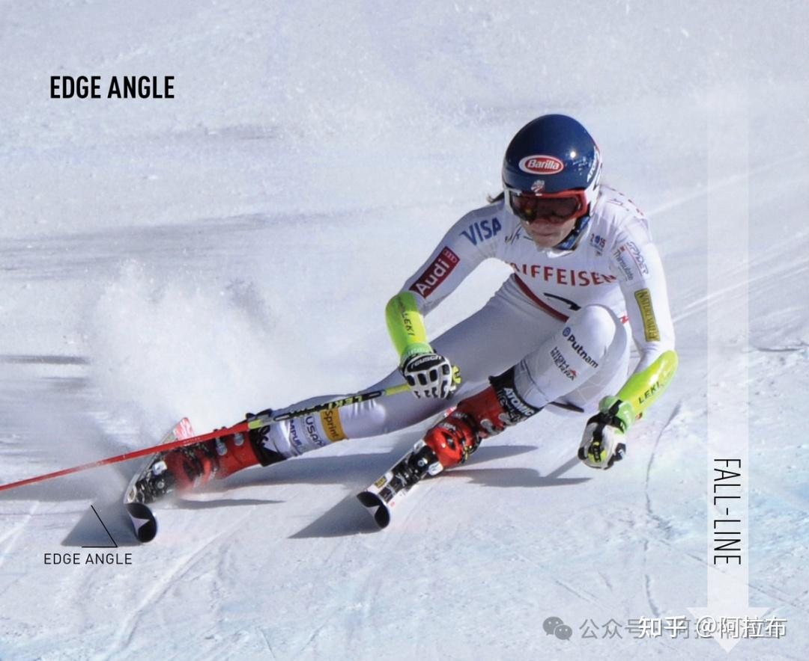

*Mikaela Shiffrin Photo: Ron LeMaster*

立刃角度会太大吗？

平台角度是从滑雪者的质心 （CoM） 到滑雪板底座的力线（角度）。如果平台角度为 90 度或更小，则滑雪板保持稳定。如果滑雪者内倒且平台角度超过 90 度，滑雪板将搓雪。虽然立刃角是关于滑雪板与雪，但我们需要考虑滑雪者的质心与立刃角度的关系。

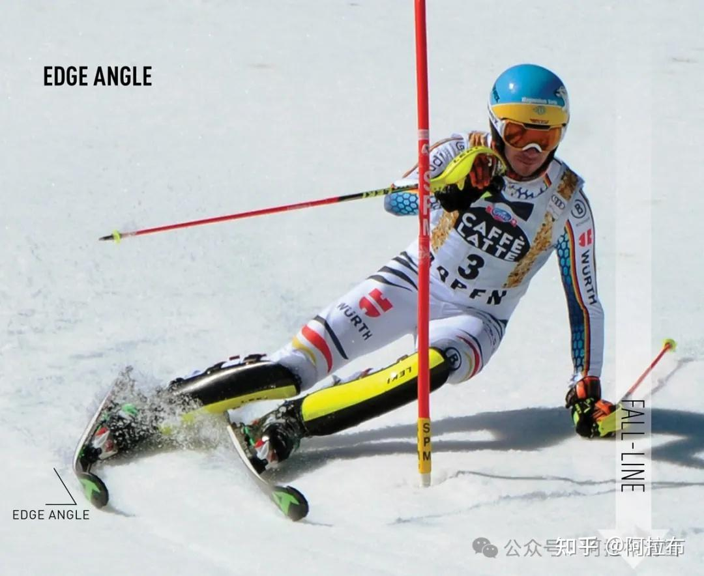

*Felix Neureuther Photo: Ron LeMaster*

例外实例： 速降中的长距离直滑部分。

观察要点： 滑雪板尾部沿着板尖路径的卡宾转弯。在大多数转弯过程中，立刃角度应在通过旗门（滚落线）处达到最大。

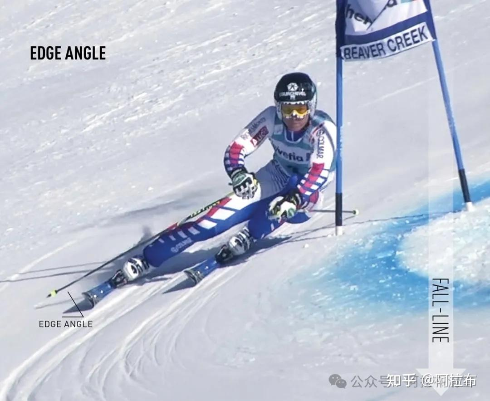

*Alexis Pinturault Photo: Ron LeMaster*

记住： 不仅是极端的立刃角度，还在于它的倾斜方式和施加的压力。

当动作不正确时看起来会怎样： 没有反弓的滑雪者：后座或任何非运动平衡姿势。

如果动作不正确会发生什么： 滑雪者搓雪。

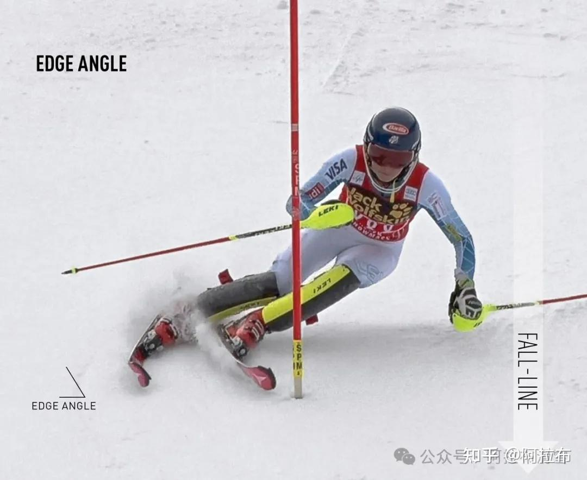

*Mikaela Shiffrin Photo: Ron LeMaster*

### Drills:

- Sideslip with edge sets
- One-legged sideslip with edge sets
- Hockey stops
- Garlands
- Outrigger pole drag
- Schlopy drill
- Carry the torch
- Outrigger pole drag
- Outside pole drag
- 2-0-2

话题点或提示词：

“用右脚鞋筒触碰左膝盖”、“用脚踝释放或开始你的转弯”和“站在雪鞋的一侧”。

## 09—平衡在外板

释义： 两只滑雪板都可以使用。然而，年轻的滑雪者必须掌握在外侧滑雪板的平衡。这是滑雪运动员最强壮的姿势。

经典的何时？

任何使用滑雪板转弯的时刻。

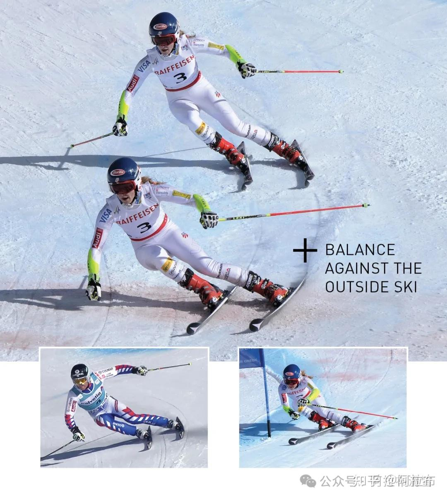

*Mikaela Shiffrin, Alexis Pinturault Photos Ron LeMaster*

尤其是何时？ 当转弯的弧顶与压力冲击重合时。

哪只雪板是外侧板？ 外侧滑雪板是位于转弯弧线外侧的滑雪板。

什么是平衡？

平衡是指滑雪者的质心 （CoM） 与其支撑面一致。滑雪者必须在整个转弯过程中不断调整他们的质心以保持平衡。

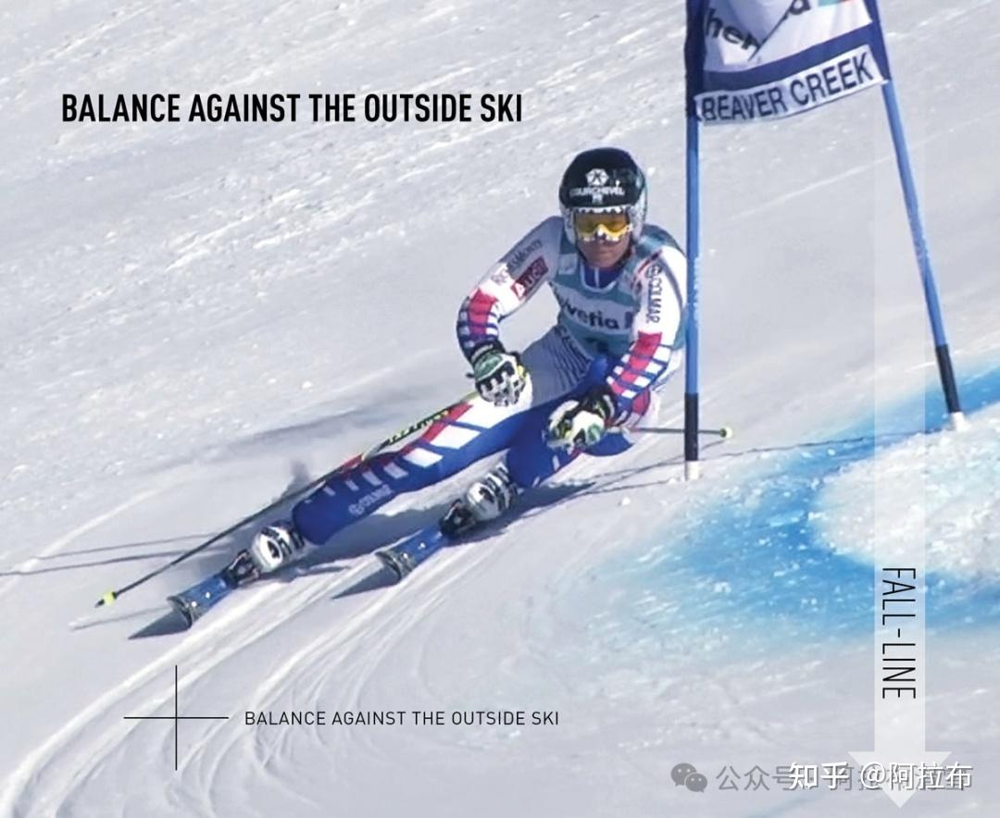

*Alexis Pinturault Photo: Ron LeMaster*

什么是保持平衡？

一个平衡的滑雪者受到两股相互抵消的力量；他们处于均衡状态 Equilibrum。Equi 是拉丁语中相等的意思，而 libra 是拉丁语中平衡的意思，它们定义了均衡——两个相等的动作作用在相反的方向上。例如，向前滑动的滑雪板会受到相反的力抵消，因此滑雪者不会向后移动。在转弯期间向内移动质心会抵消滑雪板的横向移动。顺时针旋转或转动的滑雪板与逆时针旋转的上半身相抵消。

一个平衡，三个方向：

平衡被分解为三个基本剖面。后座的滑雪运动员在前/后矢状面上失去平衡。倾斜或内倒的滑雪运动员在额面横向失去平衡。旋转过多的滑雪运动员开始或结束转弯时在水平面上失去平衡。

*Mikaela Shiffrin Photo: Ron LeMaster*

另一种说法:

老派的定义是“站在(on)山下板上”。然而，这个定义忽略了压力在哪里以及滑雪板发生了什么。

更好的说法：

“站” 在(against)外侧滑雪板是好的，但 “平衡”在(against)外侧滑雪板可能提供更多信息。在精英级别，外侧滑雪板的“指挥”可能会给滑雪者更多的反应选择。在许多世界杯转弯中，外侧滑雪板无法有效地与雪接触。这些快速、颠簸和具有挑战性的赛道使平衡在外侧滑雪板变得困难。在这些情况下，仅仅“指挥”外侧滑雪板可能是一个值得的目标。

Against 与 On 的辨析：Against 表示两者接触并存在支撑关系，On表示空间上两者存在上下关系。用 Balance against outside ski, 消除了在外板“正”上方的歧义，对滑雪动作的描述更加准确。——译者（阿拉布）

例外： 一些弯的入口具有较晚的承重转移，用来在滑雪板因雪和/或侧坡的挑战而失去购买(抓雪?)时延迟压力和冲击。

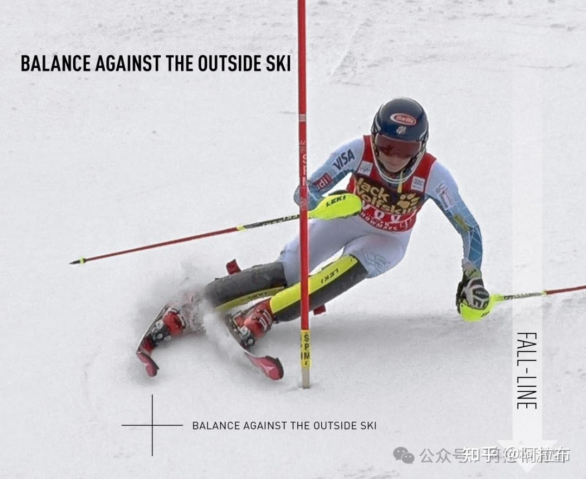

*Mikaela Shiffrin Photo: Ron LeMaster*

观察要点： 注意从质心到外侧滑雪板内刃的作用线。

为什么？ 为了有力和具有运动的预期体态。

如果没有会发生什么： 滑雪者终结在后座上。他们侧滑或用上半身内倒。上半身的旋转方向与转弯方向相同。

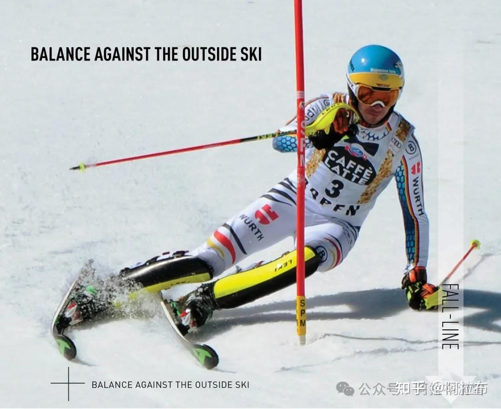

*Felix Neureuther Photo: Ron LeMaster*

Drills:

- Stork turns
- Traverse on downhill ski
- Javelin turns, 1000 steps
- Step turns
- Hands on knees.

话题点或提示词：

“站在固定器之间”、“利用整个滑雪板”和“感受板头、板腰和板尾”。

## 将它们装配在一起

一趟优秀的滑行无缝地将九个FWDI关键概念融合为三个基本要素： 站姿 、 转换 和 转弯 。

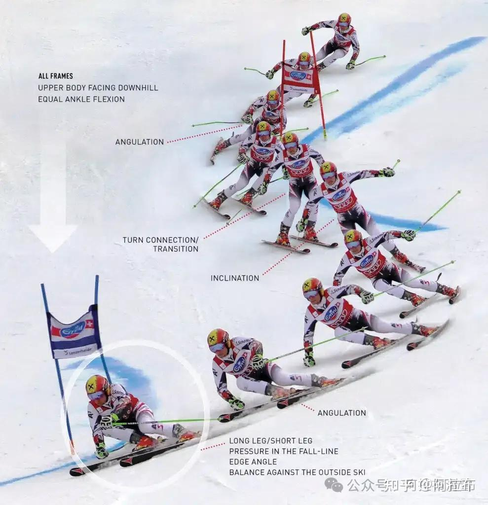

*Marcel Hirscher Lenzerheide, Switzerland Photo Montage: Ron LeMaster*

### 站姿 Stance

起始点是平衡的运动站姿。上半身面向山下的程度依赖于脚踝具有相等角度。

身体面向山下时，下半身可以相对于上半身转动。在空间中以上半身为基准时，下半身相对于上半身转动的方向相反。在跳换弯练习中，旋转发生在股骨在骨盆中转动。在弧到弧的转弯滑行中，骨盆在股骨上旋转。在这两种情况下，上半身相对于下半身旋转，或者下半身相对于上半身旋转。上半身因此面向山下。当相反的旋转在时机、扭矩和节奏上匹配时，就会保持平衡。

上半身面朝山下的角度是相等的踝关节角度造成的结果。当滑雪板在转弯时，山上侧的滑雪板在坡道上相对于山下侧的滑雪板更向前。这被称为“板头差 Lead”。在转弯过程中，山上侧的滑雪板会变成山下侧的滑雪板，从而导致板头差变化。当与膝盖、髋部和肩部匹配时，这种板头差的变化就是上半身面朝下坡的程度。

上半身朝山下的概念与相等的脚踝角度紧密相关。

### 转换 Transition

转换是一个弯与下一个弯之间的连接，这意味着解除立刃和重新立刃。当滑雪板放平在雪面上时，滑雪者在转弯之间有几种选择。其中一种是弧到弧的转弯，滑雪板立即从解除立刃切换到新的立刃以连接转弯。另一个选择是在立刃之前轻微重定向，最后是搓卡（stivot）。搓卡是指滑雪板在转弯前有显著的重定向。每个转换都有一个重要时刻，就是滑雪板放平在雪面上时。

进入新的立刃需要质心的移动。内倾会使质心进入新的转弯。内倾越大，质心就越能使滑雪板翻转。内倾后是反弓，即骨盆和腿之间的角度。有效的反弓通过对支撑面的施压来产生冲击压力。理想情况下，这应该在通过旗门时的滚落线上。由于内倾对质心的路径和距离影响最大，因此它应该在反弓之前进行。

### 转弯 Turn

转弯的相关概念不一定按规定的顺序发生。然而，在快速滑行中它们都需要出现。重心进入新弯的动作使得在转换期间实现新的立刃。之后，有效的反弓只有在存在长腿/短腿关系时才会发生。当平衡在外侧滑雪板上时，长腿能够最佳地承受高强度的力量，这对在滚落线时产生和维持压力至关重要。

### 结语 Conclusion

始于站姿，有效的转换是构建转弯的基石。
