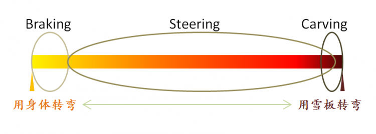
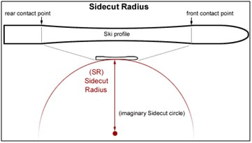
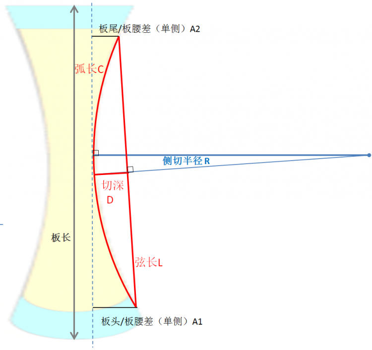
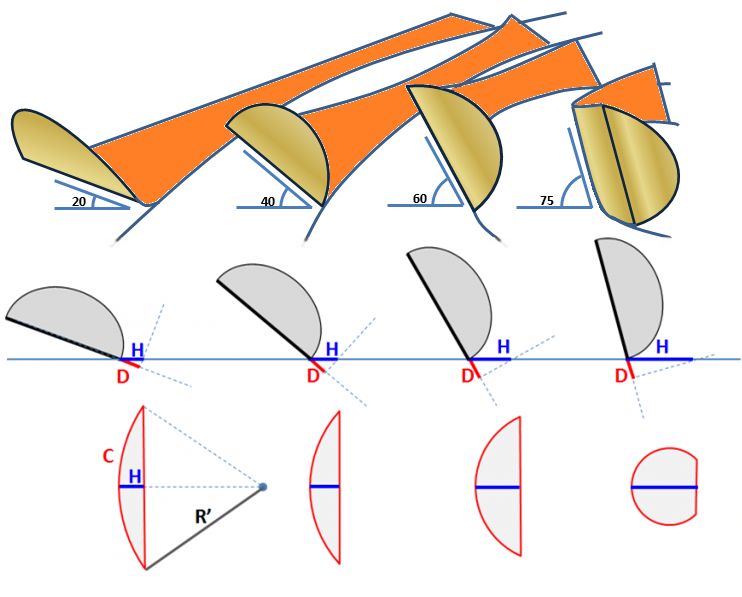
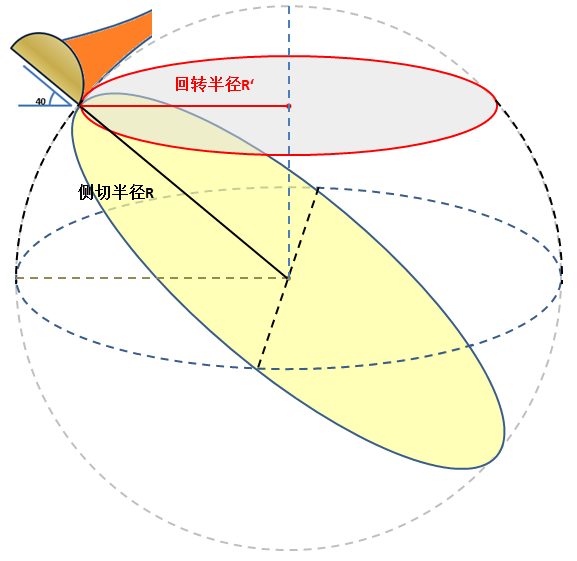
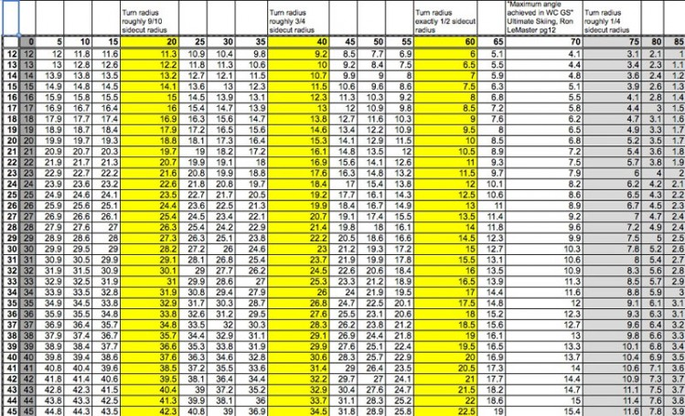
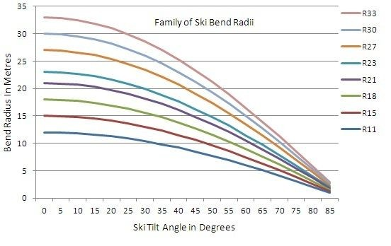
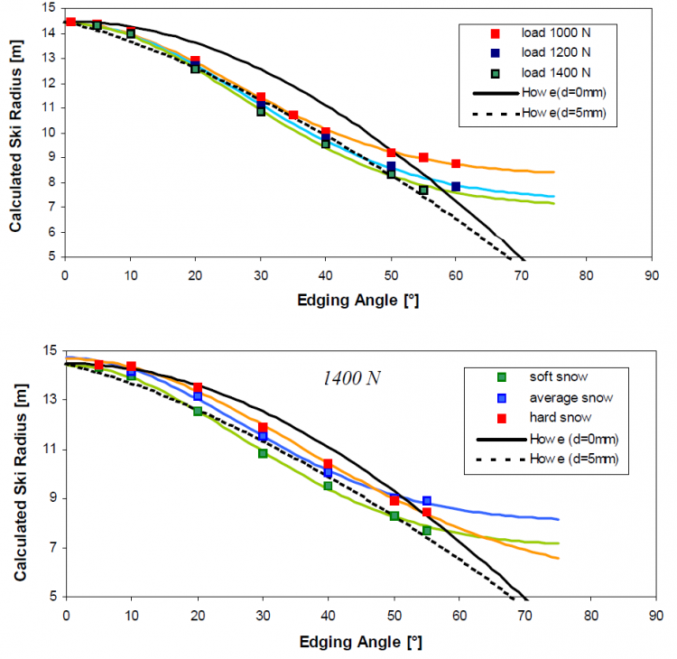
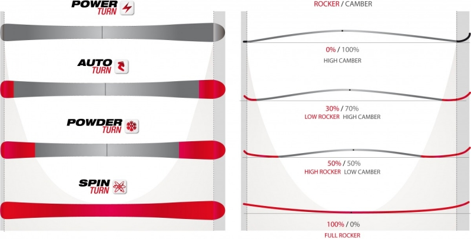

<!-- 来源: https://zhuanlan.zhihu.com/p/23671623 | 分类: 03_装备与器材 | 发布: 2016-11-15 | 赞同: 253 -->

# 转弯半径那点事儿：如何读懂双板的基本参数

一、什么决定了转弯半径

当我们使用现代雪板转弯的时候，有个两个因素决定了转弯的效果：自身的力量（如拧动大腿等），和雪板的侧切（Sidecut）。

如果以这两个因素为端点画条直线的话，那么最右侧完全使用侧切进行转弯，就是卡宾。在左侧，自从出现带侧切的现代雪板之后，完全使用身体转弯的滑法几乎已经消失，但是随之崛起的，是混合使用身体和雪板的转弯技术——驱转（Steering）。

当采用驱转时，因为雪板是在持续搓雪（立刃时雪板的横向移动叫做搓雪），通过增加或者减少搓雪的程度就可以改变转弯的半径，因此与雪板本身的参数没有决定性的关系，只是有难或者易（初中级）、累或者爽（中高级以上）的影响。

卡宾时的转弯半径，则是由雪板侧切，立刃角度，压力三方面共同决定的，其中雪板的侧切是决定性的因素。

事实上，近20多年来卡宾技术的普及，正是得益于侧切的产生（1988出现在赛场，1993进入大众市场）。

二，雪板的侧切半径

所谓侧切，就是把原来直边的雪板，挖掉一个弓形，这样就在雪板侧边上形成了一段圆弧（所以也叫侧挖）。这段圆弧的半径，就叫侧切半径。

形成侧切的弓形有三个要素：弧长C，弦长L，切深D（几何上称拱高）。

雪板在纵向上可以弯曲，所以弦长会变化，只有弧长和切深是恒定不变的。

弧长和切深的计算并不难，可以通过板头/板尾与板腰的差值A1/A2，以及厂家给定的侧切半径R来得到：

弧长C = ( ACOS((R-A1)/R) + ACOS((R-A2)/R) ) * PI * L / 180

切深D= (1 - COS(( ACOS((R-A1)/R) + ACOS((R-A2)/R) ) / 2) ) * R

以Fischer Ranger 98 Ti为例，三维是132-98-122，板长1800mm，半径18米，算出弧长C=1439mm，切深D=14mm，看起来差不多。

如果要反过来通过三维推算半径，那么就需要弦长的数据，也就是雪板侧切部分的长度。通常我们只有雪板的总长度，而侧切部分的长度比较难得到，只能手工实测，或者估算。

三，卡宾半径

侧切半径实际上是雪板平放在雪面时的数据，并不是雪板的实际回转半径。

当雪板在卡宾回转时，因为立刃并压弯雪板而导致半径远小于标称的侧切半径。

可以看到，当雪板立刃压弯后，雪板侧切的弧长C并没有改变，沿板腰横轴方向的切深D也不会变化，但是弦长L明显缩短了，相应的拱高H则被放大了。上面的示意图中，75度时雪板看起来不可能弯曲到那个程度，这是因为绘图所使用比例的问题，实际上弦长与切深要保持10:1左右才合适，绘图用的是3.5:1。

理想状态下卡宾半径的计算公式并不是很难导出。求解的关键，在于拱高H实际上是切深D在地面的投影：

H = D / COS(立刃角度)

通过弧长C与拱高H求半径R’，算式为COS( C/2R’ ) + H/R’ = 1，无法直接解出，只能通过迭代法。不过 滑雪 界的大牛们已经有了成熟的简化方法，据说是《The Physics of Skiing》这本书里先提出的。

首先推导出半径的近似解：R’ = C^2 / 8H + H/2。因为H/2对R’来说太小了，所以直接消去。

同时考虑侧切半径R的公式：R’ = C^2 / 8H, R = C^2 / 8D, 以及上面提到的H = D/COS(立刃角度)，可以得到R’ = R * ( D / H ) = R*COS（立刃角度）。

因此，简易的计算公式就是

卡宾半径 = 侧切半径 * COS(立刃角）

如果要形象化理解这个公式，可以想象侧切的圆弧旋转成为一个球体。把雪板的原始平面按照立刃角度插入地面时，前后板刃被地面所阻，只能沿球体的表面弯曲滑动。最终弯曲的板刃在地面形成一个圆截面，回转半径就是侧切半径在这个截面上的投影。

下图是不同侧切半径的雪板，在立刃后的回转半径变化情况。

按照理论数据，18米的侧切半径，在立刃20度时只有16.9米（94%），40度时是13.8米（3/4），60度时是9米（1/2），75度时是4.7米（1/4）。极限值是85度，1.6米（9%），理论上可以爽爽的小回转了。

不过上面说的都是理论状态，那么实际情况呢？

有个很牛的论文叫《对卡宾状态高山雪板的有限元仿真》（Finite Element Simulation Of A Carving Alpine Ski），提出立刃超过40度以后简易数学模型就不再适用。论文同时还考虑了压力、雪况等因素，计算加模拟后给出了最终结果：

立刃超过40度以后确实简易公式不能再用了。

四，压力、硬度、以及可变半径

前面计算的前提是雪板的侧刃全部与雪面保持接触，而这就需要适当的压力。虽然说这个压力的范围还是非常大的，但总有压力不足或者压力过大的情况发生。

当压力不足时，比如板太硬，身体太轻，速度不够等，显然转弯半径要比计算的值要大，相当于有一部分立刃角度白费了。

当压力过大时，雪板会过度弯曲，板头和/或板尾会离开雪面，相当于弧长C减小，因此回转半径R’也会大大减少，相当于不需要那么大的立刃就有同样的效果。

这么看起来，似乎软的板子比较容易转卡宾小弯？但是，当速度非常快的时候，因为离心力很大，软的雪板也会因压力太大而过度弯曲，从而无法保持弯形。所以，大牛们滑卡宾小回转，反而常用比较硬（通常转弯半径也比较大）的板。

为了更好的应对压力问题，雪板厂家通常采用Camber技术来提高雪道性能，既雪板中间拱起，以保证压力可以均匀的分散在整个板刃区域，并避免太早的过度弯曲。现在可以看到偏重雪道的板，通常都会采用Camber形式。

相对的，还有提高粉雪等操作性的Rocker技术，这部分内容可以参考其他相关文章。

另外，还有一些可变半径的设计，比如板头与板腰构成一种半径，而板腰与板尾构成另一种半径，这样板头板腰板尾全结合则是第三个半径（中间值）。还有一些技术可以通过设置雪板的扭曲（横向的弯曲）状态等来改变半径，这些雪板需要仔细研读厂家说明，并细细磨合才能完全发挥雪板性能。

五，板腰与雪板类型

雪板最重要的基础数据是什么，板长，三维，还是什么别的？

雪板最基础的数据莫过于三维：板头，板腰，板尾的宽度。前面我们知道了，板头/板尾与板腰的差，与板长一起构成了侧切，这就决定了转弯特性。而板腰，则决定了雪板的地形适应性和操控性。

所以，通常看一个雪板的基础特性，板腰和侧切半径（经常简化说成“半径”）这两个数据就足够了。

板腰的宽窄与侧切半径关系不是特别大，比如Fischer的一系列（侧切）半径18米的雪板，板腰各种都有：

RC4 WC RC PRO RaceBooster， 115-68-97

Ranger 84 Ti， 126-84-112

Ranger 98 Ti， 132-98-122

但是板腰越窄，侧切半径就越容易做小。而宽的板腰想做成小侧切半径，则必须把板头做成非常非常宽才行，而这就比较困难了。所以，宽腰板的侧切半径通常不会特别小。

好在宽腰板主要是用于野雪、粉雪，也不需要特别小的转弯半径。因为板腰越宽，雪板面积就越大，能够提供更多的浮力，所以粉雪板/大山板全都是100以上的大宽腰。

相应的，越宽的板腰在换刃时越不灵活，因此竞技板全部都是70左右的小瘦腰。

可见板腰是雪板按照用途分类的重要指标，也可以直接按照用途划定板腰的大致范围，更加便于选择。

比如，按照美国的主流划分，把板腰小于70的板归入竞技板，道内100%，基本不用于道外；

板腰71~84的板叫FrontSide，直译是“前坡板”，实际上就是指的雪道板，也有说“全能板”的，道内为主，有一点道外能力（20%~40%）；

板腰85~90+是全地形前山板（All-Mountain Front Country，大约40%~50%的雪道能力，50%~60%的道外能力）；

90~106是全地形后山板（All-Mountain BackCountry，保留40%的雪道能力）；

更宽的叫粉雪板（Powder）或者大山板（BigMountain），一般不归入全地形，这类雪板仅保留约20%的雪道能力。

各个厂家的也都有自己的分类，比如Fischer的分类是竞技板（道外0%），雪道板（Piste，道外20%），全地形（All-mountain，板腰75~95，道外40%左右），Freeride（板腰84~108，道外60%~90%）。

六，小回转板与大回转板：前人马虎、后人迷糊

说到“小回转”与“大回转这两个词，很多雪友都感到头疼，无他，翻译惹的祸，两个外文词汇对应到一个中文翻译上，具体含义就不好分了。

滑雪比赛中小回转和大回转，是指Slalom（障碍回转比赛）和Giant Slalom（超级障碍回转赛）。

而日常大众滑雪所说的小回转和大回转，多数情况下仅仅是Short Turn（小弯）和Long Turn（大弯）的意思。

一般的语境下，两者倒也不怎么会混淆，可能“大回转”有时会是“卡宾大回转”（Carved Long Turn）的意思，而小回转倒从来不会特指卡宾小回转。

但是放在雪板上，就出问题了！因为雪板上标注的大、小回转（GS/SL或者SC等），都是指的竞技意义的大小回转比赛（Giant Slalom/ Slalom）。

可以看一下各个雪板厂商的产品列表，基本上标准GS/SL(SC)的都是竞技板（Racing）。

所有，当有人问：“小回转板可以玩大回转吗？”他的实际意思，很可能是：

Could Slalom skis be used in carved long turn?

可问题是，很多雪友并不知道这一层关系，并在选择雪板时毫无意义的倾向于竞技小回转板（这就是所谓民用顶级小回转只在中国大卖的主要原因？）

这个坑，源于最早的翻译者的不严谨，现在已经形成习惯，没办法改正了。这也是我为什么在涉及到翻译用词，以及概念的引入时，一再强调要严谨，不能随心所欲，因为一旦造成概念或者用词的混乱，扩散后根本是无法补救的。

前人一马虎，后人就迷糊。不过，“卡宾小回转”就是比“卡宾小弯”好听、提气、上档次，所以就这样吧，只是选择雪板的时候一定要明白，小回转板对应的很可能不是你想滑的那种小回转。

真正需要竞技小回转板的场合，应该是各种业余比赛。当然，作为小回转技术的顶级，卡宾小回转可能也适用。但据我观察，真有这个水平的大牛们，反而不爱用小回转板了。

通常高级雪友对自己所需要的雪板是比较了解的，因此往往是初中级雪友，才会掉进上面的坑里，买雪板就直奔“民用顶级小回转”而去。

问题是竞技板的窄板腰、高固定器（因为板腰太窄，需要垫高固定器给脚宽留出空间），对中级的技术进步可不是什么好事。再加上较高的硬度，比较小的甜点范围等，不但对技术进步没什么帮助，甚至会导致一些错误的动作习惯。

真正适合初中级雪友的，是那些雪道板/全能板/FrontSide板，这一类雪板在用途上虽然没有竞技板那么“高端”，但应用的技术可不见得比那些民用竞技板低多少。价格上，从适中到顶级也都有，选择余地还是比较大的。

而初学者，买板还是比较少的，如果要买，建议多考虑中等板腰，半径小一些的板。毕竟初级雪友的即使搓雪回转，也比较容易受雪板自身特性的影响，半径比较小的大头板，对他们来说相对更容易转一些，有利于技术的学习和提高。

正所谓：中腰大头，转弯不愁！
