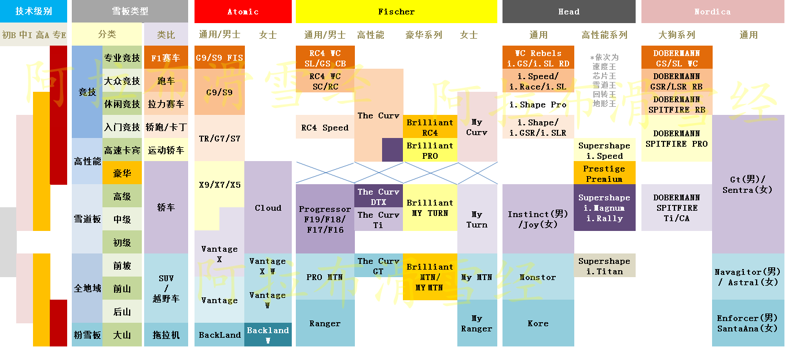
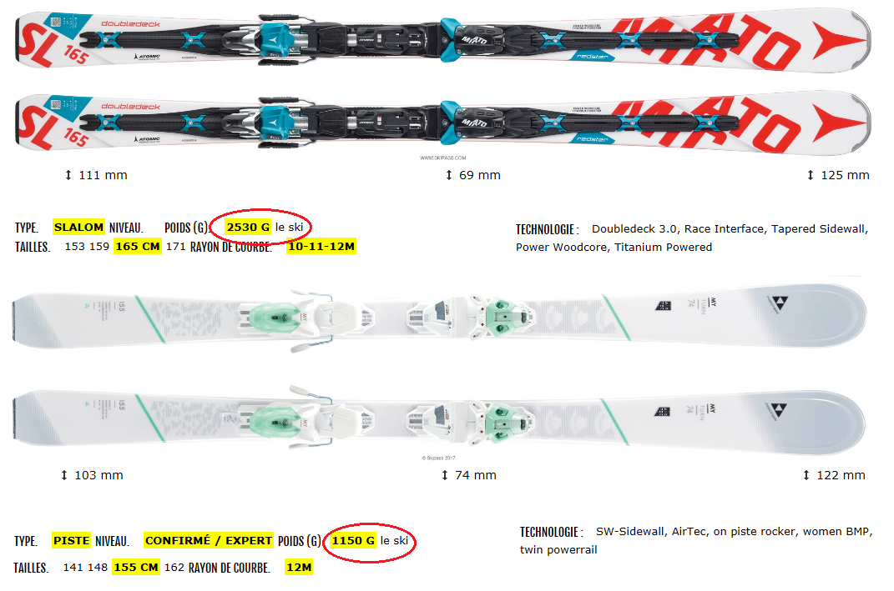
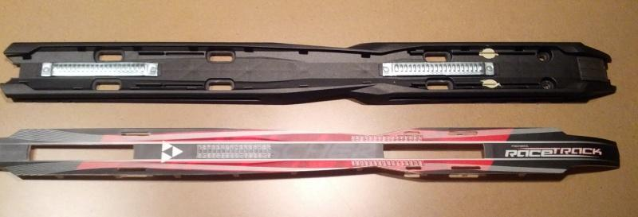
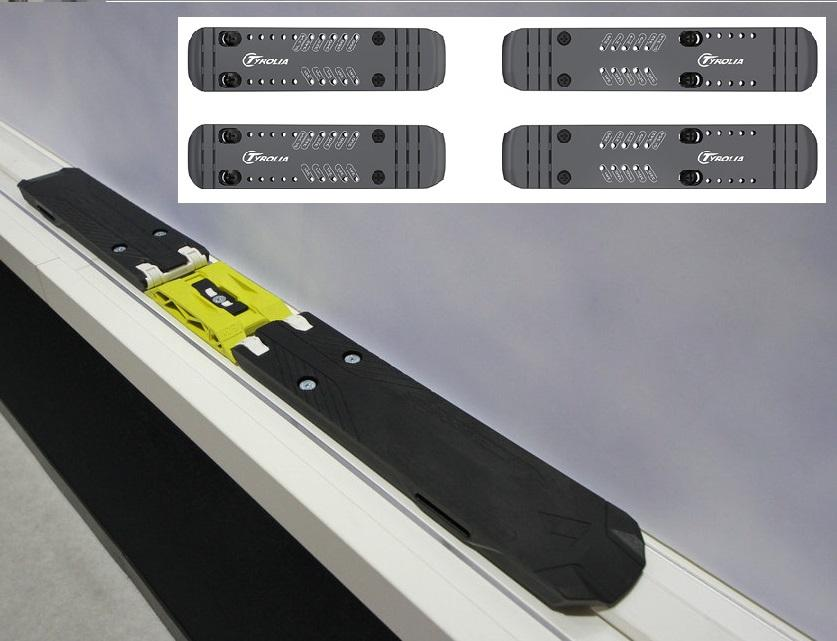
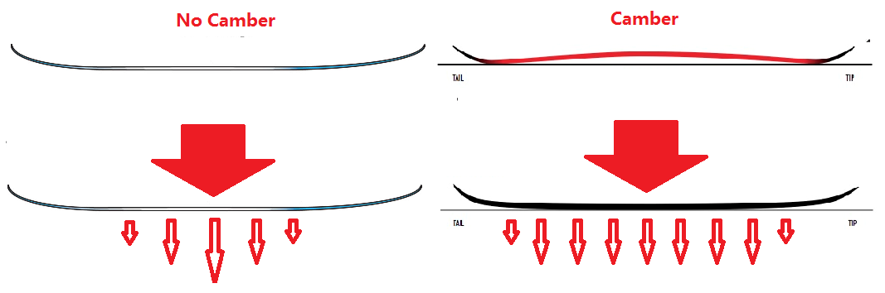
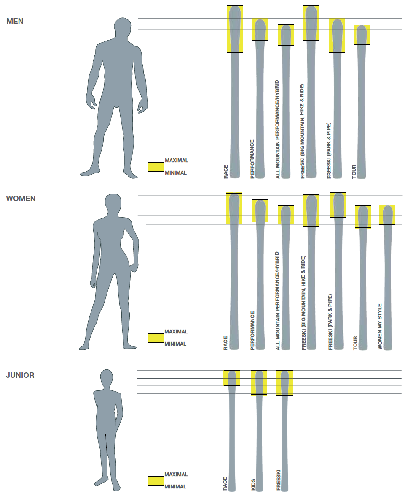
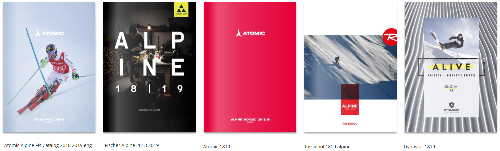

<!-- 来源: https://zhuanlan.zhihu.com/p/34377538 | 分类: 03_装备与器材 | 发布: 2018-03-09 | 赞同: 803 -->

# 如何选择一副适合自己的滑雪双板

> 原文：[知乎 · 阿拉布](https://zhuanlan.zhihu.com/p/34377538)　·　发布于 2018-03-09　·　本文仅供学习交流，版权归原作者所有

（现在是18年3月12日，第二版，后半部分重写）

雪季末大减价马上就要开始，正是添置装备的好时候！ 可是，如何选择一副适合自己的滑雪板？ 这是一个非常头疼的问题，包括我自己，除了物理与材料等知识，还有风格、技术水平、价格、涂装等诸多因素困扰。 现在，在梳理思路的同时，把一些常用雪板知识也分享给大家，希望有所帮助。

## 一、雪板的分类

除去登山滑雪、越野滑雪、自由式（公园、猫跳）这些专项，大众常接触的滑雪双板主要是三种大环境：

- 竞技板：类似冰面的硬化雪面。只在乎速度，非常硬，非常沉，不注重寿命。
- 雪道板：平整的机压雪道。
- 道外板：非机压的天然雪，树林，野雪等环境。

如果用我们熟悉的车来比喻的话，那么竞技板就是F1赛车，只在专用场地上跑；雪道板就是跑公里的普通轿车；而道外板则是各种SUV和越野车。但是就像汽车有各种交叉概念一样，雪板也大量存在功能交叉和组合的情况。我把各种情况细分如下：

- 专业竞技：顶级比赛用板，一般都会冠以WorldCup字样，适用于受过专业训练的运动员，相对于方程式赛车。
- 大众竞技：面向大众的竞赛用板，适用于非专业滑手，通常是专业竞技板的缩减版，以适应大众/业余比赛的强度和技术水平，相对于公路跑车，普通司机稍加训练就能开。
- 竞技巡游：面向大众，喜欢竞技的滑行风格，但是主要还是在雪道巡游滑行的类型，如“能走刃绝不搓雪”的暴力卡宾分子、在雪场高速巡游的退役运动员等。竞技巡游类会考虑长时间滑行的问题，因此会降低操控强度，并提升舒适性，对动作的精确性也不那么苛刻，但是还要保留一点大众竞技的能力，综合下来价格通常比较贵。这类雪板有从专业竞技板降级来的，也有从高级雪道板升级来的，可定位为拉力赛车，介于公路跑车和运动轿车之间。
- 竞技入门：通常是学习竞技技术所用的雪板，使用目的单纯，对滑行能力要求不高，通常价格也比较合适。这种板可比作卡丁车，或者轿跑车。
- 高速卡宾：又是一个暴力卡宾分子适用的类型，但是稍微低端一点，因此适用速度、操控强度、重量、硬度、价格相应的都会让人舒服一些，可比作运动型轿车，不贵还可以强调驾驶快感的那种。
- 豪华雪道板：技术水平保持在高级，附加各种科技以提高操控、舒适等特性，同时涂装也往往非常有个性，易于识别，简而言之，不缺钱，希望彰显个性，那就非它莫属了。等同于豪华轿车，不多解释。
- 高中低级雪道板：为从初级到高级的滑雪学习者准备，主打性价比，等同于常见的各种家用轿车。但要注意，供销售的初级板很少，因为初级滑雪者经常会去租板，即使购买也会偏向于中级甚至更高（在中国一步到位的概念很流行）。这里提一下，很多厂家还有一个大的分类，叫租赁板，主要是初级和初中级雪板。
- 全地域前坡板：板腰71~84的FrontSide板，也有说“全能板”的，道内为主，有一点道外能力（20%~40%），类似于高地盘轿车，或者SUV外形的轿车，呵呵，不多说。
- 全地域前山板：板腰85~90+的Front Country板，大约40%~50%的雪道能力，50%~60%的道外能力，算是城市型SUV，下个一般难度的野地还是可以的；
- 全地域后山板：板腰90~106的All-Mountain BackCountry板，保留40%以下的雪道能力，更宽更沉，可以应付除深粉外的各种野雪地形，可比做越野型SUV，一般的野地轻松跑；
- 粉雪板：板腰100以上，也叫大山板（BigMountain），仅保留约20%一下的雪道滑行能力，专门对付深粉的利器，像是极限越野车，或者拖拉机（吼吼）。

根据以上分类原则，我根据厂家说明、数据和价格（而不是试滑、感受、评价），把17/18版的四家雪板中的相应成人板归了归类大概，以供大家参考。可能有些归类不太准确，或者比较牵强，请海涵并指正。（图稍后改）

这四家的对比，可以看出Nordica的分类简单清晰，Atomic也还好，Head和Fischer最复杂，这也是H和F家细致的市场细分和出众的营销能力的体现。至于通过概念延伸、交叉、搭车等方式，把中级板打扮成“高级概念”而提高价格的行为，谁家都有，所以买板前一定要多看看说明和评价。

## 二、雪板的特性

雪板参数、硬度/重量、容错性等特性，是了解雪板的关键。

1）板腰宽度：这是最基本的雪板参数，上面那张表中的板腰从上到下大致上越来越宽。初中级选取75左右的板腰最舒适，中高级以上按照自己的滑行能力和目标来决定需要的板腰尺寸。

2）雪板侧切半径（三维）：决定了雪板 在卡宾时 走大弯还是小弯。至于搓雪，半径小稍微好搓一点点，但是影响远远没有硬度来的大。所以，大回转板还是小回转板，只对于高级以上雪道板和竞技板需要考虑，中级以下绝大多数都是偏小弯。

3）硬度：厂商不会给出这个指标，但是通常越高级的板越硬，这是因为速度越快时转弯承受的压力就越大，所以需要更高的硬度。硬度直接关联的特性包括重量和稳定性，同时越硬越不容易操控。很多雪板是变硬度设计，如随弯曲程度改变硬度（A家），或者板头和板身采用不同的硬度（F家），甚至用芯片控制入弯和出弯的硬度/弹性不同（H家），这就造就了厂家之间不同的特性，只有多听多看多试才能有真实体会。

4）重量：自己的板总要搬来搬去的，甚至还会随身长途旅行，重量当然是越轻越好。然而，稳定性和高速能力决定了高级板很难做的轻便（一只竞技板有时比一副中级板还沉）。这里就出现了第三个要素：价格，通过一些高成本的材料（如碳纤维）将重量降下来。轻便的高级板不是没有，只是很贵。不少网站会把雪板重量标出来，不过也有厂家不提供这个参数。

5）容错性：雪板上会有一个最佳操控位置，也叫做甜点（不知道蓝色鸦片有没有甜点?），通常位于固定器中间，对应站姿的重心投影。甜点的范围差别很大，通常越高级的雪板甜点范围越小，对动作的精确度要求就越高。另一因素是板腰，窄板腰竞技板在入弯、换弯等环节反应很灵敏，要求动作迅速，宽板腰的后山和大山板同样也对动作时机（节奏）有较高的要求，这些都会减少容错性。所以，量力而行很重要，买一副超出能力太多的雪板，滑起来很可能极不舒服。

## 三、雪板与固定器

雪板与固定器的搭配形式主要有三种：

A）采用滑轨固定器，与固定器搭配好。这是最通常的情况，中级以下的大部分雪板、高级雪道板等。对应滑轨类型，买家也可能更换固定器，但是可选通常不大。滑轨固定器可以很方便的调整鞋壳长度（Solo Length），但也有个调整范围，脚特别大或者特别小的，购买前要查清楚。

B）采用垫板安装，通常与固定器搭配好。这是竞技板的主要方式，固定器是用螺丝拧在垫单上的，购买时对应鞋壳长度安装好，除非拆下就不能改鞋壳长度了。固定器通常只可以微调若干毫米。也有的竞技板垫板采用预打孔，这样安装和更改时能略方便一些。因为竞技板的这个特点，出售二手竞技板就会相对困难一些，必须卖给鞋壳长度一样的人，或者再花费一笔不菲的钱来拆卸和重装固定器。

C）直接安装在雪板上，通常不搭配固定架。这是野雪板（主要是大山板，以及部分后山板）的主要方式，用户需要自己选择合适的固定器，然后按照鞋壳长度来安装。不过对应的固定器比较多，也有很多可以前后调节尺寸的，所以倒是不影响二手出售。这种雪板选择固定器时要注意止滑器（雪耙）宽度必须大于板腰，以及脱离值DIN范围符合自己的设定。

固定器脱离值（DIN）的计算可参考： 滑雪板双板固定器上的 DIN 值调节有什么讲究

这里还有一个小窍门，有时候不好判断一副板的级别时，可以看看它所配固定器和DIN值范围，垫板的肯定比滑轨的高级，DIN最低值6的肯定比最低4的高级。

## 四、雪板与人

雪板终归是要人来使用，与滑行者能力和偏好相适合的雪板才能完全让人真正满意。

能否用好这幅雪板，既所谓驾驭，有两个方面，一是能否发挥出雪板的性能，二是用这副雪板能否发挥出个人正常水平。

第一点方面，其实就是浪费了点。比如很多高级板是在当中级板用，但只要使用者自己高兴，并是什么大问题。

第二点就比较麻烦了。高手用低级板往往滑的也不错，只是速度不能太快，所以会不爽。但能力与雪板不匹配时，有可能会有这两个种表现：

1）装备暴露技术缺陷：比较常见的是搓雪学习阶段，比如重心落后，换上硬板之后雪板转不动了。还有一个因素，是雪板的Camber结构可以更好的分散雪板上的压力，但是这种压力分布的变化会略微增加搓雪的难度。

2）装备掩盖技术缺陷：中级比较常见，尤其是卡宾阶段，本来滑不好的走刃，换了板尾很硬的雪板板之后立即滑的嗖嗖飞快，好像立即晋级了一样，其实是板子带着人走，重心落后的问题仍然存在着。

所以正确的评估自己的能力，然后选择与能力相适应的雪板就很重要了。雪板的级别可以比自己能力高半级到一级，但再多就不建议了。

## 五，决策与购买

选板前，首先要明确自己买板的目的，目的明确了才能确定选板的原则，是比赛，还是野雪，是技术能力，还是适用范围（使用时间），是价格，还是涂装。然后确定大概的目标范围，这时候可以去找找试滑的机会，相同类型和定位的雪板都可以。经常试滑筛选后，定了几个备选目标，就可以寻找购买渠道，确定价格、交货周期、服务等因素，最后下单采购。

现在购买的渠道也比较多了。从国外海淘有直邮、转运两种方式，优点是可以直接享受国外网站的优惠活动，缺点是周期长，运输和报关环节相对麻烦。

国内的采购有代购、经销商、二手交易等。现在国内外价格已经非常透明，没有特别优惠时，海淘回来的雪板比国内直销价格并没省多少，而经销商通常还会附赠保养等服务。另外，每年新款发布后，旧款就会折价促销，多数情况下雪板的年度改版不大，这时候旧版就比较超值了。雪板相对来说不太容易坏，日常磨损也不算严重，正规保养的二手板的性价比还是很不错的。但是尽量别买超过3~5年的雪板，虽然板子的寿命可以到10年以上，但是毕竟越老的板风险越大。

最后说说雪板长度。中级以下按（身高-15）作为基础长度，体重偏大增长，体重偏小减短。其他情况，可参照下图，喜欢速度的选长一点。

最后，祝大家都能拥有一副合意的雪板！

参考资料：

（1） http://www. skieur.com ：欧洲一家杂志网站，存有近几年主流厂家几乎全部雪板的资料

（2）Atomic，Fischer，Head，Nordica官网：要走了，不抄网址了。可以看当年产品，F家有历史产品可查，F家和H家有历史产品手册（Catalogue或者Workboolk）可查

（3） https:// issuu.com/ ：电子出版网站，可查到各家新旧产品手册，很多家18/19产品都发布了，可速速观看！

