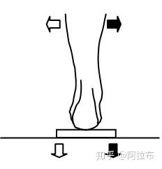
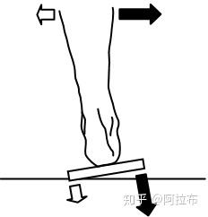
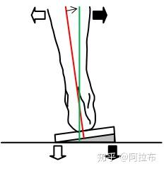
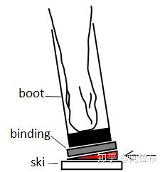
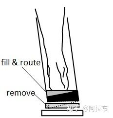
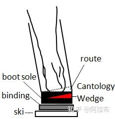
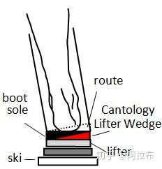
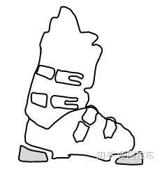
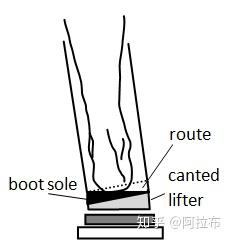
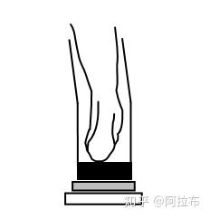

<!-- 来源: https://zhuanlan.zhihu.com/p/42383206 | 分类: 03_装备与器材 | 发布: 2018-08-27 | 赞同: 26 -->

# 【翻译】双板脚底调整 Canting：Why & How

本文翻译自Cantology网站的介绍文章 The 'Why' of Canting 和 The 'How' of Canting 。Cantology是一家专业生产双板脚底调整垫片和调整鞋底的商业机构。

## 为何需要调整脚底的侧倾角（Canting）

可以这么说，并非所有人的身体结构都是非常适合滑雪的。我们中一些人的胯、腿、脚踝的几何构形阻碍了我们滑雪能力的提高。理想状态下，当滑雪者以中性姿态站立、身体的重量落在两脚中间时，他们的体重应当均匀的分布在两只脚的脚底。在雪上，这意味着他们可以轻松的横向搓动雪板，用微小和对称的膝盖动作，立即施展立刃来进行卡宾或者调整弯形或控制搓雪。

然而对于我们中的一些人来说，事情并非如此。当我们试图以中性姿态站立，由于我们身体的形状，大部分体重会落在脚的内侧边或者外侧边。我们可能一只脚有这样的问题，也可能两只脚都有，体重分布不平衡的情况也可以是两种——偏向脚内侧或者偏向脚外侧。在雪上，这是很大的缺点，因为在我们以所谓“中性站姿”站立时，我们的雪板其实会自然的轻微立刃，一侧板刃切入雪面更深。所以我们很难搓动雪板，必须让膝盖向“高的一侧”移动更多的距离来进行补偿。

*为图示进行了夸张，实际倾角不超过3度*

我们可以自我检查一下。

站在一个松软的表面上，比如厚沙发或者发泡胶棉枕头。向前直视，两脚以舒适的距离分l开，尽量平衡和均匀的站在两脚上。保持腰部以下不动，去窥视你的双脚。如果在你试图站在中性平衡位置时，一只或者全部两只脚都斜向内侧或者外侧，我们所说的，就是你了！你鞋底内侧边和外侧边的磨损就是证据。

当站在雪上（你所钟爱的软雪），一侧的板刃要比另一侧更深的压入雪面。当你学习滑雪时，你可能也学到了用一些角度来补充这个问题。但是，这种一直需要进行的补偿，会拖累你的滑行技术，并阻碍你成为一个优秀的滑雪着，而你本来可以的——除非你解决掉这个根本问题。

基于问题的严重程度，有很多个解决办法。矫正的方式包括调整鞋筒的倾角与小腿匹配和/或在从脚到雪板的连接中间插入一个楔子。楔子的作用是升高和对齐膝盖的中心到脚部中线的正上方，因此可以补偿较大的几何问题。

一般来说，“canting”这个词指的是调整雪鞋与雪板接触面的角度。楔子就是“cants“，有许多角度可选。

合适的雪鞋Canting会让你的雪板在中性平衡站姿时完全平放在雪面，或者仅仅是内侧压力略微大一点。用新调整的装备滑几分钟，你就会发现弱的一侧消失了，转弯变的更容易，而你刚发现的稳固的、能够放平雪板的站姿，会给你一个坚实的平台，在此之上可以建立更高级的滑行技能。

因此，如果你厌倦了挖空心思却在技术上无法晋阶，就去当地有全面服务的雪鞋店或者专业雪鞋调整店，在专家的指导下做个倾角测试。如果你需要调整，改善后的装备会给你的滑行带来很大的不同。而且如果你需要调整的角度越大，这种感受就会越强烈。

这都是显而易见的。而困难在于，如何完成这个调整，以及在你的脚与雪板的连接中的特定装备的何处来放置所需要的楔子。

## 如何调整脚底侧倾角（Canting）

以下罗列和对比了许多种调整雪鞋或雪板脚底倾角的方法。注意大多数方法对于在脚与雪板的连接中插入必要角度方面都很有效。而不同之处可通过查看各种方式的不足或缺点进行最佳的比较。

在固定器下放置调整带

在固定器和雪板之间插入一条塑料材质的楔形长条。

优点

- 非常有效的实现了所需的调整角度。
- 调整带可以在出售雪板时摘除，或者在试滑之后通过更换来增加或减小角度。

缺点

- 不太方便与朋友交换雪板，也不适用于试滑板或租板。
- 如果有多副雪板，每副雪板都需要调整，成本高。

鞋底刨削法

雪鞋的鞋底可以用电动刨刀在一侧或者另一侧刨除一部分材料。脚尖和后跟的上表面用树脂做起来以补偿去除的材料。或者，用一个升高垫片加在鞋底的底部来形成高度。两种方法都需要用切槽刀切除脚尖和后跟的部分上表面，以恢复ISO5355规定的厚度尺寸，保证雪鞋可以正确地与固定器接合。注意与插入调整垫片相比，需要去除另一侧的材料来形成相同的角度更改。

优点

非常有效的实现了所需的调整角度。

缺点

- 雪鞋的价值降低，二手出售困难，除非对方需要完全一样的调整。雪鞋不可能再退货。
- 刨床上用来精确固定雪鞋的夹具非常昂贵，刨床的一些操作也非常危险。
- 鞋底的标准花纹被部分刨除，走路时可能会打滑。
- 部分鞋型不支持这种调整。
- 鞋尖与鞋跟的树脂填充材料可能随时间而老化并需要更换。如果部分或者全部脱落，雪鞋与固定器的连接会变得的危险和低效。
- 如果没有使用升高垫片，当鞋底在行走中磨损，调整角度可能会变小并且无法修复。
- 这个过程非常消耗时间和劳动。鞋底必须精确的刨平，也不能刨过头；如果不用升高垫片，鞋尖和鞋跟还得制作围挡，以及等待树脂凝固以恢复连接部分高度。
- 无论如何都需要用切槽刀切除脚尖和后跟的部分上表面以恢复正确的厚度。

在鞋底内部调整

把塑料楔子插入到可拆卸鞋底和鞋壳之间。用切槽刀切除脚尖和后跟的部分上表面，以恢复ISO5355规定的厚度尺寸。

优点

- 非常有效的实现了所需的调整角度。
- 简单快捷——技师拧下前后鞋底模块的螺钉，插入楔子然后重新装上模块。切一下脚尖和后跟上表面。不需要用到树脂。
- 外观看不出来修改的痕迹。
- 调整的楔子可以拆除，脚尖和脚跟切除的上表面可以用树脂恢复，便于二手出售。

缺点

- 部分型号的雪鞋不支持这种调整方法。只能用于可拆卸的多片鞋底式雪鞋，并且鞋底片与鞋壳的接触面必须是平整的。
- 脚尖和后跟必须切除一部分以恢复ISO5355规定的厚度尺寸。
- 技师可能会用其他材料，以不够精确的方式制作楔子来替代。

在鞋底与升高垫片之间调整

调整的楔子可以插在正常的升高垫片和鞋底之间。

优点

- 非常有效的实现了所需的调整角度。
- 当使用Vibram牌升高垫片，可继承其改善功能。
- 对单一材质注入式鞋壳，比刨削法更简单和快捷。
- 对大部分后装的升高片都适用。

缺点

- 脚尖和后跟必须切除一部分以恢复ISO5355规定的厚度尺寸。
- 技师可能会用其他材料，以不够精确的方式制作楔子来替代，难以保证所需要的调整角度。

可替换鞋尖和鞋底调整模块

有一些制造商提供预先调整贵过的鞋尖和鞋底模块，可以直接装在雪鞋原配的标准模块所在位置。

优点

- 非常有效的实现了所需的调整角度。
- 最简单和最快捷的调整方式。
- 无须改变鞋壳或鞋底就可增加或移除调整。

缺点

- 大多数雪鞋不支持这种方式。
- 可替换模块与固定器的连接没有鞋壳与鞋尖鞋跟一体化方式结实。
- 当鞋底磨旧了，模块需要废弃时，可能替代品已经买不到了。

调整鞋尖鞋跟升高垫片

可以买到一些特别的内置调整角的升高片。

优点

- 非常有效的实现了所需的调整角度。

缺点

- 调整的材料变成了雪鞋的鞋底表面，与地面的磨损等会让调整角逐渐变小。
- 脚尖和后跟必须切除一部分以恢复ISO5355规定的厚度尺寸。

调整鞋筒

利用雪鞋内置的鞋筒调整功能来改变鞋帮与底壳的角度。

优点

- 能让鞋筒与小腿与脚踝的自然角度更加符合一致，雪鞋的内部形状与小腿和小腿肚更加贴合。
- 能精细调整让膝盖与雪鞋对齐。

缺点

- 调整效果有限。
- 只有部分雪鞋支持。
- 过度调整鞋筒角度可能会导致小腿与雪鞋的形状变得不正常并导致脚踝疼痛。（可证明这点，试着站在一只脚上，让体重均匀分布在整个脚底，然后将膝盖压向一侧。你会很快感受到脚踝的不适）。小腿与脚踝的角度应该是中性和自然的。

【完】
