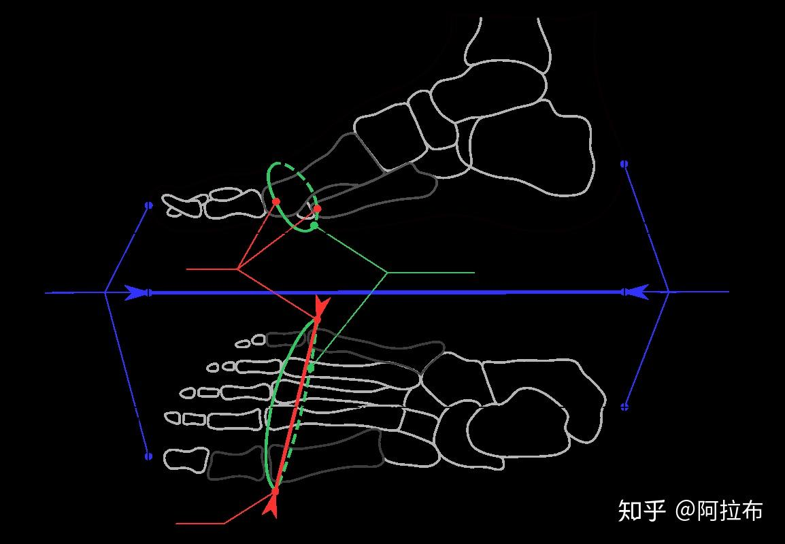
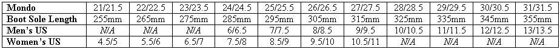
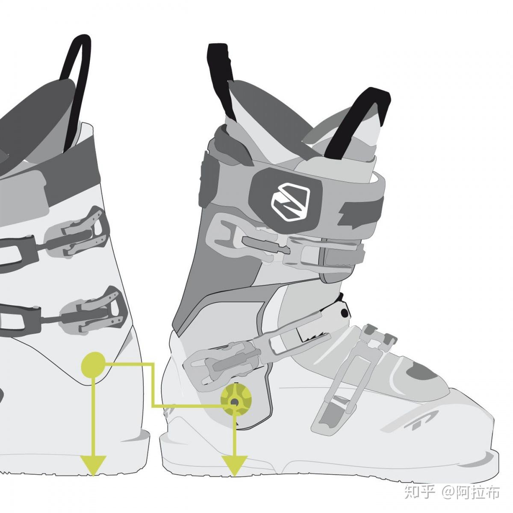
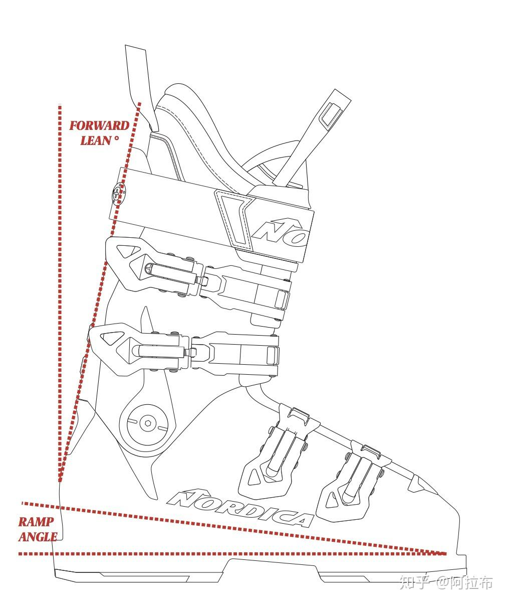

<!-- 来源: https://zhuanlan.zhihu.com/p/43349720 | 分类: 03_装备与器材 | 发布: 2018-09-04 | 赞同: 310 -->

# 【翻译】双板雪鞋知识大全

> 原文：[知乎 · 阿拉布](https://zhuanlan.zhihu.com/p/43349720)　·　发布于 2018-09-04　·　本文仅供学习交流，版权归原作者所有

本文由 http:// theskimonster.com 的几篇Blog文章翻译组成。 http:// theskimonster.com 是2007年由两个在校大学生开设的滑雪装备网站，2009年开始商业化并于2014年在波士顿开设了一间11000平方英尺的全服务滑雪鞋实体店。他们网站的Blog部分有很多不错的文章。

## 双板雪鞋适配：雪鞋怎样才算合脚

Ski Boot Fitting: How Are Boots Supposed to Fit （2015-11-30）

嗯，你可能是我们博客的忠实读者，也可能你只是在 Google 上输入了一些东西，问了一个问题类似于：“我的滑雪鞋大小合适吗？”或者“滑雪鞋应该如何调整才能合脚？”

你可能问自己和谷歌这个问题，是因为以下的问题中至少会有一个:

- 当我第一次穿上这双雪鞋，我的脚趾是否应当顶到鞋的前面并感觉到压力/略微完曲？

是的！当你第一次把滑雪鞋穿上时，你的脚会顶到前面并感觉脚趾很紧。尤其是特别容易穿上的雪鞋，出现这种情况完全正常。别担心，一旦你的脚跟在鞋里踩实就会感觉好多了。

用脚跟略微敲几下地板（别在你妈妈的漂亮硬木地板上敲），扣紧最上面的鞋扣，然后站起来向前曲踝，再依次扣紧下面几个鞋扣，最后是顶部的绑带。当你在雪鞋里向前倾、让小腿上有一些压力，你就能稍微移动一点你的脚趾——这一点都不疯狂，当你在鞋里，鞋也会动。

- 当我在雪鞋里向前倾，就像我正处于滑行姿态，我感觉我的脚跟向后滑动，并且我可以更多的活动我的脚趾，这是正确的吗？

太棒了！你肯定不想（脚）在鞋里游泳。当你在雪鞋里站直，上部鞋帮贴在小腿肚的后侧，你的脚趾应该顶到前面。

- 当我在雪鞋里站直时，脚趾碰不到前面，当我向前倾时，我感觉自己（的脚）像在游泳，我的靴子是不是太大了？

如果你觉得你（的脚）在雪鞋里游泳，那么是的，它们是太大了。游泳不是一个在描述合脚时你想用的词。

- 我认为我的滑雪鞋尺寸是合适的，但不确定。我如何适配我的滑雪鞋外壳？

外壳的适配是为了保证雪鞋既不会太大也没有太小。做外壳适配时，先从滑雪鞋中取出内胆。穿上滑雪袜，把脚放进雪鞋，脚趾尽量前伸直到接触到前面。我们要测量的是你的脚跟和外壳后部的空间。如果你的脚跟后面超过 2cm (不到一英寸)，那么滑雪鞋太大了。如果你的脚跟后面有 1.5~2cm 的空间，它的大小是合适的。(每个人的手指大小是不同的，不要用1指/2指这样的测量方法）。

一般来说，你的脚和鞋壳之间的空间越小，滑行表现就越好，但舒适度就会越差。 然而，越紧的外壳，也越不需要担心内胆松懈，这对那些频繁和激进、并希望雪鞋尽可能经用的滑雪者来说很有意义。大多数 399~599 美元价位的滑雪鞋在感觉松弛之前可以使用 80-100 天左右。(当然这取决于你虐待给的次数，以及存储和护理情况。）

* 注: 像我这样的滑雪者更喜欢脚跟后只有1厘米或者更小空间的鞋壳。我喜欢特别紧的贴合，我的脚宽是106mm，穿鞋楦宽度100mm并且没有撑大的雪鞋。我这样的爱好者在滑雪者中比例很小。

- 当我扣紧鞋扣的时候，我可以提起脚跟，这样好吗？

是的，如果你试着用脚趾站在鞋里，你就能提起脚跟。你能提起脚跟的原因是因为你的脚比滑雪鞋更容易变形。如果你不能提起你的脚跟，这也不是一件坏事，它更可能是你被鞋挤住了，或你有一个不太灵活的脚。

如果你是在雪鞋中前倾时，脚跟会抬起——这很有可能是因为你脚踝的运动范围较小。这并不意味着鞋不好，你只是需要在雪鞋中增加斜坡角，如果你在波士顿，可以在我们的商店里做这个调整。

- 当我在山上滑雪的时候，我感觉脚弓下面有痉挛和灼烧感，是因为雪鞋吗？

你滑雪时使用在雪鞋里放置了后配的或者定制的鞋垫？如果答案是“否”，那你应该去配一双。如果你的雪鞋在试穿时确实非常合脚，却在滑雪时有不贴合/脚疼的问题，那么你绝对应该去找一双好的鞋垫。

好的鞋垫，特别是定制鞋垫，可以解决几乎所有的贴合性问题，包括：脚趾重叠，足弓疼痛，脚踝疼，脚凉，和胫骨前面疼痛。

如果你已经在用定制鞋垫，却仍然有足弓疼痛的问题，那么开始每天都使用鞋垫，或者穿一双带有良好支撑的好鞋，比如跑步鞋或者专业运动鞋。习惯于支撑会极大的帮助你解决这个问题，你的脚就不会在滑雪时感到痉挛。

大部分的雪鞋适配问题可以通过正确的尺码（鞋壳内有1.5~2cm空间）加上后配的一双好鞋垫来解决。鞋垫的作用是让脚正确的踩在鞋上，支撑起所有需要得到支撑的部位。雪鞋里的原配鞋垫做不到这样。鞋垫不仅会让你感觉舒适，而且还能帮助你滑的更好。

所以，如果你的雪鞋有适配问题，先检查鞋码和鞋垫，如果这两项都无误，那也可能是你的鞋垫对脚来说太硬或者太软。软的足弓需要用更硬一些的鞋垫，而硬的足弓要用像（车的）悬挂那样软一些的鞋垫。如果鞋垫的硬度于脚的柔韧性不匹配，脚可能会疼——我们店可以修正这个问题。

如果你（在滑雪时）还是会疼，有一个好办法，就是滑雪前让足弓“伸展开”。在地上放一个球（曲棍球最好），用一只脚站在上面并前后滚动——每只脚2~3分钟。无论你能否无视疼痛，在滑雪前让脚部有足够的“热身”总是好的。

* 注：鞋垫可以换到不同的雪鞋上使用。然而，用于新鞋时可能需要重新塑形。鞋垫从高性能/竞技鞋换到舒适型鞋可能会有问题，因为足底面积太小。你只能让鞋垫变小，而不能变大，对吧？

- 如何找到一个好的调鞋师？

给我们打个电话，如果你不是波士顿的本地人，我们会告诉你所在地区的一些大商店，他们能让你对你的雪鞋更满意。

- 我的朋友是专家，我会带他们去，他或她会帮我挑选滑雪鞋。

你的朋友是调鞋师吗？ 如果答案是“不”，那么他或她并不会比你要去找的调鞋师知道的更多。

结束语: 确保你的滑雪鞋尺码正确，当有疑惑时找一双与你的足弓高度、脚长、软硬程度完全适合的鞋垫。

## 关于鞋码（简述）

https:// theskimonster.com/blog/ posts/ski-boot-sizing-chart/

大意是不可用平时的鞋码来估算雪鞋鞋码。雪鞋尺码使用Mondo标准，也就是实际脚长。需要注意的是，一个人的两只脚并非完全一样。

*译注：鞋码这个问题，在全世界都是热门的吵架题材，需要详细了解的可以看一下这里：

Shoe size - Wikipedia

还有一个网页是各个厂家的雪鞋尺码于鞋底尺寸对照表：

https:// theskimonster.com/blog/ posts/ski-boot-sole-length-comparison-chart/

简易的对应可参照下表：

## 双板雪鞋适配：硬度，宽度，内胆，行走模式，外壳设计

Ski Boot Fitting: Flex, Width, Liners, Hike Modes & Shell Design （2017-09-26）

这篇博客的目的是澄清一些关于滑雪鞋的误解。在互联网上有大量不正确的信息，很多信息提供者仅仅对滑雪鞋，这个最重要的滑雪设备，略知皮毛。这篇文章中的许多信息都超出了老店雇员/经理/业主或高于一般客户服务代表所知道的范围。这是你需要和愿意知道的滑雪鞋设计，组成和技术。

## 一切始于蒙特贝卢纳

意大利的蒙特贝卢纳位于威尼斯西北约40英里处，滑雪鞋的设计就是从那里开始的。在以鞋类闻名之前，蒙特贝鲁纳是许多雕塑家的家。为了制作任何一件好鞋都需要的鞋楦，你需要——对，雕刻家。木制的鞋楦被用来制作第一双皮鞋和第一代滑雪鞋。当滑雪鞋从皮革进化到塑料注入成型，这里没有太大的变化，雕塑家们仍然在塑造铝制的模具，这个铝制鞋楦将用来生产第一双塑料滑雪鞋。蒙特贝鲁纳是大多数鞋业技术公司的所在地，它仍然是滑雪鞋设计和制造的圣地。

在过去的几十年里，滑雪板和滑雪风格都发生了变化，靴子也有了很大的发展。

## 滑雪鞋硬度（Flex，柔性）：

常见问题：

- 滑雪鞋上的硬度指数是什么？

硬度指数直到第一代Nordica SpeedMachine 8,10,12和14才真正存在，后来演变成90,100,120和140——号码越高，鞋就越硬。在这之前，更贵的鞋通常，在大多数情况下，会更硬。Nordica基本上通过SpeedMachine系列创建了这个的硬度指数的标准。当雪鞋制造商生产用于测试的雪鞋时，硬度测试过程并不像你想象的那么科学，或者厂商让它看起来那样。这更像是‘这感觉像130吗？好的，我们真棒'。如果感觉太软或太硬，他们会对材料进行调整，使其更加精确/真实。说真的，当我们和产品负责人去测试滑雪鞋原型时，情况就是这样。

- 他们如何改变不同型号雪鞋的硬度，例如Mach1 100到Mach1 130？

外壳是由不同的热塑性聚氨酯（TPU）混合物注入而成。聚氨酯中的弹性体越多，硬度就越低，弹性体越少则硬度越高。如果你有一双Mach 110 MV 26.5雪鞋，它与Mach1 130 MV 26.5用了完全一样的模具。所以，当生产不同硬性的雪鞋时，只需要关闭机器，模具清洁，然后注入下一个型号。

- 雪鞋鞋帮后脊上的钉扣如何影响滑雪鞋的性能？

一双重叠式或两片式滑雪鞋的力量来自于鞋脊。通过在后脊上加上一两个铆钉，你实际上是将上部的鞋帮固定在下端壳上。更多的铆钉产生更多的刚性–它会感觉更硬。但真正改变的是，靴子将会带来更多的反弹。如果你觉得你的腿越来越酸痛然后你认为他们就是这样，多一些反弹可能会帮助你摆脱困境。

后脊没有铆钉的鞋会有较少的反弹，我们可以把上下鞋壳一直铆合在一起——也可以每隔一段时间做一次。如果你有一双带步行/徒步模式的重叠式滑雪鞋，它的反弹会比固定鞋壳的高山型号更少——想想Lange XT和RX。

- 两片重叠式雪鞋设计与三片敞开式雪鞋设计的性能比较？

在重叠式滑雪鞋上，力量来自鞋后脊。在敞开式的设计中，鞋帮的运动取决于舌鞋的硬度——如果你把内胆从敞开式雪鞋中拿出来，你可以比在重叠式雪鞋中更容易地前后移动鞋帮。这是因为三片式鞋壳的后面没有铆钉。鞋舌也提供了反弹，所以更换鞋舌就可以调整反弹。在重叠式雪鞋中，当雪鞋向前弯曲时，下端壳（雪鞋的下部）外鼓，即：变形。而在敞开式雪鞋里，变形的是鞋舌。由于敞开式雪鞋明显减少了鼓胀，这就需要额外的工作（打孔/打磨）来避免对脚踝骨的摩擦。但是，也正因为减少了鼓胀，敞开式雪鞋可以更好地适应更高/更瘦的脚部。

两片重叠式雪鞋与三片敞开式雪鞋哪一个更好/更高级？

没有答案，看滑雪者喜欢哪个。我们能说的是，Dalbello推出了三片式雪鞋，他们是对重叠式雪鞋市场的创新。其他所有厂商永远在做重叠式雪鞋，不能像Dalbello那样推出三片式雪鞋靴子（干得好，Dalbello）。

不要与3扣和4扣滑雪鞋混淆。有些三件式雪鞋有4个扣子，大部分有3个扣子。大多数两件式雪鞋有4个扣子，有些有3个扣子。对于两片式雪鞋，可能的性能问题是鞋帮上只有1个大扣——它只有较少的反弹，并且不能传递更多的力量到滑雪板。但是好处是很容易穿上。

为什么三片式雪鞋的弹性比两片式雪鞋靴感觉更柔软？

三片式雪鞋的铰链位置低于两片式雪鞋，给了滑雪者更长的杠杆，更长的杠杆意味着你有更多的力量来弯曲雪鞋。三片式雪鞋开始弯曲时会感觉很软，但是会越弯越硬。两片式雪鞋的硬度更加线性。

- 外壳的厚度是否影响靴子的合脚性？

哦，是的，这就是为什么世界杯比赛的雪鞋不那么舒适的部分原因，其鞋壳的厚度明显大于任何你在滑雪商店看到的雪鞋。如果你穿的两双滑雪鞋实际上有着相同的宽度（我们将在下一节讨论滑雪鞋的鞋楦宽度），使用相同的内胆，鞋壳较薄的靴子会显得更宽敞，因为它更容易弯曲。另一个对于滑雪鞋更重要的因素是重量，在过去几年中壁厚明显变薄，因此雪鞋变得更舒适了。

- 滑雪鞋的鞋楦（宽度）会随着鞋码的增减而变化吗？

是的 ，这是关于雪鞋的最大误解之一。一般来说，脚长的人脚更宽，反之亦然，所以滑雪鞋的宽度会根据长度而变化。雪鞋对外公布的宽度仅基于鞋码26.5——所有的品牌都是。当一个新雪鞋开始设计，第一个生产尺寸就是26.5，其余的模具是在26.5的基础上用数学计算出来的。例如Lange RX 120的鞋楦宽度是100——再次说明这是26.5的——随着鞋长每增加一个尺寸，鞋楦宽度增加2毫米。所以鞋码29.5 的RX 120宽度是106毫米，而24.5的是96毫米。所有滑雪鞋制造商都大致按照2毫米的跨度来增加鞋楦宽度。如果你想要高级技术，Nordica每个雪鞋尺寸的变化值是2.3毫米。

- 制造商如何测试滑雪鞋？

并不是所有的滑雪鞋都经过同样的测试：

——比较硬的全地域滑雪鞋，像Nordica SpeedMachine 130按如下顺序考虑：性能，重量和舒适性。

——世界杯竞技鞋，就像Dobermann 150则只考虑性能。它要有能力在冰面驱动小侧切的硬滑雪板。它与舒适性无关。这样的雪鞋是为了让滑雪者在赛道上尽可能快。

——高山旅游雪鞋，像Dynafit TLT7考虑了：重量，舒适性和性能。现在有了轻巧舒适的性能，这些雪鞋的设计理念是让它们一次穿上好几天，甚至一个星期。上面的两双靴子（世界杯和全地域）可能在度假村的一整天中只滑两趟，而TLT的鞋则是专为长时间的木屋旅行设计的，每次8–16小时，连续一周都是这样。

——出租用滑雪鞋考虑了：耐久性和舒适性。出租的雪鞋必须耐用，你可能在I-90公路上用车拖着这些东西，穿过好几个州的界线，而他们仍旧可以滑。至于舒适性，当他们是新的，他们会更舒适，但被使用了很多次后，可能连内胆都破了——够长时间的话。

- 斜坡角（Ramp Angle）和前倾角（forward lean）是如何影响性能的？

这是个关于脚踝屈曲的问题。如果你看一下我们的滑雪鞋页面，看看技术规格，你会发现大多数雪鞋的斜坡角都是4º-4.5º，但是海德Advant Edge的是5.5º。滑雪鞋的斜坡角越大,你的脚踝需要的前屈就越少。通过更少的脚踝屈曲，靴子会一整天都更舒适——像一个真正的高山旅游鞋.....但对滑雪板的反应会不那么灵敏。 在大多数情况下，回转赛滑手需要更少的，平的甚至负的斜坡角，以使滑雪板的前端更灵敏，而速度比赛滑手需要一些斜坡角，来使得雪板在70英里每小时下不至于跑飞。

在一天结束时脱掉滑雪鞋感觉很好的部分原因，是因为你不再被迫处于运动姿态。4度的斜坡角和12度的前倾就是一个运动姿态。某些缺少斜坡角的竞技鞋更具运动性，因为有更多的胫骨前倾角——以保持运动姿态。即使只是在机压道巡游，你的肌肉也会长时间保持紧张，滑几天后就会感觉酸痛。

老式滑雪鞋 (1997以前)，包含后入式，滑雪鞋的斜坡角明显更大，脚跟更重。今天的滑雪鞋是用整只脚。由于斜坡角的增加，老式雪鞋的脚踝屈曲更少，而现在会有更多的踝关节屈曲。现在的雪板比过去的雪板对横向运动的反应更好，更平的站立面和更多的脚踝屈曲效果更适合现在的雪板。

如果你想从你的滑雪鞋上获得更多的性能，不要增加足跟升高片来放松你的运动姿势。如果你想能够更容易地在阿斯本高地CloudNine餐厅的桌子上跳舞——那就去吧。To each their own。

- 聚酰胺Grilamid与聚氨酯Polyurethane滑雪鞋

聚酰胺已成为一种更受欢迎的靴子材料，原因是它比聚氨酯轻，它不太受温度影响——对不对？Grilamid 的缺点是它会有轻微的“湿”感，就想在滑chundery雪，不像PU那种略潮的感觉。 聚氨酯在所有材料的测试中有最好的雪感。 高品质的聚氨酯外壳也比其他滑雪鞋材料更好操作，允许调鞋师有效地对雪鞋做适配调整。

聚酰胺外壳在出模后也比聚氨酯收缩更多。 因此，如果你拿到一双与Nordica Speedmachine 130同模具的Strider 130——后者实际上在雪鞋所能够接触到的地方更贴合，不过两种雪鞋所用内胆的不同弥补了这种差异。 通常，徒步或旅游滑雪鞋中的内胆比普通的高山滑雪鞋更薄。

- 定制泡沫注入内胆值得做吗？

当然可以！泡沫注入内胆将提供定制的贴合度，它们在填补空隙或充实空闲容积方面极其有效。有些人是真喜欢他们的感觉，然而大多数并不是。多数滑雪者不需要削减更多容积，他们需要更多容积或对原配内胆提供的当前容积很满意。制作泡沫注入内胆需要雪鞋拥有者和注入操作者之间有良好的沟通——沟通中的断点可能会导致贴合问题。

值得注意的是，定制泡沫注射内胆并没有被广泛用于滑雪比赛，不像它被以为的那样。

- 后配的内胆会影响滑雪鞋的硬度（弹性）吗？

是的，这实际上就是人们使用 ZipFit 牌内胆的原因之一。你可以把 Zipfit 做得更柔和或更硬——用 Zipfit 内胆最多可以改变滑雪鞋软硬度10个点。 使用Intuition的power wrap内胆会感觉比原配内胆硬10~15个点。泡沫注入内胆也会比原配内胆硬。

- 带收紧绳的内胆是如何影响滑雪鞋贴合性和性能的？

他们不会改变靴子的硬度，但它会使鞋舌一直贴合在你的胫骨中央，并因为内胆更紧凑而允许你将鞋扣扣的更紧。鞋壳离你的脚越近，它就越灵敏。这就是为什么你能看到竞技滑手收紧内胆再穿上鞋壳。

- 穿硬度小的软鞋滑宽腰板会更困难吗？

是的，弯曲Enforcer 100比Navigator 80需要更多的能量。滑雪鞋的工作是让雪板弯曲，更硬的滑雪鞋传递能量更有效。要弯曲像Enforcer这样的雪板，你需要一个 110-130 硬度的雪鞋，而对于Navigator 80 随便 80-120 硬度的鞋都可以——这并不是一副需求苛刻的雪板，它的适应范围很大。

这也不是说超级硬就好。 如果你有一副雪板像Enforcer 或 Enforcer 110，甚至是Head Supershape Rally，一双WC（世界杯赛）雪鞋，像Dobermann 150，就太过了。我想你可能会说，这样有助于在垃圾雪中滑出非常技术性的轨迹，但就是这样。

多少硬度的滑雪鞋适合你？

对于特定的人，如果雪鞋适配师或者教练没看到滑雪者穿上雪鞋的样子，就很难说多少硬度才是正确的——部分原因是适合于特定雪板的硬度是一个范围。决定正确的硬度值取决于：踝关节的活动能力、力量、重量以及所使用的滑雪板。很多滑雪者都买了不足的雪鞋以及过头的滑雪板，比如399美元的硬度90的鞋不能驱动Enforcer 100——你能滑，但你不能发挥出你本应做到的雪板的全部性能。

现如今滑雪鞋已经改变了很多，比以往有了更多的种类。滑雪鞋像滑雪板一样是为不同的目的制造的，硬度的微妙的差异，重量，材料和斜坡角，可以在雪道上给你真正的优势。谁做出了最好的雪鞋？取决于具体的人以及他们的偏好和倾向。

【完】
