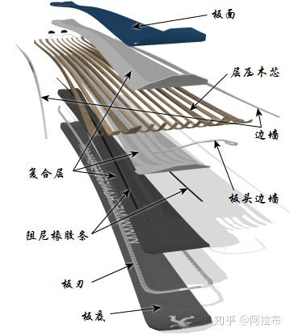
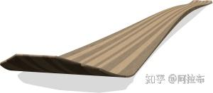
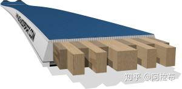
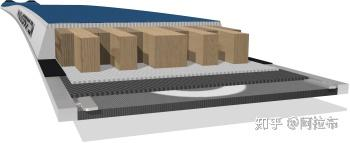
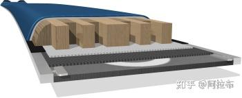
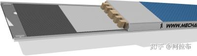
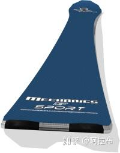
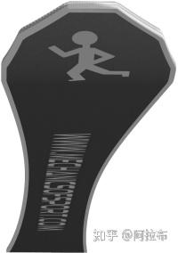
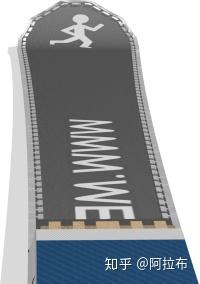

<!-- 来源: https://zhuanlan.zhihu.com/p/141016534 | 分类: 03_装备与器材 | 发布: 2020-06-02 | 赞同: 74 -->

# 【翻译】滑雪板的构造

> 原文：[知乎 · 阿拉布](https://zhuanlan.zhihu.com/p/141016534)　·　发布于 2020-06-02　·　本文仅供学习交流，版权归原作者所有

（本文翻译自网站Mechanics Of Sport，原文地址在末尾。）

尽管滑雪板的构造可能有很大不同，但基本组件通常是一样。制造商使用略有不同的材料和方法制造滑雪板，并且都声称自己的方式具有优势，但最终所有滑雪板都是按照基本原理制造的，这就是本文要说明的内容。

如下图所示，滑雪板的基本结构在其中心处有一个层压木芯。木芯被上方和下方的 复合层 以及侧面的 边墙 所围绕。因此，要将 板面 连接到顶部，将边缘和底层连接到底部。用于这些层和组件的材料和形状可能会有很大不同，以下是有关结构各部分的更多详细信息。

## 木芯

木芯是滑雪板的中央结构，它决定了许多滑雪板的特性。这是大部分纵向强度和硬度的来源，被视为滑雪板中其他所有部件所附着的部分。

——核心材料 大多数滑雪芯由层压的硬木条制成，例如山毛榉木，桦木，白杨木，泡桐，富马，白蜡木，冷杉，枫木，云杉，杨木或竹子，通常将不同的木材条层压在一起。使用木头是因为它给人生命的感觉，同时有着良好的减震效果，可以很好地保持其形状，并具有相当低的共鸣。

但是，通常将许多其他材料添加到木材中或用作木材的替代材料，包括：

- 碳—轻巧，活泼，结实，在压缩下工作良好，但非常昂贵。
- 凯芙拉 纤维（Kevlar）—坚固，轻便，在张力下良好，还是良好的阻尼器。
- 铝蜂窝—非常轻且结实，但价格昂贵且减震功能减弱。
- 玻璃纤维—相对坚固，轻便且便宜。
- 钛—非常轻且坚固，具有良好的阻尼特性，但价格昂贵。
- 空气—正确使用空气可以减轻滑雪芯的重量，而不会对滑雪芯的强度产生重大影响。
- 泡沫—如果在核心中使用大量泡沫，通常可以使用复合扭力盒来制造滑雪板的大部分强度和弯曲特性。

——核心结构

木芯由沿着滑雪板长度方向延伸的硬木条层压制成。芯子的木质部分的长度可以根据芯子的类型而变化，但是木材通常会从尖端延伸到尾部。所使用的木材条通常是不同的木材，以不同的样式排列，并且可以具有使用其他材料（例如泡沫，碳或钛）的区域。通过在层压板中使用不同类型的木材条，制造商能够在其木芯中使用几种类型的木材的特性，并且可以更准确地塑造滑雪板的特性。这样做是为了给滑雪板的不同区域提供不同的强度，弯曲度和重量。将层压的木条胶合在一起，然后精确地CNC加工成一定形状。 一些滑雪芯的顶部也有一些隆起和形状，通常可以在板面的形状中看到它们。使用这些山脊和形状是赋予滑雪板不同的弯曲度，硬度或重量等特性的另一种方式。

## 边墙结构

边墙是沿着金属边缘上方的滑雪板两侧边缘的区域。根据滑雪板不同层的两侧的完成方式，可以有3种类型的边墙结构。

ABS边墙/三明治结构 — 这种滑雪板的每一层都是平的，ABS侧壁置于侧面以保护核心。这种设计通常用于竞技滑雪板，因为它可以很好地将压力传递到边缘。ABS侧壁使滑雪板具有更高的抗扭强度，更好的板刃抓地力和更强的抗冲击能力。但是它们很重，并且在滑雪板交叉时会容易被板刃伤到。

帽状结构 — 这是将复合层和板面向侧下延伸到密封边缘的位置以完全包裹住木芯。这种设计使滑雪板更轻一些，并且由于弯曲的形状，通常使板面不易损坏。但是，盖状结构的抗扭强度略低，在高速下提供的板刃抓地力和操控性较少一些。

半盖结构 — 这是2种结构的混合体，其中复合材料层围绕芯层下降，而板面则部分围绕以连接较小的边墙。这种设计可提较好的将压力传递到板刃，并且相当轻巧。

相当多的滑雪板上使用了混合帽状结构，滑雪板的中部采用ABS边墙，而在板头部分变成了帽状结构。

边墙一般由ABS塑料制成，通常在其下方放置帮助吸收冲击的橡胶层，并且还可以具有诸如铝和竹子的其他材料层。在滑雪板的末端和尾部没有边墙的地方，由塑料外壁来保护木芯。

## 复合层

复合层是大多数滑雪板的抗扭强度的来源。这些层位于木芯的上方和下方，既保护了滑雪板的核心，又为滑雪板增加了新的强度和性能。这些层可以使用许多不同类型的复合材料，最常见的是玻璃纤维，但是使用碳纤维，芳纶和钛的复合材料层也很多见。通常，会使用几个不同的复合层，每个复合层由不同的材料制成。与滑雪板木芯一样，利用几种不同材料可获得不同的强度和性能，以及进一步提高滑雪板的性能。

对于玻璃纤维复合材料层，玻璃纤维的编织或结构化有两种通用方法：

- 双轴包裹 — 在双轴包裹层中，玻璃纤维束彼此编织成90°角，从而形成了轻巧，可靠且宽容的结构。
- 三轴包裹 — 在三轴包裹中，玻璃纤维束在+ 45°，0°和-45°处编织，这再次产生了轻巧，可靠且宽容的结构，但与双轴相比，其扭转刚度和响应性比双轴包裹增强了。

玻璃纤维板浸有树脂，将它们固定在一起并赋予其强度。

## 板面

板面是您在滑雪板顶部看到的层。这里包含了涂装，也是滑雪板内部的保护层。板面通常只有几毫米厚，可以由许多不同的材料制成，包括尼龙，木材，玻璃纤维，塑料和复合材料。

在滑雪板上放置涂装图案的主要方式有两种：

- 封装 — 这种方法将图形打印到纸，布或类似材料上，并放在透明的顶层下，或在顶层上的透明油漆之下。这样可以将图形保留在顶层下面或内部，但可以通过顶层材料看到。所用的材料和油墨应仔细选择，否则会影响顶层和下面的复合层之间的粘合力。
- 升华 — 在这里使用特殊油墨，合适的塑料和热量，将图形融合到制成板面的材料中。这样就将图形留在了板面，而颜色一直贯穿整个材料，因此即使顶层被刮擦，图形也仍然存在。

## 板底材料

板底由P-Tex聚乙烯塑料制成。大多数基础材料后面都会有一个数字（例如：烧结2000）。该数字是指聚乙烯的分子量。数值越大，P-Tex的分子量越高，标志了底面更好，更耐用。

有两种类型的板底，挤压和烧结：

- 挤压（Extruded ） — 在这里将基础材料熔化，然后切成一定形状。挤压的板底制造便宜且维护成本低，但是耐用性较低且较慢。它们更光滑，孔少，因此不会吸收太多蜡。但是如果不打蜡，则不会对整体性能造成太大影响。
- 烧结（Sintered） — 在这里将基础材料研磨成粉末，加热，压制并切成一定形状。烧结的基底制造起来更昂贵，但是更耐用和更快。它们非常多孔并且可以很好地吸收蜡，但是如果不打蜡会损失性能，并且更难以修复。

烧结板底中还可以包含石墨和其他材料，这使它们更快，更耐用。加入石墨是因为它具有导电性。当滑雪板滑行时，在底部和雪地之间形成静电荷，从而增加了摩擦力。石墨有助于消散静电荷，减少摩擦，并使板底更快。石墨板底比普通的烧结基料还可以容纳更多的蜡，这又使它们更快。

通常这样放置在基座上的图案：将图形打印在板底层上方的一层上，并使用透明的板底材料以便形成透视，或者通过用机器精确切割和拼装的不同颜色的P-Tex来制成的板底。

## 板刃

滑雪板的板刃由钢或不锈钢制成，并通过位于下部复合材料层和板底之间的T形插入物固定在滑雪板中。有两种类型的边线：完全包裹和部分包裹。

- 全包板刃 — 在全包边中，一段长度的边缘金属一直围绕滑雪板，并在一端连接。这是滑雪板最坚固的边缘类型，尽管如果损坏严重则可能难以修复。
- 局部包裹板刃 — 局部包裹板刃是板刃只沿着滑雪板侧切的位置布置。由于使用的金属较少，因此可以使滑雪板略轻一些，尤其是在板头处，这样可以使滑雪板更容易转动。但是，由于失去了连贯的金属，因此边缘的强度并不总是那么强，并且可能使滑雪板的板头更容易损坏。在某些滑雪板上，板刃在板头周围似乎是连贯的，但是这些部分是由不相连的金属（通常是铝）制成。这样可以在不增加过多重量的情况下使尖端和尾部变得更坚固，但是由于仍然损失了连贯的金属，因此其强度仍然不如完全包裹的板刃强。

## 树脂类

滑雪板的所有单个零件都用树脂（通常是环氧树脂）粘合在一起。正确选择树脂的类型和数量非常重要，因为这会影响滑雪板的强度，重量和弯曲度。有时滑雪板会分层，不同层粘合的地方开始分离，这是因为在制造滑雪板时，树脂没有将滑雪板很好地粘合在一起。

## 雪蜡

雪蜡被应用于滑雪板的底部，以使它们与雪的摩擦减小，并且可以更快地滑动。蜡的最重要特征是：尽可能降低板底和雪之间的摩擦系数，足够坚硬以使雪晶不会渗透到蜡中并使板底粘雪，并且起到斥水作用。

——蜡的种类 蜡有两种，碳氢蜡和含氟蜡。碳氢蜡是基于石蜡的最常用的类型。当与热蜡熨斗一起使用时，它们可以渗透到P-Tex基料的最深处，并且可以持续最长的时间。含氟蜡与碳氢蜡的不同之处在于，它由带有负电荷的氟原子与碳分子制成的，而不是碳氢蜡中的中性电荷的氢原子。这样可以更好地排斥水和污垢，减少摩擦并加快含氟蜡的速度。但是，含氟蜡通常仅由竞技赛手使用，因为它们价格昂贵并且需要更多的准备。通常，滑雪板先打碳氢蜡，然后，如果要使用含氟蜡，则将其涂在上面。 ——不同温度的雪蜡 蜡被设计用于不同温度的雪。有许多种号称在所有条件下均可使用的全温蜡，但实际上它们只是中等温度的蜡。不同温度下蜡之间的主要区别在于它们的坚硬程度。较硬的蜡会产生更多的摩擦，因此希望使用最软的蜡，但该蜡仍需要比雪更硬，以阻止板底抓雪并增加摩擦。较冷的雪较硬，需要较硬的蜡；而较暖的雪又软且又湿，需要较软的蜡和更多的疏水性添加剂才能更好地斥水。 对于一般的滑雪者来说，全温度的碳氢蜡可以很好地完成这项工作，并且可以在所有条件下为他们提供相当快的滑行速度。 ——防静电性能 当板底在雪上滑动时，会产生静电荷，从而增加摩擦。蜡中含有石墨添加剂有助于将这些电荷从雪板的底部带走，从而产生更好的抗静电性能。这会在板底和雪之间产生较少的静电荷，因此减少了由于静电引起的摩擦。

【完】

原文地址：

http://www. mechanicsofsport.com/sk iing/equipment/skis/ski_construction.html
