<!-- 来源: https://zhuanlan.zhihu.com/p/252856122 | 分类: 03_装备与器材 | 发布: 2020-10-14 | 赞同: 666 -->

# 再谈滑雪双板的选择，以及近两年的大厂亮点

我曾写过一篇如何选择滑雪双板的文章：

这篇文章已经过去两年半了，通过大家的咨询，发现有必要做一些补充。另外这段时间几大厂家的技术亮点和产品系列都有不少变化，也一起来盘点一下。首先更新雪板分类图：

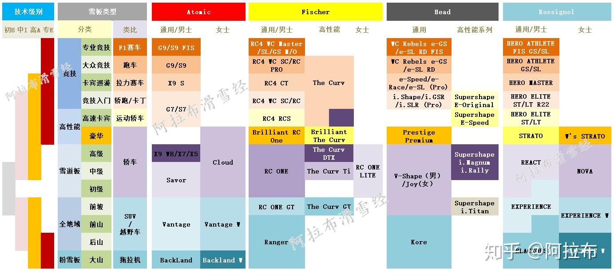

*双板分类例图（2020版）*

在大部分滑雪教程中，对滑雪者的水平是按照滑行能力来划分的，如犁式、基础平行、动态平行、高级平行等。但是这种划分方式与雪板的级别并没有直接对应起来，部分雪友因此产生了困惑，这次要重点明确这一部分。

## 初级水平

- 犁式和基础平行式阶段可划分为初级水平，对应的雪板为初级（Beginner）和初中级。
- 这个阶段完全是搓雪滑法，主要使用雪道板和前坡板。而这两种板型通常是Camber结构，如果不能压弯雪板，就会对转弯造成比较大的阻碍，所以硬度是选择雪板的重要因素。在这个阶段，选择高级雪板会对滑行造成一定阻碍，就是因为雪板硬度超过了滑雪者所能把握的范围。
- 另外，较小的板腰容易导致立刃过快而无法快速驱转(Steering)，即“卡刃”，所以尽量避免使用板腰70以下的高级板。
- 初级板实际是比较少的，这个水平的滑雪者以租板为主。如果这时候就想买板，建议选择初中级或者中级板，但最好不要买中高级板，双板采购从来没有一步到位之说。只有每年滑的比较少，进步很慢，但是又希望使用自己雪板的雪友，购买初级板才比较合适。

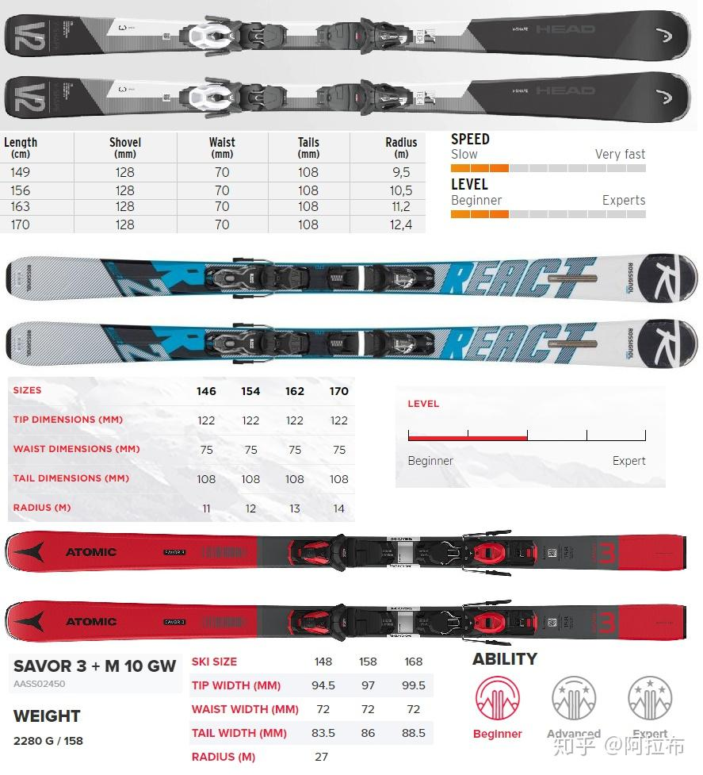

*三块初级板参数比较：Head V-Shape V2 vs Rossignol React R2 vs Atomic Savor 3*

## 中级水平

- 熟练掌握基础平行式，以及后续学习了动态平行，或者基础卡宾/动态卡宾，甚至基础小弯/动态小弯之后，滑雪者可以驾驭更快的速度，滑行难度更大的雪道，这个相当漫长的阶段，都属于中级范畴。这个水平对应的雪板范围很大，中级、中高级和高级都有可能。
- 所以中级也得细分前中后。前期跟初级差不太多，对雪板的操控还很粗糙；中期开始于动态平行、或接触卡宾或者小回转技术，此时对雪板开始有细腻的感触，能够初步分辨出不同雪板对自身滑行的影响；后期接近高级阶段后，会进行技术方向的选择，同样是中高级板，偏雪道还是偏道外（全地域），在这个阶段的技术差别已经比较明显了。
- 中级前期买板的必要性仍然不大，如果之前购置了初中级雪板，可以在感觉雪板偏软之后升级为中高级雪板。但如果是第一幅板，则要从中级板和较易上手的中高级板中选择。
- 中级中期开始，自己买板就比较合适了，这时候购买一副中高级板，可以一直用到高级水平。中级后期则可以根据自己的发展目标来决定，可以直接购买高级板然后继续练技术，也可以买一块价格合适的中高级板，以休闲享受滑行为主。

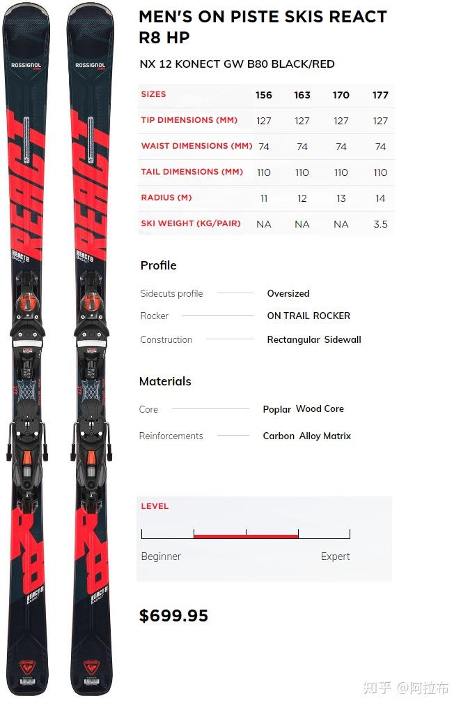

*2020年Rossignol React R8 Ti曾获得欧洲ProSkiLab的高级雪道板大奖，今年新款略有变化*

## 高级水平

- 动态卡宾之后直至卡宾小回转，或者进入后山、蘑菇等地形后，滑雪者的速度更快，动作更精准，对雪板的要求也就越高。这时候中高级板只能勉强满足其要求，各种高级和专家级雪板才是最适合的选择。
- 虽然大部分高级水平滑雪者能够比较明确的了解自己想要的雪板类型，但对于卡宾爱好者，仍然要警惕能否驾驭各级竞技雪板，尤其是不要盲目追求顶级竞技板，那个级别的硬度是为了匹配比赛速度的，日常滑行根本用不到，白白浪费了那么贵的板不说，动作还不够精确的话反而对滑行有负面影响。
- 此时可以尝试拥有多块雪板了。大弯、中弯、小弯卡宾板在机压道上的感觉是完全不一样的，前山或者后山板虽然可以搞定蘑菇和一般的野雪，但在大粉雪中与板腰110以上的大山板仍旧是天差地别。只要有经常使用的场景，多来几副也未尝不可。
- 高级和专家级雪板的参数差异相当小，各家独门技术虽然千差万别，但是带来的滑行差异却只在非常细微的层次，反倒是硬度和涂装两个方面的差别比较明显一些。购买这个级别的雪板，使用感受非常重要，尽可能先试滑再决策。

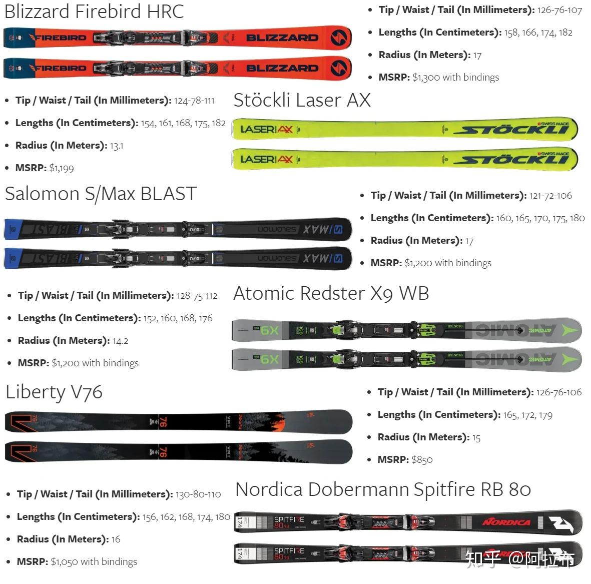

*SkiMagazine：The 6 Best Men&amp;amp;#39;s Performance Carving Skis of the Year 2020*

至于专业水平，最高端的雪板全部都是服务于竞技的卡宾板，日常的大众滑行速度完全让这些雪板无从发挥。而能力达到竞技层次的滑雪者，通常对雪板有着清晰明确的认识，不需要我在这里啰嗦了。

总的来说，选购雪板不仅要参考当前滑行水平，还要考虑技术发展前景，通常会比当前高半个到一个等级，高的太多则有可能驾驭不了。至于选购的板长，可以用（身高-10cm）作为基准，然后按以下规则调整：

- 如果体重大于常规就加长一点，体重比较轻则短一点；
- 看雪板的转弯半径，大弯板要加5~15cm，技术水平越高，加的越多；
- 喜欢速度快，加长5~10cm，喜欢控制和稳定性，则略减一点长度即可。

## ATOMIC：小幅调整中弯产品线，初中级板换代

- 中弯板这个领域算是Atomic率先开启的，虽然说中弯板滑卡宾大弯不如GS板，滑卡宾小弯不如SL板，但它可以比较轻松的 既卡大弯，又卡小弯 。20/21雪季的Atomic中弯产品线由四块板组成，分别是竞技级别的X9 S，以及涵盖中高级别的X5/X7/X9 WB。全系列采用MultiRadiusSidecut（The best of slalom and giant slalom combined – the sidecut for playful, agile short turns and smooth long turns in one ski.），可以很好的兼容大小弯，尤其适合技术全面的卡宾滑雪者 用单一雪板应对多变的地形或者任务 。

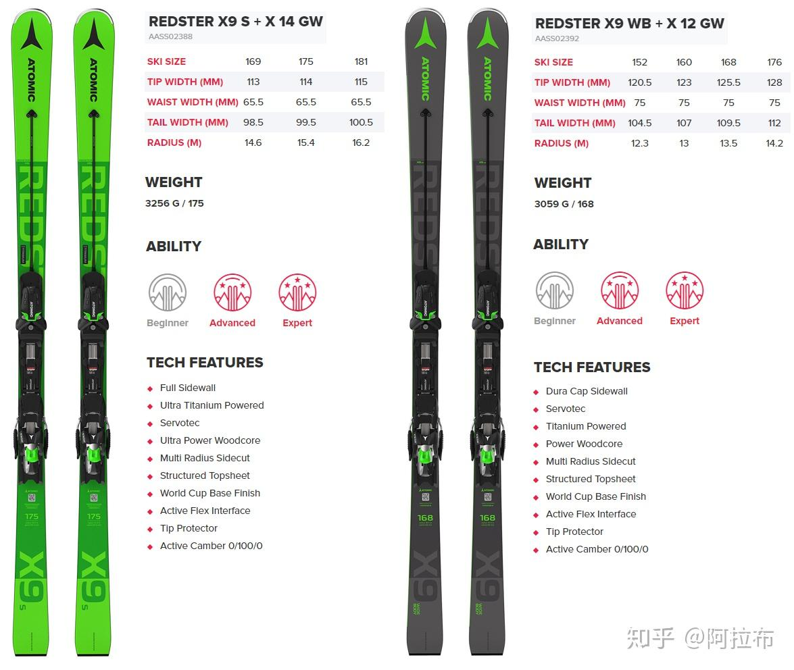

*两块几乎同型号的雪板却天差地别*

- Atomic调整了初中级产品线，用新的Savor系列取代了原来的初中级雪板，全系列板腰72，6块板从初级覆盖到了高级（注意A家的Beginner级别包含了intermidiate中级）。虽然20/27米的侧切半径标注有点迷，但全系列采用的TripleSidecut技术，据介绍能够“想卡就卡想搓就搓”（Greater in the mid-section and straighter in tip and tail. This unique shape helps skiers slide when they need and carve when they want, making the ski feel secure and easy to control – to help skiers progress.）。

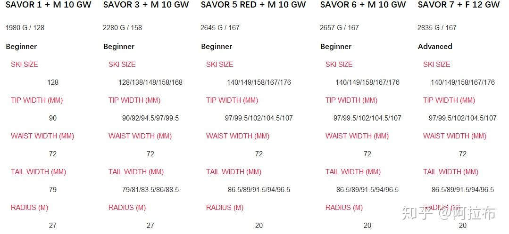

- 附带说一下Servotec。虽然G9/S9自从推出后一直热卖，但是A家的高级板家族一直都挺单薄，所以Atomic将核心技术Servotec也应用到X9和Cloud 12/14上，算是扩展了高端产品线。Servotec的原理是用一根拉杆和弹簧将板头预先拉紧，这样即使雪板硬度很高，入弯时也很容易压弯雪板，同时弹簧还能起到减震的作用。很多人试滑S9会感觉特别软，不像这恶级别的板，其实只是Servotec的“助力”作用，板本身是非常硬的。

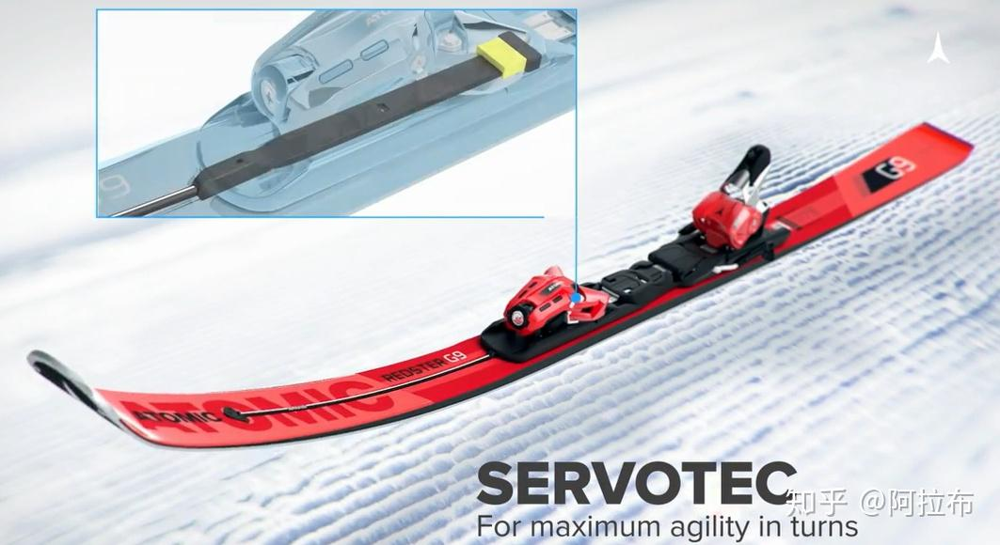

*Servotec原理：黄色的弹簧通过拉杆能够有效的加速入弯和降低板头振动*

## FISCHER：进军中弯板，大幅度简化产品线

- 今年F家的重头戏是中弯板RC4 WC CT，板腰65，侧切半径15.5米，采用专业级垫板固定器，出厂价也是民用最高，因此我把它定位到 卡宾巡游 ，即性能最高的非竞技用板。

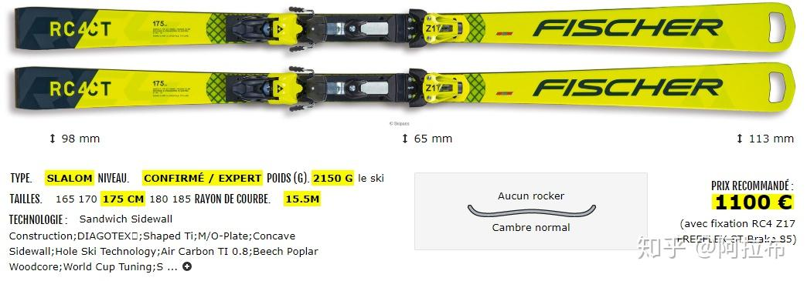

- 今年Fischer也调整了初中级雪道板产品线，取消了Progressor系列雪道练习板、ProMtn系列全地域、My系列女士板，取而代之的是新的RC One家族，或者说对应了RC One / RC One GT / RC One Lite三个子系列。家族中产品众多，一眼过去有点眼花，不过下面这张基本代表了这些产品的级别分布——子系列中越靠上的越高端一点。

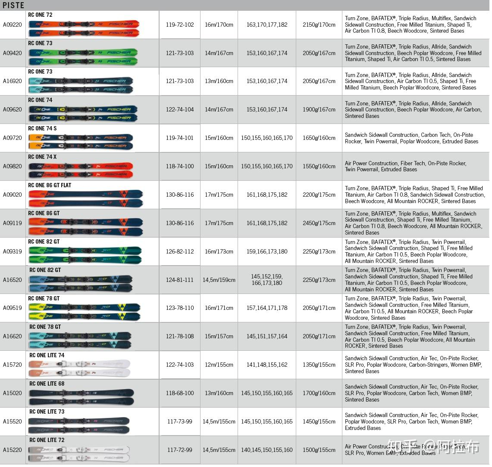

- 另外，其豪华系列Brilliant也削减为Brilliant The Curv和Brilliant RC One两个产品（其实还有另外两个：RC One Black/White）。但在竞技板系列，通过民用板基与垫板/滑轨两种固定器的搭配，又新增了一个级别RC4 WC SC/RC Pro。原来的产品线中，大众竞技的RC4 WC SC/RC和竞技入门的RC4 Speed都弱于同级竞品，现在取消了RC4 Speed，将RC4 WC SC/RC下移到竞技入门，总算与其他厂家对应上了。

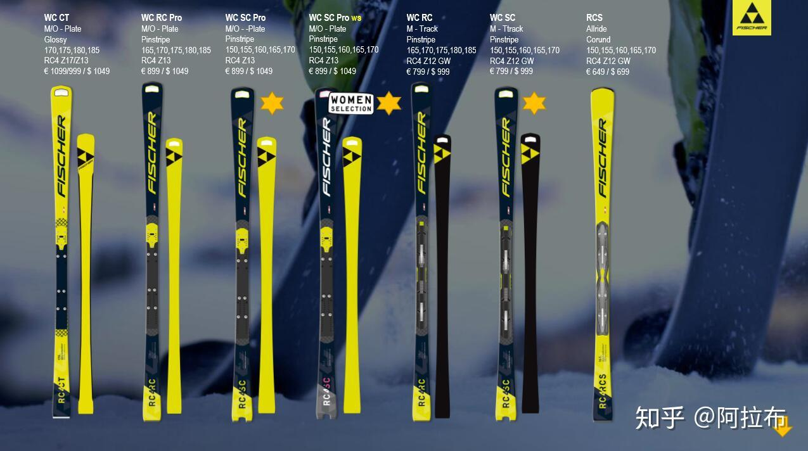

*20/21雪季Fischer民用竞技板全家福*

## HEAD：核心技术更名，初中级产品线换代

- Head今年最大的变化应该就是其独门核心技术IntelligenceTechnology变更为EMC (Energy Management Circuit)，相应的大部分“I.”前缀的雪板名，变成了“e-”前缀。EMC采用了类似之前技术的方式来“吸收震动”，但是没有再提“越压越硬”和“爆发反馈”这两个特性。

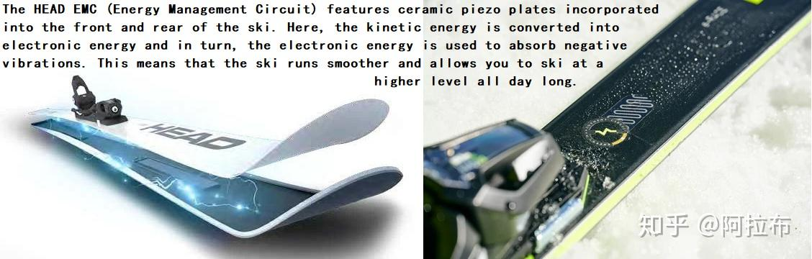

- SuperShape系列增加新成员e-Original，板腰66，侧切半径12.1米，目标滑行方式偏向卡宾小回转。考虑到其高级板的定位（而不是专家级），暂时归入到竞技入门级别。

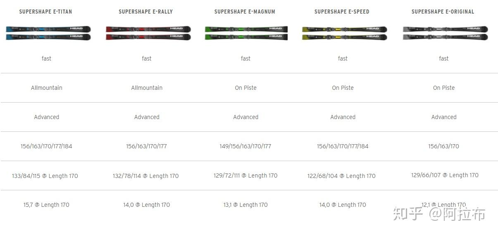

- 简化初中级产品线，由V-Shape系列代替原来的Instinct和Monstor系列。V-Shape的主要卖点是轻量化，侧切半径都不大，全系6块板涵盖了多种板腰、级别、和类型。

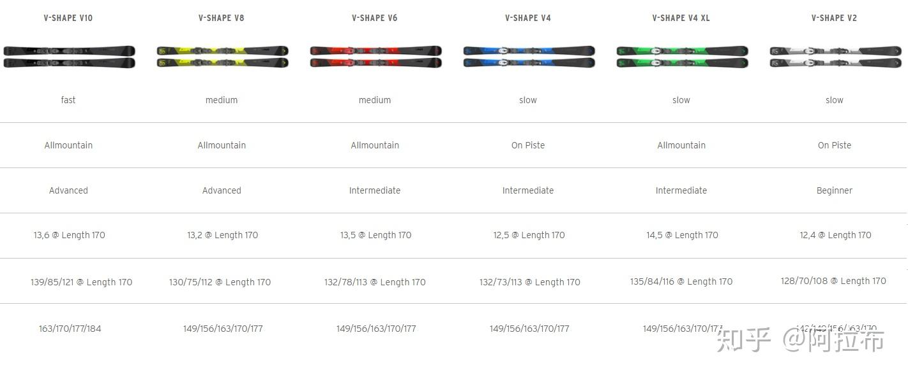

## 关于中弯板：

中弯板虽然是比较小众的市场，但一直都存在一块板兼容大小弯的需求，在Atomic开发TR/X9/X7/X5这些中弯板时，Fischer则以DTX/F19等多半径雪板来应对。今年这个领域百花齐放，不但F家以RC4 WC CT Z17/Z13和RC4 RCS三套产品强力进入，Rossignol以React R10切入了中弯板领域，H家其实一直也有e-Race和i.Shape这种剑指滑行多样性的中弯产品。

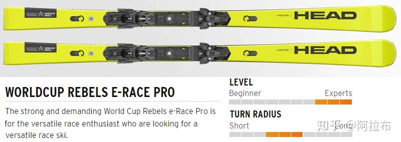

我个人还是很喜欢中弯板的，虽然我用的只是一块16.4米半径的“偏小半径GS板”，但它硬度适中，大小弯兼顾，尤其适合多变的雪道，有时出门还能少带一副板。希望更多的滑雪者能够关注这个类型，切实体验到中弯板的魅力。

## 附录：

Fischer目录： https://www. fischersports.com/explo re/company/catalogues

Head目录： Head.com - Catalogue Browser
