<!-- 来源: https://zhuanlan.zhihu.com/p/344812494 | 分类: 03_装备与器材 | 发布: 2021-01-16 | 赞同: 245 -->

# 双板雪鞋——参数全解

对于购买雪具来说，最麻烦的莫过于雪鞋，因为每个人的脚都有些许不同，每个厂家的鞋楦设计也不相同，如何让两者能够匹配好就成了一个大问题。

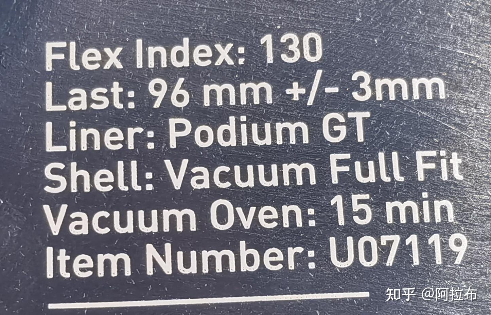

本文从雪鞋参数的角度，对如何挑选雪鞋做好铺垫，让读者能在选购雪鞋时更快捷、更好交流。如果需要更深入的了解双板雪鞋，请阅读我的一篇翻译文章：

## 一、鞋长

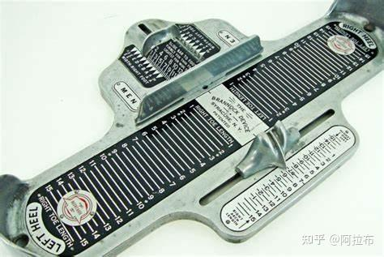

雪鞋的参数不多，我们自己最了解的是脚长，就是脚跟到脚尖的长度。这个长度的标准有很多种，雪鞋用的是国际标准Mondo Point，数字即代表以厘米表示的脚长。至于其他的换算，比如235的鞋到底相当于37#还是38#，那是一笔糊涂帐，不要太依赖它。

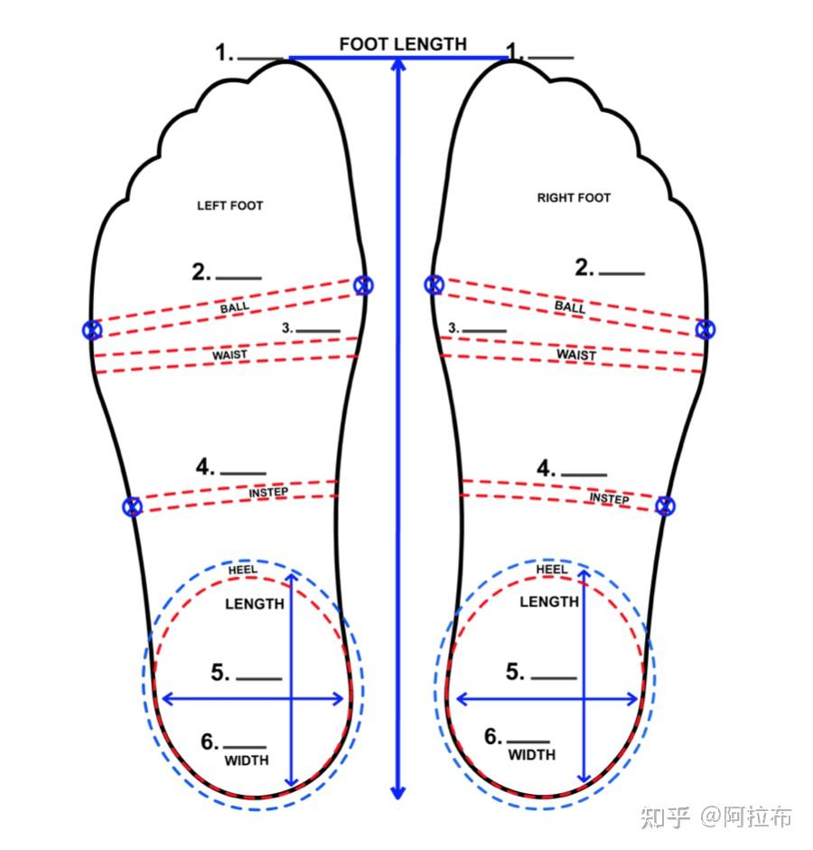

雪鞋的鞋壳通常会对应两个鞋号，比如22.0与22.5共用一个尺寸的鞋壳，而内胆则不一定。脚长的测量一定要在站立状态下，这样才准确。

## 二、鞋宽

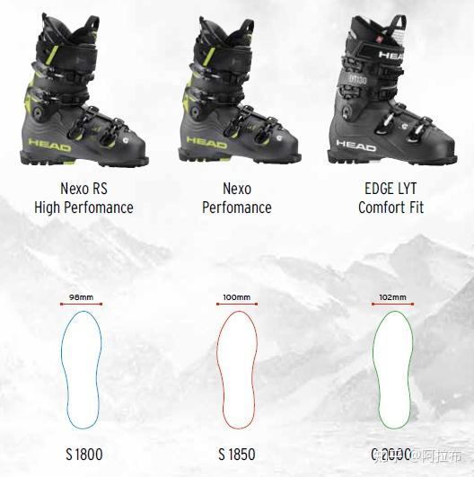

而脚的另一个参数，脚宽，就不那么直接了，因为鞋宽的标准通常与性能联系在一起。如果要高表现力，就得选购更窄的鞋；如果要舒适，就必须放弃一些性能。

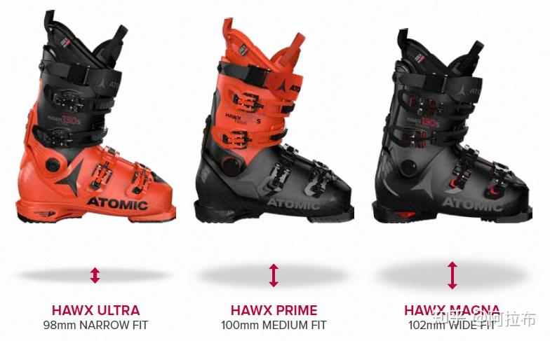

大众雪鞋的鞋楦差不多，但在竞技鞋中，不同厂家的鞋楦差别可能很大，比如大众和青少年竞技鞋，阿托米克是公认的窄，鞋楦只有93到96，其他则多为96到98。

## 三、脚背高度

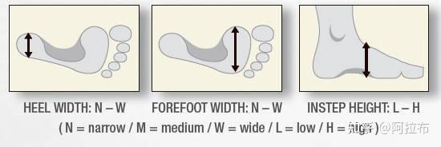

脚背高度是一个隐藏的参数，但是非常重要，这个参数决定了鞋内的实际容积。海德鞋宽是用容积表示的，有些标注为C2100的鞋可能会高一些。

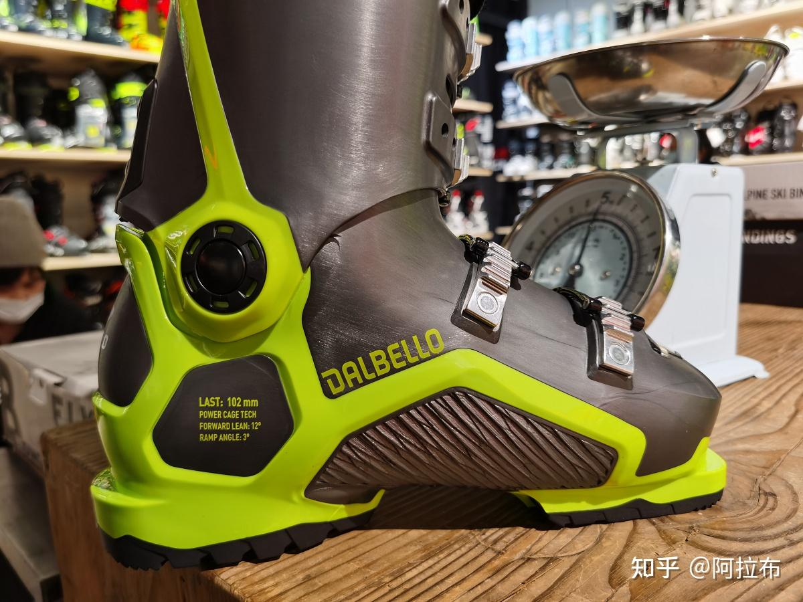

肆加贰雪具店的阿喆告诉我，海德鞋的高度中等，费舍尔的脚背会更高一些，阿托米克是又窄又高，而大菠萝则是又宽又扁。

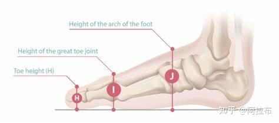

除了脚背高度，还有脚面和脚趾的高度也会影响我们的舒适感，这就需要有经验的店员指导顾客仔细试穿，才能找到最舒适的雪鞋。

## 四、硬度

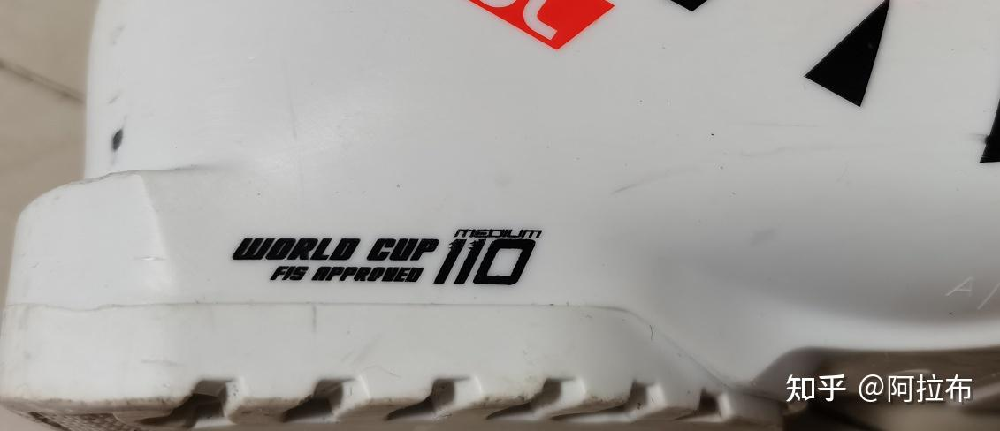

雪鞋的硬度也是经久不衰的迷之话题，因为越是大神用的雪鞋越硬，所以很多人盲目追求高硬度，这是不可取的。

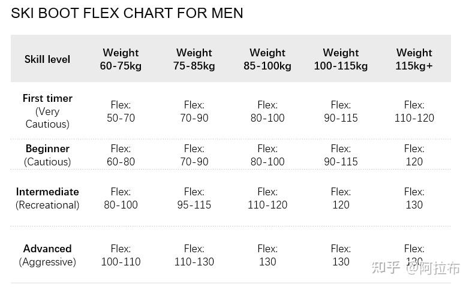

雪鞋硬度的本意是可弯曲度，一个人能用到的最高硬度主要与体重与力量相关。更硬的雪鞋可以更快的传递力量，而较软的雪鞋能够更好的吸收震动，会有更高的舒适性。

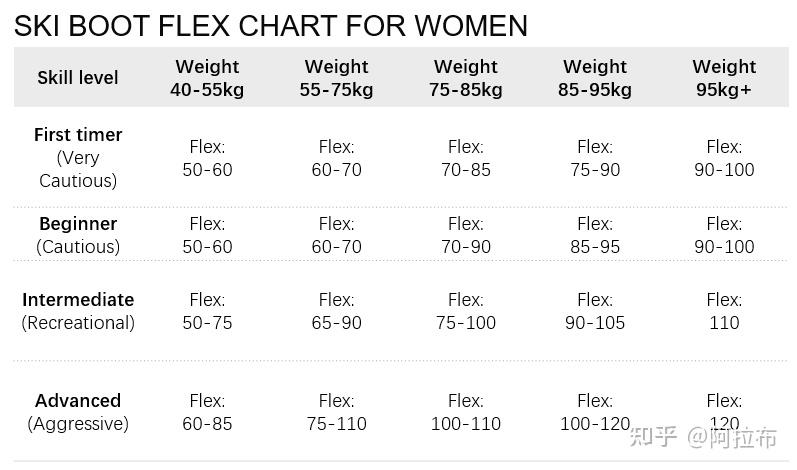

在室内试鞋时，雪鞋会比室外软，这时候扣紧鞋扣，用全部身体下压膝盖，应该能够很明显的看到脚背位置的鞋壳变形。如果变形很小或者一使劲脚跟就抬起来，说明硬度大了。

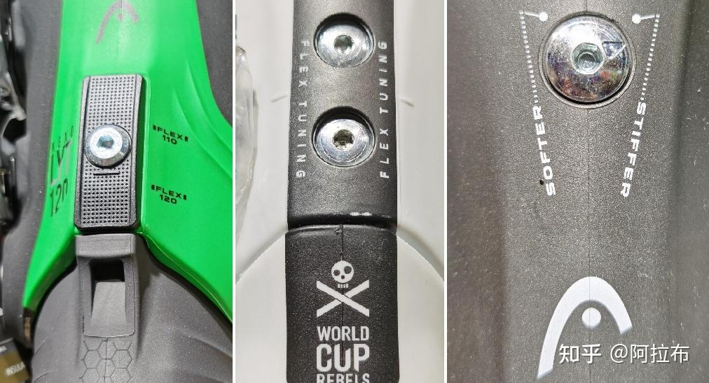

雪鞋的硬度可以通过鞋脊上的螺钉调整，海德将这种调整方式应用在了大部分产品上。不得不夸奖一下，在雪鞋方面海德还是很有想法的，当年还曾推出过可调鞋楦宽度的一款产品。

## 五、重量

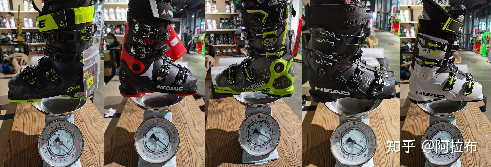

试鞋的时候可以明显感受到，不同厂家和系列的鞋，重量有所不同，越是高性能的鞋通常越沉。而不同厂家之间，我做了一个小小的对比，这是五双100硬度255的中级雪道鞋，可以看出费舍尔最沉1900克，大菠萝和海德Edge LVT最轻1700克，差别还挺大。

## 六、前倾角

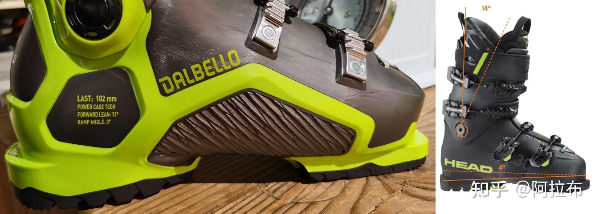

绝大多数雪鞋前倾角是14°，也有12°和15°的。

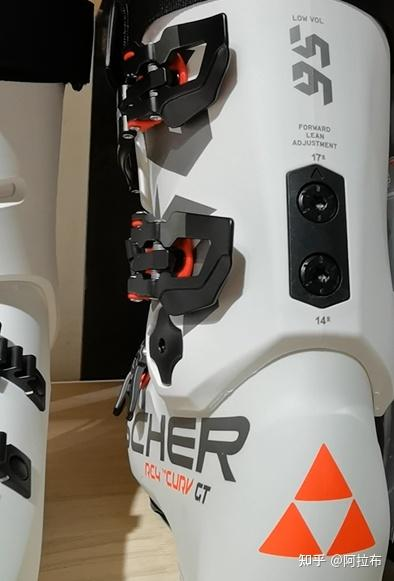

前倾角可调的雪鞋已经陆续出现，比如费舍尔RC4 Curv CT，阿托米克的HAWX Ultra等。

## 七、鞋筒粗细

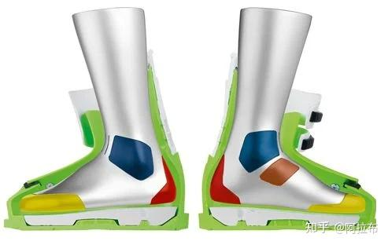

没有人知道鞋筒粗细的确切指标，毕竟对大部分人来说鞋筒上的巴扣调节足够了。然而那些小腿比较粗的雪友（以及个子比较矮的女生）恐怕会强烈反对这个观点，对于他们来说，扣紧脚腕就会勒的小腿疼，而小腿舒服了脚腕就会松松垮垮。

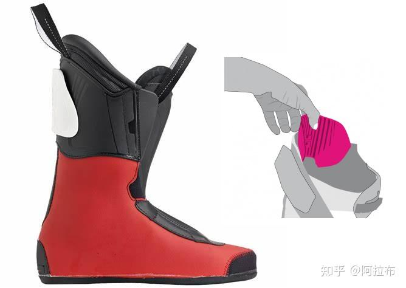

有一些雪鞋，比如阿托米克和诺蒂卡的一些系列，会自带鞋筒垫片，如果腿比较粗，可以取出来不戴。当然，这样会略微影响前倾角。如果这都不行，那只有去找那些鞋筒有特别设计的雪鞋了，听说诺蒂卡的女鞋有这样的型号。

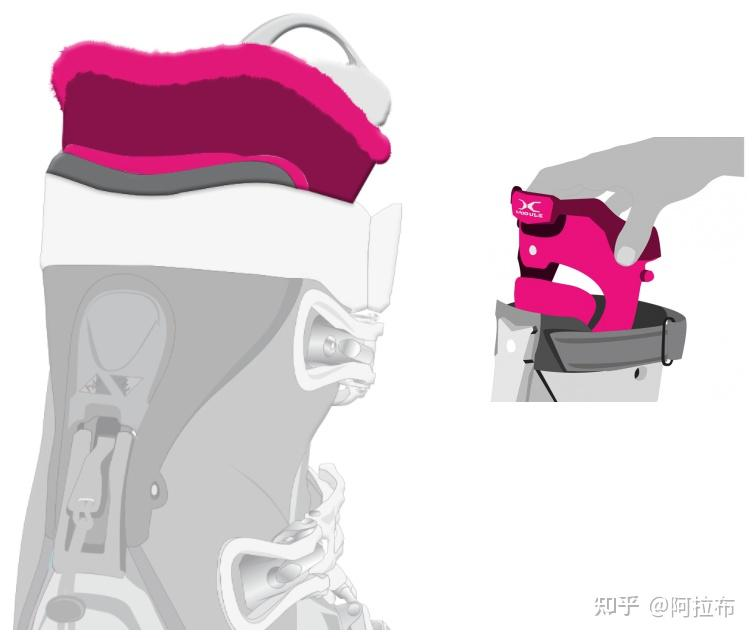

另外，腿比较细的女生也会有扣不紧的问题。这时可以购买鞋筒垫片，插入鞋壳和内胆之间。当然也可以自制这种垫片。

## 八、内胆

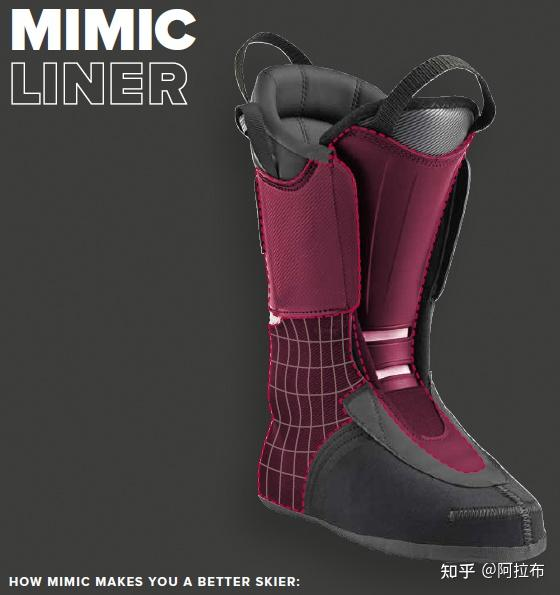

厂家会根据雪鞋的性能档次，配好相应的内胆。当然也可以自己选购高端内胆更换。

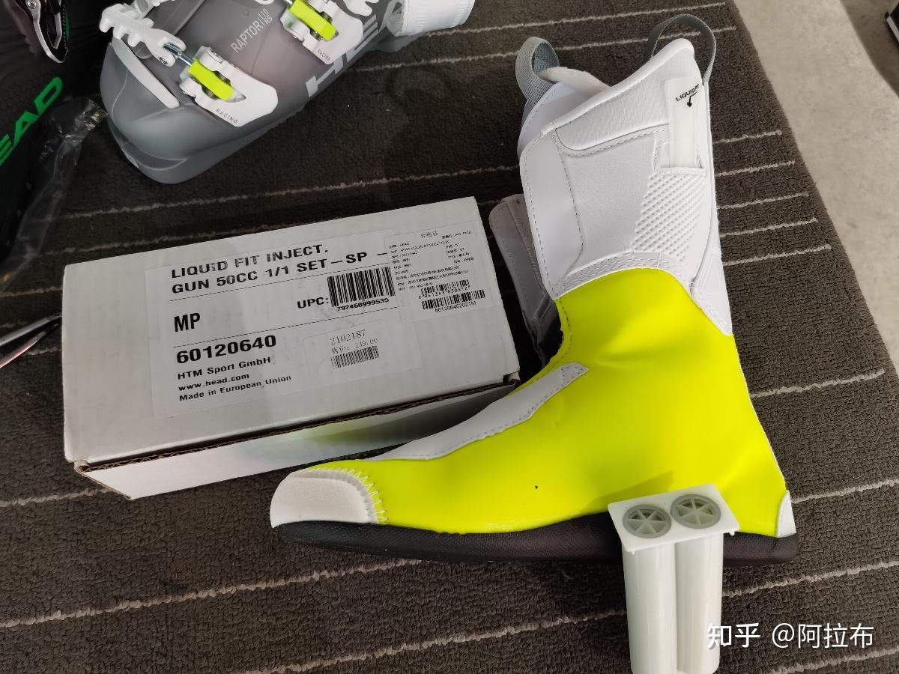

这里又要点名表扬海德，他的LiquidFit技术可以通过向内胆某些位置填充液体材料，实现更贴合的脚感。

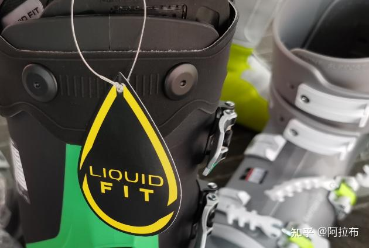

凡是有Liquid Fit 标记的产品都支持。

## 九、适配调整

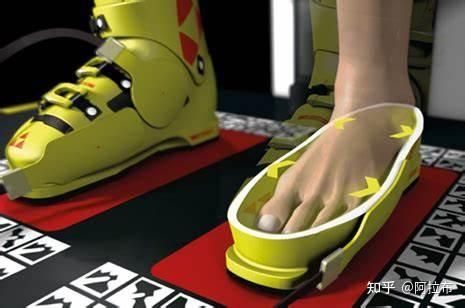

再好的鞋楦设计，也不可能贴合每个人的脚，除非脚型特别完美，否则雪鞋总有个别地方或多或少的不太舒服，这就需要适配调整（Boot Fitting）上场了。

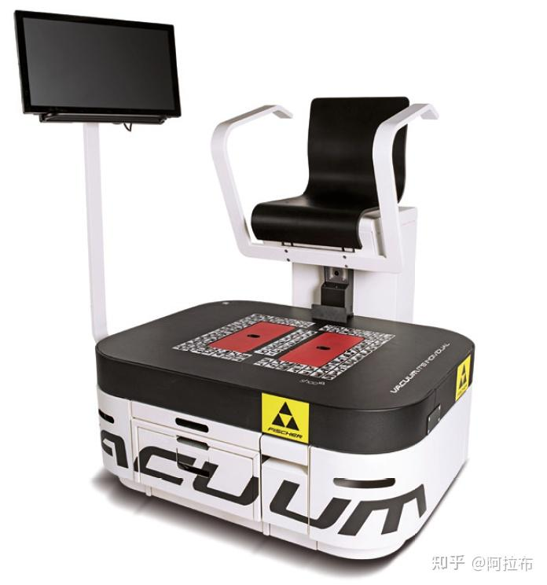

很多厂家的鞋可以做热定型，也就是加热让鞋壳软化，然后穿在脚上加压，让鞋壳完美贴合脚型，冷却后就不会再有硌脚的地方。当然效果有时候未必那么完美。

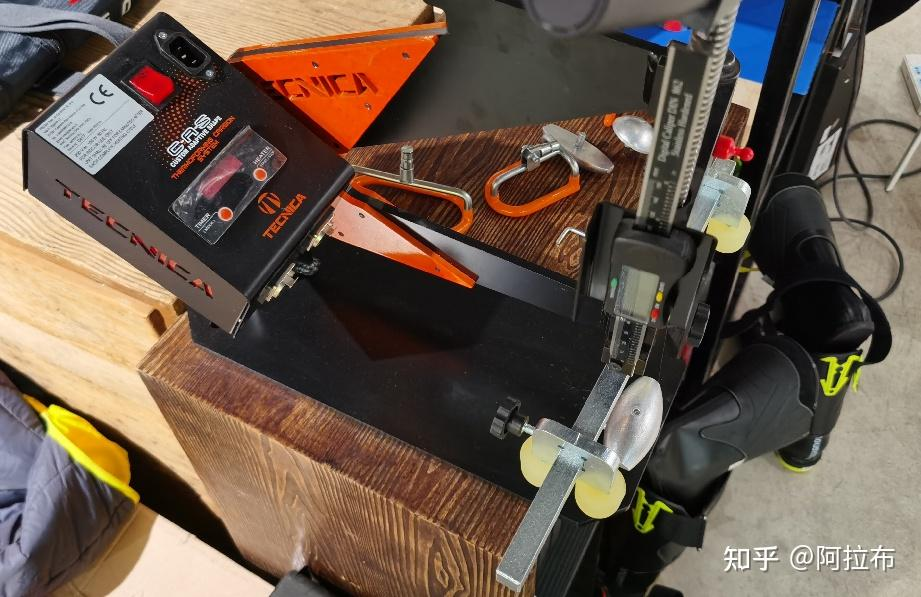

对于绝大多数雪鞋的局部问题，都可以通过手工适配调整。这是肆加贰上庄店的调鞋工具，他们只给自己的顾客调鞋，而且免费！好心酸，早两年就这样多好。

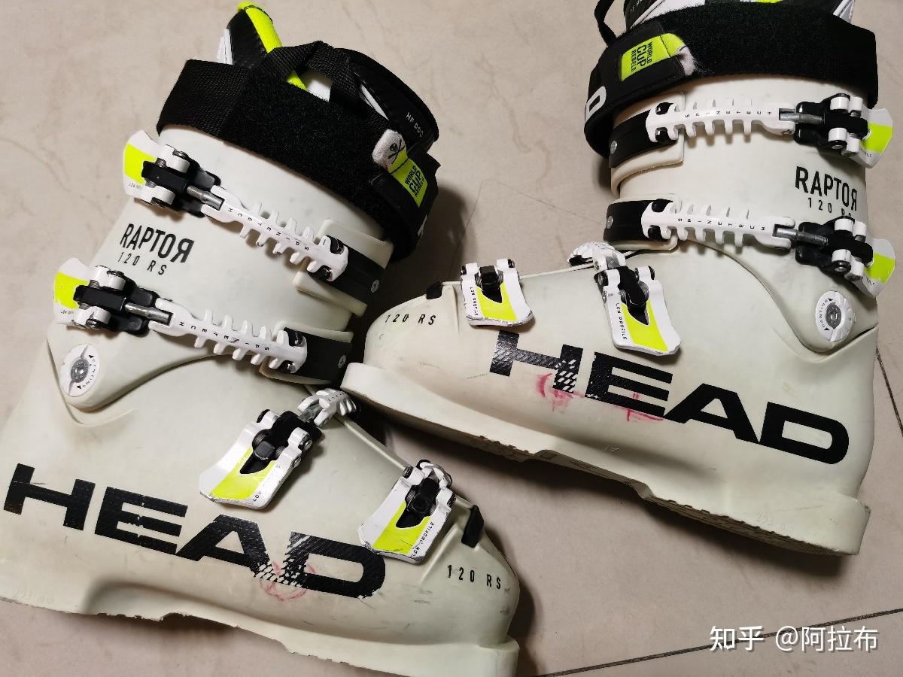

很明显我的这双大白是调过的，诊断和调整一共1800元。心好疼。

## 十、绑带

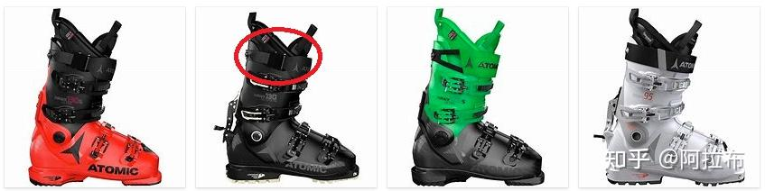

鞋筒最上方的绑带，有时候会有一些麻烦，比如绑不紧，或者松开时比较繁琐等。阿托米克已经把部分高端雪鞋的绑带更换为快拆扣了（40mm Quick Release Cam Strap），向后一拉就能绑紧，轻轻一按就松开，非常方便。

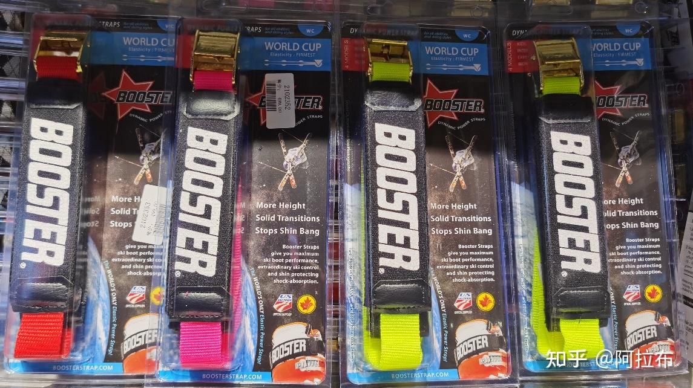

对于其他雪鞋，其实可以自己买Booster装上。这东西在竞技运动员那里非常普通，因为他们需要经常的放松和拉紧绑带。今年Booster推出了更多的颜色，增加了炫酷和装饰雪鞋的效果。

最后感谢肆加贰的大力支持。
