<!-- 来源: https://zhuanlan.zhihu.com/p/364297100 | 分类: 03_装备与器材 | 发布: 2021-04-13 | 赞同: 34 -->

# 雪板防抖之五大黑科技（2020版）

> 原文：[知乎 · 阿拉布](https://zhuanlan.zhihu.com/p/364297100)　·　发布于 2021-04-13　·　本文仅供学习交流，版权归原作者所有

“ 雪板板头在高速滑行中的抖动会带来极大的不稳定性。 ”

因此，减少甚至消除这种板头振动，成为各大厂商科技实力较量的重要舞台。

本文盘点了目前市场上最主要的5种防抖减振技术，以方便大家更好的了解雪板上那些特别的设计。注意，介绍的次序不代表排名。

## 05 Fischer：Holeski Technology

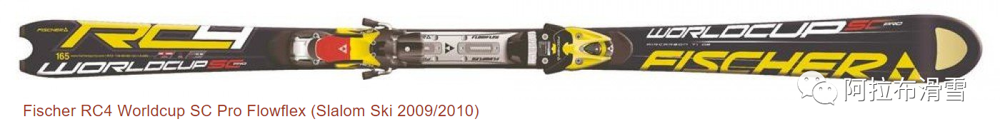

Fischer向来擅长用最简单的设计实现高级功能，例如畅销至少16年的RC4 WC SC。板头开孔技术是Fischer从1975年起在越野滑雪板上使用了10年的老技术，自从2009年重新启用并移植到竞技雪板后，成为Fischer高级雪板标志性的特征。

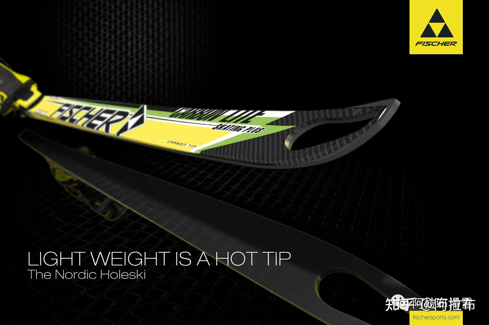

通过去除板头的一部分材料，Fischer不但减少了板头的振动惯性，还减轻了雪板重量，这确实是一个经济实惠的技术。从2020年起，孔的形状从圆三角变成开瓶器，立刻变得时尚了。

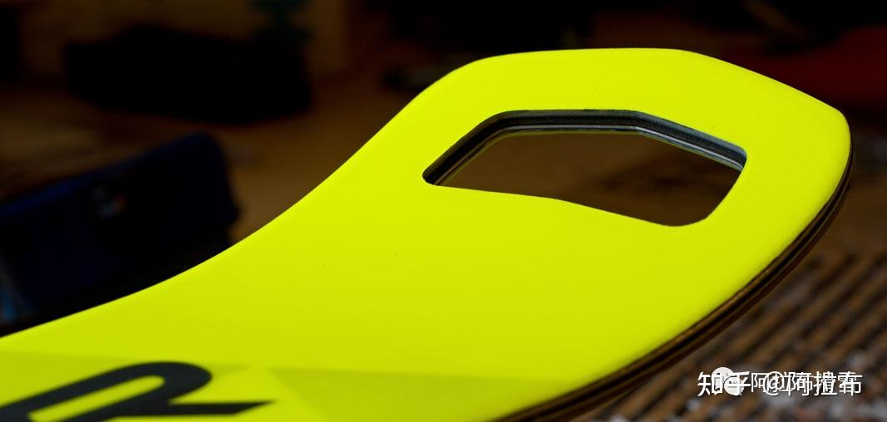

## 04 Volkl：Ultimate Viberation Object 3D

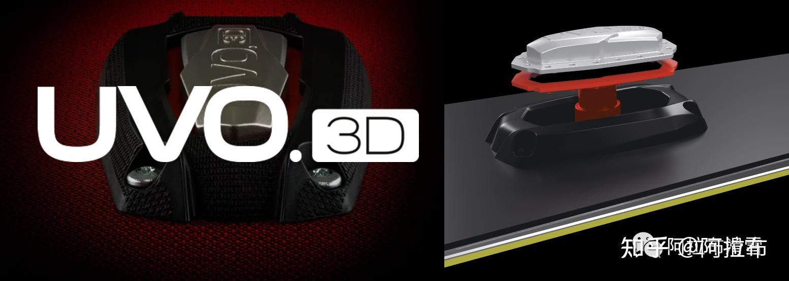

与Fischer去部分材料的方法相反，沃克的UVO 3D采用了增加质量的思路，在板头上安置了一个浮动的滑块，并革命性的通过设置2个方向的阻尼来调整振动相位，从而起到抵消一部分板头振动的效果。

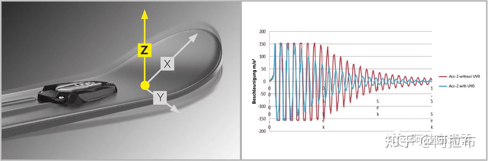

UVO的设计思路比较巧妙，效果如何相信其用户会有评价，不过雪板上增加的重量和成本确是实打实的。

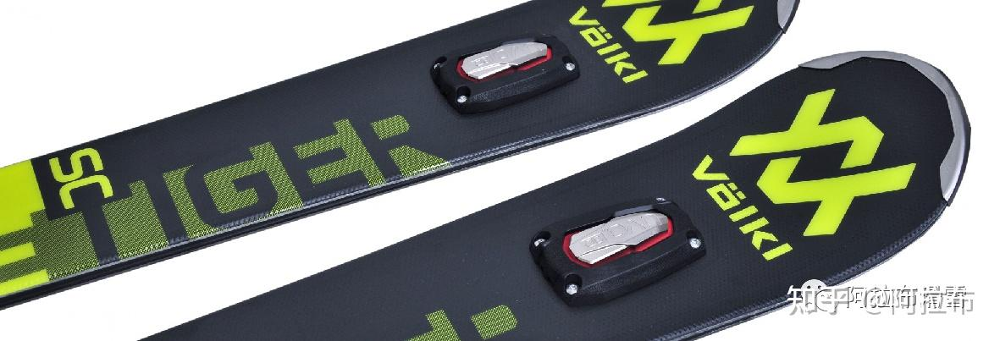

## 03 Head：Energy Management Circuit

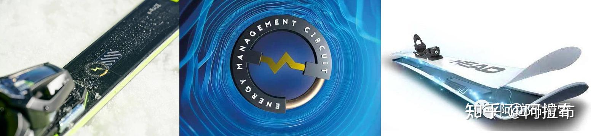

海德的芯片科技可谓如雷贯耳，享誉雪圈。上一代技术称为Intelligence™ Technology，它的原理有点复杂：在雪板被压弯时，通过压电晶体产生电能，激活芯片并收集雪板受力变化的信号，芯片在5毫秒之内完成信号放大和处理，将电能注入导电纤维，使其硬化，从而提高雪板的扭转稳定性。另外雪板上还应用了KERS（Kinetic Energy Recovery System ，动能恢复）系统，能够将转弯中搜集的能量在出弯时反馈给板尾，强化板尾硬度，从而起到加速效果。（真的吗？）

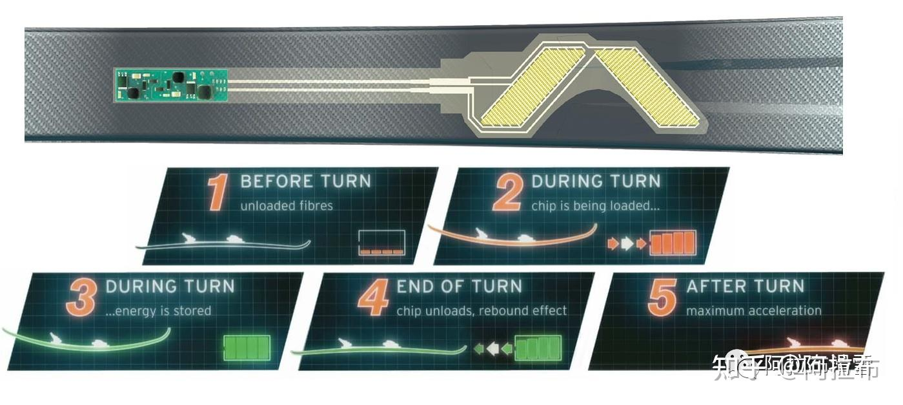

2020年海德技术升级，新的“能量管理电路”EMC取代了两大系统，功能也简化为只有减振这一点：雪板中的压电陶瓷元件将滑雪板的弯曲和振动转化为电能，通过电路处理后，注入到雪板的石墨烯碳纤维中，从而滤除有害振动，使雪板的滑行表现更加协调稳定。

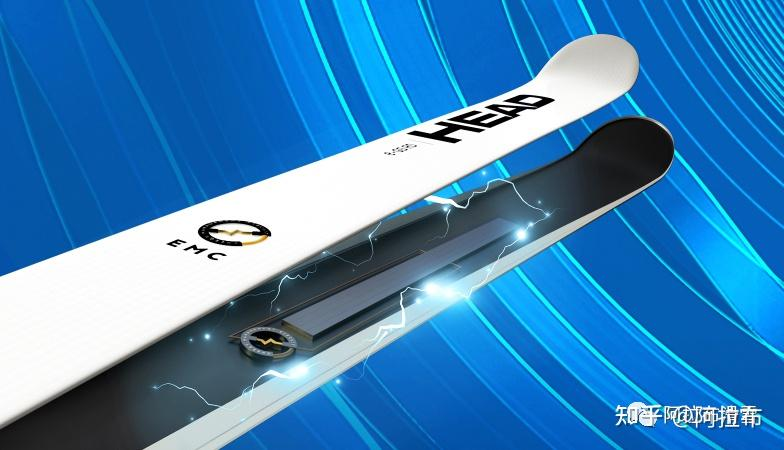

## 02 Rossignol：Dynamic Line Control

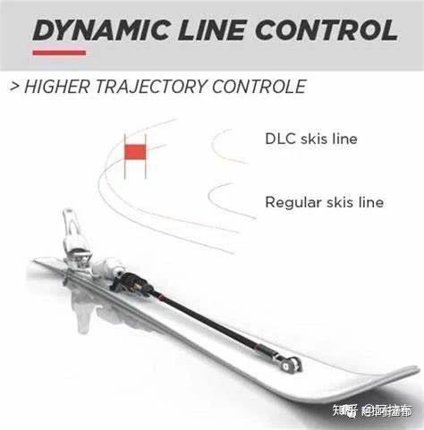

相对于前面几家的精巧设计，金鸡就简单粗暴多了。不就是减少振动吗，汽车是怎么做的？在四个轮子上加装减震器。于是金鸡就把一个小型化的液压减震器装在了雪板上。

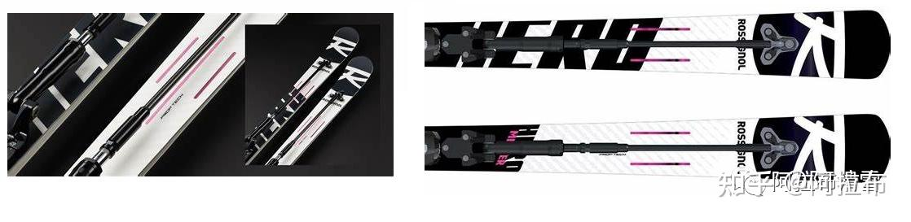

这个方案原理简单成熟，性能可靠，效果肉眼可见的出众，然而成本和重量大大限制了它的应用。目前金鸡民用雪板只有寥寥几款采用了DLC，但价格都非常高，甚至达到同类的两倍。而金鸡的其他高性能雪板，则采用的是更加简单的LCT（Line Control Technology）技术。

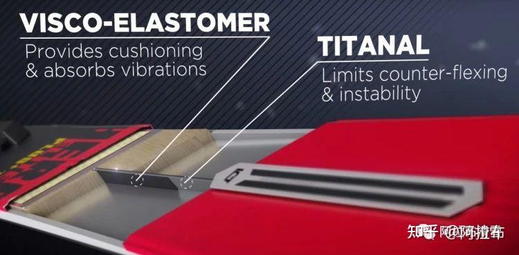

## 01 Atomic： Servotec

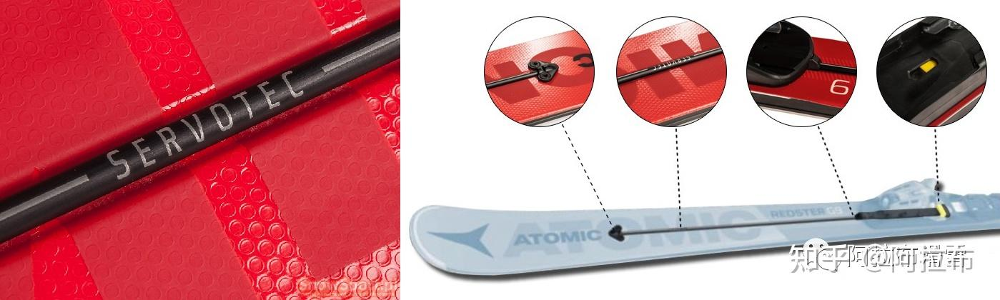

Atomic的板头拉杆，甫一出现就风靡世界，它的大名就叫Servotec。其原理是内置在固定器下方的阻尼弹簧通过拉杆来抑制板头振动，同时提供良好的入弯助力。这个设计既包含了金鸡的粗暴，又有胜似其他厂家的精巧，不但效果好，而且外观非常炫酷，更要命的是成本也不高， 也难怪会如此火爆。

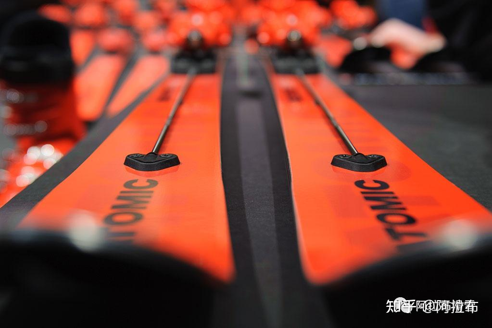

但是拉杆外露的薄弱易损，生产质量不稳定等问提，也困扰着这项明星技术。从21年起Atomic将采用全新Revoshock技术，这几年风光无限的板头拉杆终将成为记忆。

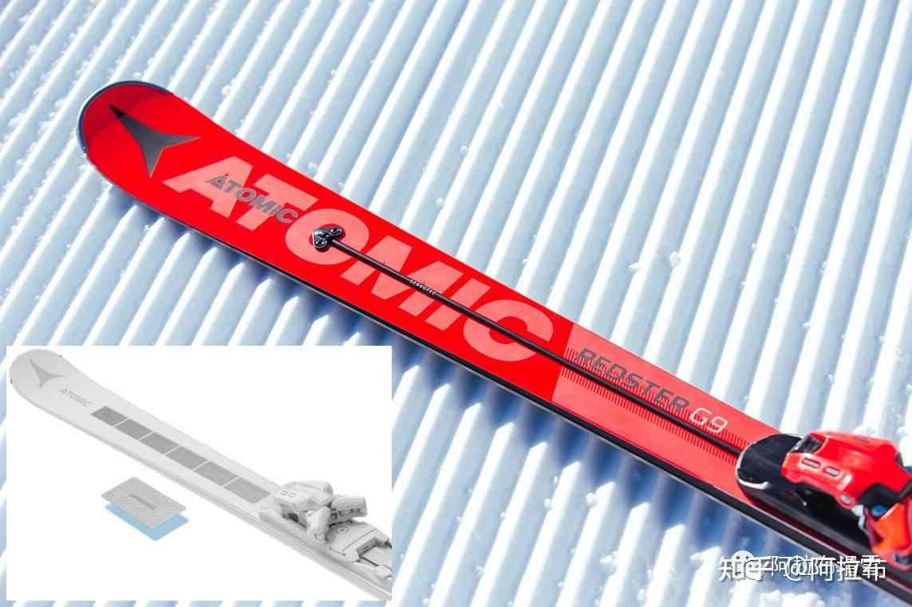

以上就是目前主要的五种板头减振技术。除去坚持了数十年的Fischer没有理由改变，Head和Rossinol已经（或逐步）进行了技术换代，下雪季Volkl的UVO技术和Atomic的Servotec技术也将退出舞台。更新后的技术表现如何？我们拭目以待。
