<!-- 来源: https://zhuanlan.zhihu.com/p/145465657 | 分类: 03_装备与器材 | 发布: 2021-07-28 | 赞同: 48 -->

# 雪板的家庭养护—①装备与工具

> 原文：[知乎 · 阿拉布](https://zhuanlan.zhihu.com/p/145465657)　·　发布于 2021-07-28　·　本文仅供学习交流，版权归原作者所有

拥有一副雪板是件快乐的事情，但由此而来的小烦恼是：雪板要不要保养维护呢？

如果每年滑的不多，水平中等，只在机压雪道上滑行，对滑行顺畅程度要求不高，雪板不贵也 不想那么爱惜 ，那么每次滑完擦干，一直用着也不是不可以。

但大多数雪友应该不至于这么佛系，至少“不想爱惜”雪板的雪友很少。对于只在机压道上滑行的中级板来说，滑10天左右去做一次养护是比较合适的，全套维护的主流价格80~300不等（北京我所知道的最便宜的维护是80一次，手艺非常可靠；其他店100/150/200都有，很多雪具店也会附送每年一次的免费保养），一个雪季保养2~3次负担也不大。

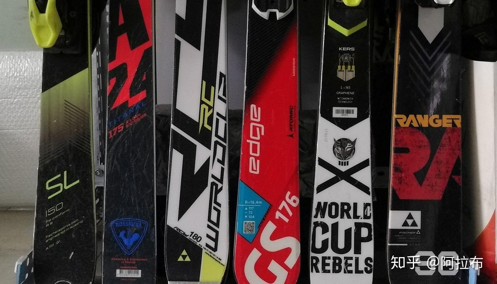

但如果你拥有一副高级板，通常是竞技板或者大山板，那么雪板维护就必须变成日常活动，前者1~2天就得修刃，后者的打蜡抛光是常态。这时，在自己家里完成雪板养护，无疑可以节省大量的花费，以及送/取雪板的时间和路费。

当然，全套的专业雪板养护装备也很昂贵，很多人会觉得一年几次的保养不值得花巨资购置。这是个切实存在的问题，维护的频次比较低时自己购置装备可能还不如送去店里做，但本文也会针对性的提出一些廉价替代方案，让偶尔的家庭保养成为可能。

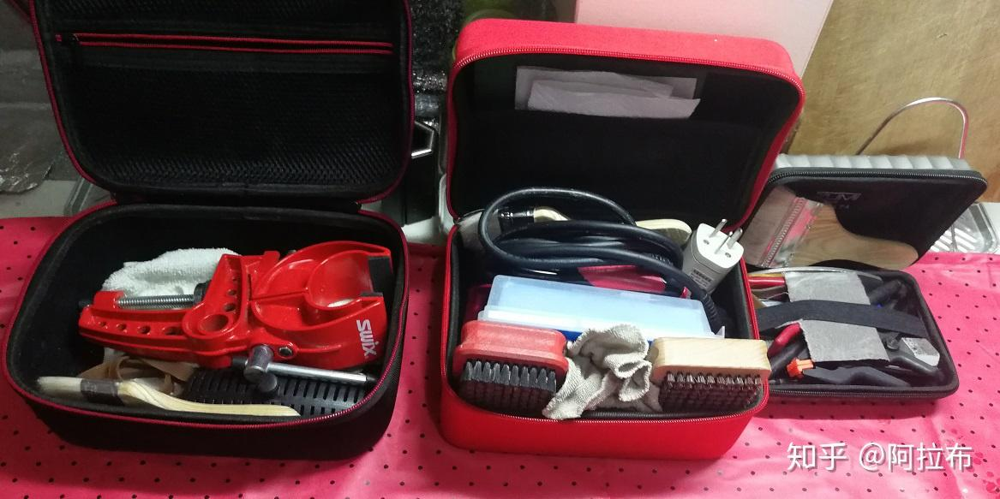

*自用全套工具价值3000多，19年第一场雪时在家门口一起丢了，心疼~~*

雪板的养护包括：①每次使用完的擦拭和晾干；②板底修复；③修整板刃；④打蜡抛光。板面通常不需要特别维护。每次养护不一定需要做全套内容，可根据雪板的状态只做需要的部分。

在开始养护工作之前，需要先准备好场地。其他的内容会放在后续文章中，预计总共分4篇完成。

## 场地与保护

如果你拥有一个2米以上的工作间，那再合适不过了，就把它布置成修板间吧。大多数人没有这样的条件，但如果家里的厨房、阳台、卫生间有2米长约1米宽的空间，也可以用做雪板养护场地，但是要注意地面和台面的保护。

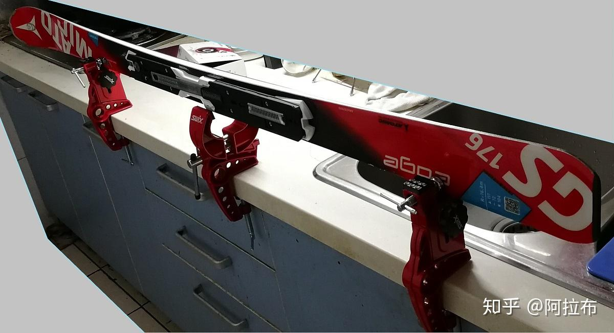

我的橱柜台面刚好两米多长，台面的收边也能夹住雪板支架，于是这里就是我家里最完美的场地了。但是每次维护做完，板刃碎屑和雪蜡到处都是，非常难清理，因此我工作时一直用旧沙发罩和尼龙布做台面和地面保护。

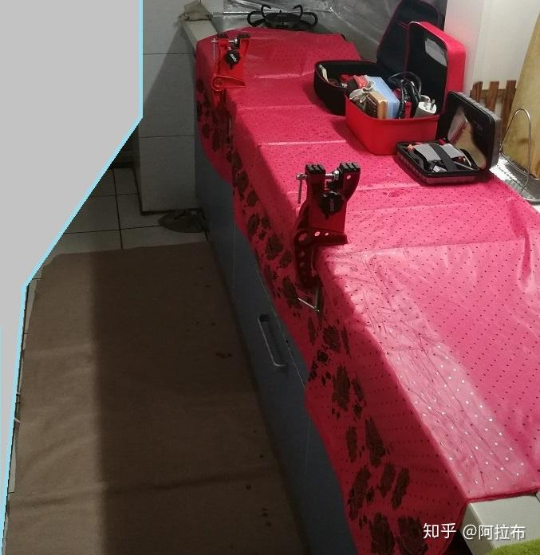

这些保护可以用旧床单什么的来改造。如果家里没有，可以去窗帘店或者某宝买布头，非常便宜。当然也可以买更专业的牛津布或者防潮布/苫布等等，一块1.5*2米的足矣，成本也不会超过50元。还有一个办法是用大块的纸箱板，在外面跟随国外竞技队训练时，所有的修板工作间的地面一般也都是用纸箱板保护起来的。但是家里少有大块的纸箱板，而且收放也不方便。

如果家里实在没有空间，那么可以借用楼道或者室外的空间来进行雪板养护，这里要注意两件事：1）你需要电源来打蜡（以及电动修刃机，有的话）；2）记得工作完成后把地面打扫干净。

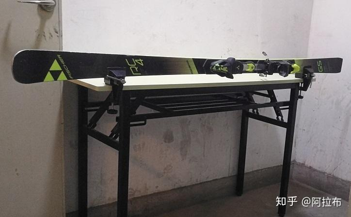

*没有人的楼道也是个不错的工作场地*

## 修板桌

如果能利用橱柜台面或者阳台窗台来当作修板桌，无疑省了很多麻烦。不具备这样条件、有没有专用工作间的话，就需要准备一个可以移动和收纳的修板桌。

下图是最常见的SWIX修板桌，非常贵，也不能算太好使，因为地面不够涩时很容易滑动。它的好处是可以供两个人同时修板。这个桌子也可以折叠搬走，不过比较沉（好的修板桌都很沉）。

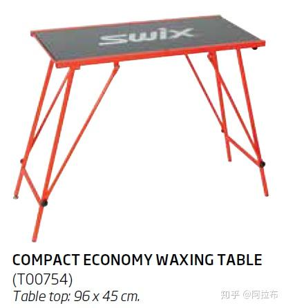

题图中我用的轻便型修板桌是从日本海淘的，VOLA在国内也有这种桌子（下图右侧），而且某宝上也有同样的国产品牌。

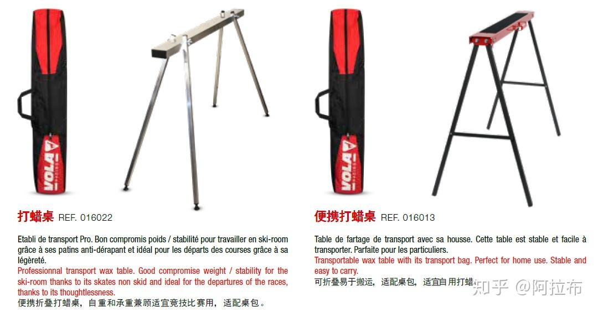

还有很多牌子的修板桌可以采购，但兼顾结实、稳定、便携等特性的产品普遍还是会超过千元。如果修板频次很低，对平台要求不高（手要稳，不依赖桌子的稳定性），我倒是建议用这种折叠会议桌，不到100元，也可以折叠收纳。

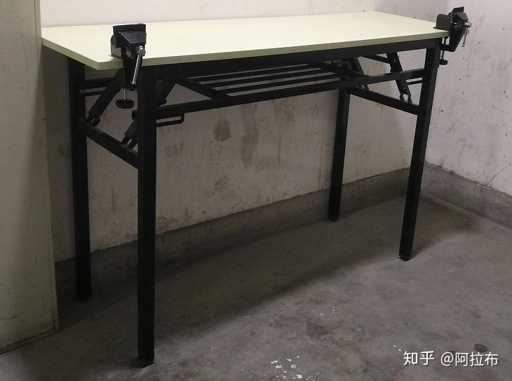

## 修板支架

SWIX的支架在国内零售价两千多，实际上我从挪威买的不到一千RMB。VOLA和TOKO在国内比较便宜一些，我的SWIX支架丢了之后就买的VOLA竞技款。每家都有多个产品，注意分辨是否适用，如果不清楚，就买WorldCup或者竞技版准没错。

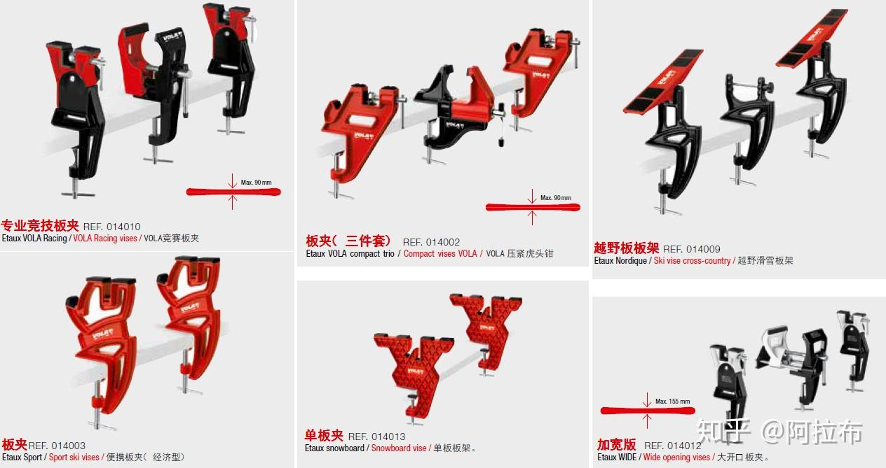

国产同类型的产品也不少，普遍在几百元这个价位。

其实做过钳工的都明白，这就是几个专用的台虎钳而已，所以60块钱一对的50#小虎钳当然也是可以用的，只不过需要一些简单的改造：钳口垫橡胶片（防止损伤板底板面），以及打蜡用的支架（固定器比虎钳高，打蜡的时候需要把雪板垫高，给固定器足够的空间）。还有更便宜的，右边那个一对可能不到20元就能买到，也能凑合用，但打蜡就需要另外的支架了。

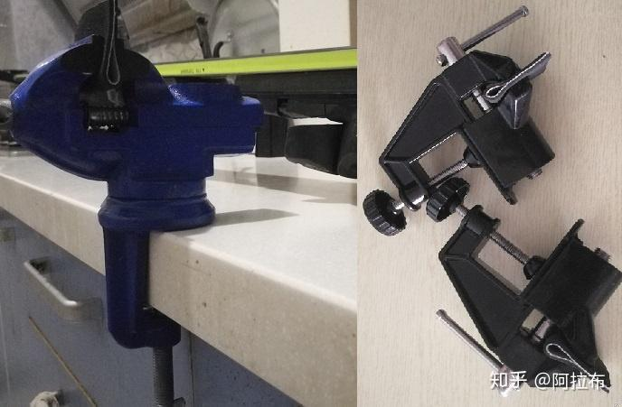

*钳口保护的简单办法——旧鼠标垫*

最后给大家看看一个另类的小玩意，真的挺有意思，可以在外出不想多带装备的时候临时救急用用。做的不是很结实，最好自己用木螺丝重新加固一下。

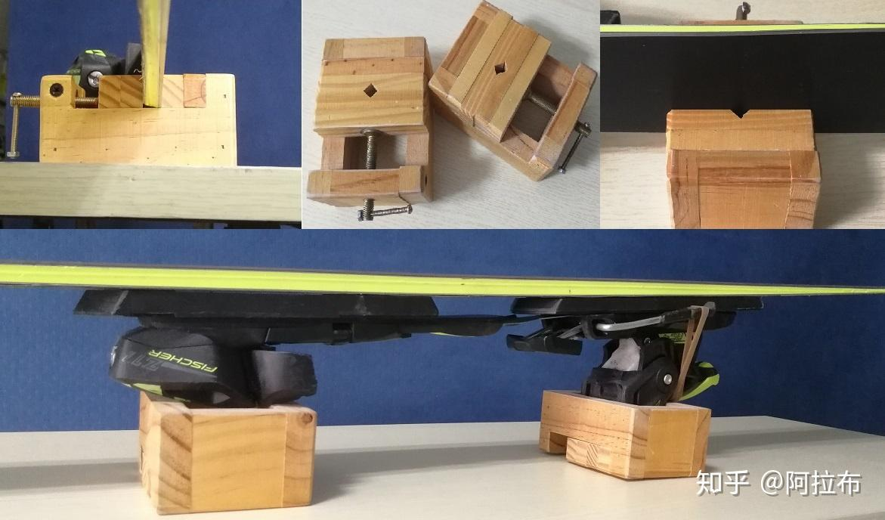

同支架一起使用的还有捆扎止滑器（雪耙）的橡胶圈，通常可能卖几块钱到十几块钱一对，我在某宝的橡胶制品工厂店里15块钱买了100个。如果手头一时没有，可以用捆扎绳之类的东西替代一下，也就是装和拆时稍麻烦，并没有其他影响。

## 常用工具列表

一些工具的型号和细节会在相应内容讲到，这里只是简单罗列一下，备注*号的是可选项目。

板底修复工具 ：

- 砂纸（除锈用，300目左右）
- 刻刀
- P-TEX胶条
- 打火机
- 金属刮板 *

修刃工具 ：

- 角度尺+锉刀夹/A字夹
- 锉刀（粗/中/细）
- 金刚石锉/油石
- 边墙刨 *
- 底刃角度尺 *
- 毛刷 *
- 锉刷/铜丝刷 *
- 细砂纸（800~1000目）*
- 白板笔 *

打蜡抛光工具 ：

- 打蜡熨斗
- 雪蜡（清洁蜡、预底蜡、高中低温的滑行蜡/竞技蜡/赛蜡等）
- 除蜡剂 *
- 刮蜡板
- 粗刷（铁刷/铜刷）
- 细刷（抛光刷）
- 抛光布（百洁布）*
- 纤维纸 *

本系列文章计划四篇，后续会分别讲解板底修复、修刃、以及打蜡的工具、方法、技巧等。
