<!-- 来源: https://zhuanlan.zhihu.com/p/141342517 | 分类: 03_装备与器材 | 发布: 2021-09-08 | 赞同: 49 -->

# 雪板的家庭养护—②板底修复

> 原文：[知乎 · 阿拉布](https://zhuanlan.zhihu.com/p/141342517)　·　发布于 2021-09-08　·　本文仅供学习交流，版权归原作者所有

雪板养护的第一步工作应当是板底修复，当然这取决于板底是否受损，所以养护工作的第一步就要检查板底和底刃。

我们先准备好工作环境，然后用橡胶圈固定雪耙（止滑器）：将雪板固定器朝上平放，一只手拉起雪耙，另一只手套上橡胶圈。

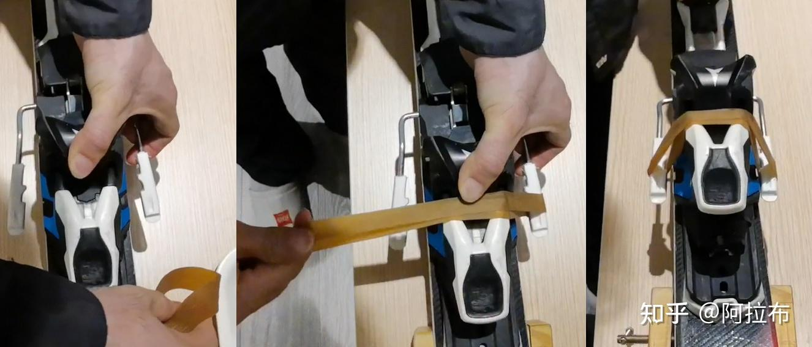

## 板底检视与除锈

板底检视包含这几个内容：

- 底刃是否有锈迹和损伤
- 板底是否有需要修复的划痕
- 板底是否平整

雪板上其他金属部件则多用不锈钢、钛铝合金、铝合金等，或者有镀锌、涂油等保护手段，所以基本不会生锈。但板刃不同，使用了强度比较高的高碳钢，且无任何保护，如果没擦净雪水，在温暖环境下（如车里）几个小时就能产生锈迹。

所以滑行完毕必须擦干板刃。如果需要立即打包，则尽可能吹去固定器空隙里的冰雪，以免融化后流到板刃上。一旦处于无法完全干燥的温暖环境，尽可能在几小时内取出雪板擦干板刃。带水的板刃如果保存不当，超过12小时就可能锈蚀出肉眼可见的凹坑，这种凹坑根本无法修复，所以一定要尽可能保持板刃干燥。

如果已经产生锈迹，可用细砂纸打磨生锈的地方直到看不见铁锈即可。当然用WD40等除锈剂也可以。

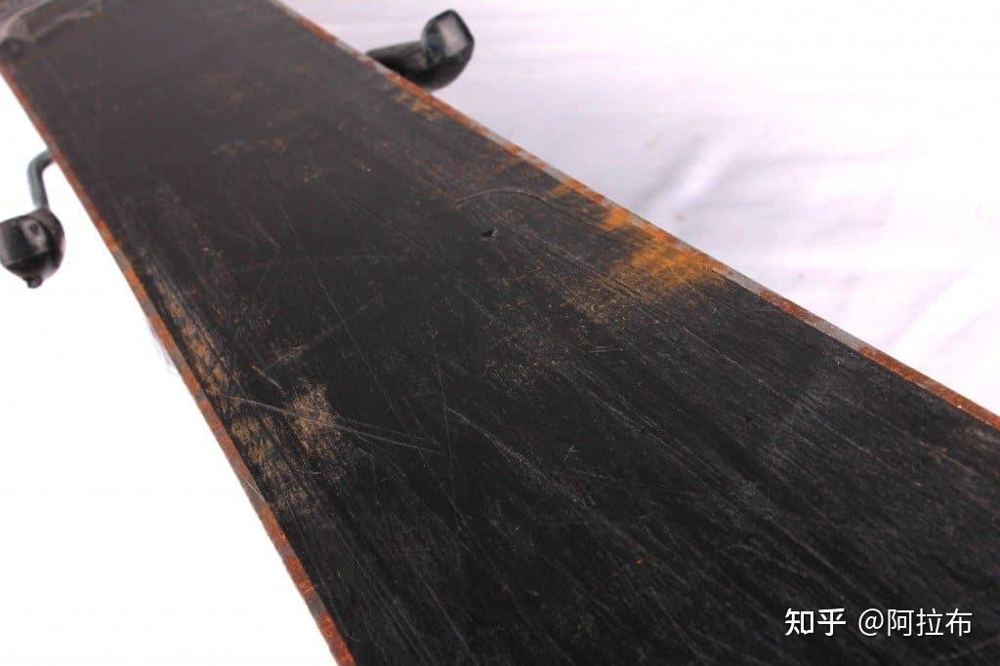

板底划痕基本上是不可避免的，但较小的划痕不需要处理，较深的沟槽可视严重程度而定。露出板芯、以及紧贴板刃的严重划伤，则必须尽快处理。

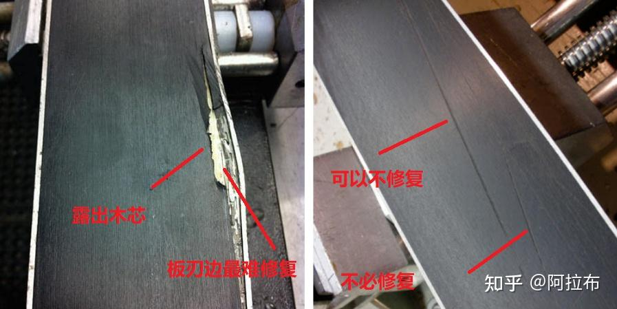

最后一项是板底平整度检查，需要对着光源用检查器具（一般是绝对平直的金属尺）来查看。如果出现底面不平整的情况，不但对滑行有一定的影响，还可能会导致修刃时角度不准确。

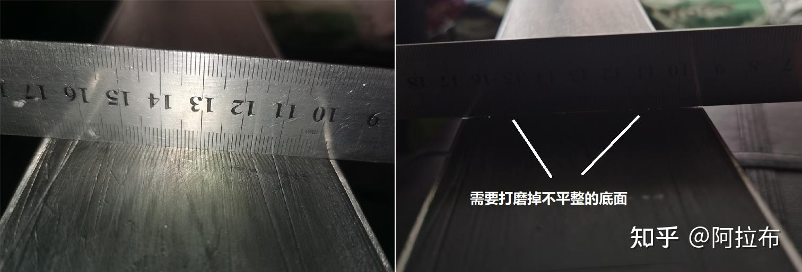

板底平整度的检查不需要经常做，一个雪季进行一两次即可。如果出现不平整，可以自己用板锉修整，但更建议去专业雪具维护机构采用机器处理。据我了解，刨平板底这一项的费用并不高，不过如果出现板底低于底刃的情况，那就得磨底刃了，最好去之前先咨询清楚。

## 板底划痕修复

工作前，将雪板底面向上放在板架上，并固定好。

对于需要修复的板底划痕，首先要把伤处清理干净，然后喷涂除蜡剂并擦干。

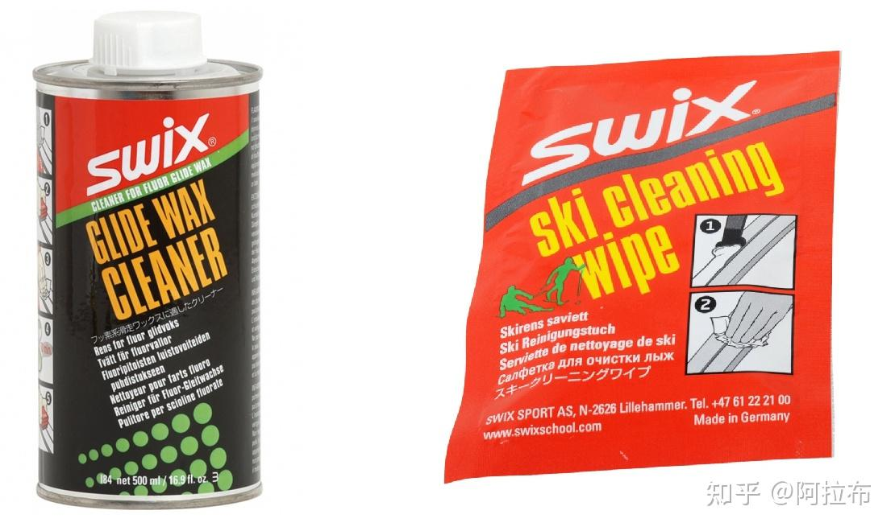

下一步是点燃修补胶棒（P-TEX胶棒，专门修补滑雪板板底的热熔胶），形成稳定的滴落状态。

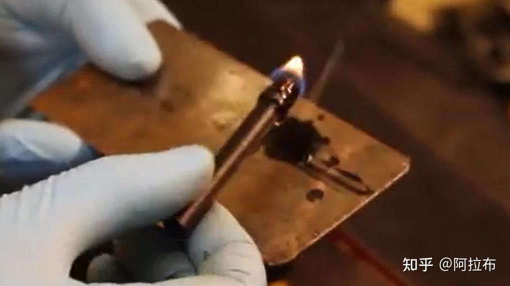

将融化的胶条依次滴在板底需要修补的地方，务必保持稳定和连续。

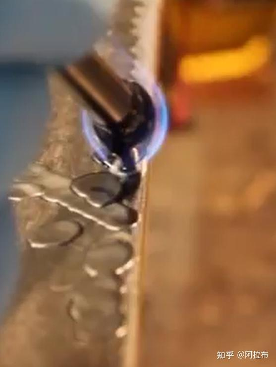

所有需要填补的地方都滴满后，可以稍微休息一下，等待其冷却。

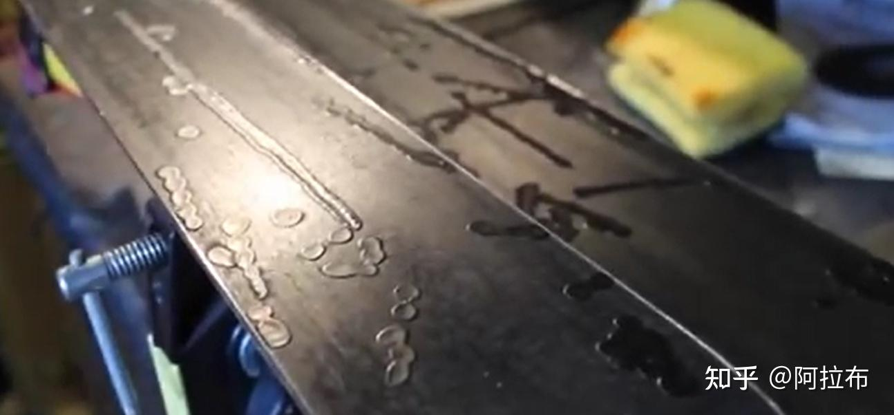

最后，等修补的板底冷却后，用金属刮板将板底刮平，修复工作就完成了。

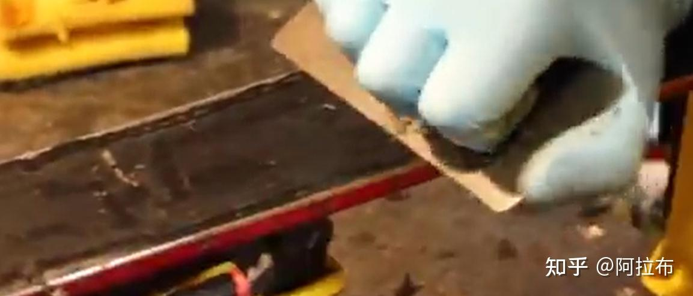

## 板底结构

最后，普及一下板底纹的基本常识。

所谓板底结构，实际上指的是板底纹路，俗称“水纹”。它的作用是减小板底与雪面的摩擦，增加滑行速度。

精细的纹路对应于冷雪：

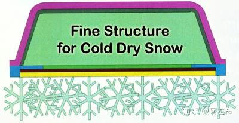

粗糙的纹路对应于暖雪：

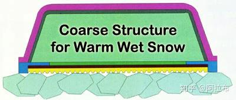

板底纹可以重新打，但是工具和操作都很麻烦（每种板底纹都有对应的辊子），所以家庭养护就别做这部分了。如果有需要，可以送到专业的维护场所去重做板底纹。

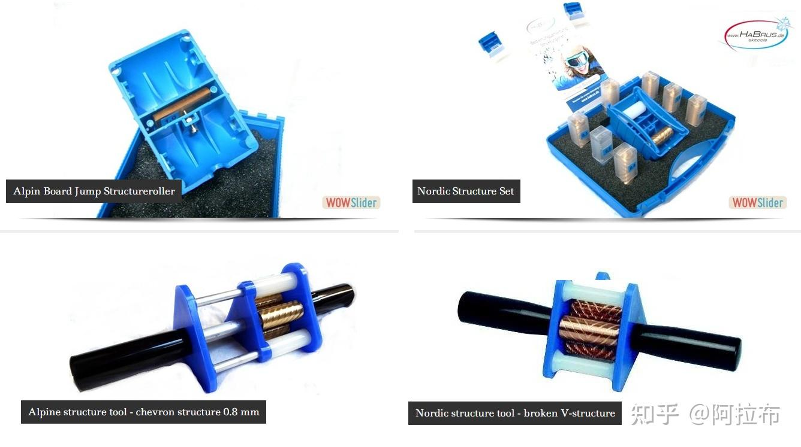

本篇内容就到这里。
