<!-- 来源: https://zhuanlan.zhihu.com/p/408059959 | 分类: 03_装备与器材 | 发布: 2021-09-28 | 赞同: 67 -->

# 雪板的家庭养护—③修刃

> 原文：[知乎 · 阿拉布](https://zhuanlan.zhihu.com/p/408059959)　·　发布于 2021-09-28　·　本文仅供学习交流，版权归原作者所有

雪板的板刃在滑行中会逐渐磨损，从而减弱雪板的抓雪能力。尤其是对于硬雪面上的卡宾滑行，磨钝的板刃甚至可能导致打滑、摔倒、甚至受伤。因此，定期修磨板刃是必不可少的工作。

不同的滑行方式对板刃锋利程度的要求不同。偏冰面的竞技卡宾要求最高，高强度训练每天都要修刃，一般强度的竞技训练也得2~3天修刃一次。大众卡宾滑行可以间隔更久一些。以搓雪为主的滑行方式可以一个月甚至一个雪季修一次。而粉雪滑行对板刃就更没有要求了，但为了安全考虑，比如偶尔遇到冰面，还是需要保持一定的锋利。

不同的滑行方式对板刃的消耗也不一样，越纯粹的卡宾，板刃磨损越轻。滑行者的技术特点还会导致不同位置的磨损也不一样，比如后座的滑法会导致雪板前部板刃几乎完好而后部磨损严重；重心完美的滑行者中，力量型滑法会导致雪板中部消耗较多，偏温和滑法则整条板刃的磨损都比较均匀。在高级阶段，有经验的教练可以通过修刃来了解学员当日的滑行表现。

## 底刃与边刃

虽然每条板刃都只是一个角，但是它的两个面有不同的名字：底面称之为 底刃 ，侧面称之为 边刃 。

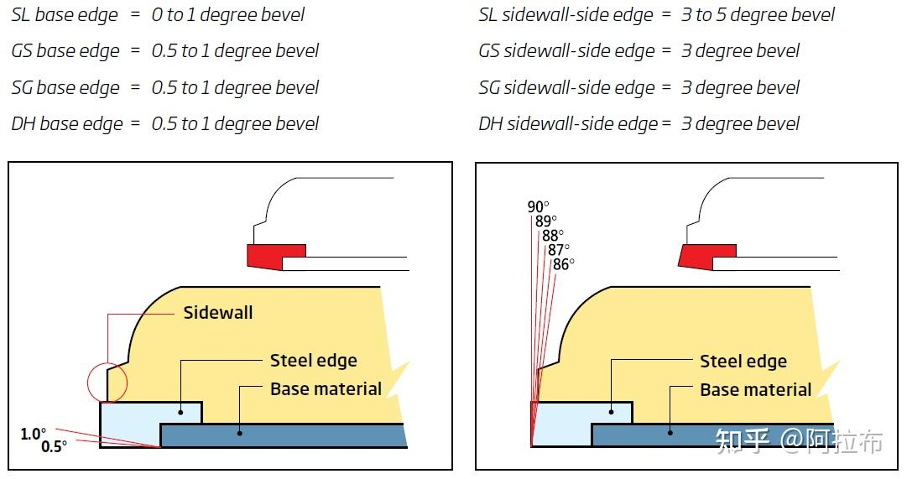

## 修整底刃

修整底刃，包括去毛刺、修磨、改角度等工作，我们在日常维护时主要是去毛刺。

保持板底朝上，检查底刃有没有被石头或者硬物划伤，有的话用底刃角度尺夹持锉刀，将毛刺修平即可。如果没有底刃角度尺，手稳的话也可以直接手持锉刀操作。

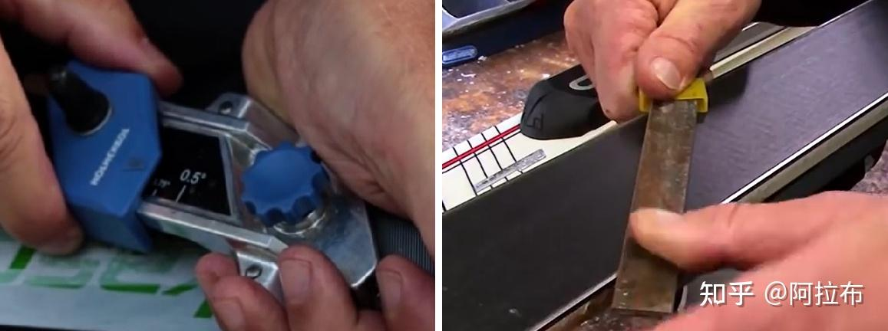

底刃角度尺常见有可调和固定两种，主要形式是上图左侧这种，比较贵。右侧的KUU简易角度尺设计思路非常出挑，不过角度的准确性存疑。国产角度尺现在也有了，价格相对亲民。

如果要修整全部底刃，建议用胶带保护好板底，避免不必要的磨损。

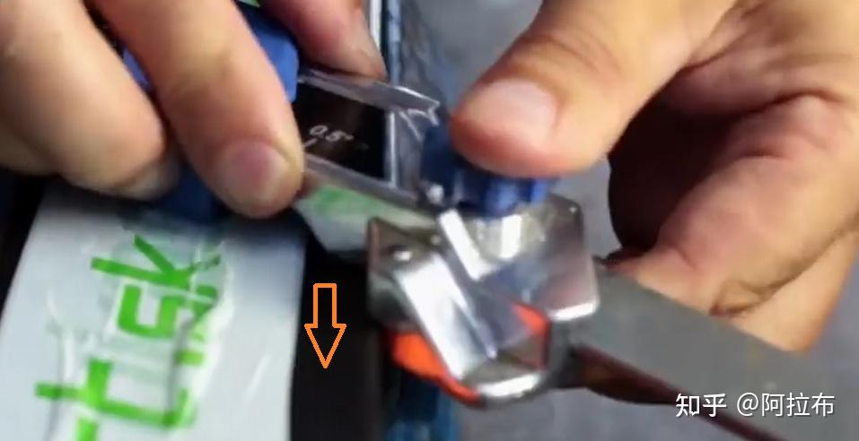

## 去除边墙

边刃上面的边墙对板刃起到保护作用，但是当边刃修磨到与边墙持平时，修刃就会因锉刀被边墙挡住而变得困难，这时候我们需要去除一层边墙，让板刃暴露出来。

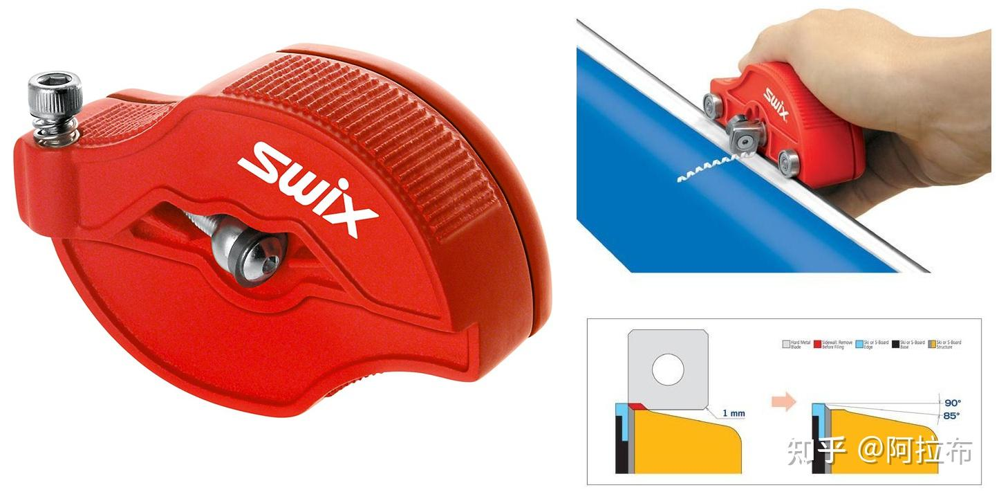

刨除边墙的工具就叫做边墙刨子（Sidewall Cutter），它的刀头有两种，圆形和方形。圆形刀头适用于三明治边墙结构，方形刀头适用于帽状边墙。

在使用边墙刨子之前，必须调整刀头的位置，使得刀头刚好切除所有边墙。然后调整进刀深度，一个简单的方法是调整到刀头刚刚接触到边墙，然后退回1/4圈。如果需要切除更多的边墙，可以刨完后再退回一点，然后重复切除边墙直到满意。不建议一次进刀过深，会导致刨刀跳动、打滑等问题，导致边墙不平整。

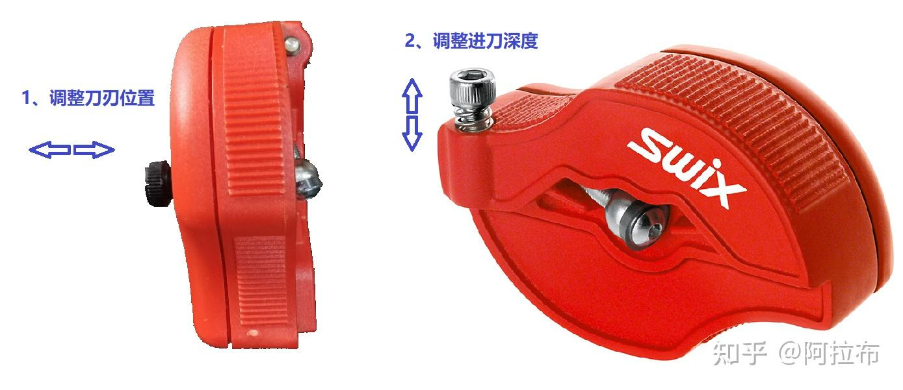

切除边墙时，需要将雪板立着固定在板夹上。完美的边墙切削，应该是一刃到底，从头到尾切下一条完整的切丝。

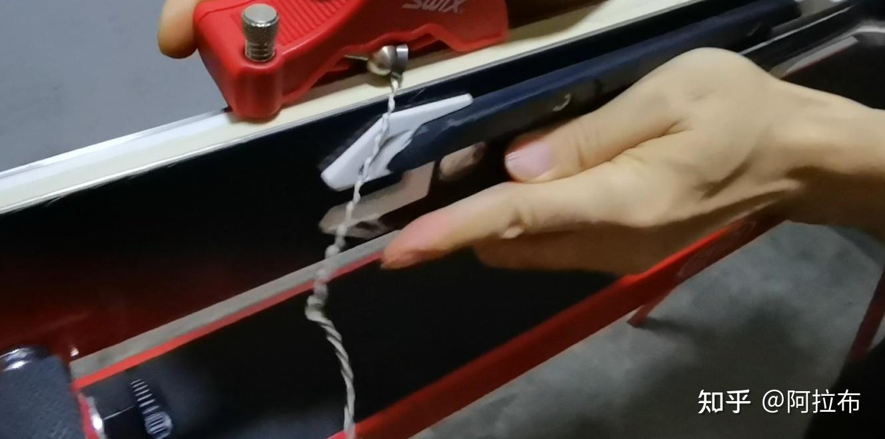

## 修刃工具

边刃的修整需要用到边刃角度尺，大致可分为可调角度、固定角度、简易三种类型。可调角度尺相对成本较低，但精度略差；固定角度尺可能需要多个以对 应不同的雪板，但精度高，耐用；简易角度尺体积小，便于携带，而且比较便宜，也可以作为偶尔使用的方案。

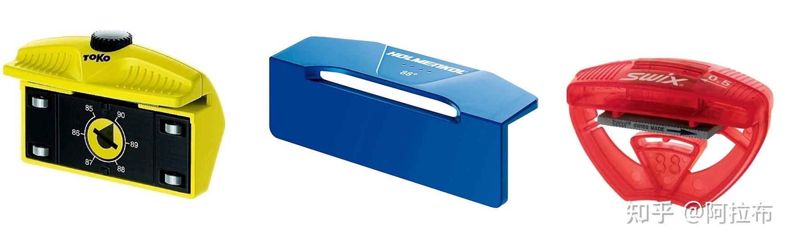

修刃用的锉刀与常见的金属锉刀是不同的，后者是双纹锉，锉面为菱形纹路；而前者是单纹锉，有普通板锉形式，也有块状板锉形式的。

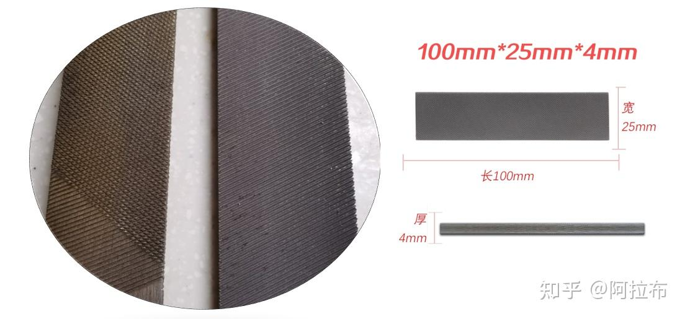

SWIX/TOKO/VOLA等大牌工具出品的锉刀比较贵，通常在100~200元，但同样的单纹普通金属锉刀在淘宝3~8元就能买到，块状锉刀20~30元。当然，耐用性可能不如大牌产品。

锉刀按切削力度/深度分为四种：细齿锉（约18齿/厘米），中齿锉（约15齿/厘米），粗锉（约12齿/厘米），鱼鳞锉。鱼鳞锉（月牙锉）切削力度非常大，用于开刃、改刃角、过度磨损等需要切除较多板刃的粗放场合。日常修刃，细锉和中锉用的比较多，也可只买一把中锉，通过手上的力度来控制切削量。

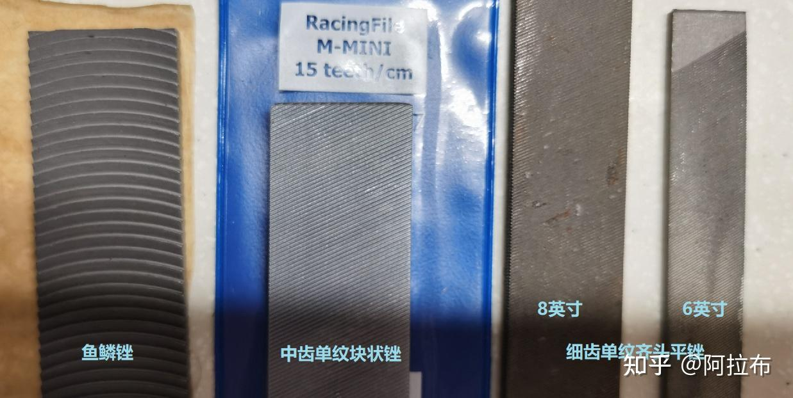

使用锉刀时要注意切削方向。平锉是向前切削，即从握柄一端向齐头方向。块状锉会在一个锉面或者侧面标注切削方向。如果找不到标记，可以从侧面观察锉齿，锉齿为直角三角形，直立的边代表切削方向。

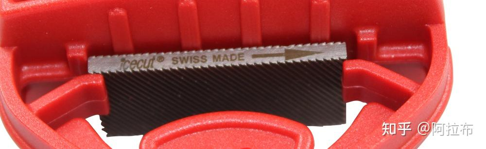

有一些角度尺自带固定锉刀的夹持器，其他的需要再配一个锉夹。注意，不能用普通的夹子，夹持力度太差。如果不喜欢昂贵的专用锉夹，那也必须要买 夹口带橡胶垫的强力夹 ，否则固定不住锉刀（淘宝搜强力A夹，注意确认是加粗弹簧）。

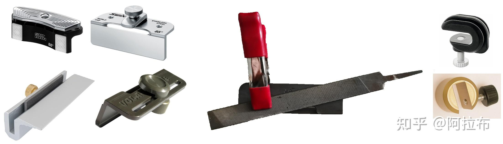

最后一件装备是抛光用的磨石，比如油石或金刚石锉，粒度为400~1000目。同锉刀一样，大牌货昂贵无比，国产工业品单面不到20，双面30（可能会弯曲，不如单面稳定）。

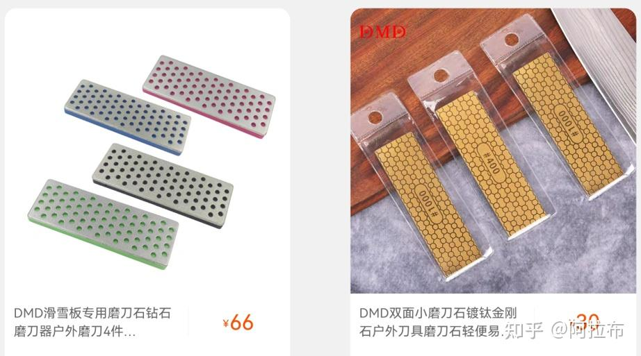

## 修磨边刃

修刃的流程为：1 粗修，2 精修，3 去底刃毛刺，4 抛光 。

粗修通常是开刃或者磨损较多时才做，用鱼鳞锉、粗锉去除较多边刃。这也是感觉比较爽的一个步骤，会有大片的金属屑打着卷被切出来。不过考虑到板刃的寿命，大概又会很心疼吧。如果没有粗锉，用中锉多修几遍也是可以的。

粗修之后就是精修，这是因为粗修后的平面不会非常平整，必须用细锉再修整一遍。如果经常性的进行修刃保养，那么用中锉或者细锉进行精修就好，几乎用不到粗修。

修刃时不要太用力，主要的力量用来将角度尺贴住底面，稍微压住锉刀即可，保持锉刀力度和速度都要均匀稳定。

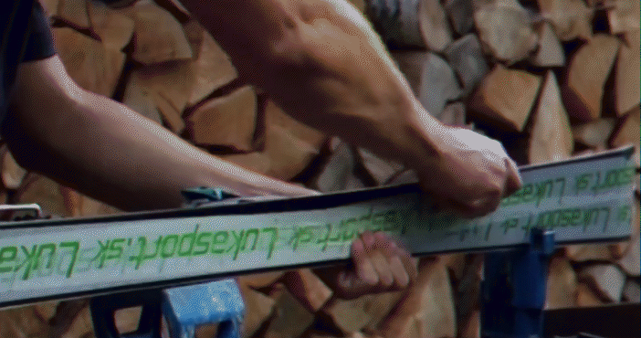

修刃的时候，一般是从板头向板尾修整，同时不断用手指检查板刃的锋利程度。大部分情况下，用指头肚轻刮板刃就能感受到。手指肚不太敏感的话，也可以用指头背。如果对自己的感觉不放心，可以去感受一下别人修好的板刃，特别是专业人员修完的板刃，对什么程度才叫 锋利 就会有直观的认识（当然，如果每次都修到真正的“锋利”，会很快消耗掉板刃寿命）。

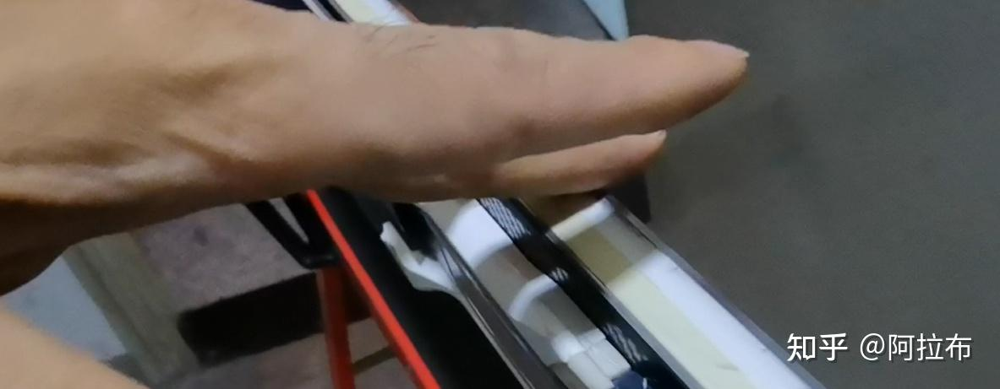

修刃过程中可能会在底刃方向产生些许毛刺，这种毛刺用油石/金刚石锉很容易就能刮除，因此，用手指把金刚石锉贴在底刃上走一遍即可，遇到明显的阻碍时则多来回打磨几次。

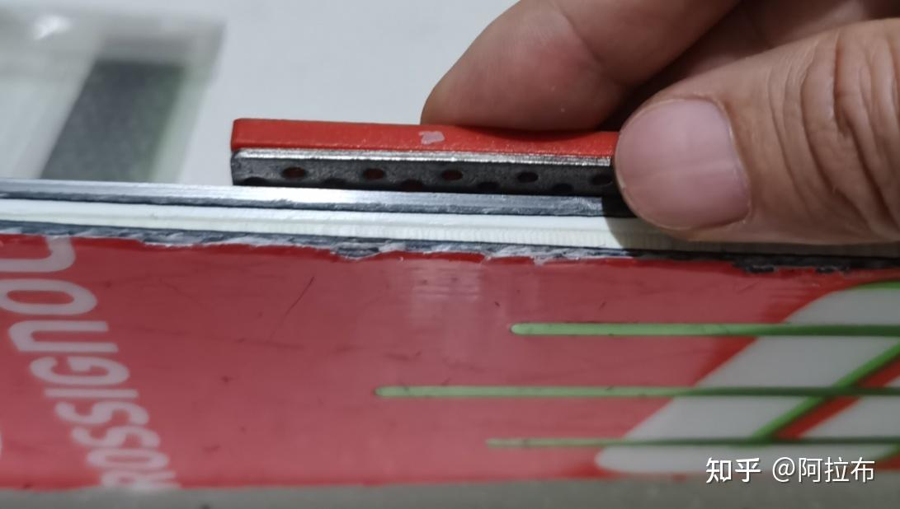

最后是用油石/金刚石锉抛光边刃。如果精修使用的是细锉，建议仅用400-600目抛光一次。如果之前只使用了中锉且切除板刃较多，可用150~250目先打磨一遍再抛光。对于使用要求比较高的雪板，如比赛或高表现滑行，可用1000目最后抛光一次。

## 其他要点

在这里讲解一些修刃中的小细节。

手套保护

板刃虽然不像刀口那么尖锐，但也挺容易划伤手的。因此初学修刃时，持锉的手最好戴上手套。熟练以后就可以选择不戴手套操作，如果自认皮糙肉厚的话。

清理工具

修刃完成后，除了清理工作台和地面，最好也清理一下角度尺和锉刀，用铜刷去除脏东西。金刚石锉比较容易被碎屑堵塞，工作时注意多换几个位置，等最后一起清理。

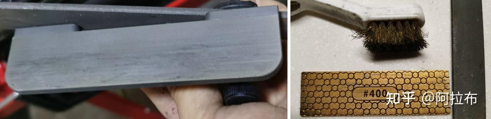

用力方向

作为持劳动部证书的二级钳工，正规的用锉方式是向前推锉。然而在修刃时，最方便的一侧，即雪板右刃，大家普遍采用的是 雪板底面朝右、板头朝前、右手持锉刀向回拉 的方式。当换到雪板左侧刃后，可以改成 雪板底面 朝左 、板头朝前、 左手 持锉刀向回拉 ，也可以像我一样，采用 雪板底面朝右、板头 朝后 、右手持锉刀 向前推 的方式。

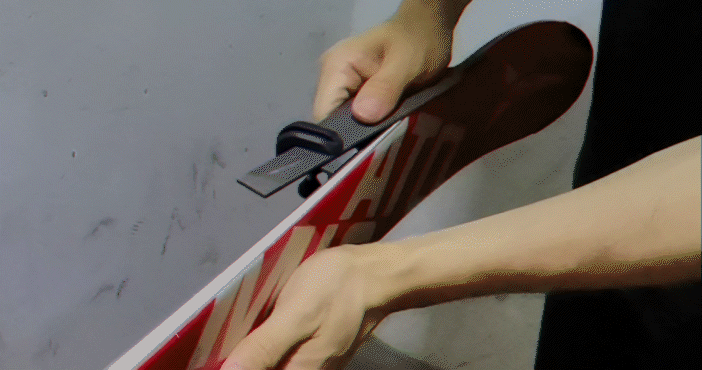

排屑槽口

锉刀切下来的金属碎屑会沿纹路排出，那么总有一侧板刃的金属碎屑会排向手心方向，这时就需要注意锉刀的夹持位置，给碎屑留出通道。

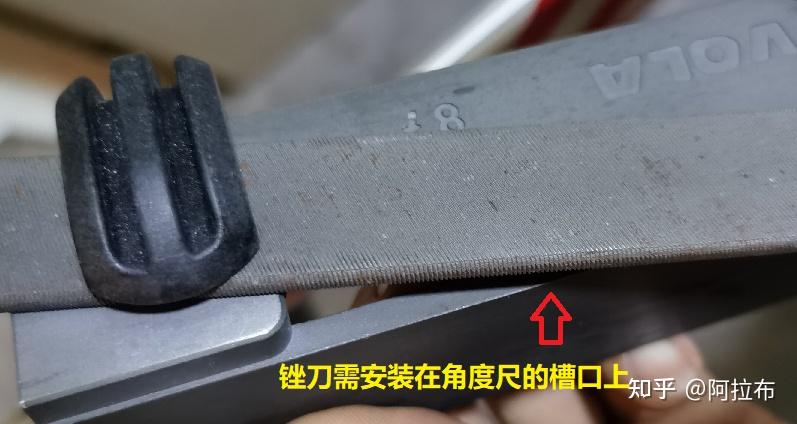

每日修刃

板刃的磨损不大时，可以不用锉刀，直接用150~250目油石/金刚石锉修整。如果每天都修刃，可能两三天才会需要用锉刀精修，基本上不会需要粗修。

钝化处理

有一些滑行技术要求雪板前后10CM左右的板刃保持圆角，避免入弯时较早的切雪，加速出弯。因此，很多教程会有一个钝化（Detunning）的操作，即用锉刀把需要钝化的板刃打掉。

对于大众来说，修完刃再打掉，其实不如就不修这部分，钝化位置仅仅去毛刺就可以了。但如果是FIS比赛，对雪板的尺寸要求非常精确，如果两头总是不修刃，等于变相的改变了雪板侧切尺寸，这是不允许的，所有才会有先修刃再磨掉的操作。对此我们了解就好，没必要完全遵从。

以上为本文全部内容。
