<!-- 来源: https://zhuanlan.zhihu.com/p/415268665 | 分类: 03_装备与器材 | 发布: 2021-11-19 | 赞同: 56 -->

# 雪板的家庭养护—④雪蜡篇

雪板养护的最后一步是打蜡。

常见的打蜡方式有三种：液体蜡涂抹/喷涂，软木涂抹，热烫涂。

液体蜡适用于应急、强化、偶尔使用、以及不打算购置打蜡工具等情形。软木涂抹使用较木擦和较软的固体蜡，多用于越野滑雪。热烫涂又称热蜡(Hot Wax)，是最主要的打蜡方式，采用电熨斗、热辊、红外线等方式将固体蜡融化并均匀涂抹在板底。

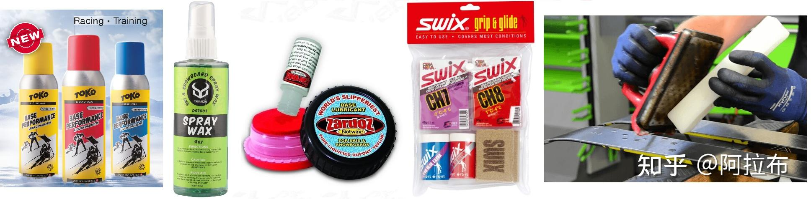

无论哪一种，打蜡之前先要清理板底，然后打一层蜡，冷却后刮除；如果需要，再打一层或者多层蜡；最后抛光（也可能省略）。

## 雪蜡工作原理

蜡的种类繁多，除蜡烛外，日常多见的是汽车和家具的亮光蜡，它具有防脏、防渗透、美容等作用。

而雪蜡的作用完全不同，甚至雪蜡本身也存在两种截然不同的作用：加速或者阻碍滑行。起加速作用的称为滑行蜡（Glide Wax），高山滑雪仅使用这种蜡。起阻碍作用的称为抓地蜡（Grip Wax / Kick Wax），用于越野滑雪等项目。本文仅涉及高山滑雪所用的滑行蜡。

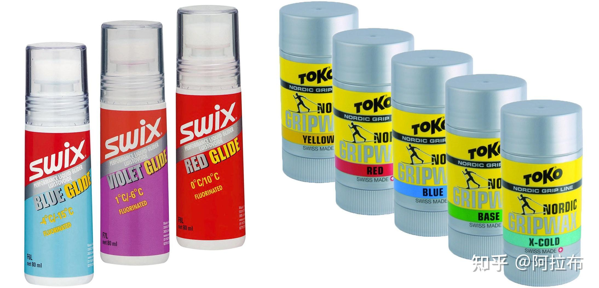

一定温度条件下，当雪板与雪粒高速摩擦时，会融化出细微的水珠。如果水珠沾在板底上，就会增加板底与雪粒之间的粘性，导致滑行速度减慢（ 湿摩擦作用 Wet Friction ）。【另外有种说法，随着雪板的移动，雪板与雪面之间因为水的填充导致没有缝隙，会产生 真空效应 ，进一步减慢速度】。而且一旦停下来，板底上的水分有可能将雪黏在板底上，甚至冻住，变得寸步难行。

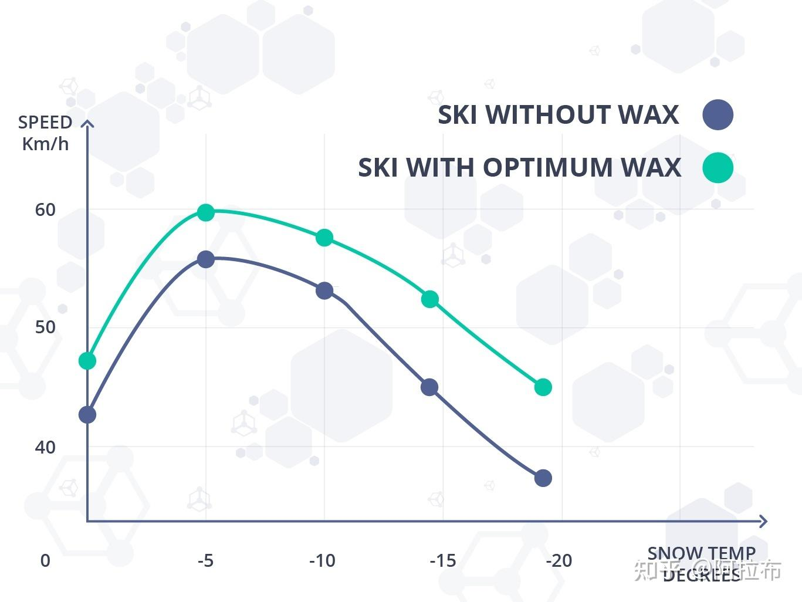

*来源：《Wax Science Demystified》DominatorWax*

如果板底有一层雪蜡，蜡的疏水性就能够避免板底沾上微型水珠，这些水珠会在板底和雪之间滚动，从而不会发生减速、沾雪等麻烦。对于采用烧结板底的雪板，板底材料由小颗粒烧结形成，这些小颗粒之间存在大量的微型空隙，雪蜡会渗入这些空隙里，并在使用时逐渐渗出。

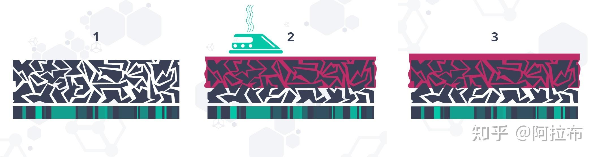

如果温度更低，在遇到坚硬或/和磨损的雪粒时，雪粒会直接穿透蜡层，与板底发生摩擦，并因两者的相对运动缺少润滑而导致减速（ 干摩擦作用 Dry Friction ）。高速滑动产生的短时高热会伤害板底，使原本的孔隙结构消失，于是板底变得更加致密、干涩、发白，性能下降，这就是俗称的“烧板底”。一旦发生烧板底现象，基本上这层板底就无可挽回了，只能打磨掉，并重新印制板底结构（水纹）。板底材料的厚度不大，仅仅能够打磨大约6次板底。

## 雪蜡的分类

雪蜡的性能主要表现在两个方面：润滑能力和耐用程度，这两者都与雪蜡的软硬程度有关。越软的蜡，在疏水性和润滑性方面的表现就会越好，但也就更不耐磨，只能用在温度较高的场合。而硬的雪蜡更加耐磨，也就更多的用于低温环境，以缓解硬雪粒对板底的摩擦。因此雪蜡最基础的分类依据就是使用温度。虽然雪温更加精确，但普通人可没有办法测量雪温，更别提提前预报了，所以大气温度就是合适的指标。

根据使用温度可以把雪蜡分为： 超低温蜡、低温蜡、中温蜡、高温蜡、超高温蜡 这5类，并用颜色进行标识。常用的是中间三种，超低温蜡也可以用来强化耐用性，避免烧板底，如SWIX CH3/CH4（目前已升级为Polar Wax）。另外还有一种 全温蜡 ，针对的是大众非专业使用、偶尔使用等场合，其实只是温度适应范围比较宽，并不是真的能用在任何温度下。

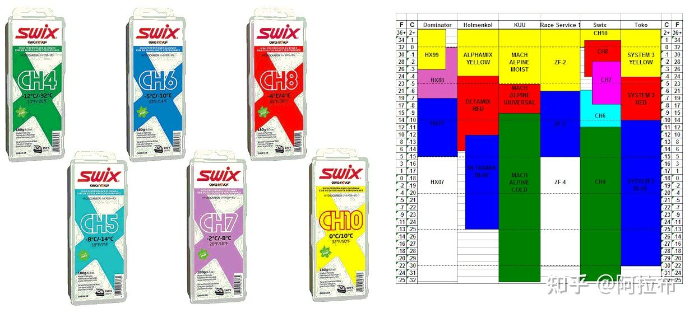

除了大气温度，雪的湿度、颗粒度、磨损程度也会影响蜡的性能。有经验的打蜡师会根据具体的雪况，在大气温度的基础上进行浮动，以选择更合适的雪蜡。

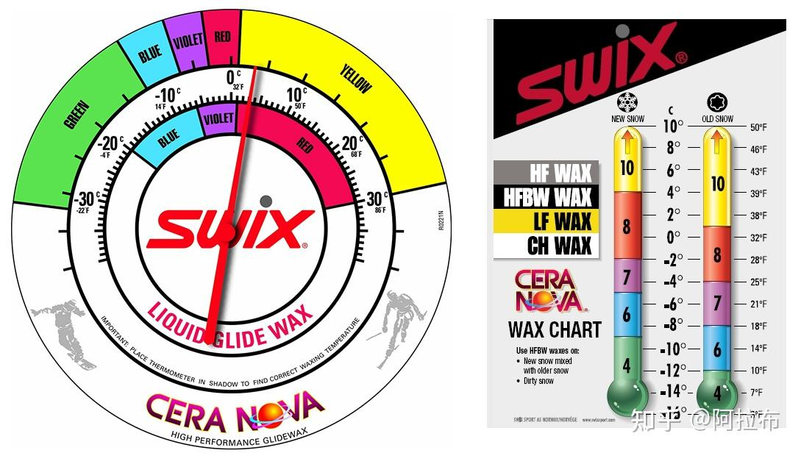

从蜡的成分上划分，可以分为：碳氢蜡（基础蜡）、低氟蜡、高氟蜡、无氟高性能蜡、石墨蜡等。蜡本身就是碳氢化合物，因此碳氢蜡代表无其他添加的最基础的蜡。将石墨加入碳氢蜡中，有助于传导出因板底摩擦产生的电荷，从而减小 静电摩擦作用 （ Electrostatic Friction ）。碳氟化合物具有更强的疏水性，而且能够让板底获得“自洁”功能，加入到碳氢蜡中能够极大的提高滑行性能，但是其成本也比较高，因此仅使用在高性能雪蜡上面。

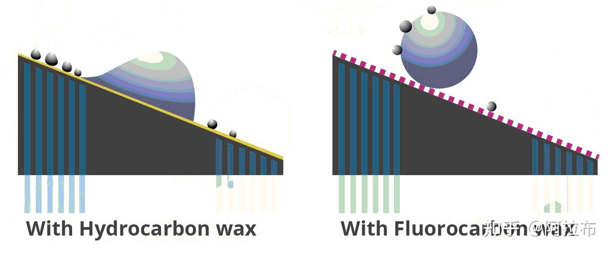

然而氟对自然环境有一定的污染，从绿色环保的角度，近年来多个国家和组织开始抵制含氟蜡。国际雪联已经颁布禁令，自2021年7月1日开始在FIS比赛中禁止使用含氟蜡，因此各大雪蜡厂商开发了无氟高性能蜡，比如SWIX以金属胶体代替碳氟化合物的HS/TS系列等。

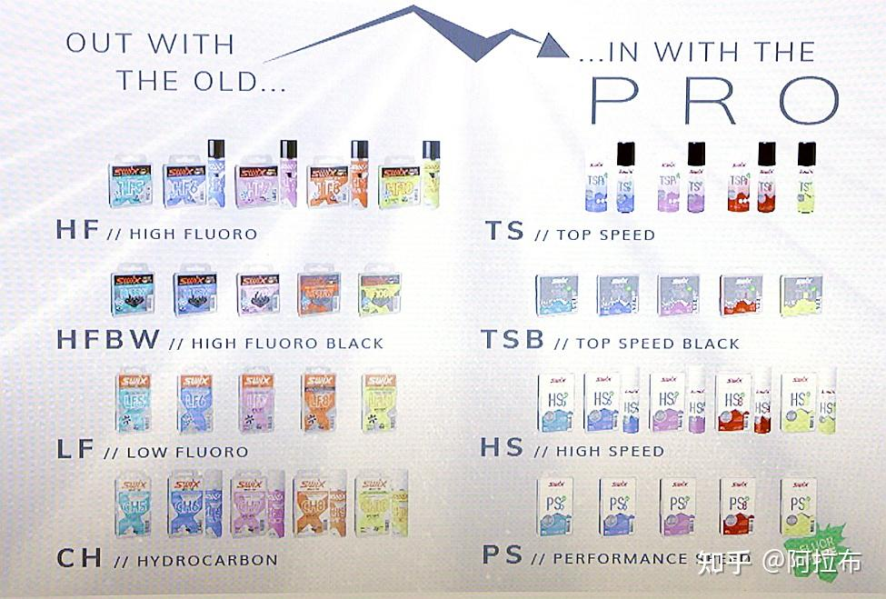

最后是蜡的形态，有液体喷涂蜡、液体涂抹蜡、膏蜡、蜡纸、块蜡（固体块状）、碎蜡（固体碎屑）、粉末蜡（固体粉状）这些种类。下面的表格对这些种类进行了简单说明。

## 选择"冷"蜡与热蜡

要根据打蜡的目的来选择相应的雪蜡。专业人员通常会很明确所需的雪蜡，所以我们主要是面向大众雪友进行说明。

如果是滑行次数不多，或者是雪板采用了挤压板底，那么不一定需要购置热蜡的全套打蜡装备。最简单的方案是采用液体/膏状全温蜡和电吹风，也能起到不错的保养效果。液体蜡使用简单，但单独使用的耐用性很差，通常滑行1KM就消耗完毕。但根据国外雪友的测试，涂抹液体蜡之后立刻用电吹风对板底进行加热，也能够让更多的蜡渗入板底，从而将滑行距离提高到20KM以上（热蜡的滑行距离在60KM以上，使用专业设备可达200KM）。用软木摩擦板底抛光也有加热的效果，有厂家测试软木抛光时的温度甚至可以达到130℃。

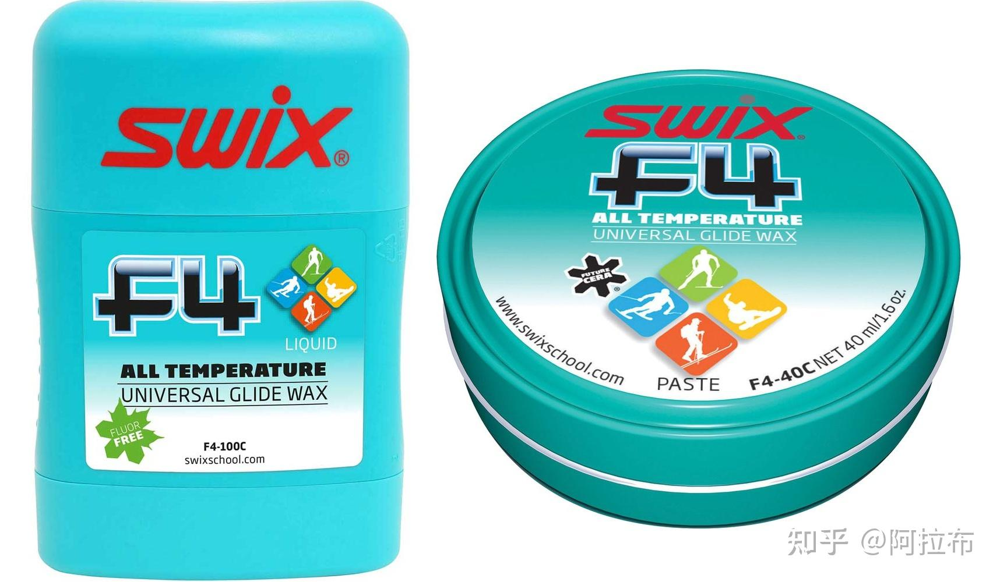

随着科技的进步，液蜡的使用效果也在提升，目前已有厂家宣传其液蜡使用距离可达40KM（使用软木抛光），也许未来液蜡会成为更普遍的大众雪板保养方式。

固体蜡的软木涂抹，比不加热的液蜡要耐用一些，但打蜡过程比较费力，因此多用于很窄的越野雪板。将块状雪蜡像粉笔一样涂满板底，然后用软木摩擦均匀。它的好处是不需要电源，在野外环境就可以直接操作。这种方式只适合较软的固体蜡，遇到低温蜡时会更加吃力。

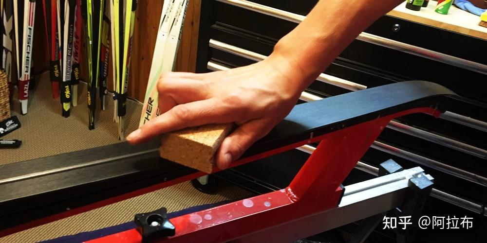

最普遍的方式还是热蜡，以电熨斗为主流工具。需要大量处理时，可以采用热蜡辊子、专业打蜡机等装备来提高工作速度。还有更加精确的红外线加热打蜡设备，用于世界杯比赛等高端场合。

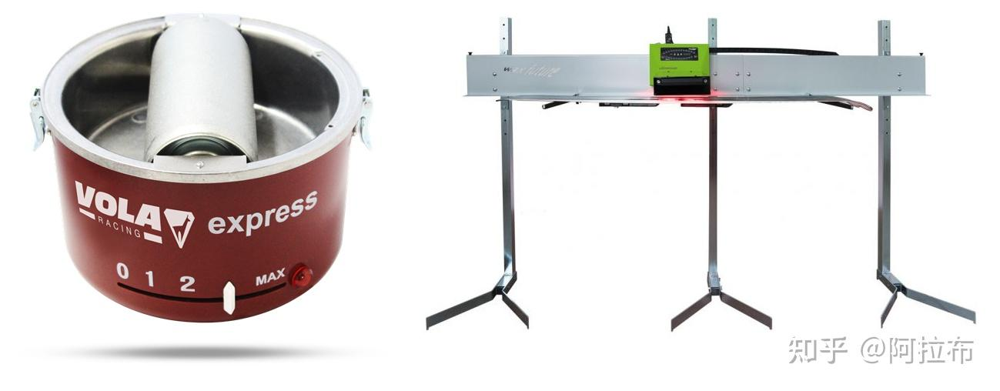

## 选择合适的雪蜡

以热蜡为例，谈一下如何选择合适的程序和雪蜡。

普通雪板日常保养时，查看下一次滑雪时的天气预报，以开始滑行时的温度为依据来选择相应温标的碳氢蜡即可。

如果是新板，或者是级别较高的雪板，又或者将面临较长距离的滑行，建议先打一层预底蜡，冷却刮除后再打滑行蜡。

预底蜡 （Base Preparation Wax）是一种渗透性特别强的软蜡，用于新板保养、雪板运输、封存等场合，也可以作为其他滑行蜡、爆发蜡的底蜡使用，能够有效地增加表层蜡的滑行距离。

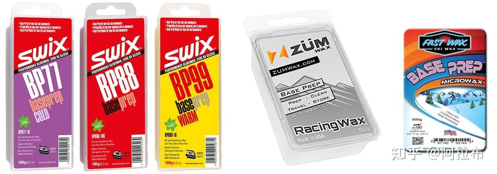

当春季来临，需要面对湿雪时，选择低氟蜡能够显著提升滑行体验。可以直接打低氟蜡，也可以用预底蜡作为底蜡。

参加比赛的竞技雪板可能会使用高氟蜡或其他爆发蜡，较好的程序是三层结构：预底蜡—底蜡—表层蜡，底蜡可以是碳氢蜡，也可以是低氟蜡。比赛不一定非要使用高氟蜡，低成本方案也可以选择碳氢蜡+低氟蜡的组合；而比赛当天温度非常低的话，高性能碳氢蜡有可能比含氟蜡更快。通常在比赛前还会再涂一层液蜡作为出发蜡。

同一种雪蜡也会有多种封装，大封装的单位价格会更便宜，但不容易携带。如果经常需在旅行中打蜡，那么中小型封装就比较合适。最常见的块蜡封装是120~180克的中等封装和60克的小型封装。我在家中使用的500克雪蜡，基本上是块蜡中的最大规格了。很多工坊会采购5公斤的桶装碎蜡来使用。

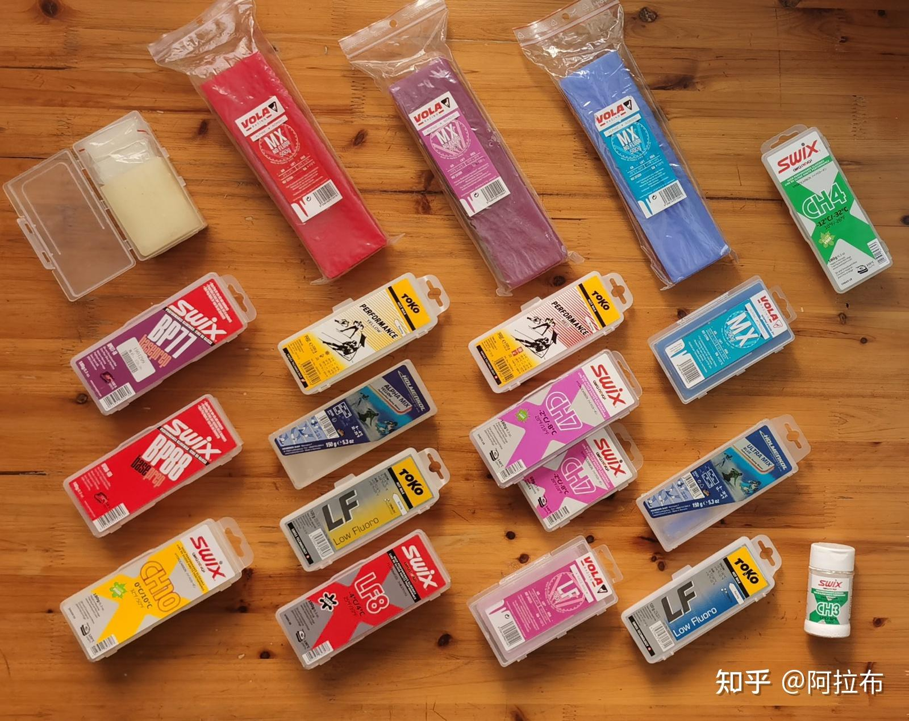

限于篇幅，本文到此结束，下一篇会讲解打蜡的具体操作以及其他内容。
