<!-- 来源: https://zhuanlan.zhihu.com/p/435095271 | 分类: 03_装备与器材 | 发布: 2021-12-15 | 赞同: 58 -->

# 雪板的家庭养护—⑤打蜡（完）

> 原文：[知乎 · 阿拉布](https://zhuanlan.zhihu.com/p/435095271)　·　发布于 2021-12-15　·　本文仅供学习交流，版权归原作者所有

无论打液蜡还是热蜡，打蜡之前先要清理板底，然后打一层蜡，冷却后刮除；如果需要，再打一层或者多层蜡；最后抛光（也可能省略）。

## 清洁板底

将板底朝上架好，用 硬尼龙刷 从头到尾把板底刷干净。

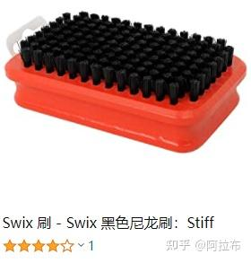

如果板底比较脏，或者要更换更专业的雪蜡时，使用除蜡剂会有较好的效果。除蜡剂可直接均匀喷在板底，也可用纤维纸/纤维巾沾湿后擦一遍。但如果发现有脏物渗入的情况（彩色板底会更明显），除蜡剂并不能将渗入板底的脏东西清理掉，需要先在脏处打上清洁蜡，将板底渗入的脏东西“吸”出来，然后用纤维纸、厨房纸巾等垫在熨斗下吸走污染的清洁蜡，或者趁热刮除（Hot Scraping/热刮蜡，省时但据说可能会伤板底）。必要时重复几次。

清洁蜡 可以用最便宜的白色雪蜡，手头没有的时候也可以用其他价格较低的软雪蜡，如预底蜡、高温碳氢蜡等。这种白色雪蜡的成本可能不到预底蜡的五分之一，也可用来运输和封板。

清洁完成后，用专业的 钢丝刷 或者 粗铜刷 彻底清理板底，最后用纤维纸或者百洁布将板底完全擦干净，等待上蜡。

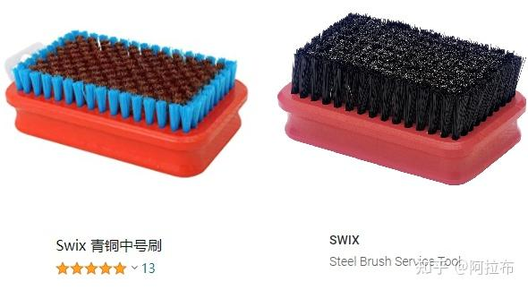

纤维巾是非常好用的东西，后面还会用到，值得常备。原厂的纤维巾比较贵，不过，它有一个名字下里巴人的廉价兄弟：懒人抹布。注意大部分的懒人抹布是印了纹路的，个人感觉不印纹路的平整型更好用一点。

## 打蜡熨斗

热蜡之外的其他方式前面已经讲解过，家庭养护使用热蜡还是以电熨斗为主。

熨斗的性能对打蜡过程影响很大。功率越大加热速度就越快，加热盘越厚热容就越大，这两点保证了熨斗在接触板底后不至于快速冷却。

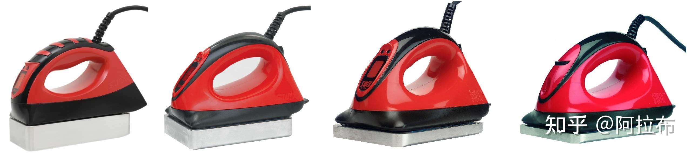

打蜡需要一定的温度，越硬的蜡烫熨温度就越高，最高可达170℃，这个温度已经可以融化板底材料了，所以需要快速的烫过板底表面，不能停留。一个建议是从板头烫熨到板底，不能超过8秒，但我试验过，这得用最好的熨斗才行。如果熨斗的功率不够大，或者加热盘的热容太小，那么就必须放慢烫熨速度等待熨斗重新加热到高温，这样就很难控制加热时间。

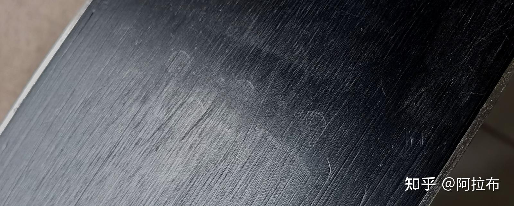

*被烫伤的板底*

同时，熨斗和蜡液所蕴含的热量不会仅仅停止在板底，也会向整个雪板传导，粘合在一起的板芯以及其他各层材料在受热后会有所变化，过高的温度将导致不应有的变形、甚至开胶。在打蜡时可以摸一摸板头部分板面一侧的温度，如果感觉很热，说明热量已经穿透雪板，烫熨操作的时间有点长了。

稳定的温度是打蜡熨斗的另一个性能要求。温度设定通常以5℃间隔就足够了，但是稳定性的要求很高。温度低了雪蜡融化不好，渗入效果差；温度高了除烫坏板底的风险，还会导致雪蜡冒烟蒸发，吸入蜡蒸汽会导致呼吸系统的伤害。所以打蜡时也要注意保护，尽量戴上口罩。

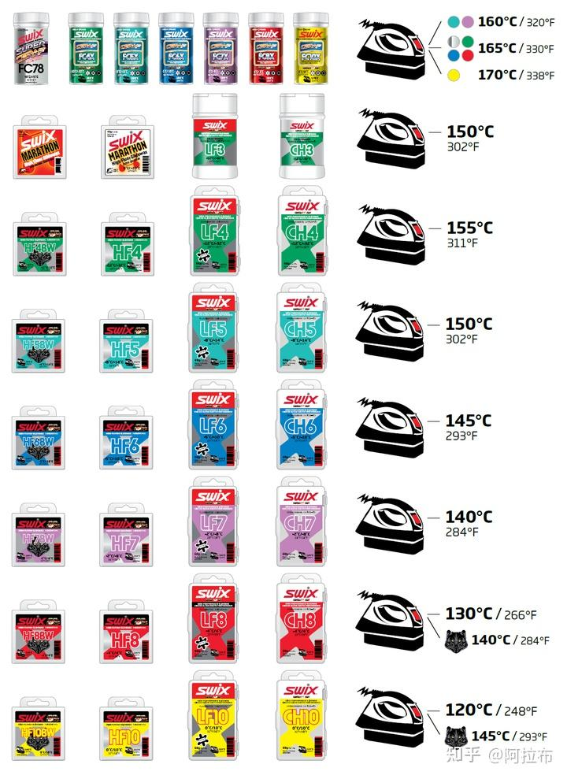

很多人问为什么要用昂贵的专业打蜡熨斗，几十块钱的普通铁熨斗不行吗？我还真花58元买过一只500W的大功率普通熨斗，但确实不好使，除了500W的功率不太够用之外，定温也不方便。如果只使用一种雪蜡，倒也能凑合，可以先从较低的温度开始试验能否融化雪蜡，直到雪蜡能够快速融化但还没有冒烟，就是合适的温度设定。

## 打蜡操作

打蜡操作本身比较简单。

第一步是上蜡，块蜡要先用熨斗融化、滴在板底上，碎蜡和蜡纸就直接撒或铺在板底即可。上蜡的关键是量要正好，保证蜡液能够浸润整个板底的同时，所用雪蜡尽量的少。这不仅仅是为了节约，也是减少后续刮蜡工作量的关键。如果蜡层足够薄，甚至不需要刮蜡和抛光，上雪后多蹭几下板底或者滑行一两趟，外面的蜡层就自己磨没了。

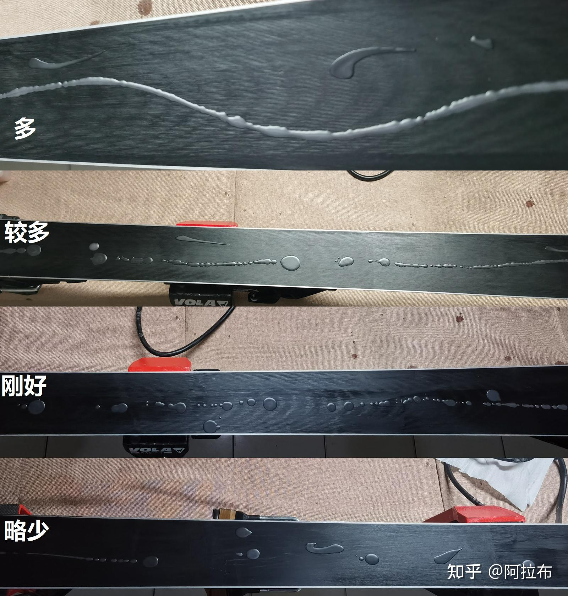

当然，上蜡比较多时，操作速度会快一些。如果习惯这样，建议上蜡前先用美纹纸或者胶带把固定器和板架保护起来，避免蜡流下来弄脏这些地方。

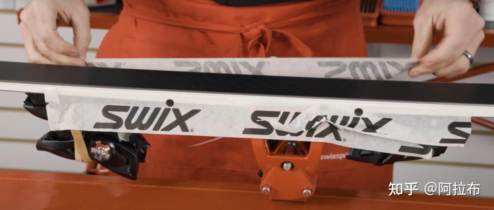

上蜡之后，用熨斗将蜡烫平两遍，让融化后的蜡均匀覆盖所有的板底即可。如果不打算刮蜡，最后一遍烫平的时候从头到尾匀速移动，中间不要暂停，这样打出来的蜡非常平整光滑，像镜面一样。

如果将要在寒冷的日子进行大量卡宾滑行，建议使用超低温蜡对板刃两侧的板底进行强化，比如将粉末状雪蜡撒在板底两侧，然后一次性烫平。

打蜡之后，最好等待雪板完全冷却再进行下一步，这样板底能够尽量多得吸收雪蜡。如果是封板或者运输，到这里就可以收工了，不需要后面的刮蜡和抛光。

## 刮蜡与抛光

刮蜡是整个保养过程中最脏和最累的步骤。

刮蜡的工具是一片有机玻璃板，常用厚度为4mm。很多 刮蜡板 的一个角上会有直角缺口，这是用来清理底刃的。

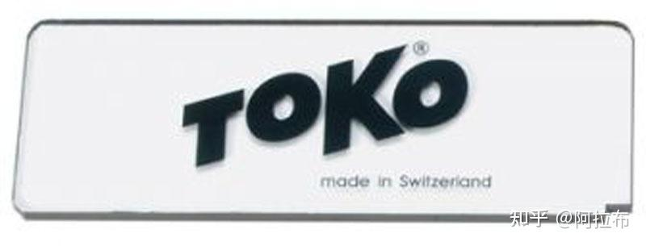

刮蜡之前可以用锉刀修整一下刮蜡板侧面，锋利的边角用起来更有效率。

从板头向板尾刮除表面的雪蜡，直到完全露出板底为止。底刃上的雪蜡可以用刮蜡板上的缺口刮除。

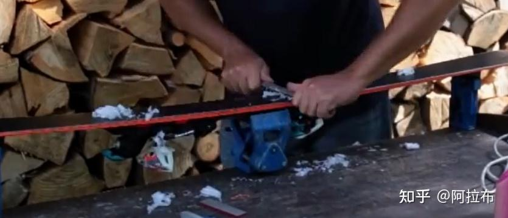

用纤维巾或者抹布清理一下板底，然后用硬刷（钢刷/铜刷/粗尼龙）继续清除板底纹路里的雪蜡，直到板底表面的雪蜡完全去除，这一层蜡的操作就结束了。

如果需要打下一层蜡，用纤维巾或者百洁布清理干净板底，就可以继续打蜡了。如果工作结束，则需要用抛光刷（软尼龙刷、马毛刷、羊毛辊子等）将板底抛光，以达到最佳滑行性能。没有抛光刷时，可以用保洁布代替。

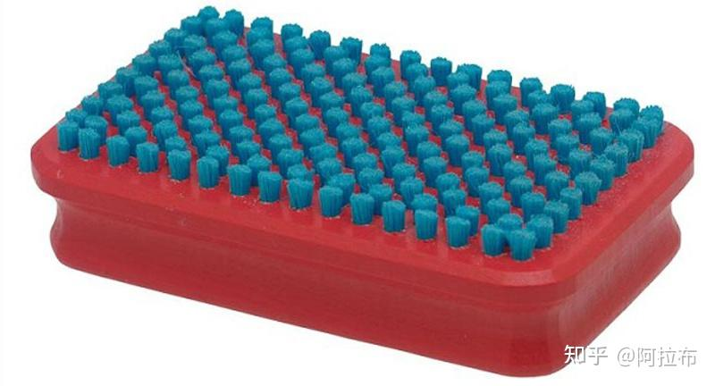

刮蜡工作完成后要清理蜡屑，非常繁琐，因为蜡屑又轻又黏，飘的到处都是，稍微用点力就会黏在物体表面。用吸尘器会稍微好一点，提前用旧床单、废纸板等保护好工作台和地面也会省一些力气。有时候清理蜡屑所用时间比打蜡本身还多。

有一种略微没那么多蜡屑的除蜡方式，是用纤维巾吸除表面多余的蜡。将纤维巾垫在熨斗下面，随熨斗一起移动，速度跟打蜡时接近。如果发现纤维巾已经吸饱，换一个位置或者新的纤维巾。等板底冷却之后，直接用粗刷清除板底多余的蜡即可。当然，如果操作的不好，用粗刷时就会产生很多粉末状蜡屑，所以这种方式还是要熟练后才比较有效。

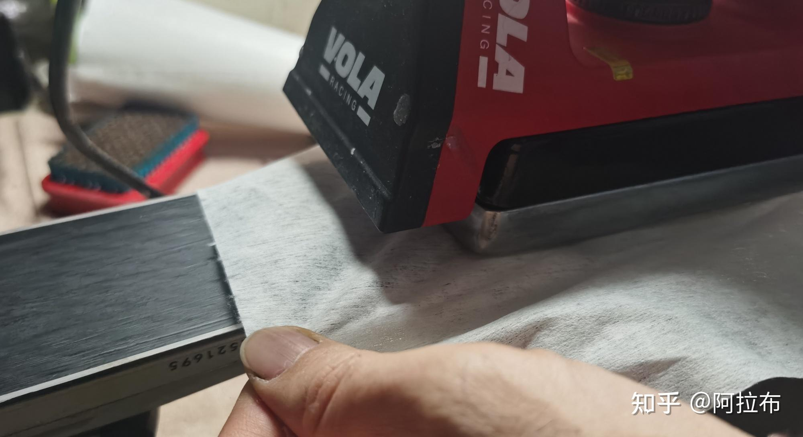

## 减少刮蜡

如果没有刮蜡这个又脏又累又费时（清理环境）的步骤，整个保养过程还是比较享受的，所以尽可能的要避免刮蜡。

避免刮蜡最有效的办法是打蜡尽可能的薄，这样除了重要比赛，都不需要刮蜡。具体的方法包括：

- 上蜡时恰到好处，滴的不多不少。
- 不滴蜡，将蜡融化在熨斗上，然后直接涂抹在板底，不断重复。需要更多时间，并要对温度掌控较好。
- 用蜡纸上蜡。没有蜡纸可以用纤维巾上蜡，但对手法要求较高。

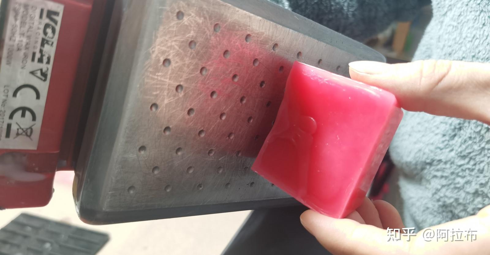

雪板家庭养护系列文章到这里就全部结束了，祝大家滑雪愉快。
