<!-- 来源: https://zhuanlan.zhihu.com/p/514364403 | 分类: 03_装备与器材 | 发布: 2022-05-19 | 赞同: 69 -->

# 如何选择滑雪双板——厂家信息、评测、试滑

今天我们谈一下选择滑雪板的一些具体操作。

选择一副适合自己的雪板，无疑是购买雪板时最重要的原则，毕竟雪板是拿来滑的。购买雪板前，应该明确几个自己的基本需求点：

- 自己的滑雪水平，同时考虑提升速度。当然，水平越好，提升速度就会越慢，而中级水平以下可能提升速度较快而不适合购买雪板。
- 购买雪板的目的，也就是雪板的用途，比如是雪道上练习技术，还是道外娱乐休闲，或者外滑度假一板多用等等。
- 用于购买雪板的预算。如果预算足够，那么有可能购买多块雪板，不必将所有需求压缩在一副板上。完美的配置可能是：大中小三块卡宾板，一块75腰的休闲板，一块90腰的旅行板，一块110腰的粉雪板。

在明确了需求之后，如何选择对应的雪板，就需要获取雪板信息。主要的信息渠道包括：厂家指导信息，第三方评测、朋友推荐、试滑体验。

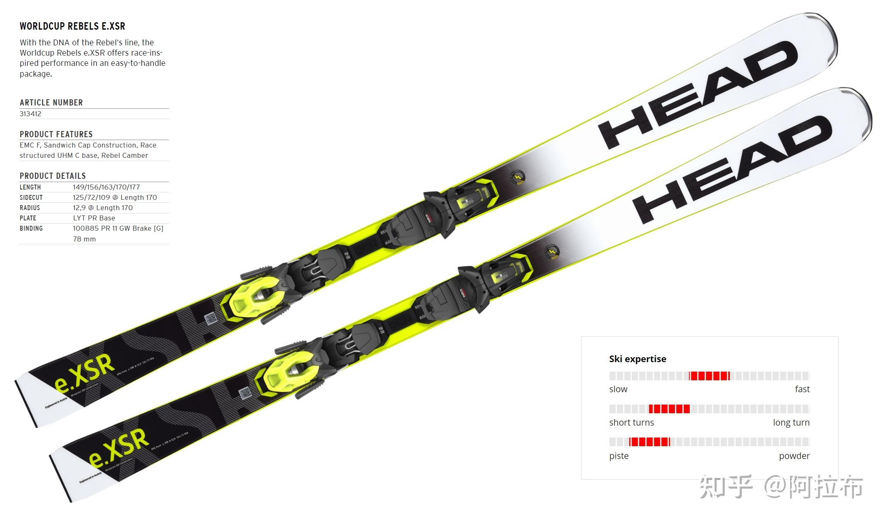

## 厂家指导信息

设计者对产品的理解，通常是最权威的信息。当然产品是否能够满足设计者意图，还需要看使用者的反馈，但总体而言，雪板厂家对产品的描述，是最有参考价值的信息来源。通过全面了解厂家对产品线的设置，能够帮助我们准确理解雪板的定位。

今天以Noridca公司2019年的 文章 （原文） 为例，看看厂家如何指导消费者选购雪板。

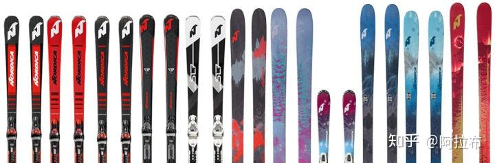

NORDICA DOBERMANN SLR & GSR

> Dobermann SLR 和 GSR 是两款非常通用的高端滑雪专用滑雪板，适合男女朋友使用。 SLR 适合那些喜欢在坚固、平整、压实的雪道上进行高速、高性能小弯滑行的专家，在这些雪道上您确实需要这样的滑雪板来撕裂并抓住雪面。 它的侧切和尺寸与 WC 回转比赛板非常相似。新的 Recoil Power Plate 使过渡非常顺畅，因此您可以更轻松、更自由地更改转弯半径。 Dobermann GSR 专为喜欢在坚硬、光滑、压实的雪道上进行大、中弯滑行的专家而设计。 它的 Recoil Power Plate 可让您在需要时改变转弯形状。

毫无疑问，这是大众顶级滑雪卡宾板，一切为了卡宾，任何卡宾以外的滑行体验不在厂家的关心之内。推荐的水平是专家级，面临进阶的高级滑雪者也可以考虑。

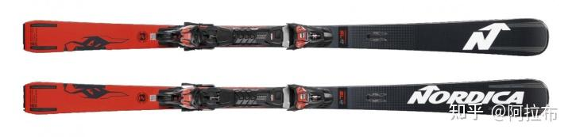

NORDICA SPITFIRE PRO、RB 和 TI

> Dobermann Spitfires 将回转的板头与 GS 板身和尾部结合在一起。其结果是为喜欢在坚固、整齐的斜坡上以中等速度进行中型转弯的男女滑雪者提供了一系列强大而有趣的跨界滑雪板。 72 毫米 Dobermann Spitfire Pro 专为喜欢以中等和中慢速，在坚硬、光滑、机压雪道上卡宾滑行的专家而设计。 Spitfire RB 具有近似的 72 毫米板腰。 较强的结构和 Race Bridge 碳纤维技术让您在坚硬、平整的雪地上以稍高的速度在中等半径转弯时感觉更舒适。 Spitfire Ti 是为较轻、 可能较年长的高级滑雪者寻找更窄、更圆润、更容易实现和要求不高的滑雪板而设计的。比专家级滑雪板低一个档次，用于以中等速度进行中等半径转弯。

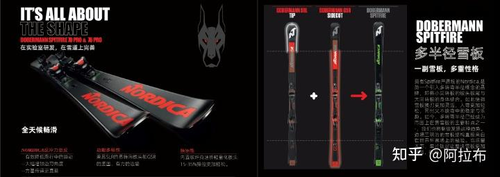

Spitfire原来只是高端雪道板系列，近两年已经涵盖Nordica以雪道滑行为主的所有雪板，产生了较多的派生型号，并取代了全地域偏雪道的GT和Navigator两个系列。目前PRO型有70和76两种板腰，以及搭配了WC固定器的70 PISTON。RB的板腰也扩张到70~80。除了中级的Ti系列，中低端系列 73/75/CA也被纳入其中。入门板与高端雪道板使用同样的名称，大概会拉高一点中低端雪板的身价？效果不好说，但不得不承认涂装还是很漂亮的。

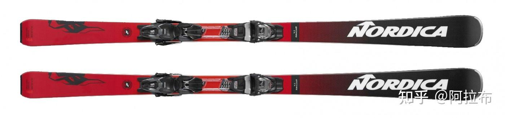

*Nodrica Spitfire CA FDT，板腰71的中半径中级板*

窄腰全地域板的性能局限性在4年前我的第一篇雪板选择文章中就有提及，目前各厂家的普遍趋势也在削减这部分产品。Nordica在21/22雪季干脆取消了GT和Navigator两个系列，将相应功能的雪板归入Spitfire和Enforce系列中，也使得消费者的选择更加简单。

Sentras Family

> Nordica Sentras 专为喜欢在平滑的雪道上滑雪的女性而设计。 Sentra SL 7 Ti 是 Nordica 性能最高的 女子滑雪板。两块完整的金属板和一个轻木芯使其成为轻巧但非常强大的、严肃的tip-it和grip-it滑雪板。 Sentra S 6 稍微轻松一些，但仍然具有出色的短转弯感觉。 它可以在平滑、整齐的斜坡上处理高速转弯，但不需要您全神贯注于从每一次转弯中获得最大能量。 更柔软、更宽容的 Sentra S 5 适用于高级中级滑雪者和喜欢中速或中速滑雪的专家。 Sentra S 4 更加宽容。

这里可以看到产品系列的典型分布，型号从高到低代表了滑行能力，以及背后的价格。有时候我们难以判断厂家直接近似产品的优劣时，可以参考一下它们的挂牌价和实际售价，或者说价格梯次，就很容易判断其定位。

在21/22雪季，Nordica将Sentra系列替换为全新Belle和Wild Belle系列，采用了创造性的双木芯技术，降低雪板中心厚度2mm，并缩短了垫板长度。Nordica对新Belle的评价是“事半功倍（More Power with Less Effort）”。

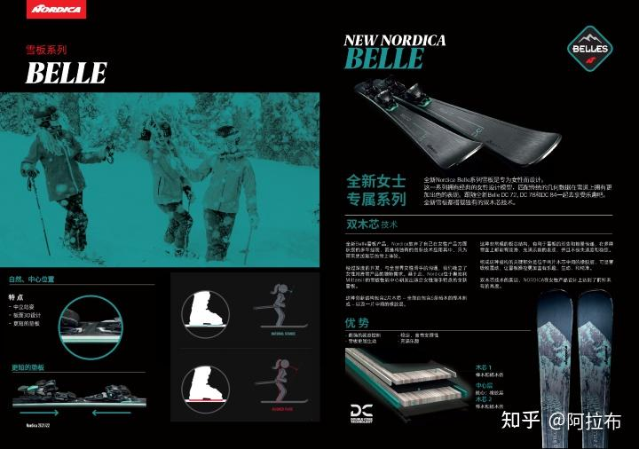

很多厂家都会有专门的女性雪板系列，这是因为女性具有相对更低的重心和更大的Q角。一些权威的评测也证实了女性在专门调整过的雪板上滑行，会更加轻松愉悦。但对于高表现滑行，恐怕女性雪板的设计不会有什么帮助。

Enforcer（男性）和 Santa Ana（女性）

> Enforcer（男性）和 Santa Ana（女性）Freeskis 专为没有限制或界限的专业滑雪者打造。它们的全木芯、双钛板、加长的侧切和 Sharknose 尖端专为稳定性和速度而设计。Santa Anas 使用 Nordica 革命性的轻量级 Balsa 技术结构。 作为Nordica 最宽的滑雪板， Enforcer Pro 拥有我们制造的所有滑雪板中最多的头部和尾部Rocker。它仅提供 191 厘米的长度，适合寻找那些深天和长滑道的滑雪者。 Enforcer 和 Santa Ana 110 在柔软的 雪地上感觉最自在。粉雪Rocker使它们易于在树林、雪包和雪泥中操纵。延长的侧切让他们在通过粉雪、碎雪和雪泥时保持平稳。 Enforcer 和 Santa Ana 100 是 Nordica 最通用的全地形、全条件滑雪板。 它们非常适合在粉雪和雪道上使用，适合喜欢在任何情况下高速进行中弯滑行的专家。 Enforcer 和 Santa Ana 93 与 100 具有相同的特性，但由于它们稍窄一些，因此它们适用于将时间平均分配在雪道和道外的专家。

目前Enforcer/Santa Ana 系列在低端扩展到了88/84板腰，以补充取消GT和Navigator后的空缺。道外板是最依赖于滑行目的地的雪板，目的地的粉雪越厚，就需要越宽的板腰。当然，驾驭这样的雪板，也需要更好的技术。所以，想要玩爽？先下功夫吧。

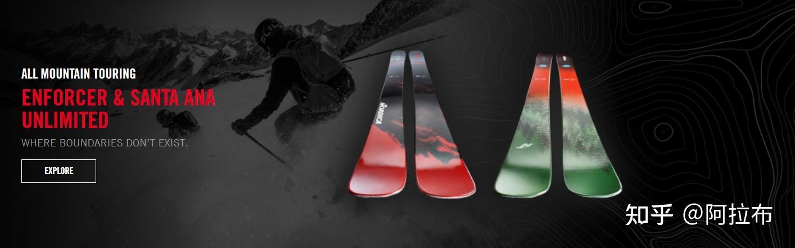

## 雪板评测

每年都会有大量的雪板评测报告（包括购买指导Buyer's Guide和媒体大奖Media Awards等）。这些评测报告可能会一定程度上影响消费者的决策，比如被挑选为“最佳编辑奖”的雪板可能会提升一些销量，但我认为评测的最大作用，还是引导消费者认识更多的优秀产品，从而引发更深入的探究和了解。

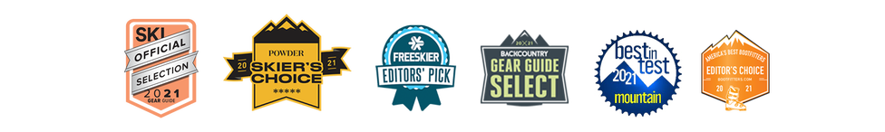

必须明白一点，并不是所有的评测都有参考价值。有一些评测只是将产品参数和特点罗列出来（我经常这样做），进行书面的比较，这种评测就是简单的带大家更多和更广的认识产品。而更加深入的评测，则是通过专业人员试滑之后对雪板进行评价或者打分，比如Neveitalia，SkiMag等。后者看似更加有效，但其中有个很重要的隐含要求，就是 评测人员的滑行能力必须要高于雪板要求 ，否则，根本没有能力发挥出雪板的特性，评测就毫无意义。所以，对于任何滑行测试，首先我们应该关注一下测试员的水平。像中级滑雪者评价高级雪板这种事，最好就别浪费自己时间了。

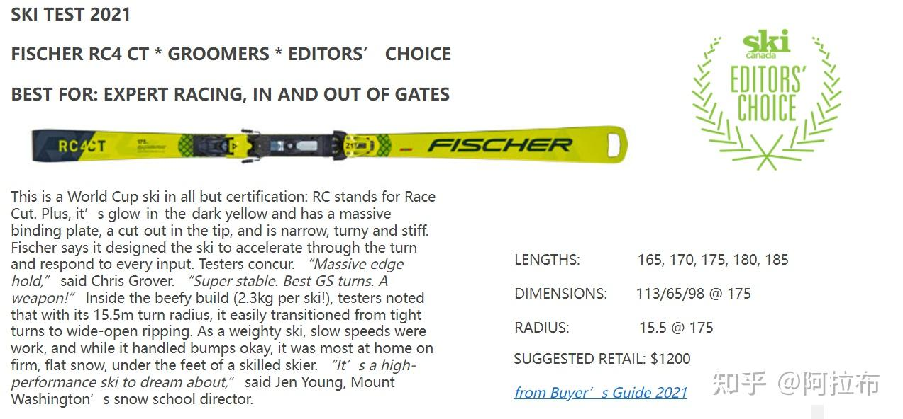

*标注测试员的评测会相对更可靠*

即使是滑行专家进行的评测，读懂这些报告可能也需要一些技巧。因为评测方作为商业机构，与雪板厂家也存在合作关系，评测报告通常只会对产品的优点大书特书，而缺陷或者不足就比较委婉，或者干脆隐匿不谈。这时候，就要从评测报告的词句背后分析分析他们的真实含义。

比如在一个对比4种小回转板的评价中，我们可以试着解读一下推荐语后面的潜台词。

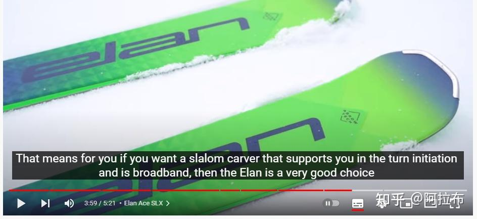

> 如果想要一块容易入弯和更多用途的回转卡宾板，Elan是个好选择

——这块板的板头比较软，板身硬度不错。

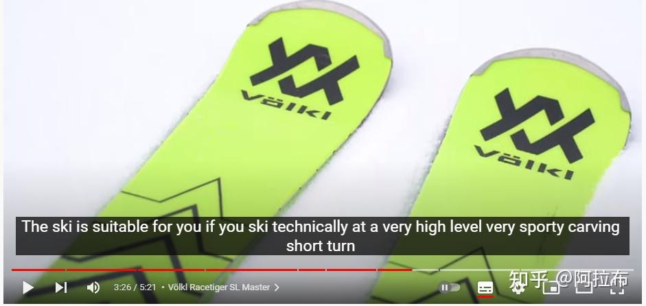

> 这块板适合非常高水平的滑雪者进行非常运动的卡宾小弯

——个性很强，宽容度小

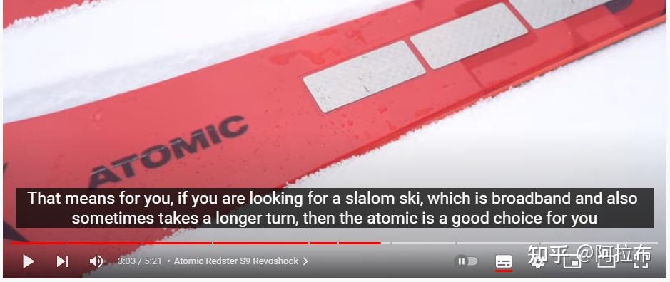

> 如果需要多用途和经常进行大弯的小回转卡宾板，Atomic是好选择

——硬，非常硬

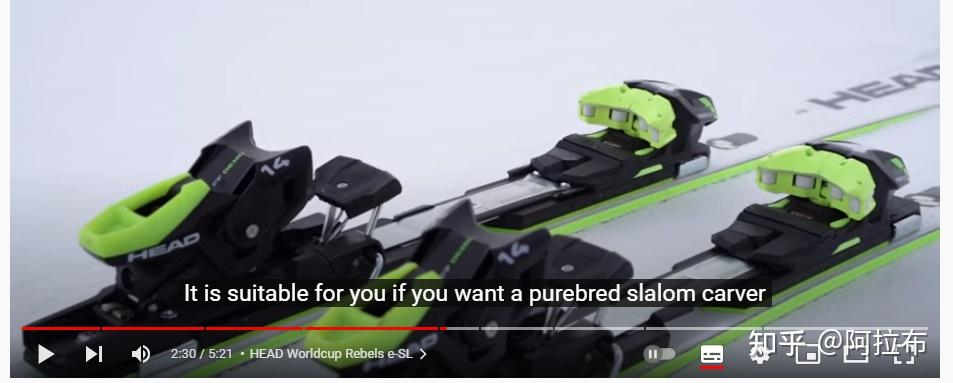

> 适合纯粹的卡宾小弯

——这块板真没特点

## 试滑体验

在购买前试滑是了解雪板是否适合的最好途径。

朋友们的雪板可能是相对方便的一个试滑来源。厂家和雪具代理商也会经常在雪场举行推广活动，有可能提供免费试滑的雪板，无疑这是最经济的方式，关注雪场、厂家、代理的公众号，或者加入一些雪圈，以便及时了解到活动信息。不少雪具店提供收费试滑项目，不过好的店家会在购买时扣除试滑的费用。还有一种方式是高端雪具租赁，价格大概是普通租赁的2~3倍或者更高，可能比较贵，但是会有更多的时间来了解心仪的雪板。

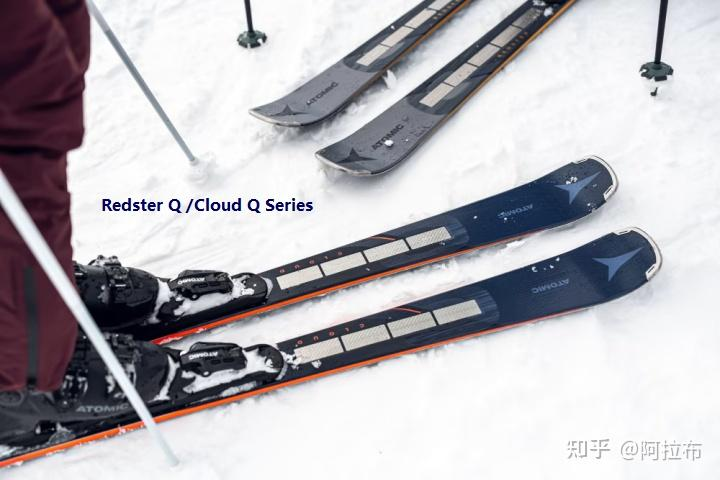

排除维护状态干扰

对于很少参与厂家试滑的雪友来说，有件很重要的事情必须提前说明： 必须排除雪板维护方面的干扰 。很多人用惯了雪场租赁板、以及自己的老涩滑雪板，去试滑的第一感觉就是真好滑！抓地稳，滑行流畅，速度快！太舒服了，买买买！其实这不是雪板本身有多好，而是因为板刃修得好，板底雪蜡打得好。

排除这种干扰的办法，一种是多试几块板，找出他们之间不同，而不是跟自己之前的雪板比较；还有一种是先滑一天保养得当的雪板，适应一下这种感觉。

了解雪板的结构特性

结构特性是指雪板的三维、尺寸、硬度等带来的固有滑行体验，也就是说具备这种结构特点的雪板都会有这种体验。了解这些结构特性，有助于在试滑时正确地理解滑行感受，尤其是避免因不合理的期望而产生不准确的评价。

常见的结构特性包括：

- 越长的雪板滑行越稳定。越短的雪板滑行越灵活。但2~3CM的差别通常不会有明显感觉。
- 越窄的雪板立刃越快越容易。注意不是越快越好，身体跟不上雪板立刃的速度就会出问题。
- 垫板固定器比滑轨固定器更高，所以高级滑行时立刃更快，抓地更稳定；另外，垫板通常也更硬。
- 雪板的转弯半径只对卡宾有明显影响，以及中级以下的搓雪转弯。
- 越硬的雪板在大中弯卡宾时越稳，但卡宾小弯越难。
- 越硬的雪板越重，反过来也基本成立。所以感觉越重的雪板越稳，是因为上一条，更硬。
- 越硬的雪板反弹越明显，是因为硬雪板能够很好的传递力量。
- 越软的滑雪板会越多的吸收力量，也因此能在颠簸雪面获得更好的脚感。
- 上翘Rocker越多，粉雪中的浮力越好，在雪道上的搓雪转弯也会更容易，但是卡宾时会减少抓地力。

如何测试雪板

以下是来自Nordica的专家建议。

> 使用相同的地形来测试每个滑雪板。首先在适度、平整的地形上寻找滑雪板的最佳位置。然后试着加速，逐步尝试各种节奏。改变转弯的大小、弯形、速度、陡度和雪况，您要寻找的是能让您在冰板、雪包、平整的滑道和新鲜的粉雪中更好地滑行的产品。 现代雪板的反曲Camber和上翘Rocker变化会改变滑雪板的最佳长度。如果感觉雪板迟钝或太强势，请尝试较短的长度。如果感觉滑行不太一致、轻浮或不稳定，那就换更长的型号。 有些人尝试了很多滑雪板，结果忘记了自己喜欢和不喜欢的东西。当心可选择的内容太多，必要时每次试滑留下笔记。通过查看笔记，可以让自己的选择更加清晰。 如果雪板让您比以往任何时候都更好地滑雪，帮助您轻松驯服困难的地形，并让您感觉精力充沛，那么它可能就是适合您的滑雪板。如果您打算提高自己的水平，请选择在您挑战极限时有活力的滑雪板。如果两个滑雪板看起来同样出色，那么选择更好看的一个 ：）。

说到这里，有个题外话，22/23雪季多个大厂的雪板颜值全面崩溃，大家要有心理准备哦。【全文完】

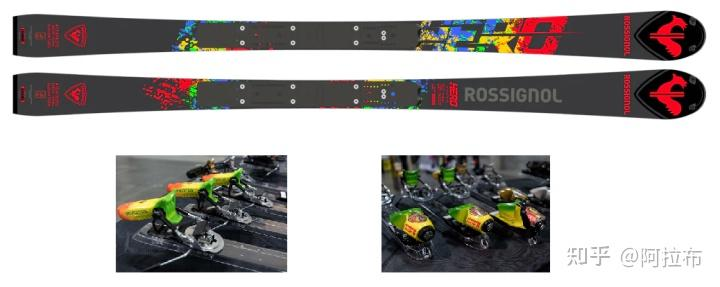
