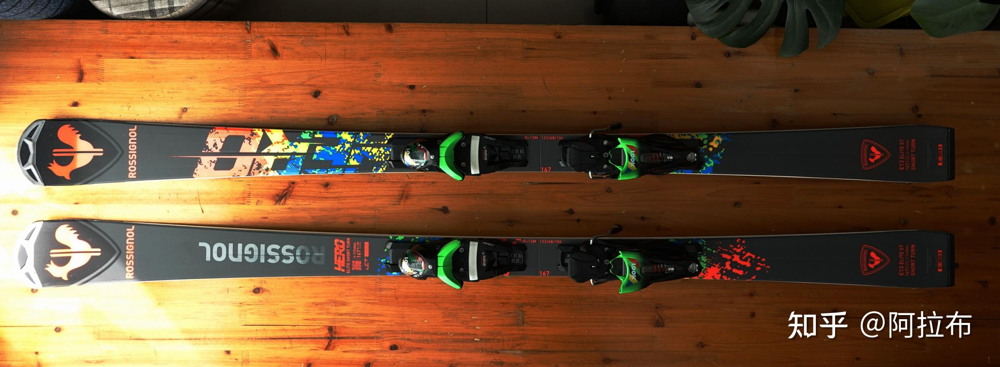
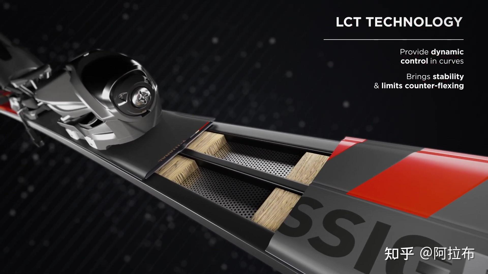
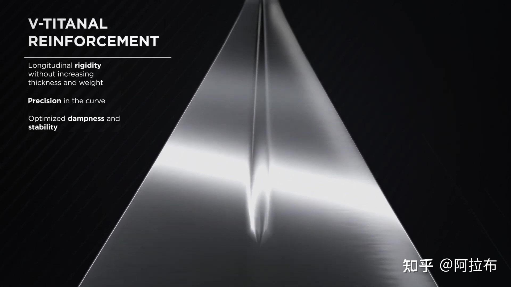
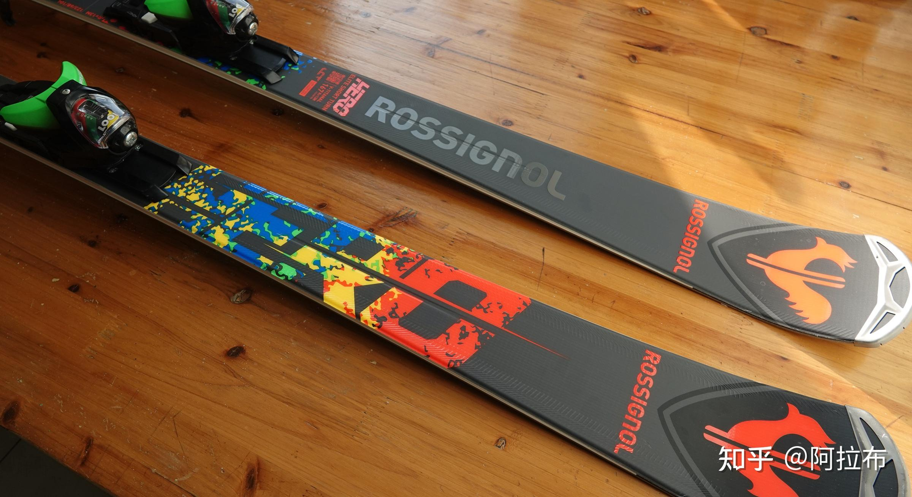
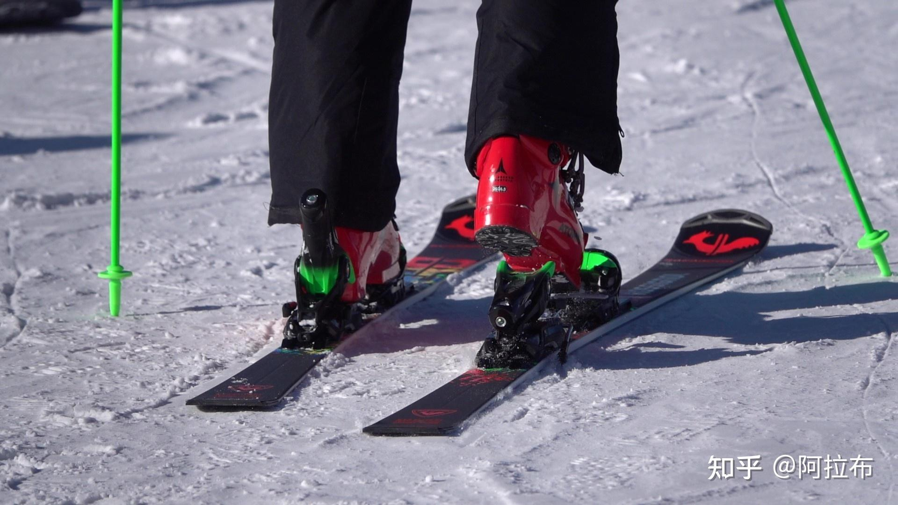
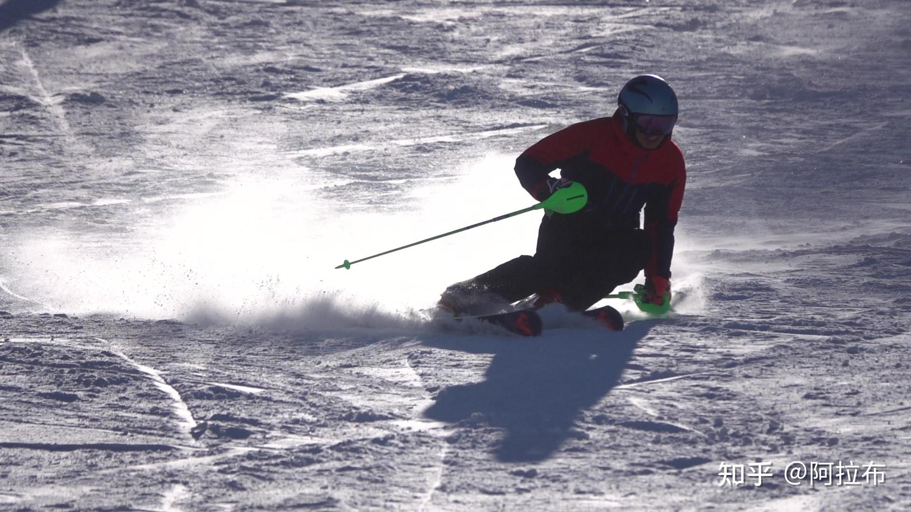
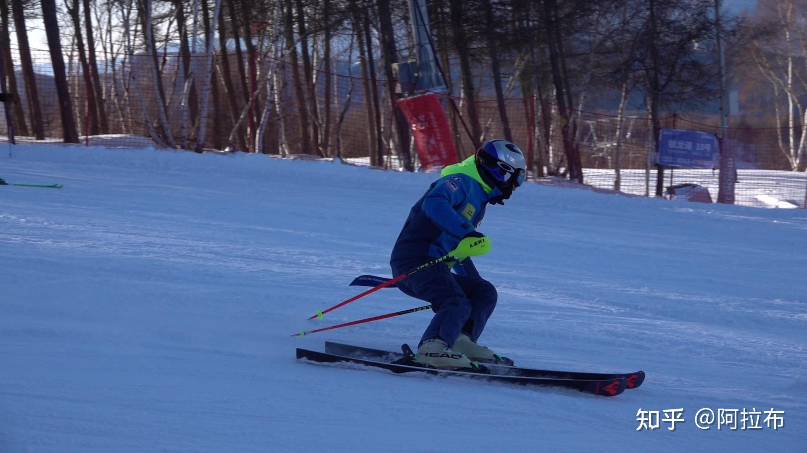
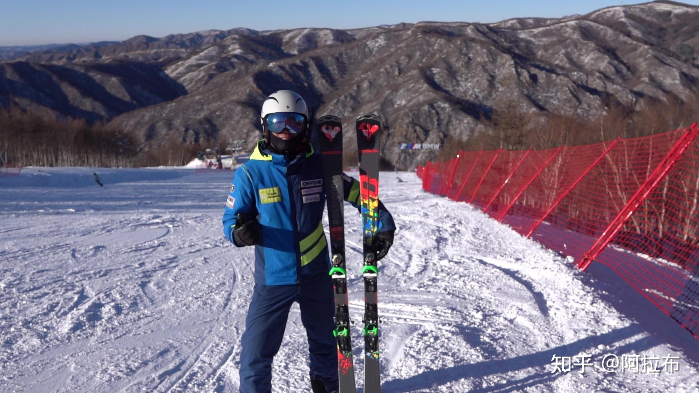

<!-- 来源: https://zhuanlan.zhihu.com/p/669580623 | 分类: 03_装备与器材 | 发布: 2023-11-30 | 赞同: 11 -->

# 【雪板测评】Rossignol Hero Elite ST Ti Limited Edition 2023

> 原文：[知乎 · 阿拉布](https://zhuanlan.zhihu.com/p/669580623)　·　发布于 2023-11-30　·　本文仅供学习交流，版权归原作者所有

ROSSIGNOL卢西诺Hero Elite ST TI 限量版 滑雪板是一款大师级竞技回转板/卡宾小弯板，也就是国人通常所说的“民顶小回板”，在ROSSIGNOL卢西诺产品线中，它的位置仅在专业竞技回转板Hero Athlete FIS SL和Hero Master ST之下，是毫无疑问的民用顶级（小）回转雪板。

Hero Elite ST采用逼近专业竞技水平的68mm极窄板腰设计，结合123mm超大板头，能够极快的立刃和入弯，适合非常激进的高水平滑行。167板长对应的侧切半径是13米，在高手脚下可以轻松转出小到6米半径的卡宾小弯。雪板采用LCT和V-Titanal双重技术抑制颤振，防抖和稳定性更加出色。

LCT（Line Control Technology）是ROSSIGNOL已经使用多年的独创技术，它在雪板的山毛榉木芯中间嵌入一根纵向金属条，极大加强了雪板在转弯时的动态控制，提升稳定性，并限制反向弯曲（抑制颤振）。

V-Titanal是ROSSIGNOL刚刚开发出来的雪板增强技术，在钛金属层的中间制造一条V型槽，从而强化钛金属层的抗弯能力，在不增加厚度和重量的条件下提升了雪板硬度，带来更加精准的转弯能力，和更优化的抗振与稳定性。

ROSSIGNOL卢西诺Hero Elite ST TI限量版采用深底色和HERO图案数字彩绘，低调的同时又彰显法国风情式的美丽，在当下以大片纯色为主流的雪板涂装中一直保持着自己的特色。表面层硬化Premium Hardtop技术提供了不折不扣的顶层耐用性和图形丰富性，以保护和延长滑雪板的使用寿命。也正是这个技术，保证了ROSSIGNOL敢于延续其色彩绚丽的涂装风格。本次评测的冬奥限定版是在普通限量版的基础上更换了Green Icon固定器，整体更加活泼。

整体而言，Hero Elite ST TI设计精良，外观漂亮，板面立体结构极大提升了雪板质感。整副雪板重量为6.4公斤，同级中略偏重，因此会有更加沉稳的表现。Hero Elite ST TI的实际硬度略低，增加了滑行的容易度，是一款对技术和身体条件不太挑剔的滑雪板，对大多数人都比较友好。

在崇礼太舞和万龙滑雪场的实际测试中，Hero Elite ST TI表现非常优异。平稳柔和的特性，使得这块雪板在任何雪况下都易于操控，而在较好的雪面上有令人惊喜的出色表现。测试在偏陡的中级道进行，部分雪面较好但夹杂大量浮雪，并有少量小块冰面。作为民用顶级回转竞技板，除去少量搓雪小弯，主要滑行为卡宾小弯和中弯，最高滑行速度约60KMPH。Hero Elite ST TI在大部分滑行中能够准确完成动作，操作灵敏，反馈及时，取得了令人满意的效果。

滑手测评Hero Elite ST TI的感受是反弹充分，甚至接近或高于某些FIS回转板，但比较好操控，比较自如；上限比较高，良好的条件下有非常优秀的表现，能够完成极致的滑行；对于比较艰难的雪况，需要更多的注意自己的滑行动作，如重心控制等。

总体而言，Hero Elite ST TI是一款相当友好的高端滑雪板，不但适用于高级和专家级滑雪者，中级和力量较差的人使用它也不会非常难受。在适宜的雪况下，Hero Elite ST TI完全可以爆发出值得信赖的高端表现力，是名副其实的民用顶级回转板。
