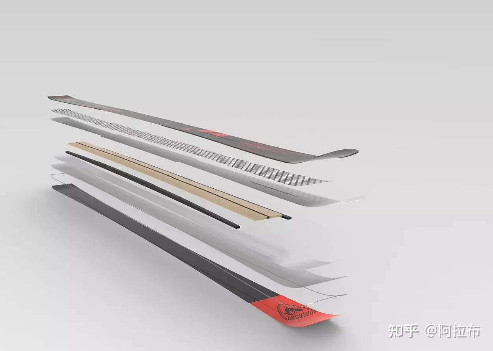
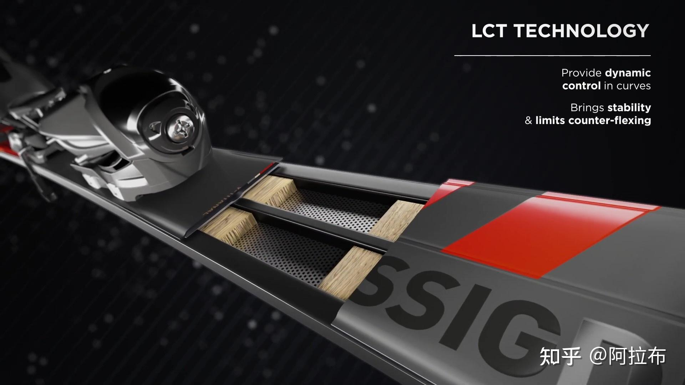
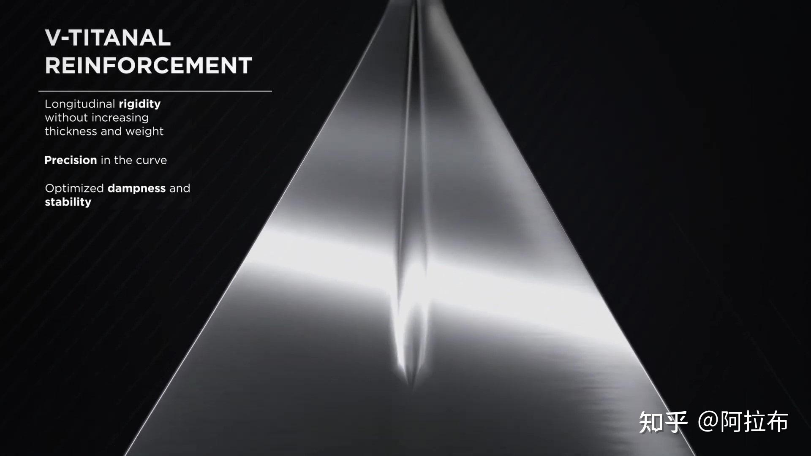
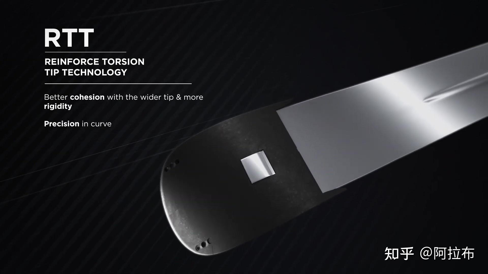
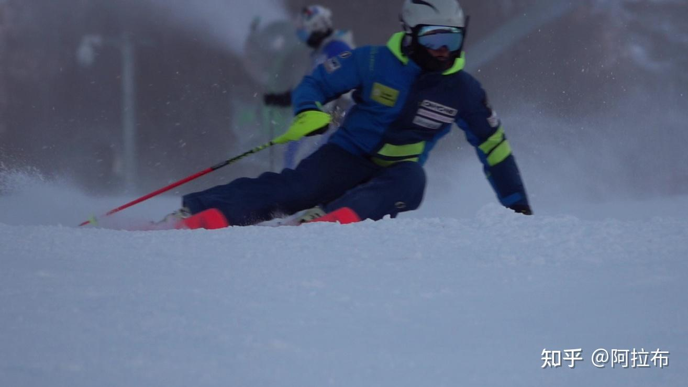
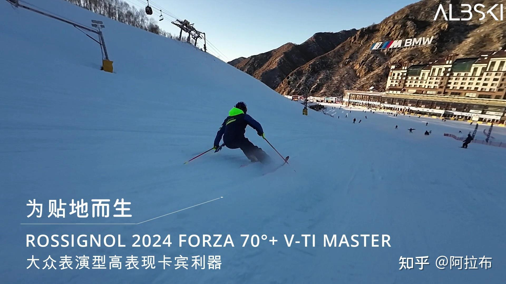

<!-- 来源: https://zhuanlan.zhihu.com/p/671016733 | 分类: 03_装备与器材 | 发布: 2023-12-07 | 赞同: 6 -->

# 【雪板测评】为贴地而生 Rossignol Forza 70°+ V-Ti Master 2024

作为Rossignol 2024 新雪道板Forza系列的旗舰产品，Forza 70°+由Forza 70° V-TI板身和Master系列所使用的SPX 14竞技垫板固定器组合而成。版面涂装虽然低调，但是靓丽的板底十分扎眼。

雪板采用Rossignol全部顶级技术，除了Hero Elite系列的LCT和V-Titanal外，还新增RTT增强型抗扭板头设计。

LCT（Line Control Technology）是ROSSIGNOL已经使用多年的独创性世界杯技术，它在雪板的山毛榉木芯中间嵌入一根纵向金属条，利用纯粹的动力和能量，极大加强了雪板在转弯时的动态控制，在所有条件下提供流畅的稳定性。LCT 具有从尖端到尾部集成的中央“动力导轨”，消除了滑雪板的反向弯曲，以确保始终如一的平稳性和线路的动态控制。

V-Titanal是ROSSIGNOL刚刚开发出来的雪板增强技术，在钛金属层的中间制造一条V型槽，从而强化钛金属层的抗弯能力，在不增加厚度和重量的条件下提升了雪板硬度，带来更加精准的转弯能力，以便在崎岖的条件下保持正确的路线。全新V-TITANAL涂层的“V”形设计带来了完美的滑雪平衡，钛合金层压板优化了潮湿度和稳定性。此外，沿板材的凹槽确保了更硬的纵向弯曲。冲压会产生机械各向异性的现象，从而带来更优化的抗振与稳定性。

RTT（Reinforced Torsion Tip）增强型抗扭板头设计是一种专门针对新型现代滑雪板的超宽板头进行调整和尺寸设计的技术，它允许实现极宽的板头。事实上，对于大于或等于 130 毫米的板头宽度，为了保持精度和完全啮合，我们必须加强滑雪板前部的横向变形。通过在板头内部嵌入特殊“领带”形状的钛金属层，实现了更好的内聚力和动力传输。

从命名就可以看出来，这是一款为70°以上立刃的极限滑行为目的专家级高端雪板，但78宽的板腰并不适合竞技滑行，因此这款雪板的目标是大众表演型的贴地滑行。三维数据136-78-112，对应163/173/181板长的侧切半径为13/14/15米，属于中弯卡宾板，选取长度应以略低于身高为准。雪板硬度仅仅略低于民用顶级竞技回转板，配合更长的有效边刃长度，处理高速高表现滑行时得心应手，并且舒服度非常好。

相对66-68mm的窄腰竞技板，78mm超宽板腰大大增加了入弯时机和动作的容错性，滑行者有更多的时间去完成高角度立刃并建立平衡，滑行更从容，表现力也更强。在初次试滑时我们发现，Forza 70°+很容易做出比以往更高的立刃，因此需要对内腿做更多控制，否则容易出现两腿不同步的小问题。这也说明了Forza 70°+的设计使得大众表演型贴地卡宾变得更简单，完全符合它“为贴地而生”的使命。
