<!-- 来源: https://zhuanlan.zhihu.com/p/717578594 | 分类: 03_装备与器材 | 发布: 2024-09-03 | 赞同: 5 -->

# ICON固定器：前世今生

一句话版：Atomic/Salomon ICON 系列固定器与Marker的Comp和Xcomp系列固定器完全兼容，两豪门十年纠葛迎来大团圆结局~

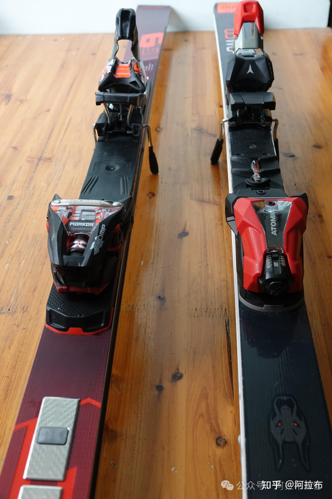

## 2001 开始于尚未开始

早在01/02雪季，Marker推出包含活塞的固定器系统：Piston Control plate/system/interface，最早可查证的型号为 Comp 1400 Piston Control 和 Titanium 1300 Piston Control 。

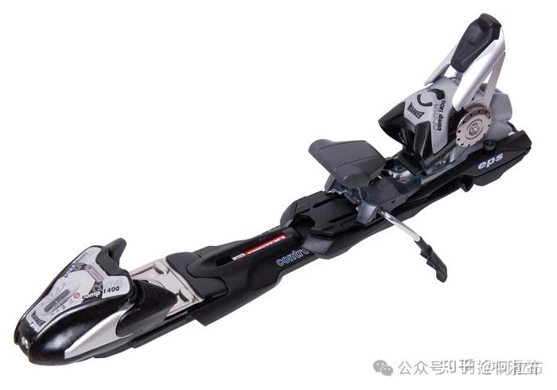

活塞设置在固定器垫板中间部位，可抑制滑雪板主动弯曲后的快速回弹或反弯曲期间发生的振动，从而实现高能量转弯之间如黄油般平滑且可预测的过渡。Comshock活塞还能够吸收高冲击滑雪中遇到的快速震颤——如硬着陆或高速通过烂雪时——有助于避免意外释放。

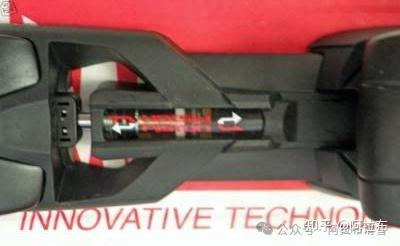

2007年，Marker Comp 30.0 EPS将世界杯竞技固定器的最大释放值增加至30，远远超过其他厂家18左右的极限，引起一片哗然。（腿掉了固定器也不会脱落？）

## 2014 Marker被装在Atomic雪板上取得世界杯金牌！

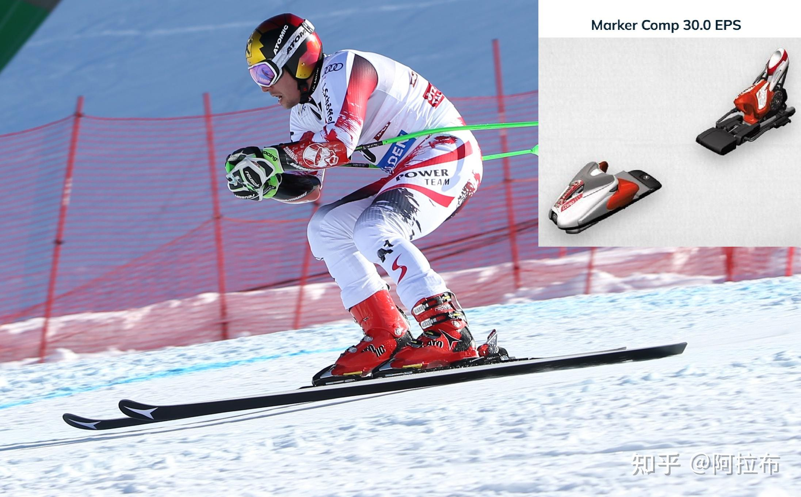

2014年10月26日的世界杯Soelden开幕赛上，Marcel Hirscher 使用了一幅装有Marker Comp 30.0 EPS的Atomic雪板取得胜利。据报道，Hirscher对Atomic原配固定器的性能有顾虑，在得到设备供应商的允许后，他将固定器系统更换为脱离值更高的Marker，以避免在不稳定条件下的意外释放（以及取得其他优势?）。尽管赛后无论是Hirscher还是Atomic官方都在淡化这一装备变化，但是Marker Comp 30.0 EPS成为世界杯比赛中的无敌存在。

## 2017 另类活塞Servotec问世

Comshock活塞有没有用？很多人认为这只不过是个噱头，但是Marker和Atomic不这么想，前者十余年来坚持在高端固定器系统中使用活塞，后者则利用Comshock活塞的原理，在2017年推出了红极一时的Servotec创新技术。

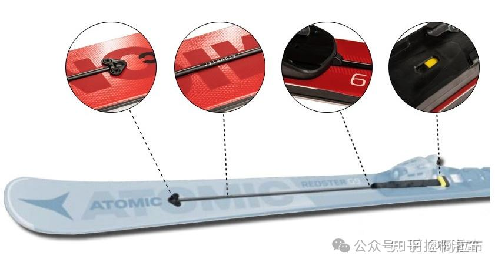

Servotec 这个词本身来自德语“Servolenkung”，意为转向辅助。同样是利用阻尼进行减震和压制反弹，Servotec 使用橡胶弹性模块代替了复杂的阻尼活塞结构。通过拉杆将前控制点从固定器前端大幅前移到了板头位置，原理上可获得更高效的控制效果。

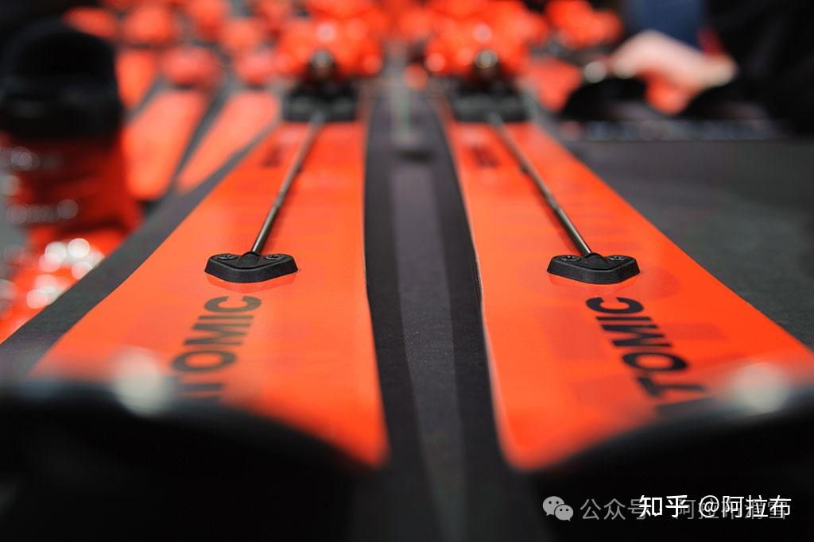

尽管Servotec存在容易受损、装配误差大等缺点，但是这一设计仍广为滑雪者喜爱。能否提高转向的精度和速度？能否在高速下完美地抑制有害振动？答案并不重要，哪怕仅仅是作为一种优雅的装饰，也足够获得雪板痴汉们的青睐。所以在21年推出新的替换技术Revoshock（Atomic版的UVO 3D）后，Atomic仍旧延续生产使用Servotec的高端产品直到22/23雪季。

## 2019 换壳Marker固定器？

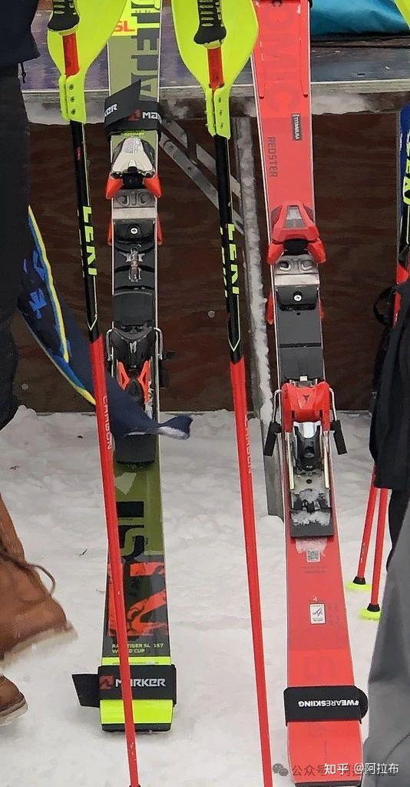

2019年冬天，大量的换壳版Marker固定器出现在Atomic世界杯雪板上，Marcel Hirscher和Mikaela Shiffrin等顶级赛手都在使用这些特制固定器。

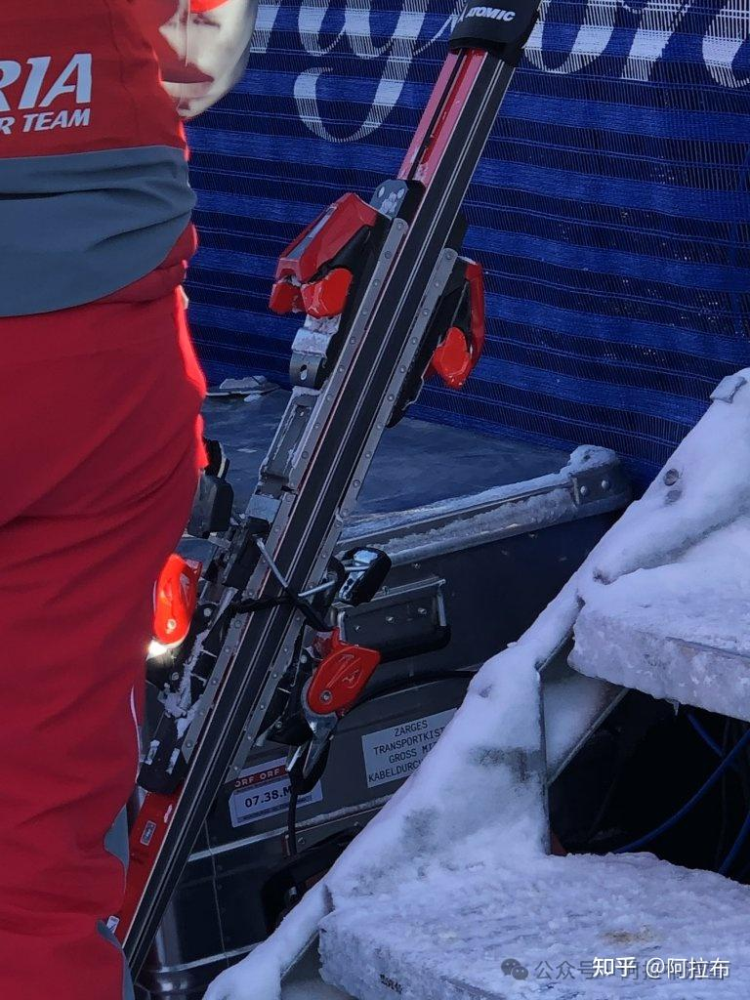

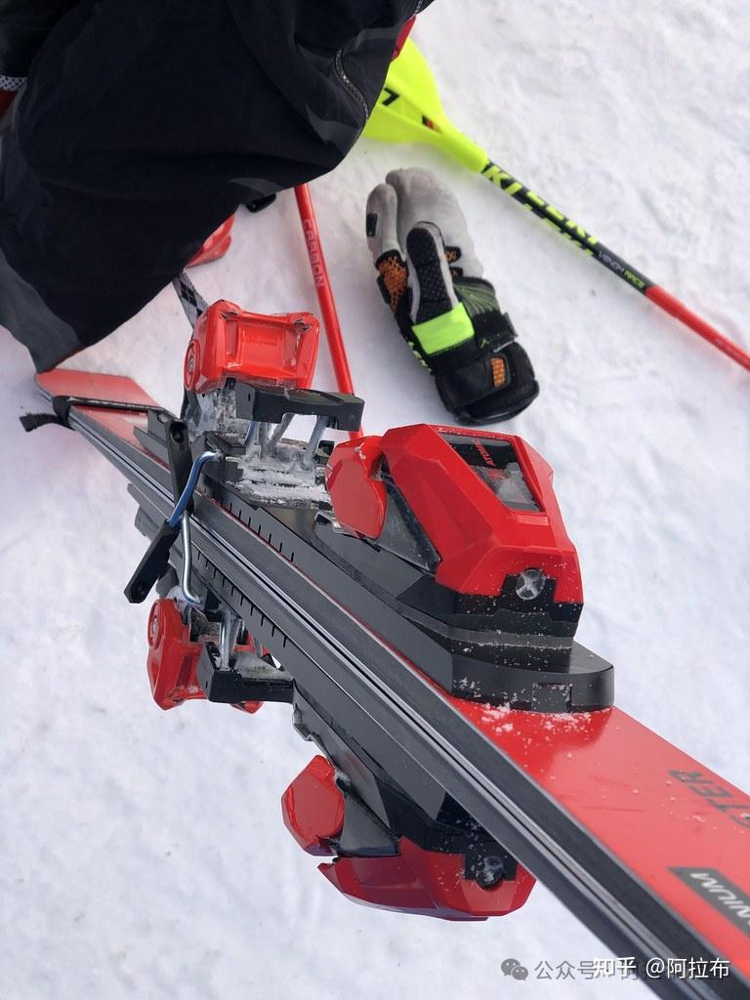

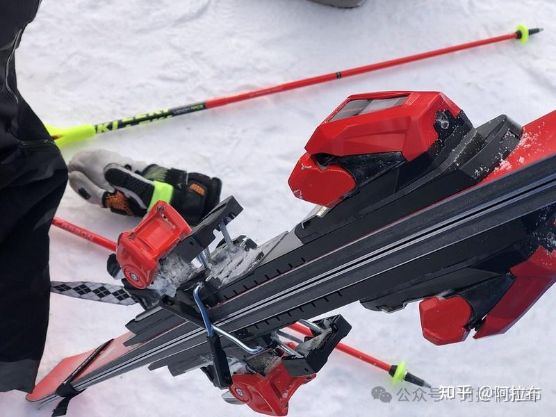

据称，Marker的专利过期后，Atomic/Salomon试图在此基础上制作自己的固定器，但没有成功。于是Atomic/Salomon搜集了大量可用的二手Marker固定器，简单更换塑料外壳后装在自家雪板上。

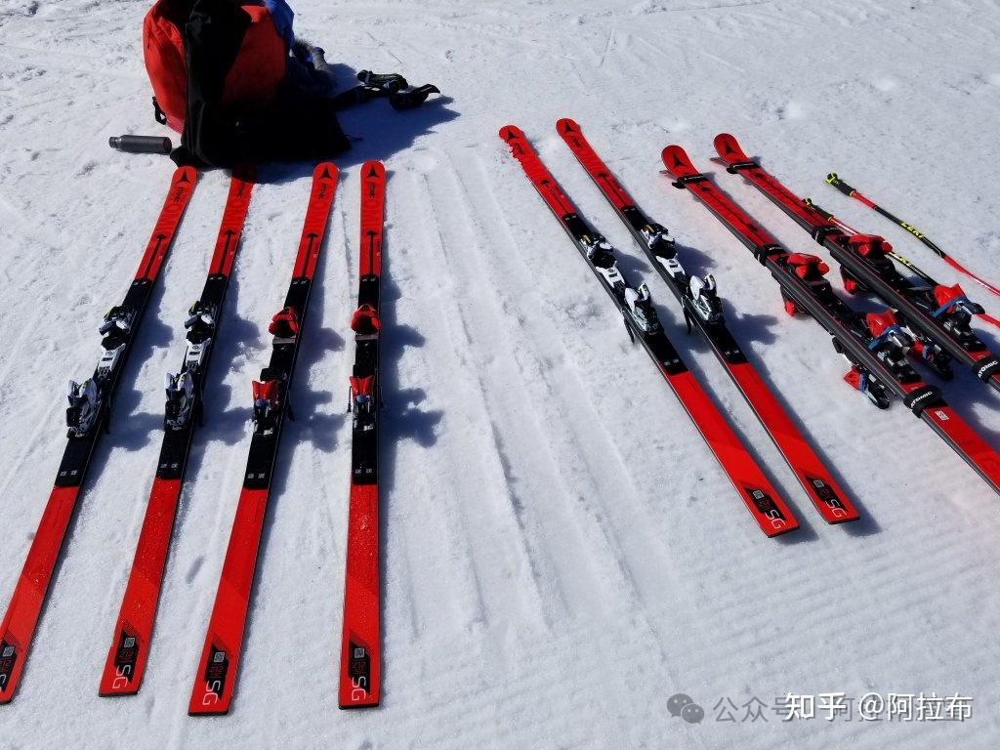

上图Mikaela Shiffrin的新雪板有一部分也安装了换壳的Marker固定器，但有可能这些固定器仅仅是用于测试。有一些讨论提到，采用三颗螺丝安装前固定器，比四颗安装螺丝的形式能够更好传递力量，Amotic很可能需要顶级运动员来验证这些观点。

## 2022 ICON固定器问世

从20/21雪季开始，ICON WC24/30固定器已经开始供应给Atomic签约运动员，但是正式发布要等到21/22雪季。新固定器的外形仍然酷似换壳版Marker Comp 30.0 ESP，安装孔位则与Xcomp系列完全兼容。

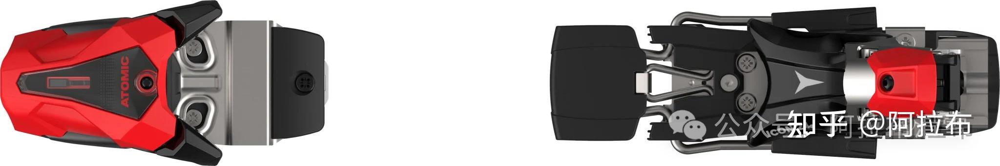

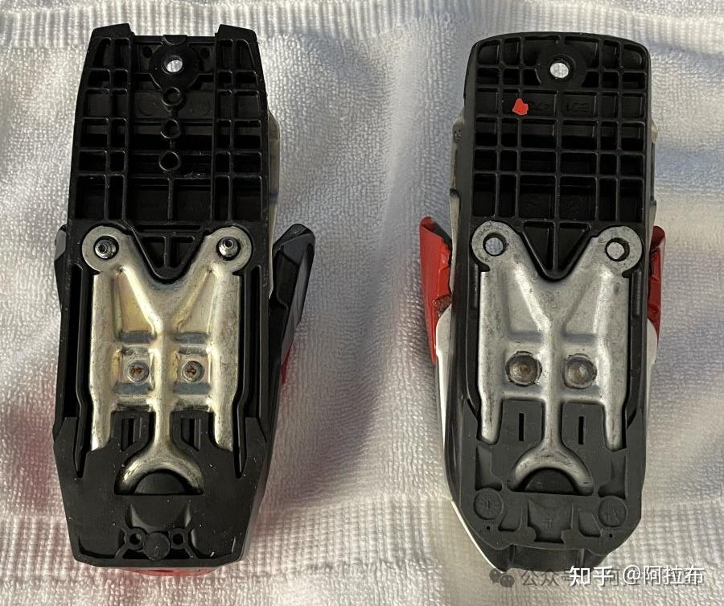

相应的垫板也更换为Icon Interface，安装螺丝采用前三后四的配置。固定器垫板为整体式，用八颗螺丝安装在雪板上。但是与原始的Marker设计不同，Atomic在逐年的测试中不断进行了简化和调整。

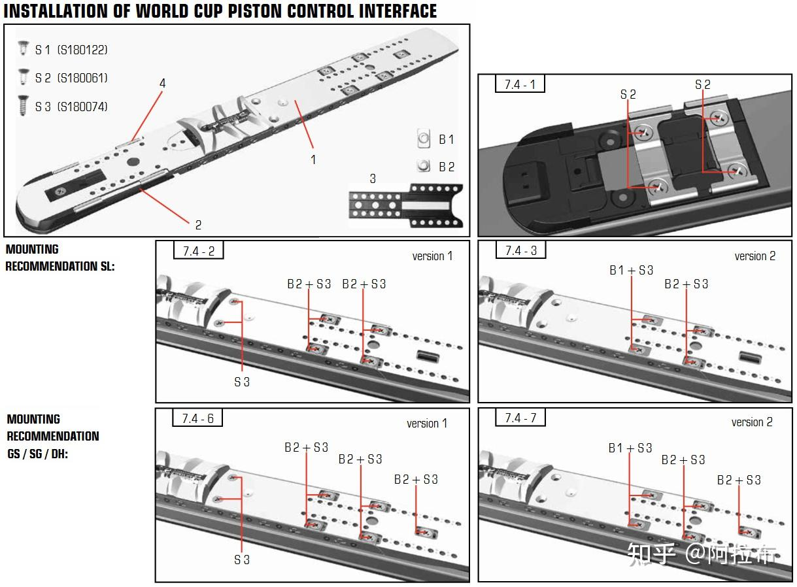

上面是Marker的Piston Control Interface，它提供多个可选安装方式，前段采用滑轨的形式，后段有7个螺丝孔，可以配置为2固定+2/3/4/5滑动螺丝，一共四种安装方式。

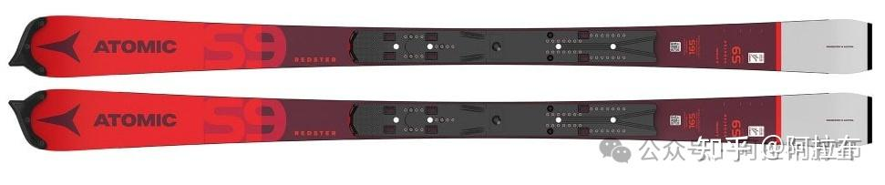

ICON固定器正式发布的22/23版本取消了前部的滑轨，只有两颗固定螺丝安装在雪板上，其余六颗采用滑动安装的形式。这种方式更适合变形比较大的GS等雪板。

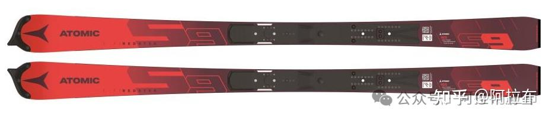

在随后的23/24雪季，也就是ICON固定器真正进入大众视野的年度，ICON垫板在SL雪板上的安装形式部分回归原始设计，前端仿照Marker采用了滑轨。后端四颗螺丝则全部固定，对于后端弯曲程度相对小一点的SL雪板，这样设计也是可行的。

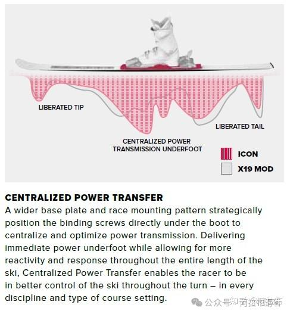

ICON固定器系统将螺丝直接放置在脚底部位，使力量传递更加集中，更加优化。这一集中动力传输技术（Centralized Power Transfer）为脚下传递即时动力的同时，在整个滑雪板长度上提供更多的反应和响应，使滑手能够在整个转弯过程中更好地控制滑雪板 。

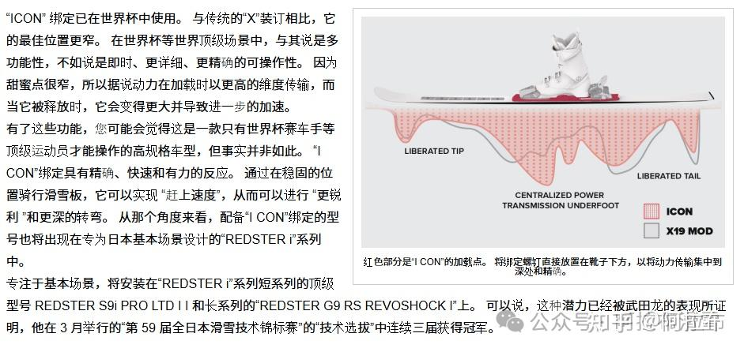

不过日本同行有更多的解读，他们关注于更窄的最佳安装位置，以及因此可能获得的速度优势。（文章来源 2022-04-24： https://www. snowmap-japan.jp/gear/4 656/ ）

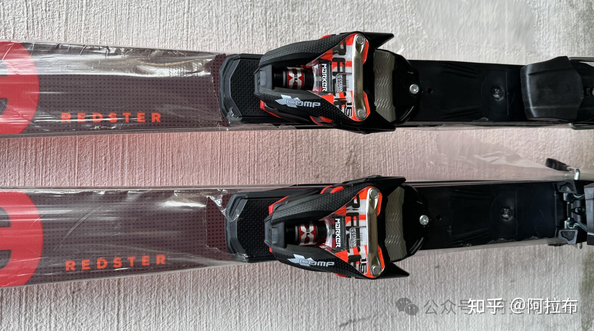

ICON WC24/30售价极其昂贵，与之兼容的Marker Xcomp 16/12成为一个不错的平替方案。不过这个消息并未引起多少波澜，可能是Atomic Redster与Marker Xcomp的组合外观上不怎么搭。

## 2024 ICON全面替代X系列固定器

经过两个雪季的酝酿，Atomic和Salomon全面停产X VAR系列固定器，取而代之的是ICON WC 30/24、ICON RS 16/12、ICON 12/10。

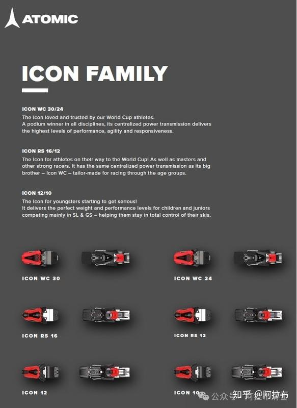

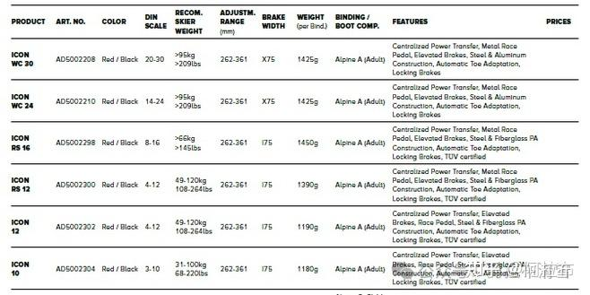

ICON Interface固定器垫板有两种，SL为前端滑轨+后端四颗固定螺丝，GS等为两颗固定螺丝+六颗滑动螺丝。有理由相信Atomic是经过了大量实际测试（滑行表现、生产成本）才确定这两种垫板形式。

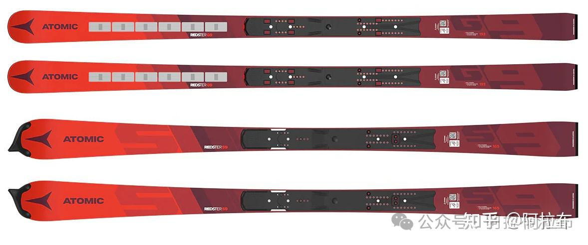

价格方面，ICON RS16定价继续执行X VAR系列的亲民策略，在诸多15/16级别FIS固定器中价格最低，至少在我们购买雪板的奥地利商店里是这样的。

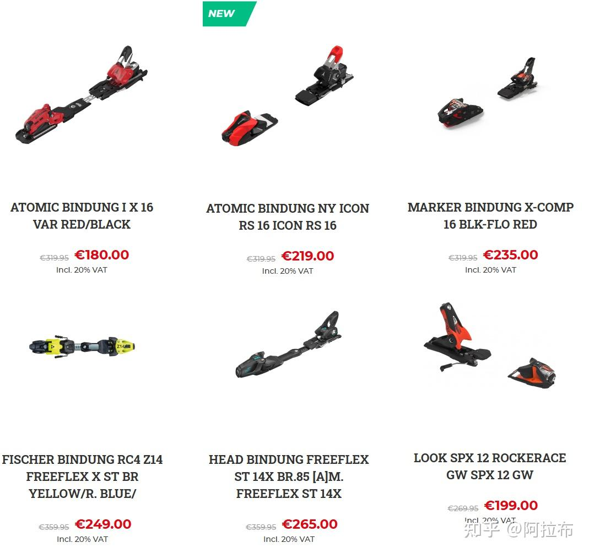

## 2025 最炫配置出场

Atomic Icon固定器与Marker Comp固定器互相兼容，使得两者互换整活成为可能。在24/25雪季，Marker也更新了固定器产品，部分Xcomp系列被替换为Comp 12/16/20/30。从外观上看，Comp 20/30与ICON 20/30非常接近，不过个人感觉Comp 12/16仍然与Redster雪板不太搭。

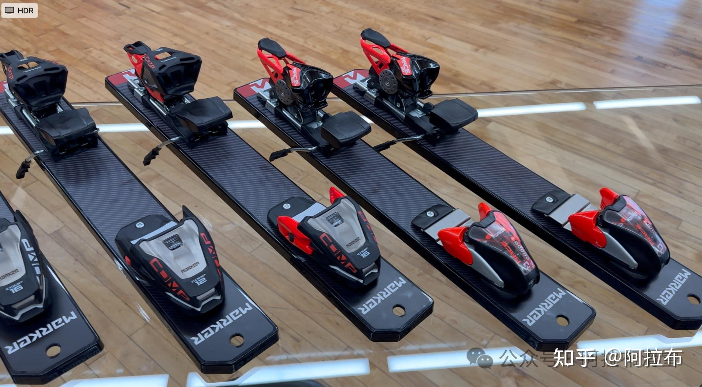

所以另外找一幅雪板搭配Icon固定器可能会是比较好的方案。Marker固定器主要安装在Nordica和Volkl雪板上，后者温吞暧昧的个性显然与Atomic Redster相去甚远，而同样走硬朗路线并装备Piston Control Interface的Nordica Dobermann FIS SL确实是不错的选择。

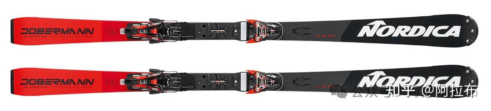

采用简约工业风的ICON RS16固定器搭配Marker Piston垫板，再点缀上Nornica Dobermann的狗脸，科技和颜值有没有拉满？

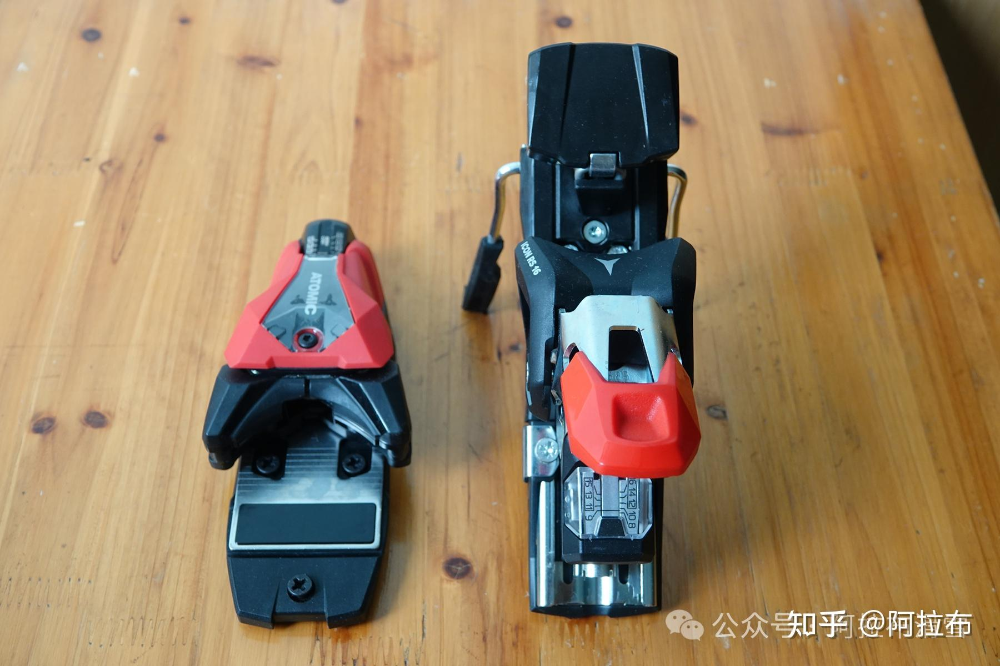

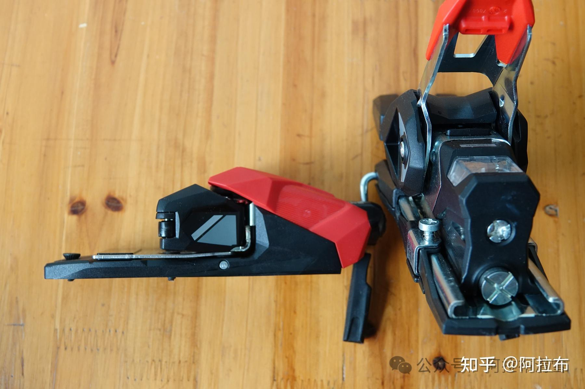

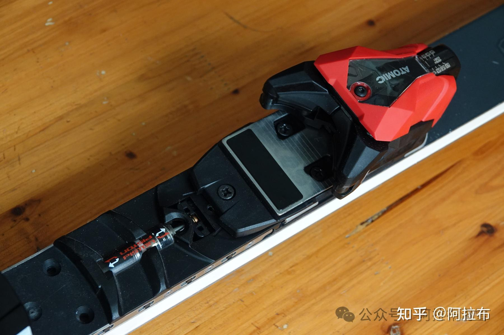

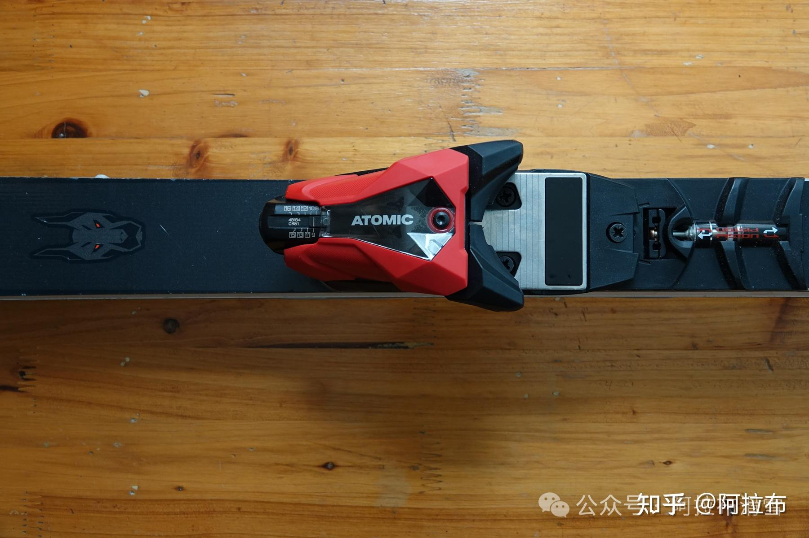

喜欢Nordica大狗的朋友们更会心动吧？万事俱备，就等上货！
